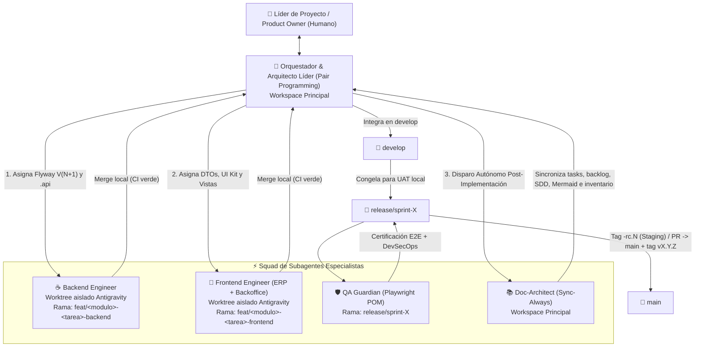
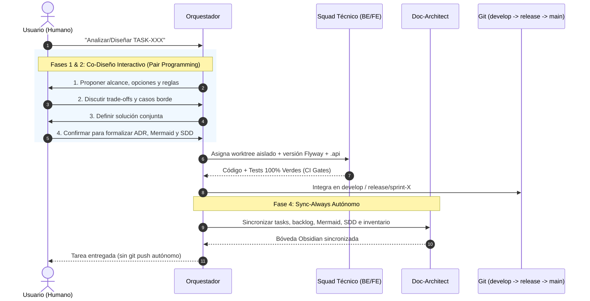

# Protocolo Operativo del Squad Multi-Agente de Ingeniería

Marco operativo permanente de **Gobernanza y Orquestación Multi-Agente** para `gestion-restaurante` (Backend Java 25, ERP Angular 22 y Backoffice React 19).

---

## 1. Topología del Squad Multi-Agente

---

## 2. Roles, Responsabilidades y Límites

### A. Orquestador y Arquitecto Líder (`orchestrator`)
- **Entorno:** Workspace principal del repositorio en sesión interactiva con el usuario.
- **Misión:**
  1. Conducir Fases 1 (Elicitación) y 2 (Spec-First) de [ADR-0007](../../docs/adr/0007_sdd_software_development_lifecycle.md) en **co-diseño obligatorio** (**Proponer $\rightarrow$ Discutir $\rightarrow$ Definir $\rightarrow$ Confirmar**).
  2. Preasignar migraciones Flyway (`V(N+1)`, actual `V24`) y congelar contratos `.api` para evitar colisiones.
  3. Asignar worktrees aislados de Antigravity (`Workspace: "branch"` o `"share"`) a subagentes técnicos e integrar hacia `develop` / `release/sprint-X`.
  4. Activar de forma autónoma e inmediata a `doc-architect` al cierre de toda implementación técnica.

### B. Agente Especialista Backend (`backend-engineer`)
- **Entorno:** Worktree aislado de Antigravity (`feat/<modulo>-<tarea>-backend`). Ver [agent.md](../agents/backend-engineer/agent.md).
- **Alcance:** `backend/` (Java 25 LTS, Spring Boot 4.1.x, Spring Modulith 2.1.x, Flyway, RFC 7807 `ProblemDetail`). Trabaja exclusivamente en su módulo asignado (`modules.<modulo>.*` o `core.<modulo>.*`), consumiendo otros módulos únicamente por `.api` o eventos.
- **Criterio de entrega:** `cd backend && ./mvnw -B clean test spotbugs:check -Psecurity` (incluye `RestaurantModularityTests`).

### C. Agente Especialista Frontend (`frontend-engineer`)
- **Entorno:** Worktree aislado de Antigravity (`feat/<modulo>-<tarea>-frontend`). Ver [agent.md](../agents/frontend-engineer/agent.md).
- **Alcance:**
  - **ERP (`frontend/`):** Angular 22 (`provideZonelessChangeDetection()`, Signals, `ReactiveFormsModule` / `FormsModule`), TailwindAdmin v3.0 (Solar/Tabler Icons), DAL Dexie.js (`LocalOrderRepository`, `LocalCatalogRepository`, `LocalShiftRepository` sobre `RestaurantPosDb` / `appDb`).
  - **Backoffice (`backoffice-frontend/`):** React 19 LTS, TypeScript, Vite, Tailwind CSS 3.4, Lucide React, primitivos en `src/components/`.
- **Criterio de entrega:**
  - `cd frontend && npm run lint && npm test -- --watch=false && npm run build`
  - `cd backoffice-frontend && npm run lint && npm test -- --run && npm run build`

### D. Agente Certificador QA & E2E (`qa-guardian`)
- **Entorno:** Rama `release/sprint-X` o `develop`. Ver [agent.md](../agents/qa-guardian/agent.md) y [testing-governance.md](testing-governance.md).
- **Alcance:** Suite **Playwright Page Object Model (POM)** bajo `frontend/e2e/` (`ADR-0017`), auditoría de regresiones UAT y validación DevSecOps (`./scripts/security/run-security-scan.sh --quick`). *(Nota: los scripts legados basados en CDP `:9222` en `scripts/e2e/` están oficialmente retirados).*
- **Criterio de entrega:** `./scripts/run-e2e.sh` verde (sin `waitForTimeout`/`sleep`, sin guardar capturas en el repo), reportes en `docs/testing/historico/reporte_ejecucion_sprintX.md` e inventario en [inventario_de_pruebas.md](../../docs/testing/inventario_de_pruebas.md).

### E. Agente Documentador y Sincronizador (`doc-architect`)
- **Entorno:** Workspace principal. Ver [agent.md](../agents/doc-architect/agent.md).
- **Misión Autónoma Post-Implementación:**
  1. **Tareas y Backlogs:** Marcar `[x]` en `docs/tasks.md` y sincronizar `docs/project/product_backlog/` y `docs/project/sprints/`.
  2. **Diagramas Vivos (`docs/project/architecture/`):**
     - Esquema/entidades $\rightarrow$ `02-domain-and-data/database_erd.md` (y `docs/backoffice/architecture/domain_and_erd_subscriptions.md` si aplica plataforma).
     - Endpoints/eventos $\rightarrow$ `04-behavior-and-flows/` (y `docs/backoffice/architecture/sequence_and_state_subscriptions.md`).
     - Componentes UI $\rightarrow$ `01-c4-system/c4_level3_frontend_angular.md` (y `c4_level3_backend_modulith.md`).
  3. **Especificaciones SDD:** Sincronizar `docs/sdd/01..05` y `docs/backoffice/sdd/01..04`.
  4. **Pruebas y Manuales:** Actualizar `docs/testing/inventario_de_pruebas.md`, `docs/business-processes/`, `docs/manuals/restaurante/` y `docs/manuals/plataforma/`.

---

## 3. Flujo Estandarizado SDD-SDLC y Git Flow

- **Promoción por Ambientes:** `feat/*` $\rightarrow$ PR `develop` (CI) $\rightarrow$ `release/sprint-X` (`testing-local`) $\rightarrow$ tag `vX.Y.Z-rc.N` (`staging`) $\rightarrow$ PR `main` + tag `vX.Y.Z` (`prod`).
- **Regla Absoluta:** Nunca ejecutar `git push` sin orden explícita del usuario.
