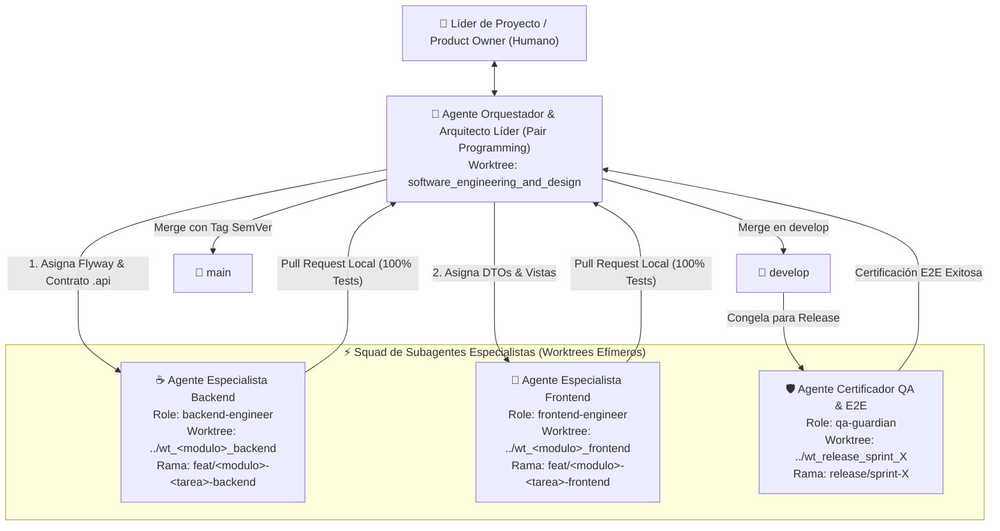

# Protocolo Operativo del Squad Multi-Agente de Ingeniería

Este documento establece el marco genérico, reutilizable y estándar de **Orquestación Multi-Agente** para el desarrollo de cualquier funcionalidad presente o futura en el proyecto `gestion-restaurante` (Sprint 3, Sprint 4, Sprint 5, etc.).

---

## 1. Topología del Squad Multi-Agente

El desarrollo autónomo se estructura mediante una división estricta de responsabilidades (*Separation of Concerns*) inspirada en equipos de ingeniería de alto rendimiento:



---

## 2. Roles, Responsabilidades y Límites

### A. Agente Orquestador y Arquitecto Líder (`orchestrator`)
- **Entorno:** Opera en el worktree principal (`software_engineering_and_design`) codo a codo con el usuario.
- **Misión:**
  1. Conducir las Fases 1 (Elicitación) y 2 (Diseño Spec-First) del ciclo SDD-SDLC (ADR-0007).
  2. Redactar y mantener los diagramas Mermaid, ADRs y especificaciones SDD.
  3. **Gobernanza Anti-Colisión:** Preasignar la numeración de migraciones Flyway (`V5`, `V6`, `V7`, `V8`...) y congelar los contratos públicos `.api`.
  4. Crear los worktrees aislados y ramas `feat/` para los subagentes.
  5. Ejecutar el *Merge Train* hacia `develop` tras validar la suite completa (`ApplicationModules.verify()`).

### B. Agente Especialista Backend (`backend-engineer`)
- **Entorno:** Opera exclusivamente en su propio Git Worktree (`../wt_<modulo>_backend`) sobre rama `feat/<modulo>-<tarea>-backend`.
- **Especialidad Técnica:** Java 25 LTS, Spring Boot 4.1.x, Spring Modulith, JPA/Hibernate, Flyway, RFC 7807 ProblemDetail, `@ApplicationModuleListener`.
- **Reglas Inviolables:**
  - Solo crea y modifica código dentro del paquete asignado (`com.restaurant.app.modules.<modulo>.*` o `core.<modulo>.*`).
  - Todo consumo intermodular debe realizarse mediante interfaces públicas `.api`. Prohibido inyectar repositorios ajenos.
  - No toca el frontend ni altera especificaciones de arquitectura.
  - Criterio de entrega: `./mvnw clean test` al 100% sin warnings y `ApplicationModules.verify()` pasando.

### C. Agente Especialista Frontend (`frontend-engineer`)
- **Entorno:** Opera exclusivamente en su propio Git Worktree (`../wt_<modulo>_frontend`) sobre rama `feat/<modulo>-<tarea>-frontend`.
- **Especialidad Técnica:** Angular 22 (Zoneless Change Detection, Signals reactivos, Signal Forms, Standalone Components), Tailwind CSS / TailwindAdmin v2.0, Data Access Layer (DAL) para Dexie.js (IndexedDB), HTTP Interceptors.
- **Reglas Inviolables:**
  - Solo crea componentes en `frontend/src/app/features/<modulo>/` y servicios en `core/services/` o DAL en `core/repositories/`.
  - Respeta los tokens de diseño de `docs/sdd/05_design_system.md` y TailwindAdmin.
  - No altera clases de backend.
  - Criterio de entrega: `npm run lint && npm test` al 100% pasando sin errores de tipado TypeScript.

### D. Agente Certificador QA & E2E (`qa-guardian`)
- **Entorno:** Opera sobre la rama `release/sprint-X` antes del cierre del hito.
- **Especialidad Técnica:** Playwright, Chrome DevTools Protocol (CDP), testing de regresión de flujos completos (POS $\rightarrow$ Kardex $\rightarrow$ Turno $\rightarrow$ Arqueo).
- **Reglas Inviolables:**
  - No modifica lógica de negocio para "hacer pasar la prueba"; reporta discrepancias al Orquestador.
  - Criterio de entrega: `./scripts/run-e2e.sh` al 100% verde (25+ casos de prueba sin fallos).

---

## 3. Protocolo de Ejecución de una Tarea (Ciclo de Vida)

1. **Paso 1: Especificación Previa (Spec-First):** El Orquestador y el Usuario definen el ADR, ERD, contratos `.api` y secuencias Mermaid.
2. **Paso 2: Aprovisionamiento de Worktree:**
   ```bash
   git worktree add ../wt_<modulo>_backend feat/<modulo>-<tarea>-backend develop
   ```
3. **Paso 3: Lanzamiento del Agente Especialista:** Se invoca al subagente indicándole su worktree, los archivos de especificación SDD que debe cumplir y su comando de verificación.
4. **Paso 4: Auditoría y Merge Train:** El subagente entrega su rama. El Orquestador revisa los diffs, ejecuta `git merge --no-ff` en `develop`, valida la compilación global y elimina el worktree efímero:
   ```bash
   git worktree remove ../wt_<modulo>_backend
   git branch -d feat/<modulo>-<tarea>-backend
   ```
5. **Paso 5: Sincronización (Sync-Always):** El Orquestador actualiza `docs/tasks.md` marcando la tarea como `[x]` y el usuario visualiza el avance inmediatamente.
