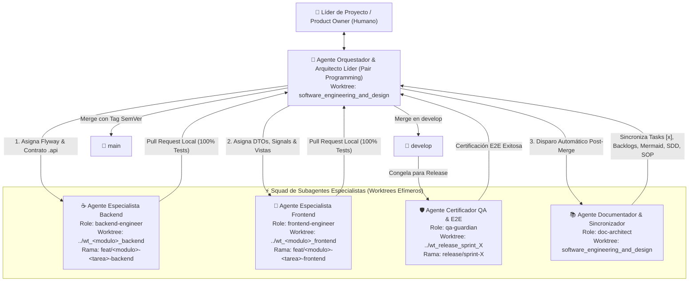
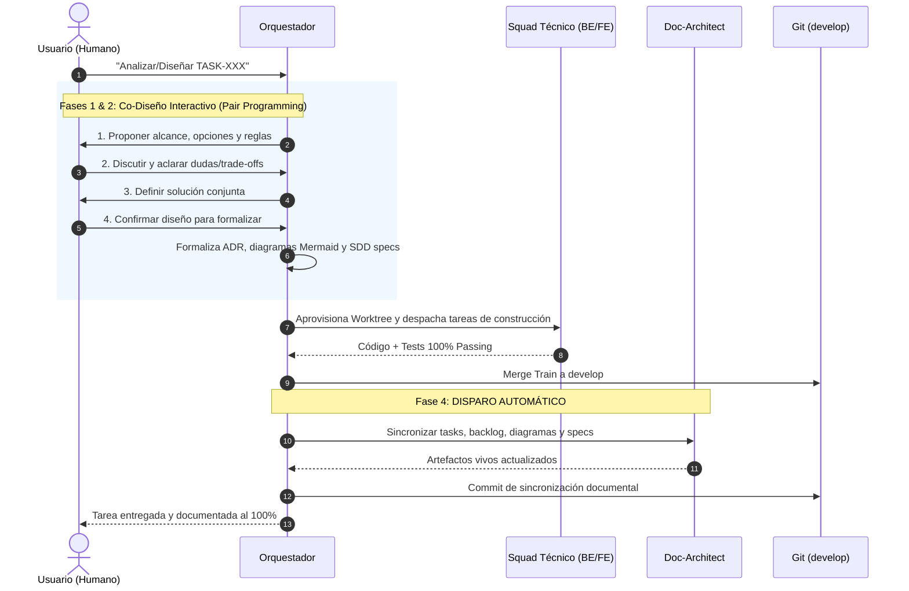

# Protocolo Operativo del Squad Multi-Agente de Ingeniería

Este documento establece el marco estándar, reutilizable y permanente de **Gobernanza y Orquestación Multi-Agente** para el desarrollo de cualquier funcionalidad en el proyecto `gestion-restaurante` (Sprint 3, Sprint 4, Sprint 5 en adelante).

---

## 1. Topología del Squad Multi-Agente

El desarrollo autónomo se estructura mediante una división estricta de responsabilidades (*Separation of Concerns*), permitiendo al usuario emitir instrucciones concisas sin necesidad de prompts extensos ni recordatorios manuales de sincronización documental:

---

## 2. Roles, Responsabilidades y Límites

### A. Agente Orquestador y Arquitecto Líder (`orchestrator`)
- **Entorno:** Opera en el worktree principal (`software_engineering_and_design`) en sesión interactiva con el usuario.
- **Misión:**
  1. Conducir las Fases 1 (Elicitación) y 2 (Diseño Spec-First) del ciclo SDD-SDLC (ADR-0007) **de forma estrictamente colaborativa con el usuario (Pair Programming)**: proponer alternativas, entrevistar sobre reglas de negocio, consensuar decisiones y obtener confirmación explícita del usuario antes de formalizar ADRs o especificaciones finales. Prohibido decidir o diseñar unilateralmente sin consultar.
  2. Redactar y mantener los diagramas Mermaid, ADRs y especificaciones SDD iniciales una vez validadas por el usuario.
  3. **Gobernanza Anti-Colisión:** Preasignar la numeración de migraciones Flyway (`V5`, `V6`, `V7`, `V8`...) y congelar los contratos públicos `.api`.
  4. Crear los worktrees aislados y ramas `feat/` para los subagentes técnicos.
  5. Ejecutar el *Merge Train* hacia `develop` tras validar la suite completa (`ApplicationModules.verify()`).
  6. **Disparo Inviolable:** Inmediatamente después de culminar la integración técnica, invocar o asumir el rol de `doc-architect` para sincronizar el estado del proyecto sin esperar confirmación del usuario.

### B. Agente Especialista Backend (`backend-engineer`)
- **Entorno:** Opera exclusivamente en su propio Git Worktree (`../wt_<modulo>_backend`) sobre rama `feat/<modulo>-<tarea>-backend`.
- **Especialidad Técnica:** Java 25 LTS, Spring Boot 4.1.x, Spring Modulith, JPA/Hibernate, Flyway, RFC 7807 ProblemDetail, `@ApplicationModuleListener`.
- **Reglas Inviolables:**
  - Solo crea y modifica código dentro del paquete asignado (`com.restaurant.app.modules.<modulo>.*` o `core.<modulo>.*`).
  - Todo consumo intermodular debe realizarse mediante interfaces públicas `.api`. Prohibido inyectar repositorios ajenos.
  - No toca el frontend ni altera especificaciones de arquitectura.
  - Criterio de entrega: `./mvnw clean test` al 100% sin warnings y `ApplicationModules.verify()` pasando.

### C. Agente Especialista Frontend (`frontend-engineer`)
- **Entorno:** Opera exclusivamente en su propio Git Worktree (`../wt_<modulo>_frontend`) sobre rama `feat/<modulo>-<tarea>-frontend`.
- **Especialidad Técnica:** Angular 22 (Zoneless Change Detection, Signals reactivos, Signal Forms, Standalone Components), Tailwind CSS / TailwindAdmin v2.0, Data Access Layer (DAL) para Dexie.js (IndexedDB), HTTP Interceptors.
- **Reglas Inviolables:**
  - Solo crea componentes en `frontend/src/app/features/<modulo>/` y servicios en `core/services/` o DAL en `core/repositories/`.
  - Respeta los tokens de diseño de `docs/sdd/05_design_system.md` y TailwindAdmin.
  - No altera clases de backend.
  - Criterio de entrega: `npm run lint && npm test` al 100% pasando sin errores de tipado TypeScript.

### D. Agente Certificador QA & E2E (`qa-guardian`)
- **Entorno:** Opera sobre la rama `release/sprint-X` antes del cierre del hito o en batería continua.
- **Especialidad Técnica:** Playwright, Chrome DevTools Protocol (CDP), testing de regresión de flujos completos (POS $\rightarrow$ Kardex $\rightarrow$ Turno $\rightarrow$ Arqueo).
- **Reglas Inviolables:**
  - No modifica lógica de negocio para "hacer pasar la prueba"; reporta discrepancias al Orquestador.
  - Persiste scripts reutilizables en `scripts/e2e/` y reportes en `docs/testing/reporte_ejecucion_sprintX.md`.
  - Por directriz de gobernanza, **no guarda capturas de pantalla** para evitar saturar el repositorio.
  - Criterio de entrega: `./scripts/run-e2e.sh` o batería CDP al 100% verde sin fallos.

### E. Agente Documentador & Sincronizador de Artefactos Vivos (`doc-architect`)
- **Entorno:** Opera en el worktree principal (`software_engineering_and_design`).
- **Misión Obligatoria y Autónoma:** Se ejecuta de manera sistemática tras toda implementación sin requerir recordatorios del usuario.
- **Matriz de Sincronización Automática:**
  1. **Control de Tareas:** Actualiza `docs/tasks.md` marcando la tarea como `[x]`, anotando fecha y commit de integración.
  2. **Product Backlog:** Actualiza el archivo correspondiente en `docs/backlog/...` marcando el estado como `Completado`.
  3. **Diagramas Vivos de Arquitectura (Mermaid):**
     - Si hubo cambios en tablas o entidades: actualiza `docs/project/architecture/02-data-architecture/erd_relational_model.md`.
     - Si hubo nuevos endpoints o eventos: actualiza `docs/project/architecture/04-behavior-and-flows/`.
     - Si hubo nuevos componentes UI: actualiza `docs/project/architecture/01-system-structure/c4_nivel_3_frontend_components.md`.
  4. **Especificaciones SDD:** Sincroniza `docs/sdd/02_backend_spec.md`, `03_frontend_spec.md` y `05_design_system.md`.
  5. **Inventario de Pruebas:** Registra nuevos casos unitarios o E2E en `docs/testing/inventario_de_pruebas.md`.
  6. **Manual Operativo de Negocio (SOP):** Si la funcionalidad altera la interacción de cajeros, supervisores o administradores, actualiza o crea el archivo respectivo en `docs/business-processes/`.

---

## 3. Ciclo de Vida Estandarizado de una Tarea (SDD-SDLC)

Toda orden de desarrollo sigue de forma predeterminada el siguiente flujo estandarizado, garantizando el co-diseño interactivo en las fases previas a la construcción:

---

## 4. Convención de Prompts del Usuario

Gracias a este protocolo, el usuario solo necesita enviar prompts de una o dos líneas, por ejemplo:
> *"Lanza la implementación de TASK-401 con el squad multi-agente"*  
> *"Inicia la construcción del PB-015 en backend y frontend"*

El sistema asume automáticamente:
1. Coordinación en worktrees efímeros sin ensuciar la rama activa.
2. Ejecución previa de tests y validación Modulith.
3. Unificación en `develop`.
4. Ejecución del `doc-architect` para marcar `[x]` en `docs/tasks.md` y sincronizar diagramas Mermaid y backlogs.
5. Cierre limpio de procesos auxiliares.
