# 🏛️ Bóveda Central de Documentación - Sistema POS, ERP & Backoffice SaaS

Bienvenido a la **Bóveda Central de Documentación** del proyecto. La totalidad del directorio `docs/` conforma una bóveda unificada en **Obsidian**, gobernada bajo **Specification-Driven Development (SDD-SDLC)** y 100% portable en Git/GitHub mediante enlaces Markdown relativos estándar.

- **Estado Actual del Ecosistema (Sprint 6 — `release/sprint-6`):**
  - **Aplicaciones (3):** `backend/` (Java 25 + Spring Boot 4.1 + Spring Modulith 2.1), `frontend/` (ERP Angular 22 Zoneless + **TailwindAdmin v3.0** + Dexie.js) y `backoffice-frontend/` (**Backoffice React 19** + Vite + Tailwind CSS 3.4 + Lucide).
  - **Base de Datos e Infraestructura:** PostgreSQL 16 con **56 tablas** (`V1`–`V24` en Flyway), **Caddy** (Reverse Proxy / TLS), **Dozzle** (Visor de logs en tiempo real) y almacenamiento agnóstico Local / S3-OCI.
  - **Cobertura de Pruebas Verificada:** **`213`** tests Backend | **`390`** tests ERP Angular | **`22`** tests Backoffice React | **`34`** tests E2E Playwright POM.

---

## 🗺️ Mapa Global de Contenidos (MOC - Map of Content)

```mermaid
graph TD
    VaultRoot["🏛️ Bóveda docs/ (Obsidian Vault Root)"]

    subgraph SecProject["🎯 01. Gestión y Alcance (project/)"]
        Profile["[project_profile.md](./project/project_profile.md)<br/>Perfil Fundacional"]
        Backlog["[product_backlog/](./project/product_backlog/README.md)<br/>Product Backlog P0 a P3"]
        Sprints["[sprints/](./project/sprints/README.md)<br/>Bóveda de Sprints (1 a 6)"]
        Retros["[retrospectiva_sprint3.md](./project/retrospectiva_sprint3.md)<br/>Retrospectivas"]
    end

    subgraph SecArch["🏛️ 02. Arquitectura Viva ERP (project/architecture/)"]
        C4System["[01-c4-system/](./project/architecture/01-c4-system/c4_level2_containers.md)<br/>C4 Contenedores y Módulos"]
        DomainData["[02-domain-and-data/](./project/architecture/02-domain-and-data/database_erd.md)<br/>Dominio, ERD (56 Tablas) y Dexie"]
        UseCases["[03-use-cases/](./project/architecture/03-use-cases/use_cases_overview.md)<br/>Matriz RBAC y Casos de Uso"]
        BehaviorFlows["[04-behavior-and-flows/](./project/architecture/04-behavior-and-flows/sequence_pos_order_deduction.md)<br/>14 Flujos Consolidados"]
    end

    subgraph SecADR["📐 03. Decisiones Arquitectónicas (adr/)"]
        ADRIdx["[ADR-0001 a ADR-0033](./adr/)<br/>Core, ERP, TailwindAdmin v3.0, Cloud & Backoffice"]
    end

    subgraph SecSDD["📋 04. Especificaciones SDD ERP & Sistema (sdd/)"]
        SDD01["[01_architecture_overview.md](./sdd/01_architecture_overview.md)<br/>Vista General"]
        SDD02["[02_backend_spec.md](./sdd/02_backend_spec.md)<br/>Backend & Contratos .api"]
        SDD03["[03_frontend_spec.md](./sdd/03_frontend_spec.md)<br/>Angular 22 & Dexie"]
        SDD04["[04_database_schema.md](./sdd/04_database_schema.md)<br/>Catálogo 56 Tablas V1-V24"]
        SDD05["[05_design_system.md](./sdd/05_design_system.md)<br/>TailwindAdmin v3.0 (13 UI Kit)"]
    end

    subgraph SecManuals["📘 05. Manuales y Procesos (manuals/ & business-processes/)"]
        ManBoot["[bootstrap_y_operacion_inicial.md](./manuals/plataforma/bootstrap_y_operacion_inicial.md)<br/>Arranque Cero & .env"]
        ManRest["[manuals/restaurante/](./manuals/restaurante/README.md)<br/>Manual Operativo Restaurante"]
        ManPlat["[manuals/plataforma/](./manuals/plataforma/operacion_backoffice_saas.md)<br/>Manual Operativo Plataforma"]
        BizHub["[business-processes/README.md](./business-processes/README.md)<br/>Flujos de Negocio"]
    end

    subgraph SecTasks["🛠️ 06. Tareas y Seguimiento"]
        Tasks["[tasks.md](./tasks.md)<br/>Sprint 6 Activo (release/sprint-6)"]
        Obs["[observaciones_y_hallazgos.md](./observaciones_y_hallazgos.md)<br/>Inbox de Triage UAT"]
    end

    subgraph SecTesting["🛡️ 07. Calidad y Pruebas (testing/)"]
        TestingHub["[testing/README.md](./testing/README.md)<br/>Bóveda QA (213/390/22/34)"]
        TestInv["[inventario_de_pruebas.md](./testing/inventario_de_pruebas.md)<br/>Matriz N1-N4"]
        E2EGuide["[e2e-testing-guide.md](./testing/e2e-testing-guide.md)<br/>Guía Playwright POM"]
    end

    subgraph SecBackoffice["🛠️ 08. Sub-Bóveda Backoffice SaaS (backoffice/)"]
        BackofficeHub["[backoffice/README.md](./backoffice/README.md)<br/>SDD, ERD V17-V22 & React 19"]
    end

    VaultRoot --> SecProject
    VaultRoot --> SecArch
    VaultRoot --> SecADR
    VaultRoot --> SecSDD
    VaultRoot --> SecManuals
    VaultRoot --> SecTasks
    VaultRoot --> SecTesting
    VaultRoot --> SecBackoffice
```

---

## 📂 Estructura Detallada de la Bóveda

### 🎯 1. Gestión, Alcance y Estrategia de Negocio (`project/`)
- [**`project_profile.md`**](./project/project_profile.md): Definición del problema, objetivos y alcance del sistema.
- [**`product_backlog/`**](./project/product_backlog/README.md): Product Backlog modularizado por criticidad ([P0 Crítica](./project/product_backlog/00_prioridad_p0_critica.md), [P1 Alta](./project/product_backlog/01_prioridad_p1_alta.md), [P2 Media](./project/product_backlog/02_prioridad_p2_media.md), [P3 Baja](./project/product_backlog/03_prioridad_p3_baja_futuro.md)).
- [**`sprints/`**](./project/sprints/README.md): Sprints históricos ([Sprint 1](./project/sprints/sprint_01_backlog.md), [Sprint 2](./project/sprints/sprint_02_backlog.md), [Sprint 3](./project/sprints/sprint_03_backlog.md), [Sprint 4](./project/sprints/sprint_04_backlog.md), [Sprint 5](./project/sprints/sprint_05_backlog.md)), [Sprint 6](./project/sprints/sprint_06_backlog.md) y [Planning Sprint 6](./project/sprints/sprint_06_planning.md).
- **Retrospectivas:** [**`retrospectiva_negocio_sprint1.md`**](./project/retrospectiva_negocio_sprint1.md) | [**`retrospectiva_sprint3.md`**](./project/retrospectiva_sprint3.md).

### 🏛️ 2. Bóveda de Arquitectura Viva ERP (`project/architecture/`)
Índice especializado: [**`project/architecture/README.md`**](./project/architecture/README.md)
- **Topología C4:**
  - [**`c4_level2_containers.md`**](./project/architecture/01-c4-system/c4_level2_containers.md): Contenedores (Angular 22 SPA, React 19 Backoffice, Dexie.js, Spring Boot API, PostgreSQL 16, Caddy, Dozzle).
  - [**`c4_level3_backend_modulith.md`**](./project/architecture/01-c4-system/c4_level3_backend_modulith.md): Límites de módulos Spring Modulith, `.api` y `.internal`.
  - [**`c4_level3_frontend_angular.md`**](./project/architecture/01-c4-system/c4_level3_frontend_angular.md): Componentes Angular 22 Zoneless, Signals, interceptores y DAL Dexie.js.
- **Dominio y Datos:**
  - [**`domain_model.md`**](./project/architecture/02-domain-and-data/domain_model.md): Entidades de dominio, agregados e invariantes.
  - [**`database_erd.md`**](./project/architecture/02-domain-and-data/database_erd.md): ERD físico PostgreSQL de las **56 tablas** (`V1`–`V24`).
  - [**`dexie_local_schema.md`**](./project/architecture/02-domain-and-data/dexie_local_schema.md): Esquema local `RestaurantPosDb` (`appDb`) en IndexedDB (`cachedCategories`, `cachedProducts`, `pendingOrders`, `activeShift`).
- **Casos de Uso y RBAC:**
  - [**`use_cases_overview.md`**](./project/architecture/03-use-cases/use_cases_overview.md) | [**`use_cases_rbac.md`**](./project/architecture/03-use-cases/use_cases_rbac.md) | [**`use_cases_sessions.md`**](./project/architecture/03-use-cases/use_cases_sessions.md) | [**`use_cases_onboarding.md`**](./project/architecture/03-use-cases/use_cases_onboarding.md) | [**`use_cases_configuration.md`**](./project/architecture/03-use-cases/use_cases_configuration.md) | [**`use_cases_catalog.md`**](./project/architecture/03-use-cases/use_cases_catalog.md) | [**`use_cases_pos.md`**](./project/architecture/03-use-cases/use_cases_pos.md) | [**`use_cases_inventory.md`**](./project/architecture/03-use-cases/use_cases_inventory.md) | [**`use_cases_finance.md`**](./project/architecture/03-use-cases/use_cases_finance.md).
- **Comportamiento y Flujos Dinámicos (14 Flujos Consolidados en `04-behavior-and-flows/`):**
  - [**`sequence_pos_order_deduction.md`**](./project/architecture/04-behavior-and-flows/sequence_pos_order_deduction.md): Venta POS, `OrderPaidEvent` y deducción en Kardex/Finanzas.
  - [**`sequence_pos_offline_sync.md`**](./project/architecture/04-behavior-and-flows/sequence_pos_offline_sync.md): Venta offline en Dexie.js y sincronización idempotente `/sync`.
  - [**`sequence_pos_order_cancellation_and_authorizations.md`**](./project/architecture/04-behavior-and-flows/sequence_pos_order_cancellation_and_authorizations.md): Anulación de comandas, PIN/cola de autorización, reintegro y mermas.
  - [**`sequence_pos_promotions_evaluation.md`**](./project/architecture/04-behavior-and-flows/sequence_pos_promotions_evaluation.md): Evaluación de reglas y vigencia de promociones en POS.
  - [**`state_order_lifecycle.md`**](./project/architecture/04-behavior-and-flows/state_order_lifecycle.md): Ciclo de vida de comandas (`DRAFT` $\rightarrow$ `PAID` / `CANCELLED`).
  - [**`sequence_daily_menu_shift_assignment_and_quota_enforcement.md`**](./project/architecture/04-behavior-and-flows/sequence_daily_menu_shift_assignment_and_quota_enforcement.md): Menús diarios, jornadas de servicio y decremento atómico de cupos.
  - [**`activity_inventory_deduction_strategy.md`**](./project/architecture/04-behavior-and-flows/activity_inventory_deduction_strategy.md): Strategy Pattern de inventario por plato/tenant y costo promedio ponderado.
  - [**`state_shift_and_expense_workflow.md`**](./project/architecture/04-behavior-and-flows/state_shift_and_expense_workflow.md): Ciclo de turnos de caja, aprobación de gastos menores y arqueo.
  - [**`state_mobile_pos_and_inventory_ux.md`**](./project/architecture/04-behavior-and-flows/state_mobile_pos_and_inventory_ux.md): Ergonomía táctil móvil en POS e inventario.
  - [**`sequence_parameter_resolution_and_hot_reload.md`**](./project/architecture/04-behavior-and-flows/sequence_parameter_resolution_and_hot_reload.md): Resolución en cascada, ETag y caché con invalidación reactiva.
  - [**`sequence_rbac_resolution_and_enforcement.md`**](./project/architecture/04-behavior-and-flows/sequence_rbac_resolution_and_enforcement.md): Cálculo dinámico de privilegios RBAC en JWT y reseteo delegado.
  - [**`sequence_session_lifecycle_and_refresh.md`**](./project/architecture/04-behavior-and-flows/sequence_session_lifecycle_and_refresh.md): Renovación silenciosa RxJS, rotación de refresh tokens e inactividad.
  - [**`sequence_tenant_onboarding.md`**](./project/architecture/04-behavior-and-flows/sequence_tenant_onboarding.md): Alta atómica de empresa, validación de slug/NIT y presets semilla.
  - [**`state_tenant_lifecycle.md`**](./project/architecture/04-behavior-and-flows/state_tenant_lifecycle.md): Estados del tenant (`DRAFT` $\rightarrow$ `ACTIVE` / `SUSPENDED` / `OFFBOARDED`).

### 📐 3. Decisiones Arquitectónicas (`adr/` — `ADR-0001` a `ADR-0033`)
- **Fundación & Núcleo (`0001`–`0012`):** [`ADR-0001`](./adr/0001_spring_modulith_monolith.md) (Spring Modulith) | [`ADR-0002`](./adr/0002_hybrid_tenancy_and_dynamic_settings.md) (Multi-Tenancy) | [`ADR-0003`](./adr/0003_offline_first_dexie_sync.md) (Offline-First Dexie) | [`ADR-0004`](./adr/0004_catalog_cloning_and_overrides.md) (Clonación Catálogo) | [`ADR-0005`](./adr/0005_cash_shift_expense_workflow.md) (Arqueo y Gastos) | [`ADR-0006`](./adr/0006_datetime_and_timezone_handling.md) (Fechas y Timezones) | [`ADR-0007`](./adr/0007_sdd_software_development_lifecycle.md) (SDD-SDLC) | [`ADR-0008`](./adr/0008_unified_multilevel_parameter_system.md) (Parametría Multinivel) | [`ADR-0009`](./adr/0009_tenant_onboarding_and_operational_presets.md) (Onboarding) | [`ADR-0010`](./adr/0010_granular_rbac_roles_and_privileges.md) (RBAC Dinámico) | [`ADR-0011`](./adr/0011_session_lifecycle_and_silent_refresh.md) (Sesiones & Refresh) | [`ADR-0012`](./adr/0012_mobile_responsiveness_and_touch_ux.md) (UX Móvil).
- **Operación POS, UI Kit & Pruebas (`0013`–`0025`):** [`ADR-0013`](./adr/0013_pos_shift_invariant_and_expense_authorizations.md) (Invariante Turno) | [`ADR-0014`](./adr/0014_tailwindadmin_v3_dynamic_theme_and_uikit.md) (TailwindAdmin v3.0) | [`ADR-0015`](./adr/0015_daily_menus_and_flexible_dish_inventory.md) (Menús Diarios) | [`ADR-0016`](./adr/0016_cash_control_separation_and_multi_cashier_shifts.md) (Multi-Cajero) | [`ADR-0017`](./adr/0017_multilevel_testing_governance_and_automation_standard.md) (Testing N1–N4) | [`ADR-0018`](./adr/0018_pos_modifiers_extras_and_kitchen_notes_suite.md) (Modificadores) | [`ADR-0019`](./adr/0019_order_cancellation_workflow_authorizations_and_waste_treatment.md) (Cancelaciones) | [`ADR-0020`](./adr/0020_service_modalities_takeout_delivery_and_ticket_badges.md) (Modalidades) | [`ADR-0021`](./adr/0021_visual_dish_catalog_image_cropping_and_pos_view_modes.md) (Catálogo Visual) | [`ADR-0022`](./adr/0022_sequential_sku_assistant_category_emoji_picker_and_ordering.md) (SKU y Emojis) | [`ADR-0023`](./adr/0023_shift_history_multicriteria_audit_and_csv_export.md) (Histórico CSV) | [`ADR-0024`](./adr/0024_self_service_user_profile_pin_and_humanization.md) (Perfil y PIN) | [`ADR-0025`](./adr/0025_parameter_console_humanization_json_catalog_and_contextual_help.md) (Consola Parámetros).
- **Cloud, Backoffice & Evolución Sprint 6 (`0026`–`0033`):** [`ADR-0026`](./adr/0026_cloud_infrastructure_and_deployment_stack.md) (Infraestructura Cloud, Caddy & Dozzle) | [`ADR-0027`](./adr/0027_platform_identity_and_clean_golive_bootstrap.md) (Identidad Plataforma) | [`ADR-0028`](./adr/0028_agnostic_media_storage_and_platform_settings.md) (Storage Agnóstico) | [`ADR-0029`](./adr/0029_backoffice_subscriptions_quotas_and_telemetry.md) (Backoffice SaaS) | [`ADR-0030`](./adr/0030_catalog_branch_isolation_by_default.md) (Catálogo por Sucursal) | [`ADR-0031`](./adr/0031_branch_service_sessions_and_dynamic_combos.md) (Jornadas y Combos `MENU_COURSE`) | [`ADR-0032`](./adr/0032_pos_promotions_engine.md) (Motor de Promociones) | [`ADR-0033`](./adr/0033_spa_runtime_env_and_cross_origin_media.md) (Runtime `env.js` & Media Cross-Origin).

### 📋 4. Especificaciones de Diseño del Sistema ERP (`sdd/`)
- [**`01_architecture_overview.md`**](./sdd/01_architecture_overview.md): Límites de contexto, módulos reales y principios de diseño.
- [**`02_backend_spec.md`**](./sdd/02_backend_spec.md): Contratos `.api` verificados, perfiles (`dev`/`testing-local`/`staging`/`prod`/`test`), 20 parámetros y endpoints REST.
- [**`03_frontend_spec.md`**](./sdd/03_frontend_spec.md): Angular 22 (`provideZonelessChangeDetection()`, `ReactiveFormsModule`/`FormsModule` con Signals), rutas reales, `apiBaseUrlInterceptor` + `runtime-env.ts` y store `RestaurantPosDb` (`appDb`).
- [**`04_database_schema.md`**](./sdd/04_database_schema.md): Catálogo maestro de las **56 tablas** y migraciones Flyway **`V1`–`V24`**.
- [**`05_design_system.md`**](./sdd/05_design_system.md): Sistema visual **TailwindAdmin v3.0**, variables CSS en caliente, shell colapsable y los **13 componentes UI Kit**.

### 📘 5. Manuales Operativos (`manuals/`) y Procesos de Negocio (`business-processes/`)
- **Manuales para Restaurante (`manuals/restaurante/`):** [**Índice Restaurante**](./manuals/restaurante/README.md)
  - [`00_guia_inicio_rapido_restaurante.md`](./manuals/restaurante/00_guia_inicio_rapido_restaurante.md) | [`01_catalogo_platos_combos_y_fotos.md`](./manuals/restaurante/01_catalogo_platos_combos_y_fotos.md) | [`02_menus_del_dia_y_jornada_sucursal.md`](./manuals/restaurante/02_menus_del_dia_y_jornada_sucursal.md) | [`03_manual_cajero_pos.md`](./manuals/restaurante/03_manual_cajero_pos.md) | [`04_control_de_caja_gastos_y_arqueo.md`](./manuals/restaurante/04_control_de_caja_gastos_y_arqueo.md) | [`05_insumos_recetas_y_kardex.md`](./manuals/restaurante/05_insumos_recetas_y_kardex.md) | [`06_dueno_finanzas_personal_y_reglas.md`](./manuals/restaurante/06_dueno_finanzas_personal_y_reglas.md)
- **Manuales de Plataforma (`manuals/plataforma/`):**
  - [**`bootstrap_y_operacion_inicial.md`**](./manuals/plataforma/bootstrap_y_operacion_inicial.md): Arranque desde cero (`testing-local`), variables `.env` y checklist inicial.
  - [**`operacion_backoffice_saas.md`**](./manuals/plataforma/operacion_backoffice_saas.md): Operación diaria de planes, inquilinos, pagos, gracia, storage y observabilidad.
- **Procesos de Negocio (`business-processes/`):** [**Índice de Procesos**](./business-processes/README.md)
  - **`01-pos-y-atencion/`:** [`01_flujo_atencion_y_venta_pos.md`](./business-processes/01-pos-y-atencion/01_flujo_atencion_y_venta_pos.md) | [`02_flujo_atencion_movil_y_conteo_inventario.md`](./business-processes/01-pos-y-atencion/02_flujo_atencion_movil_y_conteo_inventario.md)
  - **`02-caja-y-finanzas/`:** [`01_flujo_jornada_y_arqueo_caja.md`](./business-processes/02-caja-y-finanzas/01_flujo_jornada_y_arqueo_caja.md) | [`02_flujo_gastos_y_autorizaciones.md`](./business-processes/02-caja-y-finanzas/02_flujo_gastos_y_autorizaciones.md)
  - **`03-cocina-e-inventario/`:** [`01_flujo_recetas_y_kardex.md`](./business-processes/03-cocina-e-inventario/01_flujo_recetas_y_kardex.md)
  - **`04-administracion-y-personal/`:** [`01_flujo_parametrizacion_operativa_empresa.md`](./business-processes/04-administracion-y-personal/01_flujo_parametrizacion_operativa_empresa.md) | [`02_flujo_alta_empresa_y_onboarding.md`](./business-processes/04-administracion-y-personal/02_flujo_alta_empresa_y_onboarding.md) | [`03_flujo_gestion_roles_y_privilegios.md`](./business-processes/04-administracion-y-personal/03_flujo_gestion_roles_y_privilegios.md) | [`04_flujo_ciclo_vida_sesiones_y_seguridad.md`](./business-processes/04-administracion-y-personal/04_flujo_ciclo_vida_sesiones_y_seguridad.md)

### 🛠️ 6. Seguimiento y Tareas (`tasks.md`)
- [**`tasks.md`**](./tasks.md): **Sprint 6 Backlog Activo (`release/sprint-6`)** — infraestructura cloud en paralelo (`TASK-609`) y evolución futura (`TASK-636`–`TASK-640`). *(Cierre documental `TASK-613` archivado en [`sprint_06_backlog.md`](./project/sprints/sprint_06_backlog.md).)*
- [**`observaciones_y_hallazgos.md`**](./observaciones_y_hallazgos.md): Bitácora de triage de hallazgos manuales UAT.

### 🛡️ 7. Aseguramiento de Calidad y Gobernanza de Pruebas (`testing/`)
Índice QA: [**`testing/README.md`**](./testing/README.md)
- [**`inventario_de_pruebas.md`**](./testing/inventario_de_pruebas.md): Matriz de casos N1–N4 (**`213`** Backend / **`390`** ERP Angular / **`22`** Backoffice React / **`34`** E2E Playwright POM).
- [**`casos_uat_y_regresion.md`**](./testing/casos_uat_y_regresion.md): Escenarios paso a paso de UAT y regresión Sprint 5–6.
- [**`e2e-testing-guide.md`**](./testing/e2e-testing-guide.md): Guía de ejecución Playwright POM (`./scripts/run-e2e.sh`).
- [**`reporte_ejecucion_sprint6.md`**](./testing/historico/reporte_ejecucion_sprint6.md): Certificación Dockerizada, DevSecOps y métricas Sprint 6.

### 💡 8. Lecciones Aprendidas (`lessons_learned/`)
- [**`mcp-chrome-devtools-wsl2.md`**](./lessons_learned/mcp-chrome-devtools-wsl2.md): Integración Chrome DevTools MCP entre WSL2 y Windows 11.

### 🛠️ 9. Sub-Bóveda del Proyecto Backoffice SaaS (`backoffice/`)
*(Documentación aislada del plano de control SaaS y la SPA hermana `backoffice-frontend/` en React 19)*:
- [**`backoffice/README.md`**](./backoffice/README.md): MOC de especificaciones (`backoffice/sdd/`) y diagramas (`backoffice/architecture/`), cubriendo planes, suscripciones, gracia condicional, crédito por adelantado, cuotas no destructivas, telemetría *event-driven*, observabilidad y `backoffice-frontend/`.

---

## 🔄 Ciclo de Vida de Desarrollo de Software (SDD-SDLC)

El proyecto opera bajo [ADR-0007](./adr/0007_sdd_software_development_lifecycle.md): **1. Elicitación/Análisis** $\rightarrow$ **2. Diseño Spec-First (co-diseño)** $\rightarrow$ **3. Construcción** $\rightarrow$ **4. Sincronización Autónoma (`Sync-Always`)**. Todo cambio en BD, `.api` o comportamiento exige completar Fases 1 y 2 antes de implementar; solo *hotfixes* críticos o ajustes triviales usan Fast-Track con Fase 4 obligatoria.

---

## 🧭 Guía de Uso en Obsidian

1. **Abrir la Bóveda:** Selecciona **"Open folder as vault"** apuntando a `docs/`.
2. **Enlaces Portables:** `.obsidian/app.json` usa enlaces Markdown relativos estándar (`useMarkdownLinks: true`, `newLinkFormat: "relative"`). Están prohibidos los enlaces wiki con dobles corchetes y las URIs absolutas de sistema de archivos.
3. **Metadatos YAML:** Todos los documentos incluyen Frontmatter (`title`, `category`, `tags`, `last_updated`, `status`) compatible con Dataview.
