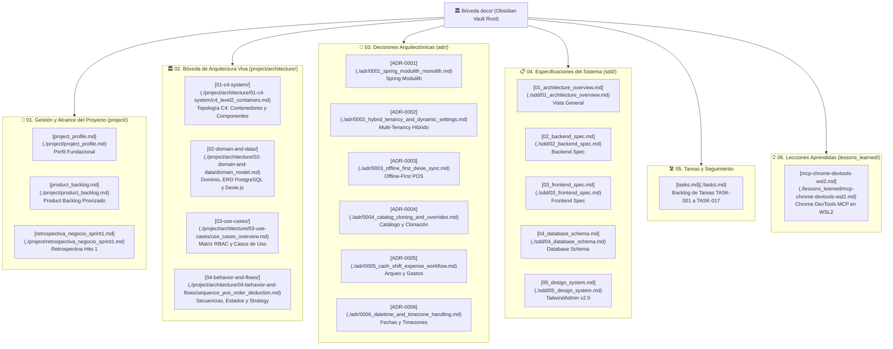

# 🏛️ Bóveda Central de Documentación - Sistema POS & ERP para Restaurante

Bienvenido a la **Bóveda Central de Documentación** del proyecto. La totalidad del directorio `docs/` está configurada como una bóveda unificada para **Obsidian**, diseñada bajo la filosofía de **Specification-Driven Development (SDD)** y 100% compatible con **Git**, **GitHub** y navegadores de repositorios.

Esta bóveda conecta las decisiones estratégicas de negocio, la arquitectura de software, los modelos de datos, los casos de uso operativos y los flujos dinámicos del sistema.

---

## 🗺️ Mapa Global de Contenidos (MOC - Map of Content)

---

## 📂 Estructura Detallada de la Bóveda

### 🎯 1. Gestión, Alcance y Estrategia de Negocio (`project/`)
- [**`project_profile.md`**](./project/project_profile.md): Definición del problema, justificación comercial, objetivos generales y alcance del sistema POS + ERP.
- [**`product_backlog.md`**](./project/product_backlog.md): Backlog formal priorizado por niveles (P0 a P3), iniciativas del producto (PB-001 a PB-023) y roadmap hacia futuros sprints.
- [**`retrospectiva_negocio_sprint1.md`**](./project/retrospectiva_negocio_sprint1.md): Retrospectiva funcional completa del Hito 1, análisis de brechas operativas y justificación estratégica para el Sprint 2.

### 🏛️ 2. Bóveda de Arquitectura Viva y Diagramas Mermaid (`project/architecture/`)
Índice de la arquitectura: [**`project/architecture/README.md`**](./project/architecture/README.md)
- **Topología C4:**
  - [**`c4_level2_containers.md`**](./project/architecture/01-c4-system/c4_level2_containers.md): Contenedores: Angular 22 SPA, Dexie.js, Spring Boot API, PostgreSQL 16 y Event Registry.
  - [**`c4_level3_backend_modulith.md`**](./project/architecture/01-c4-system/c4_level3_backend_modulith.md): Arquitectura modular de paquetes `.api`, aislamiento `.internal` y verificación con Spring Modulith.
  - [**`c4_level3_frontend_angular.md`**](./project/architecture/01-c4-system/c4_level3_frontend_angular.md): Componentes Zoneless, Signals reactivos, servicios singleton y persistencia local.
- **Dominio y Datos:**
  - [**`domain_model.md`**](./project/architecture/02-domain-and-data/domain_model.md): Clases del dominio, agregados (`Tenant`, `Branch`, `Dish`, `Order`, `KardexMovement`, `CashShift`, `Expense`) y métodos de negocio.
  - [**`database_erd.md`**](./project/architecture/02-domain-and-data/database_erd.md): Modelo físico relacional PostgreSQL con las 19 tablas, tipos de datos, claves e índices denormalizados multi-tenant.
  - [**`dexie_local_schema.md`**](./project/architecture/02-domain-and-data/dexie_local_schema.md): Esquema de base de datos local IndexedDB en Dexie.js (`cachedCategories`, `cachedProducts`, `pendingOrders`, `activeShift`).
- **Casos de Uso y RBAC:**
  - [**`use_cases_overview.md`**](./project/architecture/03-use-cases/use_cases_overview.md): Matriz de permisos RBAC para los 5 roles y mapa general del sistema.
  - [**`use_cases_catalog.md`**](./project/architecture/03-use-cases/use_cases_catalog.md): Casos de uso de categorías, insumos, ficha técnica (BOM), sobreescrituras y clonación de recetas.
  - [**`use_cases_pos.md`**](./project/architecture/03-use-cases/use_cases_pos.md): Casos de uso de venta, comanda reactiva, checkout multiformato y cola offline.
  - [**`use_cases_inventory.md`**](./project/architecture/03-use-cases/use_cases_inventory.md): Casos de uso de inventario inicial, existencias, deducción por Strategy, Kardex y mermas.
  - [**`use_cases_finance.md`**](./project/architecture/03-use-cases/use_cases_finance.md): Casos de uso de apertura/cierre de turno, acumulación de ventas, gastos de caja chica y arqueo en vivo.
- **Comportamiento y Flujos Dinámicos:**
  - [**`sequence_pos_order_deduction.md`**](./project/architecture/04-behavior-and-flows/sequence_pos_order_deduction.md): Secuencia de venta en POS con publicación desacoplada de `OrderPaidEvent` y actualización atómica en Kardex y Finanzas.
  - [**`sequence_pos_offline_sync.md`**](./project/architecture/04-behavior-and-flows/sequence_pos_offline_sync.md): Secuencia de venta offline en Dexie.js y reconciliación idempotente por lotes `/sync`.
  - [**`state_order_lifecycle.md`**](./project/architecture/04-behavior-and-flows/state_order_lifecycle.md): Ciclo de vida y transiciones de estado de una comanda (`DRAFT` a `PAID` / `CANCELLED`).
  - [**`state_shift_and_expense_workflow.md`**](./project/architecture/04-behavior-and-flows/state_shift_and_expense_workflow.md): Ciclo de turnos de caja, flujo de aprobación de gastos y conciliación matemática de arqueo.
  - [**`activity_inventory_deduction_strategy.md`**](./project/architecture/04-behavior-and-flows/activity_inventory_deduction_strategy.md): Flujograma del Strategy Pattern de inventario (`MANUAL_ISOLATED`, `AUTOMATIC_PERMISSIVE`, `AUTOMATIC_STRICT`).

### 📐 3. Decisiones Arquitectónicas (`adr/`)
- [**`0001_spring_modulith_monolith.md`**](./adr/0001_spring_modulith_monolith.md): Adopción de Monolito Modular con Spring Modulith en Java 25.
- [**`0002_hybrid_tenancy_and_dynamic_settings.md`**](./adr/0002_hybrid_tenancy_and_dynamic_settings.md): Modelo Multi-Tenant Híbrido y Configuración Dinámica clave-valor.
- [**`0003_offline_first_dexie_sync.md`**](./adr/0003_offline_first_dexie_sync.md): Estrategia Offline-First en POS con Dexie.js e idempotencia transaccional.
- [**`0004_catalog_cloning_and_overrides.md`**](./adr/0004_catalog_cloning_and_overrides.md): Catálogo Híbrido: sobreescrituras de precio y clonación de platos con receta diferenciada.
- [**`0005_cash_shift_expense_workflow.md`**](./adr/0005_cash_shift_expense_workflow.md): Workflow de aprobación de gastos menores de caja chica y fórmula canónica de arqueo.
- [**`0006_datetime_and_timezone_handling.md`**](./adr/0006_datetime_and_timezone_handling.md): Estándar estricto para manejo de fechas, horas y zonas horarias (`DATE`, `TIMESTAMPTZ`, IANA timezone).

### 📋 4. Especificaciones de Diseño del Sistema (`sdd/`)
- [**`01_architecture_overview.md`**](./sdd/01_architecture_overview.md): Visión general de arquitectura, límites de contexto y principios de diseño.
- [**`02_backend_spec.md`**](./sdd/02_backend_spec.md): Especificación técnica de backend, seguridad JWT, perfiles IAM y controladores REST.
- [**`03_frontend_spec.md`**](./sdd/03_frontend_spec.md): Especificación técnica de frontend, Angular 22 Zoneless, Signal Forms y repositorios Dexie.js.
- [**`04_database_schema.md`**](./sdd/04_database_schema.md): Esquema físico de base de datos relacional y DDL PostgreSQL.
- [**`05_design_system.md`**](./sdd/05_design_system.md): Sistema de diseño visual TailwindAdmin v2.0, tokens de color, componentes y accesibilidad.

### 🛠️ 5. Seguimiento y Tareas de Implementación (`tasks.md`)
- [**`tasks.md`**](./tasks.md): Registro atómico del desarrollo. Documenta desde la inicialización (`TASK-001`) hasta la Bóveda de Arquitectura Viva (`TASK-017`), con el 100% de tareas completadas y verificadas con tests.

### 💡 6. Lecciones Aprendidas (`lessons_learned/`)
- [**`mcp-chrome-devtools-wsl2.md`**](./lessons_learned/mcp-chrome-devtools-wsl2.md): Guía de integración del protocolo Chrome DevTools MCP entre Linux WSL2 y Windows 11 para pruebas automatizadas.

---

## 🧭 Guía de Uso en Obsidian

1. **Abrir la Bóveda:** En Obsidian, selecciona **"Open folder as vault"** y apunta a la carpeta `docs/` del repositorio.
2. **Configuración de Enlaces:** La bóveda incluye `.obsidian/app.json` configurado para usar enlaces Markdown relativos estándar (`useMarkdownLinks: true`, `newLinkFormat: "relative"`), garantizando que todo enlace funcione idénticamente en Obsidian, VS Code, GitHub y GitLab.
3. **Vista de Grafo (Graph View):** Presiona `Ctrl + G` en Obsidian para visualizar la red interconectada de conocimiento. Puedes filtrar nodos usando etiquetas:
   - `#architecture` / `#c4-model`
   - `#adr`
   - `#sdd`
   - `#use-case`
   - `#sequence` / `#state`
4. **Metadatos y Frontmatter:** Cada documento incluye metadatos YAML compatibles con el plugin Dataview de Obsidian (`title`, `category`, `tags`, `last_updated`, `status`).
