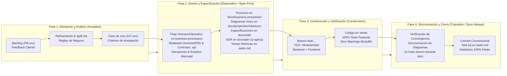

# ADR 0007: Ciclo de Vida de Desarrollo de Software Basado en Especificaciones (SDD-SDLC)

## Contexto
A medida que el sistema POS + ERP para Restaurantes evoluciona, aumentan los requerimientos de clientes potenciales, la complejidad de las reglas de negocio (combos, modificaciones BOM, arqueos de caja, deducción de inventario, parametrización multinivel) y la rigurosidad modular (Spring Modulith con Java 25, Angular 22 Zoneless con Dexie.js).

Implementar código de forma directa ("code-first") ante requerimientos complejos introduce riesgos críticos:
1. **Divergencia Arquitectónica (*Architectural Drift*):** Violación involuntaria de los límites modulares (`modules.*`), acoplamiento cíclico o inyección no autorizada de repositorios internos en lugar de interfaces públicas `.api`.
2. **Retrabajo y Deuda Técnica:** Rediseños costosos en base de datos o lógica transaccional descubiertos tardíamente durante la codificación o pruebas.
3. **Documentación Obsoleta o Ficticia:** Diagramas y especificaciones que no coinciden con el comportamiento real del sistema.

Es imperativo formalizar un estándar para el Ciclo de Vida de Desarrollo de Software (**Software Development Life Cycle - SDLC**) guiado por **Specification-Driven Development (SDD)**. Este modelo debe sintetizar las mejores prácticas de la industria:
- **Proceso Unificado (RUP / OpenUP):** Separación conceptual en disciplinas y fases claras (Inicio, Elaboración, Construcción, Transición), donde el diseño y la arquitectura preceden a la implementación masiva.
- **Scrum / Agile:** Iteraciones cortas (Sprints), entrega continua, backlog priorizado y adaptabilidad ante el feedback del cliente.
- **Specification-Driven Development (SDD) & Living Artifacts:** Los diagramas Mermaid y especificaciones técnicas son artefactos vivos de primera clase, vinculados directamente al código.
- **Principio Rector:** *"Óptimo, funcional y suficiente"*. Prohibida la sobre-ingeniería o la burocracia documental innecesaria. La especificación debe ser concisa, accionable y directamente traducible a código y pruebas.

---

## Decisión

Se adopta formalmente el marco de trabajo **SDD-SDLC** como el ciclo de vida oficial e inviolable para el diseño, desarrollo, refactorización y evolución del software en este proyecto.

### 1. Fases del Ciclo de Vida SDD-SDLC

El flujo estándar de trabajo para cualquier iniciativa se estructura en cuatro fases secuenciales:

---

### 2. Matriz de Entradas, Actividades y Salidas por Fase

| Fase | Artefactos de Entrada (*Inputs*) | Actividades Principales | Artefactos de Salida (*Outputs*) |
| :--- | :--- | :--- | :--- |
| **1. Elicitación y Análisis** *(Inception)* | • Requerimiento en Product Backlog (`PB-xxx`) • Observaciones y dolores del cliente • Estado actual del código y base de datos • Restricciones de ADRs existentes | • Refinamiento de alcance y reglas operativas. • Elicitación de casos de borde y reglas de negocio con el usuario (vía `/grill-me`). • Definición de criterios de aceptación verificables. | • Caso de Uso documentado (`UC-xxx`). • Matriz de actores y permisos RBAC impactados. • Alcance funcional delimitado. |
| **2. Diseño y Especificación** *(Elaboration / Spec-First)* | • Caso de Uso formalizado (`UC-xxx`) • Procesos de negocio existentes en `docs/business-processes/` • Diagramas de arquitectura existentes en `docs/project/architecture/` • Modelo relacional PostgreSQL y esquemas Dexie.js | • **Modelado Operativo (Humano):** Si aplica al Criterio de Impacto Operativo y Multirrol, redactar/actualizar el manual de proceso en `docs/business-processes/` (carriles de responsabilidad, flujo paso a paso y políticas). • **Modelado de Datos:** Actualizar ERD PostgreSQL (tablas, columnas, índices, multi-tenancy `tenant_id`/`branch_id`) y esquema Dexie.js. • **Contratos e Interfaces:** Especificar contratos `.api` de Spring Modulith, DTOs de entrada/salida y endpoints REST (RFC 7807 `ProblemDetail`). • **Modelado Dinámico:** Diseñar diagramas Mermaid de Secuencia (eventos `@ApplicationModuleListener`), Estados y Actividades. • **Gobernanza:** Verificar cumplimiento de ADRs (ADR-0006 de fechas/zonas horarias, aislamiento Dexie DAL). • **Decisiones Estructurales:** Redactar nuevo ADR si se incorporan patrones o componentes estructurales. | • Manual operativo en `docs/business-processes/` (agrupado en subcarpeta de área). • Diagramas Mermaid vivos en `docs/project/architecture/`. • Especificación técnica actualizada en `docs/sdd/`. • Nuevo ADR en `docs/adr/` (si aplica). • Tareas atómicas de construcción en `docs/tasks.md` con DoD explícito. |
| **3. Construcción y Verificación** *(Construction)* | • Especificación formal aprobada en `docs/sdd/` • Manual de procesos en `docs/business-processes/` • Diagramas Mermaid y contratos fijados • Tarea desglosada en `docs/tasks.md` | • Creación de rama Git atómica (`feat/<modulo>-<tarea>`). • Implementación TDD / BDD en backend Java 25 y frontend Angular 22. • Verificación estricta de límites modulares (`ApplicationModules.verify()`). • Ejecución de pruebas unitarias, de integración y E2E. | • Código fuente limpio y tipado. • Suite de pruebas al 100% pasando sin fallos ni advertencias (`./mvnw clean test`, `npm test`). |
| **4. Sincronización y Cierre** *(Transition / Sync-Always)* | • Código fuente verificado en verde • Resultados de suite de pruebas | • Auditoría de convergencia: asegurar que la implementación no divergió de la especificación técnica ni del proceso de negocio. • Si hubo adaptaciones necesarias durante el desarrollo en UI o flujos de usuario, actualizar de inmediato los manuales de `docs/business-processes/` y diagramas Mermaid impactados. • Marcar tarea como completada (`- [x]`) en `docs/tasks.md`. • Commit atómico siguiendo *Conventional Commits*. | • Repositorio en estado consistente. • Especificaciones, procesos de negocio y diagramas vivos 100% idénticos a la realidad del código. |

---

### 3. Regla de Opcionalidad y Flujo Rápido (*Fast-Track / Hotfixes*)

Para balancear la disciplina arquitectónica con la agilidad operativa, se establecen dos vías de ejecución:

#### Vía A: Flujo Completo Spec-First (Obligatorio por Defecto)
Aplica de forma estricta a:
- Nuevas funcionalidades o módulos de negocio.
- Modificaciones estructurales en base de datos (nuevas tablas, columnas, índices, migraciones Flyway).
- Alteración de contratos públicos `.api`, eventos asíncronos o endpoints REST públicos.
- Cambios en máquinas de estado (comandas, turnos de caja, inventario) o flujos transaccionales.
- Refactorizaciones arquitectónicas mayores.

> **Regla:** Está terminantemente prohibido escribir código de implementación en la Vía A sin haber completado y validado las Fases 1 y 2.

#### Vía B: Flujo Rápido Fast-Track (Excepción Controlada)
Aplica **exclusivamente** a:
- *Hotfixes* críticos de producción (fallos que bloquean la operación en caliente).
- Correcciones tipográficas o de textos en UI.
- Ajustes menores de estilo visual CSS que no alteren contratos ni flujos de datos.
- Correcciones menores de configuración de entorno o dependencias.

> **Regla en Fast-Track:** Se permite iniciar directamente en la **Fase 3 (Construcción)**, pero la **Fase 4 (Sincronización Documental - Sync-Always)** sigue siendo obligatoria en el mismo commit si el cambio afectó algún comportamiento visible o documentado.

---

### 4. Segregación de Responsabilidades por Workstream

Para garantizar la pureza del diseño y evitar interferencias con desarrollos en curso:
- **Workstream de Análisis, Diseño e Ingeniería de Software (Este Canal):**
  - Enfocado exclusivamente en las **Fases 1 y 2** (Elicitación, Diseño Arquitectónico, Modelado Mermaid, Contratos `.api`, ADRs y Desglose de Tareas en `tasks.md`).
  - No ejecuta implementación de código fuente ni altera ramas activas de desarrollo funcional.
  - Genera artefactos de especificación listos para consumo directo.
- **Workstream de Construcción e Implementación:**
  - Toma las especificaciones cerradas y ejecuta las **Fases 3 y 4** en ramas Git dedicadas (`feat/*`), verificando la suite de pruebas e implementando contra los contratos definidos.

---

### 5. Gobernanza de Procesos de Negocio (`docs/business-processes/`)

Los procesos de negocio documentan cómo opera el restaurante en la vida real, con un enfoque libre de jerga técnica dirigido a comensales, cajeros, cocineros, encargados y propietarios.

#### Estructura y Agrupación por Áreas Operativas:
Los manuales y diagramas de negocio se organizan estrictamente en subdirectorios por áreas operativas del restaurante con prefijo numérico:
- `01-pos-y-atencion/`: Atención en mostrador, personalización de comandas, combos, modalidades para llevar/delivery y cancelaciones.
- `02-caja-y-finanzas/`: Turnos de caja, conciliación y arqueo, gastos menores de caja chica y autorizaciones.
- `03-cocina-e-inventario/`: Recetas BOM, deducción de Kardex, control de mermas y transferencias de almacén central a sucursal.
- `04-administracion-y-personal/`: Parametrización multinivel de empresa, gobierno de personal y seguridad de roles.

#### Criterio de Impacto Operativo y Multirrol (Trigger de Documentación):
No todas las tareas técnicas requieren un documento de proceso de negocio. La redacción o actualización de un documento en `docs/business-processes/` durante la **Fase 2** es obligatoria únicamente cuando la funcionalidad cumple el **Criterio de Impacto Operativo y Multirrol**:
1. **Interacción Humana Multirrol:** Flujo donde participan o se coordinan dos o más actores operativos (ej. cajero solicita cancelación, cocinero reporta estado de cocción y supervisor autoriza con PIN).
2. **Impacto Físico o Financiero Tangible:** Procedimientos donde hay intercambio o egreso de dinero en efectivo físico, movimiento físico de insumos o mermas de comida preparada.
3. **Flujos Operativos Críticos de Restaurante:** Nuevas modalidades de atención (takeout/delivery), aperturas con cupos de cocina o transferencias entre almacenes centrales y sucursales.

*Exclusiones:* Cambios puramente técnicos o internos (refactors de código, repositorios DAL, renovaciones silenciosas JWT, ajustes de Docker, migraciones de librerías) no generan documentos en `business-processes/`.

---

## Consecuencias

### Positivas
- **Cero Ambigüedad:** Los desarrolladores y agentes constructores reciben especificaciones cerradas con contratos, DTOs, diagramas de secuencia y esquemas de BD predefinidos.
- **Eliminación del Drift Arquitectónico:** La arquitectura viva (`docs/project/architecture/`) refleja exactamente lo que el sistema hace y cómo lo hace.
- **Eficiencia y Velocidad de Codificación:** Al separar el pensamiento de diseño de la mecánica de codificación, la implementación se reduce a seguir planos precisos, acelerando la entrega.
- **Trazabilidad Total:** Todo requerimiento (`PB-xxx`) cuenta con un caso de uso (`UC-xxx`), diagramas asociados y tareas atómicas rastreables.

### Negativas / Desafíos
- Requiere disciplina para no saltar directamente al código ante requerimientos nuevos.
- Demanda mantener sincronizados los diagramas Mermaid ante cualquier ajuste surgido en la fase de construcción.
