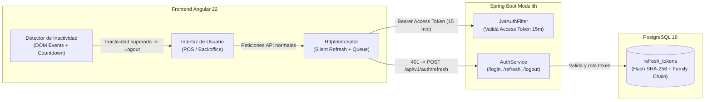

# ADR-0011: Ciclo de Vida de Sesiones, Expiración JWT, Refresh Token con Rotación y Renovación Silenciosa

## Contexto y Definición del Problema

En la arquitectura actual de seguridad (`core.security`), los tokens JWT se emiten con un tiempo de vida estático de 24 horas (`restaurant.security.jwt.expiration-seconds=86400`). Esta configuración presenta serias desventajas operativas y de seguridad:

1. **Vulnerabilidad por Exposición de Token:** Si un token JWT de 24 horas es interceptado o extraído de la memoria/almacenamiento del navegador, el atacante mantiene acceso ilimitado durante un día completo sin posibilidad de revocación inmediata (debido a la naturaleza sin estado del JWT).
2. **Fricción Operativa en el Restaurante:** Si reducimos abruptamente el tiempo del JWT a 15 minutos sin un mecanismo de renovación automática, los cajeros en pleno despacho o los gerentes cuadrando caja verían interrumpida su sesión, perdiendo datos de formularios no guardados y recibiendo errores `401 Unauthorized`.
3. **Falta de Detección de Inactividad (Idle Timeout):** En un restaurante, los terminales POS suelen compartirse o quedar desatendidos cuando el personal se mueve al salón o la cocina. Si no hay control de inactividad, un cliente o empleado no autorizado puede operar la caja abierta.
4. **Necesidad de Revocación Selectiva y Global:** Cuando un administrador resetea la contraseña de un empleado, le da de baja o detecta sospecha de robo, las sesiones abiertas deben invalidarse de manera instantánea y remota.

---

## Opciones Evaluadas

### Opción 1: Token JWT Único con Vida Prolongada (Estado Actual)
- **Ventajas:** Cero complejidad de refresco, sin llamadas adicionales al backend.
- **Desventajas:** Inaceptable para estándares de seguridad comercial y cumplimiento bancario/fiscal; imposible de revocar sin una lista negra en memoria o base de datos que destruye el propósito del JWT sin estado.

### Opción 2: Sesiones Completamente en Base de Datos / Redis (Stateful Session Tokens)
- **Ventajas:** Revocación instantánea en cada request consultando la BD.
- **Desventajas:** Alto costo en latencia I/O para cada una de las peticiones REST ($O(\text{DB access})$), rompiendo el rendimiento de alta velocidad del POS en red local o virtual threads.

### Opción 3: Arquitectura de Tokens Duales con Rotación de Refresh Token y Silent Refresh Híbrido (Opción Seleccionada)
- **Access Token (JWT):** Corta duración ($15\text{ minutos}$), autocontenido con claims de contexto (`tenant_id`, `branch_id`, `role`, `permissions`, `branch_ids`). Verificación puramente criptográfica sin consultas a BD ($O(1)$).
- **Refresh Token Opaco:** Larga duración ($7\text{ a }14\text{ días}$), almacenado de forma segura en PostgreSQL (`refresh_tokens`) mediante su hash criptográfico SHA-256.
- **Rotación Estricta (Refresh Token Rotation):** En cada llamada a `/api/v1/auth/refresh`, el refresh token presentado queda revocado inmediatamente y se expide un nuevo par (Access + Refresh Token). Si un token revocado intenta ser reutilizado, el sistema detecta un compromiso de seguridad y revoca inmediatamente toda la familia de sesiones activas del usuario (*Automatic Reuse Detection*).
- **Silent Refresh Proactivo + Reactivo en Frontend:** Renovación transparente en segundo plano sin interrumpir al cajero, respaldada por un interceptor HTTP que encola peticiones concurrentes ante un `401`.
- **Detección de Inactividad Vinculada a Parámetros:** Parámetro `SESSION_INACTIVITY_TIMEOUT_MINUTES` ([ADR-0008](./0008_unified_multilevel_parameter_system.md)) que monitorea eventos del usuario y despliega un modal con cuenta regresiva antes de cerrar la sesión.

---

## Decisión Técnica

Se aprueba la adopción de la **Opción 3: Arquitectura de Tokens Duales con Rotación de Refresh Token y Silent Refresh Híbrido**:



### 1. Especificación de Tokens y Duraciones

| Tipo de Token | Formato | Duración por Defecto | Almacenamiento Frontend | Propósito |
| :--- | :--- | :--- | :--- | :--- |
| **Access Token** | JWT firmado (HMAC-SHA256) | 15 minutos (`900` s) | Memoria (Signal) + LocalStorage (fallback de recarga) | Autorización $O(1)$ en cada petición REST sin I/O a BD. |
| **Refresh Token** | String opaco aleatorio (UUID v4 + 64 bytes criptográficos Base64URL) | 7 días (móvil/POS) / 24 horas (admin) | Almacenamiento protegido local / Cookie HttpOnly segura | Obtención de nuevos Access Tokens exclusivamente en `/api/v1/auth/refresh`. |

### 2. Estructura de Persistencia en Base de Datos (`refresh_tokens`)

El Refresh Token **nunca se almacena en texto plano en la base de datos**. Se calcula su hash `SHA-256` antes de persistir, evitando que una fuga de base de datos comprometa las sesiones activas:

```sql
CREATE TABLE refresh_tokens (
    id UUID PRIMARY KEY DEFAULT gen_random_uuid(),
    tenant_id UUID NOT NULL REFERENCES tenants(id) ON DELETE CASCADE,
    user_id UUID NOT NULL REFERENCES app_users(id) ON DELETE CASCADE,
    token_hash VARCHAR(64) NOT NULL UNIQUE, -- SHA-256 en hexadecimal
    device_info VARCHAR(255),               -- User-Agent resumido
    ip_address VARCHAR(45),                 -- IPv4 o IPv6
    expires_at TIMESTAMP WITH TIME ZONE NOT NULL,
    revoked_at TIMESTAMP WITH TIME ZONE,    -- NULL = Activo; NOT NULL = Revocado
    replaced_by_id UUID REFERENCES refresh_tokens(id) ON DELETE SET NULL, -- Cadena de rotación
    created_at TIMESTAMP WITH TIME ZONE NOT NULL DEFAULT CURRENT_TIMESTAMP
);
CREATE INDEX idx_refresh_tokens_user ON refresh_tokens(user_id, revoked_at);
CREATE INDEX idx_refresh_tokens_hash ON refresh_tokens(token_hash);
```

### 3. Protocolo de Rotación y Detección de Reúso (Compromise Detection)

1. El cliente envía `POST /api/v1/auth/refresh` con `{ "refreshToken": "..." }`.
2. El backend calcula `SHA256(refreshToken)` y busca la fila en `refresh_tokens`:
   - **Caso Normal (Token Activo):** 
     - Se marca la fila actual con `revoked_at = CURRENT_TIMESTAMP`.
     - Se genera un nuevo par de Access Token y Refresh Token.
     - Se inserta el nuevo Refresh Token en `refresh_tokens`, vinculando la fila anterior mediante `replaced_by_id = nuevo_id`.
     - Se retorna el nuevo par al cliente.
   - **Caso de Ataque / Reúso Detectado (Token ya Revocado):**
     - Si el token presentado tiene `revoked_at IS NOT NULL`, significa que un atacante o una entidad interceptora está intentando usar un token ya consumido.
     - **Acción Inmediata:** Se invalidan **todos los tokens activos de ese usuario** (`UPDATE refresh_tokens SET revoked_at = NOW() WHERE user_id = ? AND revoked_at IS NULL`).
     - Se registra un evento crítico en `audit_logs` (`SUSPICIOUS_TOKEN_REUSE_DETECTED`).
     - Se responde con `HTTP 401 Unauthorized` (`ProblemDetail: Token reuse detected. Session terminated`).

### 4. Parametrización del Timeout de Inactividad (ADR-0008)

Se enlaza al Sistema Unificado de Parámetros:
- **`SESSION_INACTIVITY_TIMEOUT_MINUTES`**:
  - `Default Global:` 30 minutos.
  - `Default para Sucursales de Comida Rápida (POS):` 120 minutos (evita que el cajero tenga que loguearse repetidamente durante horas valle).
- **Mecanismo en Frontend:**
  - Un servicio singleton `IdleTimerService` escucha eventos del DOM con debounce: `['mousemove', 'keydown', 'click', 'scroll', 'touchstart']`.
  - Cuando restan 2 minutos para el timeout, se abre un modal no bloqueante: *"Tu sesión se cerrará en X segundos por inactividad. ¿Deseas continuar trabajando?"*.
  - Si el usuario presiona "Continuar", se reinicia el temporizador y se envía un ping al backend.
  - Si el temporizador llega a cero, se ejecuta `authService.logout()`.

### 5. Mecanismo de Silent Refresh en Angular

Para evitar condiciones de carrera cuando se disparan múltiples peticiones HTTP concurrentes (ej. carga de platos, balance de turnos y alertas):
- Si el Access Token expiró y se reciben varios `401`, el `authInterceptor`:
  1. Si `isRefreshing = false`, activa la bandera `isRefreshing = true` y llama a `/api/v1/auth/refresh`.
  2. Si `isRefreshing = true`, las peticiones subsecuentes no llaman a refresco; se encolan mediante un `Subject<string>` y esperan a que el nuevo token esté listo para reintentarse automáticamente.
  3. Si el refresco falla, se vacía la cola, se eliminan los datos de sesión y se redirige a `/auth/login`.

---

## Consecuencias y Compensaciones

### Positivas
- **Máxima Seguridad:** La ventana de exposición ante robo de un Access Token se reduce de 24 horas a solo 15 minutos.
- **Transparencia Operativa:** El personal del restaurante nunca experimenta bloqueos inesperados ni errores 401 mientras esté activo en el sistema.
- **Protección Forense:** La rotación con detección de reúso neutraliza ataques de robo de sesión.
- **Control Remoto:** El dueño o gerente puede revocar sesiones de empleados despedidos o terminales extraviados en un solo clic.

### Negativas / Complejidad Aceptada
- **Mantenimiento de Base de Datos:** La tabla `refresh_tokens` acumula registros históricos de rotación. Se programa un cleanup periódico para eliminar tokens expirados con más de 30 días de antigüedad.
- **Coordinación Asíncrona en Frontend:** El interceptor HTTP exige lógica de encolamiento reactivo mediante RxJS para evitar estampidas (*thundering herd*) de peticiones de refresco concurrentes.

---

## Estado de Aprobación
- **Estado:** Aceptado (Consensuado con el Usuario para Sprint 3).
- **Siguiente Paso:** Documentación de casos de uso `UC-314`, secuencias Mermaid y actualización del ERD y contratos backend.
