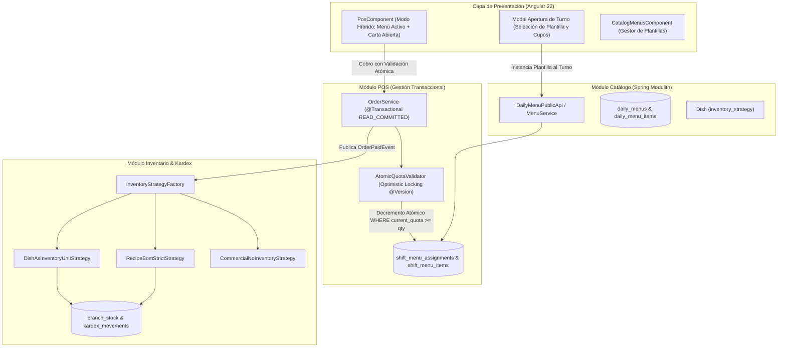

# ADR-0015: Modelo Relacional de Menús Diarios, Plantillas de Turno con Cupos Reactivos y Estrategias Flexibles de Inventario (ACID & Clean Architecture)

- **Estado:** ACEPTADO
- **Fecha:** 2026-10-30
- **Autores:** Antigravity Architect & Product Owner
- **Módulos Afectados:** `modules.catalog`, `modules.pos`, `modules.inventory`, `modules.finance`, `modules.configuration`, `frontend`
- **Relacionado con:** `PB-034`, `PB-044`, `OBS-CAT-01`, `OBS-CAT-02`, [ADR-0002](0002_multi_tenant_isolation_strategy.md), [ADR-0007](0007_sdd_software_development_lifecycle.md), [ADR-0013](0013_pos_shift_invariant_and_expense_authorizations.md)

---

## 1. Contexto y Problemática

Durante la retrospectiva del Sprint 3 ([`retrospectiva_sprint3.md`](../project/retrospectiva_sprint3.md)), se detectaron dos rigideces de modelo que impedían adaptar el software a la operativa real de restaurantes y comercios gastronómicos:

1. **Confusión Conceptual entre Catálogo Maestro y Menú Diario (`OBS-CAT-01` / `PB-034`):**
   - El sistema trataba a todos los platos (`dishes`) como un listado estático global.
   - En la vida real, un restaurante opera con **Menús Diarios** (ej. "Menú Ejecutivo Lunes", "Sábado Criollo", "Carta Nocturna") que ofrecen una selección curada de $N$ platos con cantidades/cupos finitos de producción para la jornada.
   - No existía la posibilidad de definir plantillas reutilizables por día de la semana ni de asociar una selección de platos con raciones pactadas al abrir el turno de caja.
2. **Inflexibilidad en Recetas BOM y Almacén (`OBS-CAT-02` / `PB-044`):**
   - El Kardex asumía que todo plato exige obligatoriamente una lista de insumos (`dish_ingredients`).
   - Muchos negocios no costean insumos gramo a gramo: compran o preparan productos terminados por unidad (ej. 40 empanadas, postres en porciones, bebidas) y desean controlar existencias por unidad de plato; o bien ofrecen platos comerciales sin control de inventario de bodega.
   - La falta de estrategias alternativas provocaba errores de stock o impedía la venta de productos que no tenían receta registrada.

---

## 2. Decisiones de Arquitectura y Patrones de Diseño

Para garantizar alta mantenibilidad, escalabilidad y rendimiento sin comprometer la integridad de datos, se adopta un diseño estructurado bajo **Clean Code**, principios **SOLID**, propiedades **ACID** estrictas y patrones de diseño consolidados:



### 2.1. Desacoplamiento de Plantillas de Menú y Cupos de Turno (`PB-034`)
Se diseñan dos entidades relacionales claramente diferenciadas:
1. **Plantilla Reutilizable (`daily_menus` y `daily_menu_items`):**
   - Define el catálogo sugerido de una jornada o día de la semana (`day_of_week`), con clasificación por tiempo de comida (`course_type`: `STARTER`, `MAIN`, `DESSERT`, `BEVERAGE`, `GENERAL`), cupo sugerido inicial y soporte para precio individual o precio cerrado de paquete (`price_mode`).
2. **Instancia de Turno en Vivo (`shift_menu_assignments` y `shift_menu_items`):**
   - Al abrir el turno de caja (`cash_shifts`), el cajero o supervisor selecciona una plantilla.
   - El sistema realiza una copia aislada hacia `shift_menu_items`. Los ajustes realizados en el turno (porciones reales preparadas) **no alteran la plantilla base**, salvo que el usuario elija explícitamente "Guardar como nueva plantilla".
   - Si durante la jornada cocina prepara más raciones, un supervisor puede registrar una ampliación de cupo auditada en `shift_menu_quota_adjustments`.

### 2.2. Garantías ACID en el Control de Cupos Concurrente
Para evitar la sobreventa del último plato disponible cuando múltiples terminales POS operan simultáneamente en la misma sucursal:
- **A (Atomicidad):** La verificación y decremento de cupos ocurren dentro de la transacción de base de datos de la orden (`@Transactional`).
- **C (Consistencia):** Invariante formal de dominio:
  $$\text{current\_quota} + \text{sold\_count} = \text{initial\_quota} + \sum \text{quantity\_delta}$$
  Se impone restricción de base de datos `CHECK (current_quota >= 0)`.
- **I (Aislamiento & Optimistic Locking):** La entidad `ShiftMenuItem` incorpora `@Version private Long version`. El decremento en base de datos ejecuta:
  ```sql
  UPDATE shift_menu_items
  SET current_quota = current_quota - :qty,
      sold_count = sold_count + :qty,
      version = version + 1
  WHERE id = :id AND current_quota >= :qty AND version = :version;
  ```
  Si filas afectadas es 0, el sistema rechaza la operación con `ITEM_SOLD_OUT` (HTTP 409), garantizando cero condiciones de carrera sin bloquear tablas con bloqueos pesados.
- **D (Durabilidad):** Persistencia síncrona en PostgreSQL y auditoría inmutable de ajustes en `shift_menu_quota_adjustments`.

### 2.3. Tríada de Estrategias de Inventario (Strategy Pattern - `PB-044`)
Se incorpora el campo `dishes.inventory_strategy` (`VARCHAR(30)`):

1. **`RECIPE_BOM_STRICT` (Receta BOM Estricta):**
   - Deducción atómica de materias primas según `dish_ingredients` en `branch_stock` y `kardex_movements` (movimiento `SALE_OUT` por cada insumo).
2. **`DISH_AS_INVENTORY_UNIT` (Plato como Unidad Física en Almacén):**
   - El plato terminado se controla directamente como unidad física en `branch_stock` (columna `dish_id`).
   - El Kardex registra movimientos unitarios `SALE_OUT` directamente sobre el plato (ej. 1 empanada, 1 porción de tarta).
3. **`COMMERCIAL_NO_INVENTORY` (Comercial / Venta Libre):**
   - Venta comercial sin enlace a recetas ni deducción en Kardex. Ideal para bebidas envasadas gestionadas fuera de almacén o platos a pedido libre sin control de bodega.

### 2.4. Control de Existencias Negativas Parametrizable
- Parámetro multinivel: `inventory.allow_negative_stock` (Boolean, Default: `false`).
- Si es `false`: El POS bloquea preventivamente el pedido si las existencias en `branch_stock` son insuficientes, retornando HTTP 409 RFC 7807 (`INSUFFICIENT_STOCK_ERROR`).
- Si es `true`: El restaurante opera de forma permisiva, permitiendo que la venta se procese, asentando saldos negativos en Kardex y despachando una advertencia `STOCK_DEFICIT_WARNING` para auditoría administrativa.
- Cada plato puede sobrescribir este comportamiento mediante `dishes.allow_negative_stock_override`.

### 2.5. Experiencia de Usuario Híbrida en POS
- El POS despliega por defecto los platos del Menú Diario activo en pestañas destacadas por tiempo (`Entradas`, `Segundos`, `Postres`, `Bebidas`) mostrando badges de cupo restante (`Cupo: 12`).
- Al llegar a 0, el botón del plato se desactiva con badge visual `AGOTADO`.
- Conmutador rápido en cabecera: *"Ver Carta Completa"*, permitiendo acceder al resto del catálogo maestro sin romper la operativa de turnos especiales.

---

## 3. Consecuencias

### Positivas
* **Flexibilidad Operativa Total:** Permite a restaurantes tradicionales vender menús diarios con cupos controlados y a la carta al mismo tiempo.
* **Integridad ACID Sin Bloqueos:** Cero sobreventas de platos agotados mediante Optimistic Locking y updates atómicos condicionales.
* **Desacoplamiento Limpio:** El módulo POS solo consulta `DailyMenuPublicApi` e `InventoryPublicApi` sin acoplarse a detalles internos de recetas o Kardex.
* **Onboarding Liviano:** Negocios sin control de insumos gramo a gramo pueden iniciar de inmediato usando `COMMERCIAL_NO_INVENTORY` o `DISH_AS_INVENTORY_UNIT`.

### Negativas / Mitigaciones
* **Complejidad en Esquema de Stock:** `branch_stock` y `kardex_movements` ahora pueden referenciar un `ingredient_id` o un `dish_id`.
  - *Mitigación:* Se añade restricción formal `CHECK ((ingredient_id IS NOT NULL AND dish_id IS NULL) OR (ingredient_id IS NULL AND dish_id IS NOT NULL))` e índices parciales para garantizar integridad referencial estricta.
