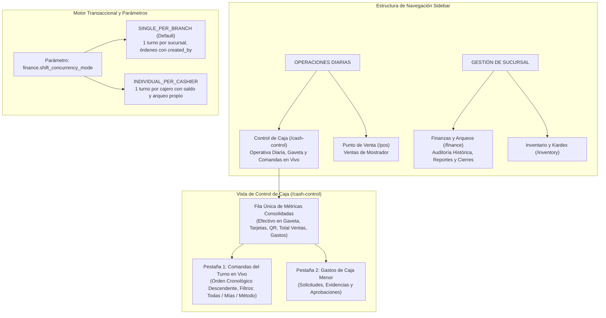

# ADR-0016: Reingeniería de Control de Caja, Finanzas y Turnos Multi-Cajero (ACID & Ergonomía Operativa)

- **Estado:** ACEPTADO
- **Fecha:** 2026-10-30
- **Autores:** Antigravity Architect & Product Owner
- **Módulos Afectados:** `modules.configuration`, `modules.finance`, `modules.pos`, `frontend`
- **Relacionado con:** `PB-029`, `PB-041`, `PB-042`, [ADR-0005](0005_finance_petty_cash_and_shifts.md), [ADR-0008](0008_unified_multilevel_parameter_system.md), [ADR-0013](0013_pos_shift_invariant_and_expense_authorizations.md), [ADR-0014](0014_design_system_tokens_and_uikit_suite.md)

---

## 1. Contexto y Problemática

En la versión previa, el sistema unificaba en una sola pantalla (`/finance`) la operativa diaria de la gaveta de caja con la reportería analítica e histórica de la empresa. Además, el modelo de caja imponía una restricción rígida de **un solo turno abierto por sucursal**, provocando los siguientes conflictos:

1. **Confusión Operativa y Sobrecarga Visual:**
   - La vista de finanzas exponía una tabla de "Historial de Turnos y Arqueos Anteriores" directamente visible para cualquier cajero en mostrador, exponiendo datos de auditoría que corresponden a gerencia.
   - Existía duplicidad masiva de métricas: una fila de 4 tarjetas superiores de KPIs y otra cuadrícula interna de 4 tarjetas dentro del turno activo repitiendo exactamente los mismos importes (saldo inicial, efectivo teórico, ventas en efectivo y gastos).
   - Existían dos botones de "Cerrar Turno / Arqueo" compitiendo en la misma interfaz y un botón redundante de "Actualizar" manual.
   - El cajero no tenía visibilidad directa de las comandas y tickets cobrados en su turno en curso para cotejar pagos con QR o tarjetas antes de realizar su arqueo.
2. **Inflexibilidad en la Concurrencia de Turnos:**
   - Algunos restaurantes operan con múltiples cajeros o terminales independientes donde cada cajero es responsable de su propio fondo inicial y su propio arqueo ciego al terminar su turno.
   - Otros negocios prefieren una única caja comunal compartida por varios operadores.
   - La arquitectura requería soportar ambos modelos de forma parametrizable a nivel de empresa (`tenant`) y sucursal (`branch`).

---

## 2. Decisiones de Arquitectura

### 2.1. Separación de Rutas y Responsabilidades
1. **Control de Caja (`/cash-control`):**
   - Pertenece a **`OPERACIONES DIARIAS`** junto a `/pos`.
   - Diseñado con la suite de componentes **UI Kit v3.0** (`<app-modal>`, `<app-badge>`, `<app-button>`, `<app-card>`, `<app-form-field>`).
   - Muestra una **única fila jerarquizada de KPIs consolidados** sin tarjetas duplicadas.
   - En lugar del historial antiguo, la parte principal expone la **lista de comandas cobradas en el turno en vivo** en orden cronológico descendente, con buscador, filtros rápidos y modal de detalle de comanda.
   - Auto-sincronización periódica en segundo plano sin interrumpir la operativa del usuario.
2. **Finanzas y Arqueos (`/finance`):**
   - Permanece en **`GESTIÓN DE SUCURSAL`**.
   - Reservada para roles administrativos (`ADMIN_TENANT`, `BRANCH_MANAGER`, o usuarios con `finance:reports`).
   - Contiene el historial completo de turnos cerrados, auditoría de discrepancias (faltantes/sobrantes) y reportería analítica de métodos de pago.

### 2.2. Parámetro Multinivel `finance.shift_concurrency_mode`
Se incorpora al sistema unificado de parametrización (`modules.configuration`):
- **`SINGLE_PER_BRANCH` (Predeterminado):**
  - Solo puede existir un turno en estado `OPEN` en la sucursal.
  - Varios cajeros pueden cobrar en POS sobre el mismo turno; cada comanda registra al cajero que la cobró (`orders.created_by`).
- **`INDIVIDUAL_PER_CASHIER`:**
  - Cada cajero abre su propio turno con su propio saldo de apertura.
  - El POS exige que el cajero autenticado posea un turno `OPEN` propio para cobrar (`SHIFT_REQUIRED_ERROR` si no lo tiene).
  - Al salir, el cajero realiza su propio arqueo ciego independiente.
  - El endpoint `GET /api/v1/finance/shifts/active?branchId={id}` permite consultar todos los turnos abiertos concurrentes para facilitar la supervisión y control cruzado.

### 2.3. Garantías ACID e Invariantes Transaccionales
1. **Unicidad de Comanda por Turno:** Toda orden cobrada se asocia a exactamente un `cash_shift_id`.
2. **Cálculo Exacto de Arqueo:**
   $$\text{expected\_cash} = \text{initial\_cash} + \text{total\_cash\_sales} - \text{total\_cash\_expenses}_{\text{approved}}$$
3. **Consistencia Concurrente:** La actualización de acumuladores del turno al cobrar o registrar egresos se realiza de forma atómica en base de datos.

---

## 3. Consecuencias

### Positivas
* **Ergonomía y Cero Redundancia:** El cajero dispone de una pantalla limpia, rápida y enfocada en su dinero físico y sus comandas.
* **Seguridad y Confidencialidad:** Los historiales de arqueos globales quedan aislados en la vista de gerencia.
* **Versatilidad de Negocio:** Permite operar tanto en formato de caja única (pequeño restaurante) como en cajas independientes por cajero (grandes salones o patios de comida).
* **Adopción Completa del UI Kit v3.0:** Se erradica el HTML legado en la nueva pantalla de caja.

### Mitigaciones
* **Compatibilidad de Rutas:** Si un usuario guardó en marcadores `/finance`, se mantiene la ruta con los permisos correspondientes; los cajeros son guiados intuitivamente a `/cash-control`.
