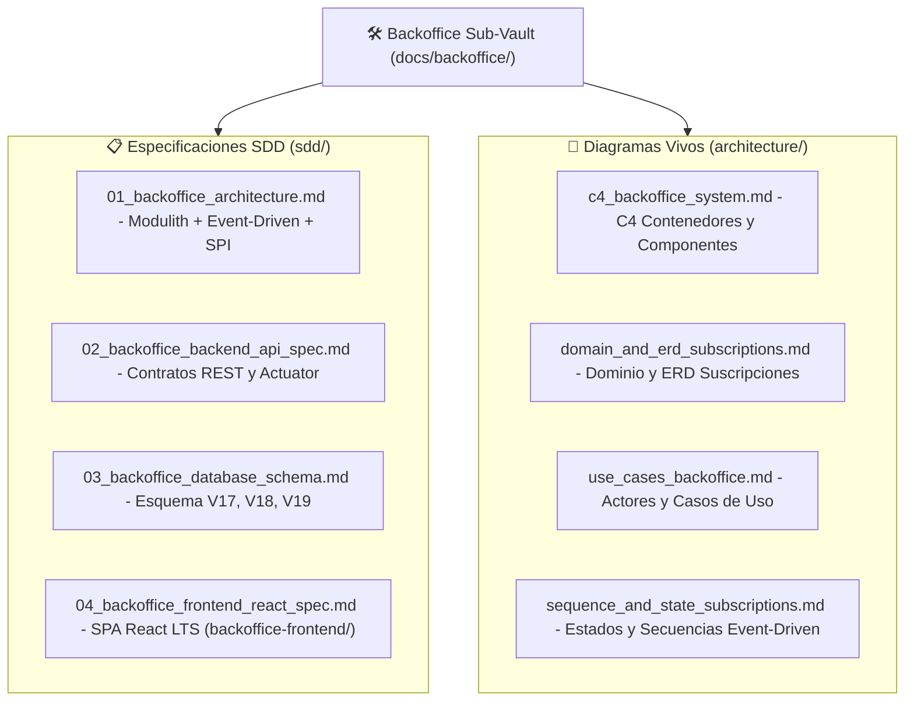

# 🛠️ Sub-Bóveda del Proyecto Backoffice SaaS (`docs/backoffice/`)

> ⬅️ **Navegación Principal:** [Inicio de la Bóveda Global (`docs/README.md`)](../README.md) | [ADR-0027 (Identidad Plataforma)](../adr/0027_platform_identity_and_clean_golive_bootstrap.md) | [ADR-0028 (Storage Agnóstico)](../adr/0028_agnostic_media_storage_and_platform_settings.md) | [ADR-0029 (Suscripciones, Cuotas y Telemetría)](../adr/0029_backoffice_subscriptions_quotas_and_telemetry.md)

Esta sub-bóveda concentra de manera **totalmente aislada del ERP gastronómico** las especificaciones SDD, modelos de datos, contratos REST, casos de uso y diagramas arquitectónicos de la plataforma administrativa (**`modules.backoffice`** en backend y **`backoffice-frontend/`** en React LTS).

---

## 🗺️ Mapa de Contenidos del Backoffice

---

## 📂 Índice de Documentos

### 📋 Especificaciones Técnicas (`sdd/`)
- [**`01_backoffice_architecture.md`**](./sdd/01_backoffice_architecture.md): Límites de contexto en Spring Modulith, puerto SPI `core.entitlements`, caché reactivo por eventos, proyección CQRS de telemetría y aislamiento respecto a `frontend/`.
- [**`02_backoffice_backend_api_spec.md`**](./sdd/02_backoffice_backend_api_spec.md): Contratos completos bajo `/api/v1/backoffice/**`, endpoint ERP `/api/v1/company/entitlements`, observabilidad Actuator curada y códigos RFC 7807.
- [**`03_backoffice_database_schema.md`**](./sdd/03_backoffice_database_schema.md): Diccionario de tablas de plataforma (`V17`, `V18` y `V19`), reglas de integridad, índices y conciliación FIFO de pagos.
- [**`04_backoffice_frontend_react_spec.md`**](./sdd/04_backoffice_frontend_react_spec.md): Arquitectura del proyecto hermano **`backoffice-frontend/`** (React LTS + TypeScript + Vite + Tailwind CSS), `env.js` runtime y módulos UI.

### 📐 Arquitectura Viva & Diagramas Mermaid (`architecture/`)
- [**`c4_backoffice_system.md`**](./architecture/c4_backoffice_system.md): Topología C4 Nivel 2 y Nivel 3 separando plano SaaS del plano operativo POS/ERP.
- [**`domain_and_erd_subscriptions.md`**](./architecture/domain_and_erd_subscriptions.md): Modelo físico `erDiagram` de plataforma (`platform_admins`, `platform_settings`, planes, suscripciones, cargos, pagos, telemetría y auditoría).
- [**`use_cases_backoffice.md`**](./architecture/use_cases_backoffice.md): Casos de uso `UC-BO-001` a `UC-BO-009` cubriendo operación comercial, técnica y resolución de downgrade sin borrado.
- [**`sequence_and_state_subscriptions.md`**](./architecture/sequence_and_state_subscriptions.md): Máquina de estados de suscripción/bloqueo y secuencias de eventos `OrderPaidEvent` y `TenantEntitlementChangedEvent`.
