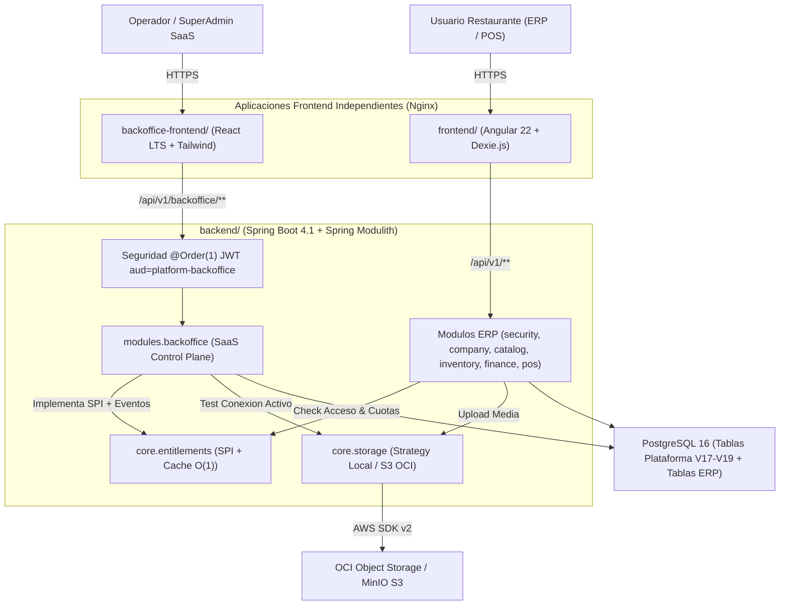
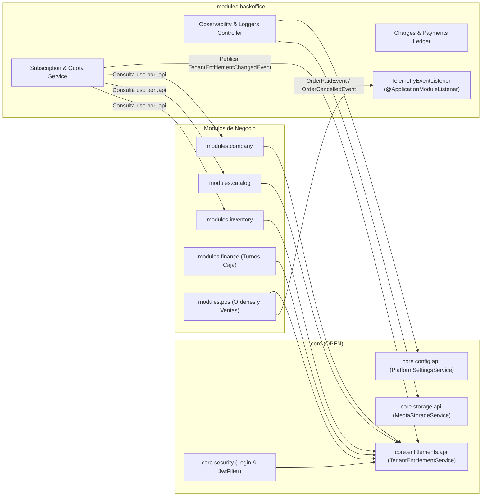

# C4 Contenedores y Componentes — Ecosistema Backoffice SaaS

> ⬅️ [Volver al Índice Backoffice](../README.md) | [Especificación Arquitectura](../sdd/01_backoffice_architecture.md)

## 1. Diagrama C4 Nivel 2 (Contenedores Separados)

---

## 2. Diagrama C4 Nivel 3 (Comunicación Event-Driven Spring Modulith)

