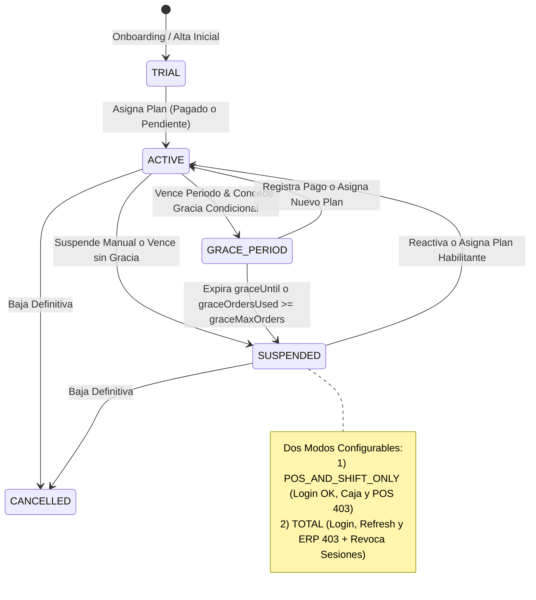
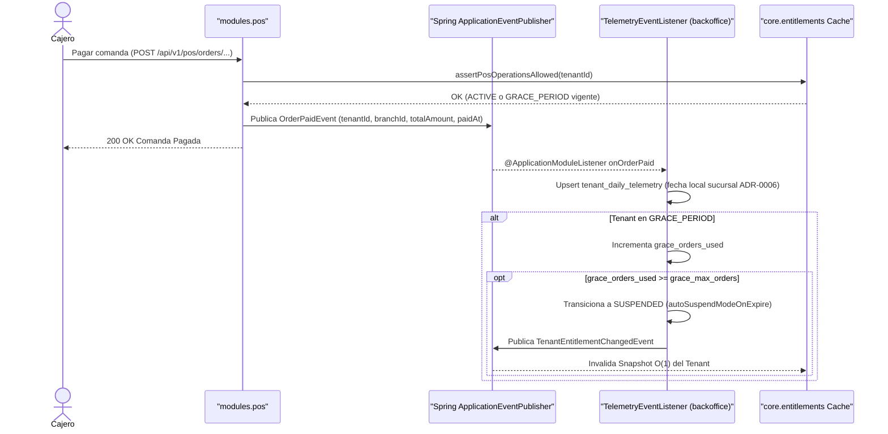
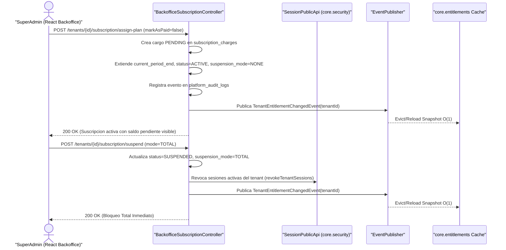

# Estados de Suscripción y Secuencias Event-Driven

> ⬅️ [Volver al Índice Backoffice](../README.md) | [ADR-0029](../../adr/0029_backoffice_subscriptions_quotas_and_telemetry.md)

## 1. Máquina de Estados de Suscripción y Modos de Bloqueo

---

## 2. Secuencia A — Venta POS, Proyección de Telemetría y Consumo de Gracia

---

## 3. Secuencia B — Asignación de Plan a Crédito, Suspensión y Reseteo de Caché

