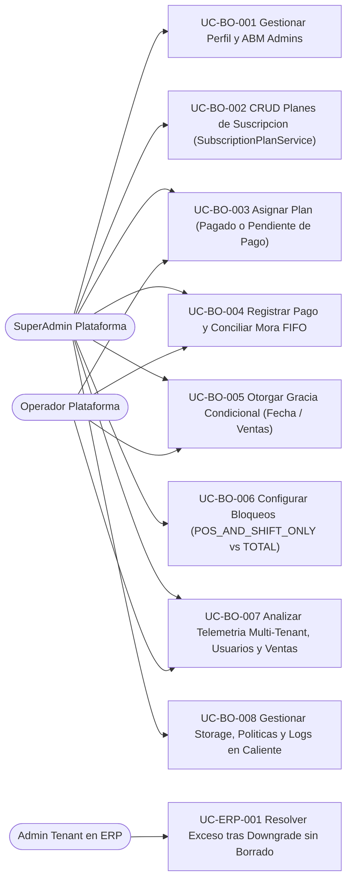

# Casos de Uso del Backoffice SaaS y Control de Cuotas

> ⬅️ [Volver al Índice Backoffice](../README.md) | [Contratos API](../sdd/02_backoffice_backend_api_spec.md)

## Resumen de Reglas Críticas por Caso
1. **`UC-BO-002` (`SubscriptionPlanService`):** Gestiona planes categorizados (`PUBLIC_ONBOARDING`, `TRIAL`, `CUSTOM_PRIVATE`) con soporte de vigencia ilimitada (`durationDays = 0`) y límites no negativos (`null` = ilimitado).
2. **`UC-BO-003` (`TenantSubscriptionService`):** Permite asignar cualquier plan marcado como pagado o `PENDING` (uso por adelantado), registrando el cargo en `subscription_charges` y habilitando la operación inmediata.
3. **`UC-BO-005` (Gracia Condicional):** Admite fecha tope (`graceUntil`) y/o tope de órdenes (`graceMaxOrders`); al cumplirse cualquiera de las condiciones (evaluado síncronamente por `BackofficeTelemetryListener`), aplica `autoSuspendModeOnExpire`.
4. **`UC-BO-008` (Storage & Observabilidad):** Prueba conectividad únicamente contra `storage.active_provider` vía `MediaStorageService.testActiveConnection()`; alterna loggers en caliente con trazabilidad en `platform_audit_logs`.
5. **`UC-ERP-001` (Downgrade No Destructivo):** Ante reducción de límites, el inquilino conserva sus registros y desactiva manualmente desde el ERP usuarios o sucursales (`is_active = false`) hasta quedar dentro de cuota (`TenantEntitlementService.getEntitlementView`).
