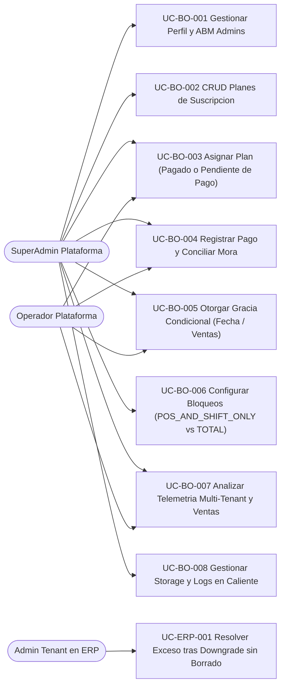

# Casos de Uso del Backoffice SaaS y Control de Cuotas

> ⬅️ [Volver al Índice Backoffice](../README.md) | [Contratos API](../sdd/02_backoffice_backend_api_spec.md)

## Resumen de Reglas Críticas por Caso
1. **`UC-BO-003` (Uso por Adelantado):** Permite asignar cualquier plan del catálogo (por ejemplo, plan semanal al vencer el mensual) marcado como `PENDING_PAYMENT`, habilitando de inmediato la operación mientras queda registrado el cargo exigible.
2. **`UC-BO-005` (Gracia Condicional):** Admite fecha tope (`graceUntil`) y/o tope de órdenes (`graceMaxOrders`); al cumplirse cualquiera de las condiciones, entra en vigor el modo de bloqueo configurado (`autoSuspendModeOnExpire`).
3. **`UC-BO-008` (Storage & Observabilidad):** Prueba conexión únicamente contra `storage.active_provider`; permite alternar loggers en caliente (`DEBUG`/`INFO`/`TRACE`) con trazabilidad en `platform_audit_logs`.
4. **`UC-ERP-001` (Downgrade No Destructivo):** Ante reducción de límites, el inquilino conserva todos sus registros y elige manualmente desde el ERP qué usuarios o sucursales desactivar (`is_active = false`) para quedar dentro de cuota y reabrir turnos POS.
