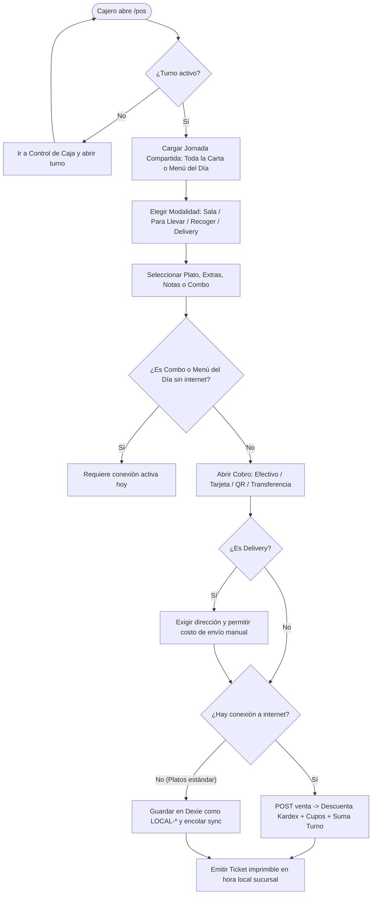

# 🧾 Flujo 1.1: Atención y Venta en Punto de Venta (POS)

> ⬅️ **Índice:** [Procesos de Negocio](../README.md) | [Manual Cajero POS](../../manuals/restaurante/03_manual_cajero_pos.md) | [Manual Menús del Día](../../manuals/restaurante/02_menus_del_dia_y_jornada_sucursal.md)

Describe el flujo de extremo a extremo de la venta operativa en **`Punto de Venta (POS)`** (`/pos`), incluyendo catálogo por sucursal, extras, combos dinámicos, Menús del Día compartidos, modalidades de atención, medios de pago, tickets y alcance real del modo offline.

---

## 1. Actores y Precondiciones

- **Actores:** Cajero (`CASHIER`), Administrador de Sucursal (`BRANCH_MANAGER`), Dueño (`ADMIN_TENANT`).
- **Precondiciones obligatorias:**
  1. **Turno de Caja Abierto** en la sucursal (`Control de Caja`, sujeto a `finance.shift_concurrency_mode`). Si el catálogo está vacío al abrir turno, el POS solicita doble confirmación antes de continuar.
  2. **Jornada de Servicio Activa** (`Toda la Carta` o plantilla de `Menú del Día` en `branch_service_sessions`). Con `finance.auto_open_full_catalog_session = true` *(default)*, abrir el primer turno inicia automáticamente `Toda la Carta`.
  3. **Suscripción Activa:** La empresa no debe estar bloqueada (`POS_AND_SHIFT_ONLY` o `TOTAL`).

---

## 2. Catálogo, Extras, Combos y Menús del Día

- **Aislamiento (`catalog.scope_mode`):** Por defecto opera en `BRANCH_ISOLATED` (cada sucursal gestiona sus platos, precios y fotos 4:3 en WebP). Permite `Clonar / Duplicar` dentro de la misma sucursal o hacia otra; la acción `Ajustar` (*override*) aplica únicamente a platos globales heredados sin `branchId` bajo `GLOBAL_SHARED`.
- **Categorías y SKUs:** Categorías con nombre, orden (`sortOrder`), selector de emoji y prefijo SKU para el asistente `Sugerir Código`.
- **Grupos de Extras/Complementos:** Pueden ser obligatorios u opcionales (`min`/`max` selecciones), con precio adicional opcional e insumo vinculado en Kardex (`SALE_CONSUMPTION`).
- **Combos (`Combos y Promos`):** Soportan ítems `FIXED` (plato fijo), `SPECIFIC_OPTIONS` (elección con ajuste `+/- Bs.`) y `MENU_COURSE` (tiempo dinámico del `Menú del Día`).
- **Menús del Día (`/catalog/menus`):** Plantillas multi-día (*V24*), modalidades *Venta Individual por Plato* vs *Paquete Fijo*, cupo numérico o `∞ Ilimitado` (`isUnlimited`), y control `Vender suelto en POS` (`Solo Combo` si está desmarcado).

---

## 3. Diagrama del Flujo Real de Venta en POS

---

## 4. Modalidades de Atención, Cobro y Ticket

1. **Modalidades reales disponibles:**
   - **En Sala (`DINE_IN`):** Atención presencial en local; cliente/mesa opcional.
   - **Para Llevar (`TAKEOUT`):** Despacho en mostrador; nombre de cliente opcional.
   - **Recoger (`PICKUP`):** Retiro programado por el cliente; nombre opcional.
   - **Delivery (`DELIVERY`):** Exige **dirección de entrega obligatoria** y permite ingresar el **costo de envío manual** en el checkout.
   - *Nota de implementación actual:* Los parámetros `pos.default_order_mode`, `pos.allow_scheduled_pickup`, `pos.delivery_fee_enabled` y `pos.delivery_fee_default` están catalogados en backend, pero la UI POS actualmente arranca siempre en `En Sala`, muestra siempre `Recoger` y mantiene `Costo de envío` editable manualmente desde `Bs. 0,00`.
2. **Medios de Pago y Calculadora de Efectivo:** Soporta **`Efectivo`**, **`Tarjeta`**, **`Pago QR`** y **`Transferencia`**. En efectivo ofrece accesos rápidos (`Exacto`, `+5`, `+10`, `+20`, `+50`, `+100`, `+200`) y calcula el vuelto en pantalla.
3. **Despacho a Cocina e Impresión:** Al confirmar la venta se habilita **`Imprimir Ticket`** con número de orden (o `LOCAL-*`), insignia de modalidad, extras, notas de cocina, datos de delivery, vuelto y fecha/hora local de la sucursal (`branches.timezone`). Hoy cocina opera con la comanda/ticket impreso.

---

## 5. Alcance Real del Modo Offline-First vs Roadmap Futuro

- **Disponible offline hoy (Dexie `app.database.ts`):**
  - Catálogo cacheado (`cachedCategories`, `cachedProducts`) con platos individuales y sus grupos de extras.
  - Referencia del turno abierto (`activeShift`) y cola idempotente (`pendingOrders` con prefijo `LOCAL-*`), sincronizada al recuperar conexión.
- **Requiere conexión activa hoy:**
  - Carga y venta de **Combos** y **Menús del Día (`shiftMenu`)**, ya que consumen endpoints HTTP directos para coordinar cupos compartidos por sucursal.
- **Fuera del alcance implementado hoy (previsto para futuras versiones):**
  - Pantalla digital **KDS en cocina** (la tabla base de roles conserva `KITCHEN` como etiqueta heredada).
  - Consola UI en catálogo para administrar promociones **Happy Hour** (solo existe motor backend interno).
  - Soporte offline para combos y Menús del Día.
  - Facturación electrónica tributaria con campos NIT en checkout y descuentos porcentuales arbitrarios por cajero.

---

## Relacionado

- [Flujo 1.2: UX Móvil POS y Conteo de Inventario](./02_flujo_atencion_movil_y_conteo_inventario.md)
- [Flujo 2.1: Jornada, Arqueo y Finanzas](../02-caja-y-finanzas/01_flujo_jornada_y_arqueo_caja.md)
- [Flujo 3.1: Insumos, Recetas y Kardex](../03-cocina-e-inventario/01_flujo_recetas_y_kardex.md)
- [Manual del Cajero POS](../../manuals/restaurante/03_manual_cajero_pos.md)
- [Arquitectura: Secuencia Offline Sync](../../project/architecture/04-behavior-and-flows/sequence_pos_offline_sync.md)
