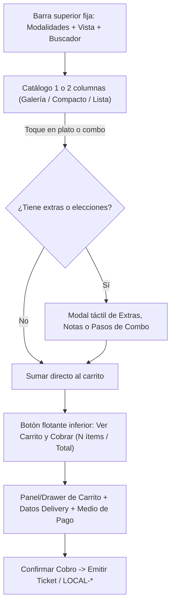

# 📱 Flujo 1.2: Operación Móvil en POS y Conteo Rápido de Inventario

> ⬅️ **Índice:** [Procesos de Negocio](../README.md) | [Flujo 1.1: Venta POS](./01_flujo_atencion_y_venta_pos.md) | [Manual Insumos y Kardex](../../manuals/restaurante/05_insumos_recetas_y_kardex.md)

Define el comportamiento operativo en pantallas móviles o tablets compactas (`< 768 px`) para dos flujos de alta frecuencia: toma y cobro de pedidos en **`Punto de Venta (POS)`** y conteo/ajuste rápido de existencias en **`Inventario y Kardex`**.

---

## 1. Venta Rápida en Móvil (`Punto de Venta (POS)`)

El diseño móvil evita tablas horizontales y separa la selección del catálogo respecto al panel de cobro:

### Reglas UX Móvil POS Reales
- **Selector de Modalidad siempre accesible:** `En Sala`, `Para Llevar`, `Recoger` y `Delivery` visibles sin abrir menús secundarios.
- **Vistas adaptables (`Galería`, `Compacto`, `Lista`):** La preferencia elegida por el operador persiste localmente en el dispositivo.
- **Cobro inmediato por pedido:** Cada pedido pasa por carrito y checkout en el acto (no existe flujo separado de "cuenta abierta por mesa / añadir rondas posteriores sin cobrar").
- **Teclado rápido en efectivo:** Botones táctiles `Exacto`, `+5`, `+10`, `+20`, `+50`, `+100`, `+200` optimizados para cálculo de vuelto con una mano.

---

## 2. Conteo y Ajuste Rápido en Móvil (`Inventario y Kardex`)

En dispositivos móviles (almacén, refrigerador o cocina), la vista tabular de **`Existencias Actuales`** cambia automáticamente a **tarjetas acordeón**:

- **Semáforo visual inmediato en borde lateral:**
  - Verde/normal: existencia saludable por encima del stock mínimo.
  - Ámbar/alerta: existencia menor o igual al `Stock Mínimo de Alerta`.
  - Rojo: existencia negativa (cuando `inventory.allow_negative_stock = true`).
- **Acordeón bajo demanda:** Al tocar la tarjeta de un insumo se despliegan su unidad, costo unitario promedio y los botones de acción directa:
  - **`Alta Stock Inicial` / `Cargar Stock Inicial`** *(si el insumo nunca tuvo stock inicial)*: incluye la calculadora bidireccional `Valor Total Pagado <-> Costo Unitario`.
  - **`Ajustar / Conteo`**: permite ingresar correcciones positivas o negativas tras conteo físico, reposición manual o registro de merma (`WASTE_ADJUSTMENT`), sin desplazamiento horizontal.
- **Auditoría en `Libro Mayor de Kardex`:** Permite consultar los movimientos reales (`INITIAL_STOCK`, `SALE_OUT`, `SALE_CONSUMPTION`, `PHYSICAL_COUNT_ADJUSTMENT`, `WASTE_ADJUSTMENT`, `CANCELLATION_REVERSAL`) formateados en el huso horario de la sucursal.

---

## Relacionado

- [Flujo 1.1: Atención y Venta en POS](./01_flujo_atencion_y_venta_pos.md)
- [Flujo 3.1: Recetas y Kardex](../03-cocina-e-inventario/01_flujo_recetas_y_kardex.md)
- [Manual del Cajero POS](../../manuals/restaurante/03_manual_cajero_pos.md)
- [Diagrama de Estados UX Móvil](../../project/architecture/04-behavior-and-flows/state_mobile_pos_and_inventory_ux.md)
