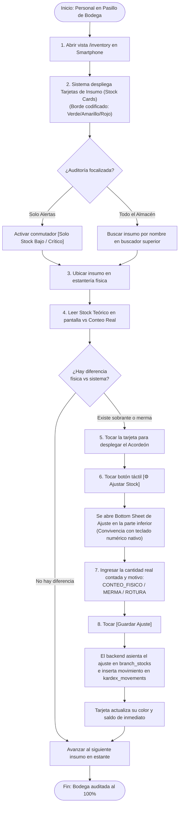

# Manual de Procesos Operativos: Operación Móvil Táctil (POS en Mesa y Conteo de Inventario)

Este manual documenta los procedimientos estandarizados (**Standard Operating Procedures - SOP**) para el personal de servicio en salón (garzones, meseros, cajeros volantes) y personal de almacén/cocina que operan el sistema Restaurante POS & ERP desde teléfonos móviles y terminales portátiles Android/iOS (`< 768px`), en conformidad con **ADR-0012** y **PB-028**.

---

## 1. Proceso Operativo: Toma de Comandas y Cobro Móvil en Mesa (POS)

```mermaid
flowchart TD
    Inicio([Inicio: Garzón se acerca a la Mesa]) --> AbrirPOS["1. Abrir POS en Smartphone<br/>(Verifica conexión o modo Offline)"]
    AbrirPOS --> SeleccionarModoVista{"¿Preferencia de Vista?"}
    
    SeleccionarModoVista -->|Menú Visual con Fotos| VistaCuadricula["Modo Cuadrícula Táctil<br/>(2 columnas, badges de precio)"]
    SeleccionarModoVista -->|Despacho Rápido de Texto| VistaLista["Modo Lista Compacta<br/>(Fila de 1 toque, botón + grande)"]
    
    VistaCuadricula --> SeleccionarCategoria["2. Deslizar píldoras de categorías<br/>(Bebidas, Platos Fuertes, Postres)"]
    VistaLista --> SeleccionarCategoria
    
    SeleccionarCategoria --> AgregarPlatos["3. Tocar plato o botón [+]<br/>(Se suma a signals reactivos)"]
    
    AgregarPlatos --> RequiereModificadores{"¿Plato con extras<br/>o grupos de cocción?"}
    RequiereModificadores -->|Sí| AbrirModificadoresSheet["Despliega Bottom Sheet de Modificadores<br/>(Término carne, guarnición, aderezos)"]
    AbrirModificadoresSheet --> ConfirmarExtras["Tocar [Confirmar Extras]"]
    ConfirmarExtras --> ActualizarBarra
    RequiereModificadores -->|No| ActualizarBarra["4. Barra Inferior Flotante Activa<br/>🛒 3 Ítems | Total: Bs. 85.00"]
    
    ActualizarBarra --> MasPlatos{"¿Comensal desea más platos?"}
    MasPlatos -->|Sí| AgregarPlatos
    MasPlatos -->|No| AbrirComanda["5. Tocar o deslizar hacia arriba la Barra<br/>[VER COMANDA / COBRAR ⬆]"]
    
    AbrirComanda --> RevisarComanda["6. Inspeccionar Hoja Inferior (Bottom Sheet)<br/>(Verificar cantidades, notas de cocina)"]
    RevisarComanda --> DeseaCobrar{"¿Cobro inmediato en mesa?"}
    
    DeseaCobrar -->|Sí| ProcederCobro["7. Tocar [💰 Proceder al Cobro]"]
    ProcederCobro --> SeleccionarMedio["Seleccionar Medio de Pago:<br/>Efectivo / QR Rápido / Tarjeta"]
    SeleccionarMedio --> NumpadEfectivo["Si es Efectivo: Digitar monto en Numpad táctil<br/>(Sistema computa vuelto al instante)"]
    NumpadEfectivo --> ConfirmarPago["8. Tocar [✅ Confirmar Pago]"]
    ConfirmarPago --> GuardarDexie["Persiste en Dexie.js con client_transaction_id<br/>Sincroniza online o encola offline"]
    GuardarDexie --> FinVenta([Fin: Comanda despachada a cocina y cobrada])
    
    DeseaCobrar -->|No, solo comanda abierta| CerrarSheet["Deslizar hoja hacia abajo<br/>(Comanda permanece guardada)"]
    CerrarSheet --> FinVenta
```

### Reglas de Oro para el Garzón en Salón:
1. **Atención con una sola mano:** La barra inferior pegajosa (`Floating Bottom Bar`) está diseñada para alcanzarse con el dedo pulgar. No es necesario utilizar ambas manos para consultar el total acumulado.
2. **Respaldo sin Internet:** Si la señal Wi-Fi del salón se debilita en esquinas o terrazas, el sistema conmuta automáticamente al **Modo Offline**. El pedido se guarda localmente en el teléfono y se sincronizará tan pronto el garzón regrese al rango de cobertura.
3. **Modificadores Obligatorios:** Los platos con acompañamiento requerido desplegarán automáticamente la hoja inferior para evitar enviar a cocina un pedido incompleto.

---

## 2. Proceso Operativo: Conteo Físico y Levantamiento de Stock en Bodega

### Reglas de Oro para el Encargado de Almacén:
1. **Cero Scroll Horizontal:** En teléfonos móviles no se utilizan tablas de cálculo extensas. Cada insumo es una tarjeta autosuficiente que se expande al toque.
2. **Alertas Visuales Inmediatas:**
   - **Borde Rojo:** Existencia en cero o negativa (urgencia crítica de compra).
   - **Borde Amarillo:** Existencia por debajo o igual al umbral mínimo configurado.
   - **Borde Verde:** Stock saludable.
3. **Firmado Digital del Ajuste:** Todo recuento asentado desde el móvil queda atribuido al usuario logueado en la sesión activa, garantizando auditoría contable estricta en el Libro Mayor de Kardex.
