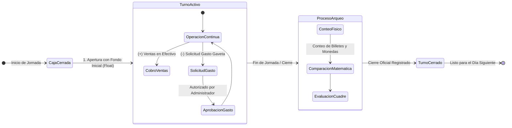
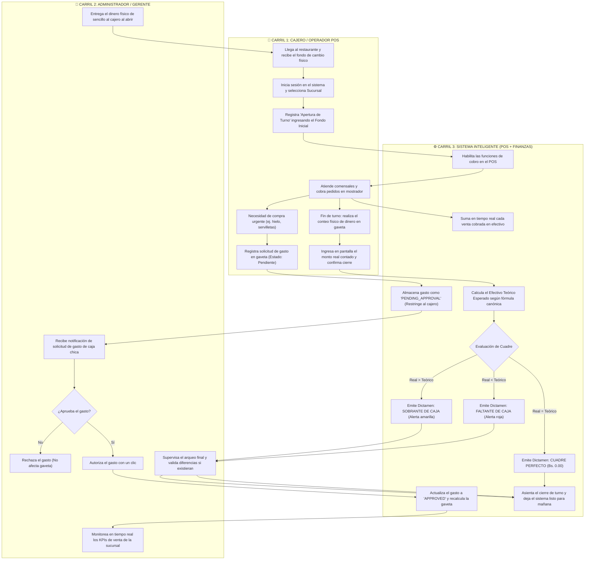
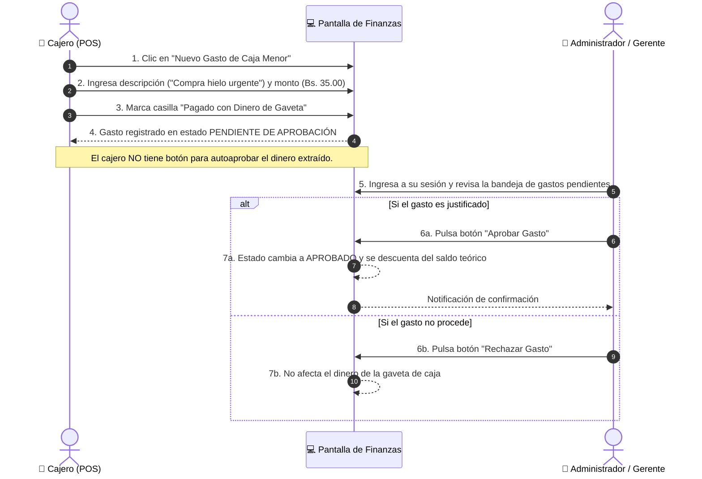

# 🏪 Manual Operativo: Flujo de Jornada, Control de Efectivo y Arqueo de Caja

> **Documento de Proceso de Negocio y Manual de Operaciones**  
> **Destinatarios:** Propietarios, Franquiciados, Gerentes de Sucursal, Supervisores de Turno, Cajeros y Personal de Auditoría.  
> **Objetivo:** Establecer el procedimiento estándar para la custodia, operación, egresos menores y conciliación matemática del dinero en efectivo durante la jornada diaria del restaurante.

---

## 🎯 1. Visión Ejecutiva y Propuesta de Valor

En la operación gastronómica moderna, el dinero en efectivo representa uno de los puntos más vulnerables a pérdidas invisibles, descuidos de cambio o descontrol en compras de emergencia. 

Este sistema proporciona un **mecanismo de blindaje financiero de doble vía**:
1. **Segregación de Roles:** Quien opera el dinero (Cajero) no puede autorizar gastos para sí mismo; toda salida de efectivo de la gaveta exige la validación de un superior (Administrador/Gerente).
2. **Conciliación Matemática en Tiempo Real:** El sistema calcula segundo a segundo cuánto dinero debe haber físicamente en la gaveta, evitando sorpresas al final del día.
3. **Cierre Transparente e Inalterable:** Una vez asentado el arqueo, el reporte queda congelado para efectos de auditoría contable.

---

## 🗺️ 2. Mapa Global del Procedimiento (Carriles de Responsabilidad)

El siguiente diagrama detalla la interacción paso a paso entre los actores humanos y el sistema a lo largo del día:

---

## 📖 3. Guía Paso a Paso de las Fases del Proceso

### 🌅 Fase 1: Apertura de Turno (Inicio del Día)
Antes de atender al primer cliente, la caja debe estar formalmente abierta en el sistema.

1. **Recepción del Fondo:** El Gerente entrega al Cajero una cantidad determinada de dinero en efectivo fraccionado (billetes chicos y monedas), conocido como **Fondo de Caja** o *Float*.
2. **Registro en Pantalla:** El Cajero ingresa a la sección **Finanzas y Caja Chica** y pulsa el botón **Abrir Turno**.
3. **Ingreso del Monto Base:** Digita el valor exacto recibido (ejemplo: `Bs. 200.00`).
4. **Activación:** Al confirmar, el sistema registra la fecha, la hora exacta local y el nombre del cajero responsable, desbloqueando inmediatamente el módulo de Punto de Venta (POS) para iniciar ventas.

> [!TIP] **Mejor Práctica Operativa**  
> El monto del fondo inicial debe ser fijo y acordado por política del restaurante (por ejemplo, exactamente Bs. 200.00 al inicio de cada jornada) para simplificar la reposición diaria.

---

### 🍔 Fase 2: Operación Comercial (Atención y Cobros en Mostrador)
Durante el servicio de almuerzo o cena, la caja opera con fluidez:

1. **Ventas en Efectivo:** Cada vez que un comensal paga en efectivo, el sistema acumula el importe cobrado directamente en el acumulador del turno activo.
2. **Otros Medios de Pago:** Los cobros efectuados mediante Tarjeta de Débito/Crédito o Código QR quedan registrados contablemente como ventas de la sucursal, pero **no suman a la gaveta física de efectivo**.
3. **Visibilidad en Vivo:** El Administrador puede consultar desde su teléfono o panel web el total de ventas acumuladas sin necesidad de interrumpir la labor del cajero.

---

### 🧾 Fase 3: Circuito de Gastos Menores y Control de Caja Chica
En todo restaurante surgen imprevistos (se acabó el hielo, se requiere comprar verduras de emergencia en el mercado cercano o pagar un flete urgente). Para estos casos, el sistema cuenta con un circuito de **doble control anti-fraude**:

> [!IMPORTANT] **Regla de Oro en Egresos**  
> Un cajero **nunca** puede autorizar una salida de dinero registrada por él mismo. Si un gasto no es aprobado por el Administrador antes del cierre de turno, el sistema asumirá que el dinero debe permanecer intacto en la gaveta, generando un faltante si el cajero ya lo desembolsó.

---

### 🌙 Fase 4: Arqueo y Conteo Físico (Fin de la Jornada)
Al concluir el turno de atención, se procede al arqueo de caja con el siguiente protocolo:

1. **Aislamiento de la Gaveta:** El cajero bloquea la entrada de nuevos pedidos en el POS.
2. **Conteo a Ciegas o Físico:** El cajero extrae el dinero físico de la gaveta y clasifica ordenadamente los billetes y monedas sobre el mostrador, calculando la suma total real en mano.
3. **Apertura de la Ventana de Arqueo:** En el sistema, se hace clic en **Arqueo y Cierre de Caja**.
4. **Comparación Automática:** El sistema presenta el desglose matemático:

$$\begin{aligned}
& \text{Fondo Inicial de Caja} & \text{Bs. } 200.00 \\
+ & \text{Total Ventas en Efectivo del Turno} & \text{Bs. } 850.00 \\
- & \text{Total Gastos de Gaveta Aprobados} & \text{Bs. } 80.00 \\
\hline
= & \mathbf{\text{Efectivo Teórico Esperado en Gaveta}} & \mathbf{\text{Bs. } 970.00}
\end{aligned}$$

5. **Registro del Conteo Real:** El cajero ingresa en el campo **Efectivo Real Contado en Gaveta** la cantidad física que tiene en sus manos (ejemplo: `970.00`).

---

### ⚖️ Fase 5: Dictamen de Conciliación y Resultados Posibles

El sistema evalúa de forma dinámica la diferencia entre lo que debería haber y lo que realmente hay:

$$\text{Diferencia de Arqueo} = \text{Efectivo Real Contado} - \text{Efectivo Teórico Esperado}$$

| Escenario | Condición Matemática | Visualización en Pantalla | Significado Operativo y Acción Requerida |
|---|:---:|:---:|---|
| **Cuadre Perfecto** | $\text{Diferencia} = 0.00$ | 🟢 **Cuadre Exacto (Bs. 0.00)** | El dinero físico coincide exactamente con cada centavo de venta y gasto. No se requiere justificación. |
| **Faltante de Caja** | $\text{Diferencia} < 0.00$ | 🔴 **Faltante (Ej: -Bs. 25.00)** | Falta dinero físico en la gaveta. Puede deberse a un cambio mal entregado o a un gasto pagado que no fue registrado. El cajero debe justificar la diferencia ante el administrador. |
| **Sobrante de Caja** | $\text{Diferencia} > 0.00$ | 🟡 **Sobrante (Ej: +Bs. 15.00)** | Hay más dinero en la gaveta del que reporta el sistema. Puede indicar una venta que no se digitó o un cambio cobrado de más al cliente. Queda asentado como excedente. |

---

### 🔒 Fase 6: Cierre Oficial y Auditoría

1. **Confirmación:** Al pulsar **Confirmar y Cerrar Turno**, el sistema estampa la hora exacta de cierre, el identificador del usuario que cerró y los valores finales de conciliación.
2. **Inalterabilidad:** El turno pasa a estado **Cerrado (`CLOSED`)**. Ningún usuario, ni siquiera el administrador, puede alterar los números de un turno cerrado.
3. **Preparación del Nuevo Día:** La pantalla regresa a su estado en reposo, mostrando el mensaje:
   > *"No hay un turno de caja abierto actualmente en esta sucursal."*  
   > *(Con el botón verde de "Apertura de Turno" listo para el turno de la mañana siguiente).*

---

## ❓ 4. Preguntas Frecuentes y Políticas de Operación (FAQ)

### ¿Qué sucede con las ventas pagadas por QR o Tarjeta?
El sistema las computa en el reporte de facturación e ingresos brutos del restaurante, pero **las excluye de la fórmula de la gaveta física**. De esta forma, el cajero solo responde por los billetes y monedas que realmente entraron a su caja.

### ¿Qué pasa si se corta la conexión a Internet a la hora del arqueo?
Gracias a la arquitectura local integrada (*Dexie.js Offline-First*), todas las ventas realizadas durante la caída de red ya se encuentran guardadas localmente en la terminal de caja. El saldo teórico incluye todas las ventas locales y el arqueo puede completarse con total precisión.

### ¿Se pueden abrir dos turnos simultáneos en la misma caja?
No. Cada sucursal opera bajo la política de un único turno activo a la vez para evitar confusiones de gaveta entre turnos de mañana y noche. Para abrir el turno de la tarde/noche, el turno de la mañana debe estar cerrado con su respectivo arqueo asentado.

### ¿Cómo retira el dueño del restaurante la ganancia del día?
Una vez cerrado el turno:
1. Se separa el monto acordado para el Fondo Inicial del día siguiente (ej. Bs. 200.00).
2. El remanente (las ventas netas del día en efectivo) se deposita en la caja fuerte o se entrega bajo recibo al administrador para su depósito bancario.

---

## 📋 5. Ficha Resumen de Parámetros y Buenas Prácticas

| Elemento | Recomendación Estándar | Beneficio de Negocio |
|---|---|---|
| **Fondo Inicial Típico** | Bs. 150.00 a Bs. 300.00 en denominaciones de Bs. 10, 20 y monedas | Evita el rechazo de ventas tempranas por falta de cambio. |
| **Tope de Gasto Menor** | Máximo Bs. 100.00 por recibo de gaveta | Compras mayores deben canalizarse por transferencia bancaria administrativa. |
| **Comprobantes Físicos** | Toda salida de dinero de gaveta debe adjuntar recibo o factura engrapada | Auditoría física cruzada contra el reporte digital del sistema. |
| **Tiempo de Arqueo** | Máximo 10 minutos al concluir la atención | Evita fatiga en el cajero y garantiza un conteo confiable de billetes. |
