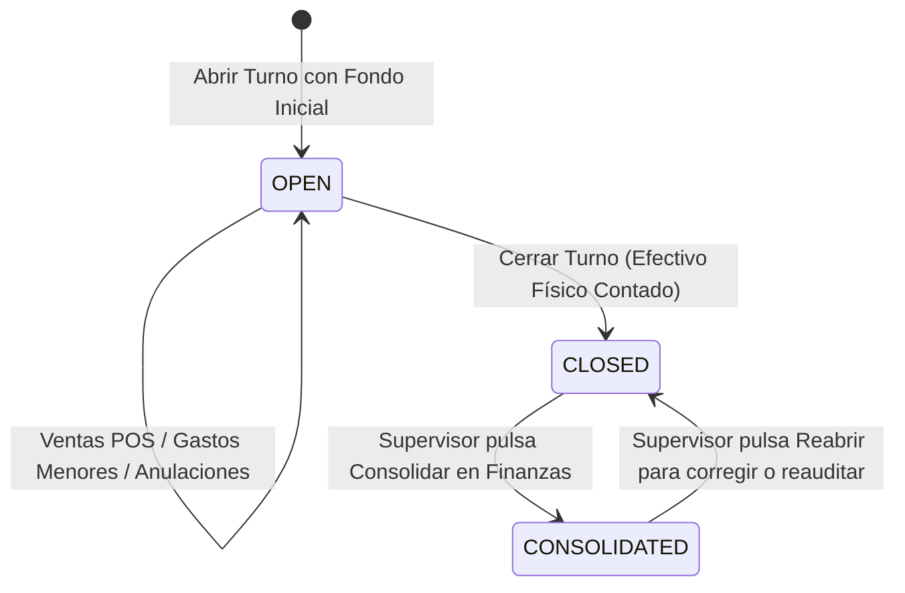

# 💰 Flujo 2.1: Jornada de Caja, Arqueo y Auditoría Financiera

> ⬅️ **Índice:** [Procesos de Negocio](../README.md) | [Manual Control de Caja](../../manuals/restaurante/04_control_de_caja_gastos_y_arqueo.md) | [Manual del Dueño](../../manuals/restaurante/06_dueno_finanzas_personal_y_reglas.md)

Detalla el ciclo completo de turnos de caja, separando la **operación en vivo** en **`Control de Caja`** (`/cash-control`) de la **auditoría histórica y consolidación** en **`Finanzas y Arqueos`** (`/finance`).

---

## 1. Separación Operativa: `/cash-control` vs `/finance`

| Aspecto | `Control de Caja` (`/cash-control`) | `Finanzas y Arqueos` (`/finance`) |
| :--- | :--- | :--- |
| **Propósito** | Operación del turno activo en curso. | Auditoría histórica multi-turno y consolidación contable. |
| **Usuario principal** | Cajero y Supervisor de Turno. | Dueño (`ADMIN_TENANT`) y Encargado/Contador. |
| **Acciones clave** | Abrir turno, ver comandas, anular pedidos, registrar gastos menores, aprobar/rechazar autorizaciones, cerrar/arquear turno. | Filtrar por fecha (`Hoy`, `Esta Semana`, `Este Mes`, rango), sucursal, cajero y estado; `Ver Detalle`, `Consolidar`, `Reabrir` y exportar `.csv`. |

---

## 2. Políticas Configurables de Apertura y Concurrencia

Al intentar abrir turno en una sucursal, el backend aplica tres reglas de `Parámetros del Sistema`:

1. **Quién puede abrir (`finance.shift_opening_policy`):**
   - `ALL_AUTHORIZED`: cajeros y supervisores habilitados.
   - `SUPERVISOR_ONLY`: restringido a roles supervisores/gerencia.
2. **Concurrencia de cajas (`finance.shift_concurrency_mode`):**
   - `SINGLE_PER_BRANCH` *(default)*: máximo un turno `OPEN` compartido en la sucursal.
   - `INDIVIDUAL_PER_CASHIER`: múltiples cajeros pueden tener cada uno su propio turno `OPEN` simultáneo en la misma sucursal (con selector de turno activo en `/cash-control`).
3. **Jornada de Menú automática (`finance.auto_open_full_catalog_session`):**
   - Si es `true` *(default)* y la sucursal aún no tiene sesión de servicio del día, abrir el primer turno habilita automáticamente **`Toda la Carta`**.

---

## 3. Ciclo de Vida del Turno y Fórmula Exacta de Arqueo

### Cálculo Contable del Efectivo Esperado en Cajón
El sistema calcula el saldo esperado en efectivo descontando explícitamente egresos aprobados y devoluciones en efectivo por pedidos anulados:

$$\text{Efectivo Esperado} = \text{Fondo Inicial} + \text{Ventas Efectivo} - \text{Gastos Efectivo Aprobados} - \text{Devoluciones Efectivo}$$

- **Comportamiento del formulario de cierre en UI:** El modal de cierre muestra el valor calculado y **precarga `Efectivo Físico Contado` con ese monto esperado** como referencia numérica; el cajero debe verificar y editar el monto al valor real contado en billetes y monedas. Si existe variación, se registra como **Sobrante** o **Faltante** junto con notas de cierre.
- **Control de zona horaria (`ADR-0006`):** Las consultas diarias y cortes por fecha respetan la zona horaria local de la sucursal (`branches.timezone`, por defecto `America/La_Paz`).

---

## 4. Auditoría Histórica y Exportación (`/finance`)

Desde **`Finanzas y Arqueos`**:
- El administrador consulta turnos cerrados/consolidados de una o todas las sucursales.
- **`Ver Detalle`** muestra desglose de ventas por método (`CASH`, `CARD`, `QR`, `TRANSFER`), lista de gastos, anulaciones ejecutadas y arqueo de caja.
- **`Consolidar`** sella el turno (`CONSOLIDATED`); **`Reabrir`** permite devolverlo a estado cerrado (`CLOSED`) en caso de auditoría correctiva.
- Exportación directa a **CSV** (resumen de turnos y detalle por turno).

---

## Relacionado

- [Flujo 2.2: Gastos Menores, Anulaciones y Autorizaciones](./02_flujo_gastos_y_autorizaciones.md)
- [Flujo 1.1: Atención y Venta POS](../01-pos-y-atencion/01_flujo_atencion_y_venta_pos.md)
- [Manual Control de Caja, Gastos y Arqueo](../../manuals/restaurante/04_control_de_caja_gastos_y_arqueo.md)
- [Diagrama de Estados de Turno y Gastos](../../project/architecture/04-behavior-and-flows/state_shift_and_expense_workflow.md)
