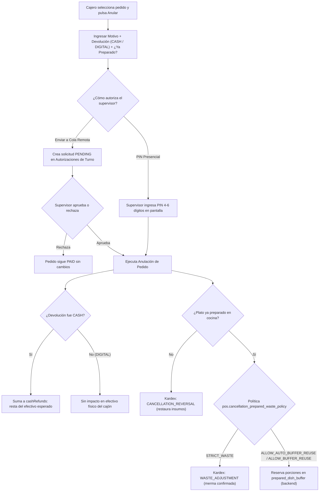

# 🛡️ Flujo 2.2: Gastos Menores, Anulaciones y Autorizaciones

> ⬅️ **Índice:** [Procesos de Negocio](../README.md) | [Flujo 2.1: Jornada y Arqueo](./01_flujo_jornada_y_arqueo_caja.md) | [Manual Control de Caja](../../manuals/restaurante/04_control_de_caja_gastos_y_arqueo.md)

Regula los dos flujos sensibles dentro de un turno activo en **`Control de Caja`** (`/cash-control`): registro y aprobación de **gastos menores**, y **anulación de pedidos pagados** con autorización presencial o remota.

---

## 1. Gastos Menores de Caja Chica (`Gastos de Caja Menor`)

1. **Registro:** El operador indica descripción, categoría, monto, si sale del cajón (`paidFromCashDrawer = true`) o fondo externo, y opcionalmente escribe una referencia en **`URL / Comprobante de Evidencia (Opcional)`**.
   - *Nota real de la versión actual:* El formulario admite enlace o texto de referencia; no incluye captura/subida binaria de foto desde cámara en gastos.
2. **Tope de Caja Chica (`finance.max_petty_cash_expense`):** Cuando `paidFromCashDrawer = true`, el sistema valida el tope máximo permitido por gasto (por defecto `Bs. 100,00`).
3. **Control Dual vs Auto-Aprobación:**
   - Si el usuario tiene rol **`ADMIN_TENANT`**, sus propios gastos se registran directamente como `APPROVED`.
   - Para cajeros u otros roles, si `finance.expense_allow_self_approval = false` *(default)*, el gasto queda en estado `PENDING` hasta que un supervisor lo apruebe o rechace en la pestaña **`Autorizaciones de Turno`**.
   - Únicamente los gastos `APPROVED` con `paidFromCashDrawer = true` se restan del efectivo esperado al cerrar el turno.

---

## 2. Anulación de Pedidos (`Comandas y Ventas del Turno`)

Toda anulación de un pedido pagado durante el turno exige autorización de supervisor (por regla operativa vigente en backend) mediante **PIN presencial** o **cola de aprobación remota**:

### Detalles Operativos Clave
- **Configuración de PIN de Supervisor:** Cada supervisor define su PIN numérico de 4 a 6 dígitos desde su propio **`Mi Perfil`** (`/profile`).
- **Reserva de Platos Preparados (`prepared_dish_buffer`):** Bajo `ALLOW_AUTO_BUFFER_REUSE` *(default)* o `ALLOW_BUFFER_REUSE`, las porciones anuladas ya cocinadas se reservan internamente en base de datos para reasignación; la consola visual dedicada para listar/gestionar ese buffer está prevista para futuras versiones, mientras que bajo `STRICT_WASTE` el registro de merma `WASTE_ADJUSTMENT` queda visible de inmediato en el Kardex.

---

## Relacionado

- [Flujo 2.1: Jornada de Caja y Arqueo](./01_flujo_jornada_y_arqueo_caja.md)
- [Flujo 3.1: Recetas y Kardex](../03-cocina-e-inventario/01_flujo_recetas_y_kardex.md)
- [Flujo 4.4: Sesiones y Seguridad](../04-administracion-y-personal/04_flujo_ciclo_vida_sesiones_y_seguridad.md)
- [Secuencia de Anulaciones y Autorizaciones](../../project/architecture/04-behavior-and-flows/sequence_pos_order_cancellation_and_authorizations.md)
- [Estados del Pedido POS](../../project/architecture/04-behavior-and-flows/state_order_lifecycle.md)
