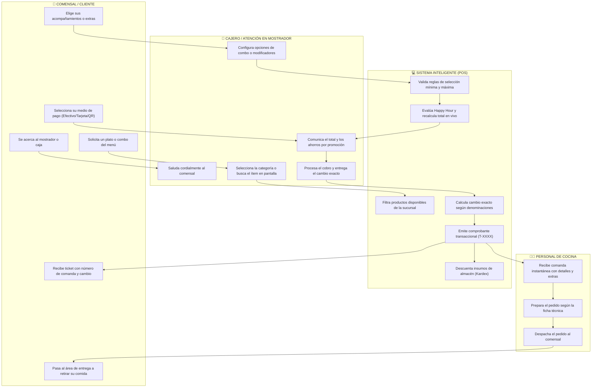
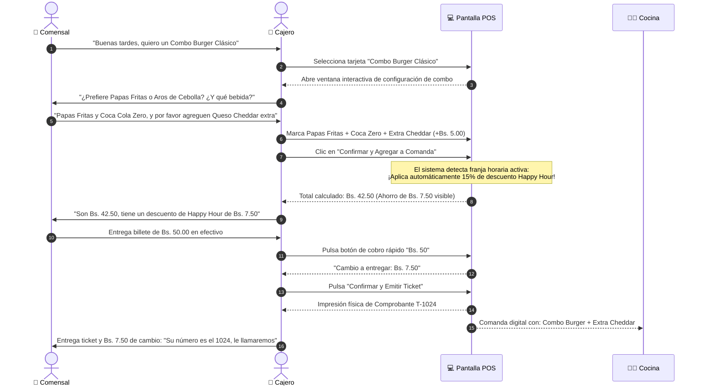
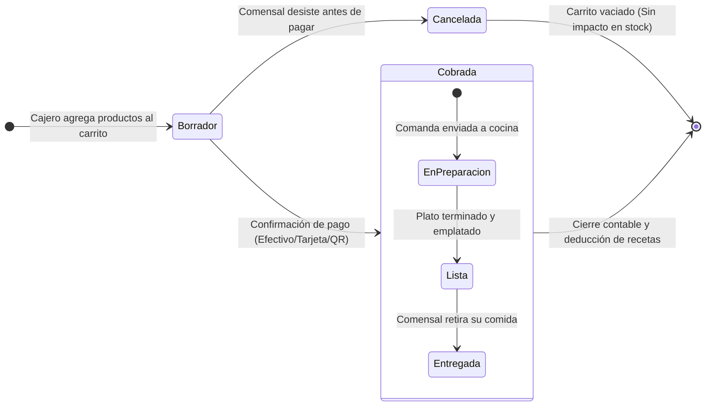

# 🍔 Manual Operativo: Protocolo de Mostrador, Combos y Venta en Punto de Venta (POS)

> **Documento de Proceso de Negocio y Manual de Operaciones**  
> **Destinatarios:** Propietarios, Franquiciados, Gerentes de Sucursal, Supervisores de Mostrador, Cajeros y Personal de Salón/Cocina.  
> **Objetivo:** Definir el procedimiento estándar de atención al comensal en mostrador, personalización de pedidos con combos y extras, aplicación automática de promociones y cobro multiformato continuo.

---

## 📑 Índice de Navegación Rápida
- [1. Visión Ejecutiva y Propuesta de Valor Comercial](#-1-visión-ejecutiva-y-propuesta-de-valor-comercial)
- [2. Mapa Global del Procedimiento de Mostrador (Carriles de Actores)](#️-2-mapa-global-del-procedimiento-de-mostrador-carriles-de-actores)
- [3. Diálogo y Secuencia de Atención al Cliente](#-3-diálogo-y-secuencia-de-atención-al-cliente)
- [4. Ciclo de Vida de la Comanda](#-4-ciclo-de-vida-de-la-comanda)
- [5. Guía Operativa Paso a Paso](#-5-guía-operativa-paso-a-paso)
  - [Fase 1: Búsqueda y Navegación Ágil de la Carta](#fase-1-búsqueda-y-navegación-ágil-de-la-carta)
  - [Fase 2: Armado y Elección de Combos Gastronómicos](#fase-2-armado-y-elección-de-combos-gastronómicos-packs)
  - [Fase 3: Personalización con Modificadores y Extras](#fase-3-personalización-con-modificadores-y-extras)
  - [Fase 4: Motor de Promociones y Descuentos Automáticos](#fase-4-motor-de-promociones-y-descuentos-automáticos-happy-hour)
  - [Fase 5: Checkout y Cobro Multiformato](#fase-5-checkout-y-cobro-multiformato)
  - [Fase 6: Emisión de Ticket y Despacho a Cocina](#fase-6-emisión-de-ticket-y-despacho-a-cocina)
  - [Fase 7: Resiliencia Offline (Venta Continua sin Internet)](#fase-7-resiliencia-offline-venta-continua-sin-internet)
- [6. Preguntas Frecuentes de Mostrador (FAQ)](#-6-preguntas-frecuentes-de-mostrador-faq)
- [7. Ficha de Estándares de Servicio y Métricas Clave](#-7-ficha-de-estándares-de-servicio-y-métricas-clave)

---

## 🎯 1. Visión Ejecutiva y Propuesta de Valor Comercial

La experiencia en el mostrador del restaurante define tanto la percepción del comensal como la rentabilidad del negocio. Un sistema POS lento o engorroso genera filas largas, pérdida de clientes en horas pico y errores costosos en las órdenes que llegan a cocina.

Este módulo de Punto de Venta ofrece **cuatro pilares de eficiencia comercial**:
1. **Incremento del Ticket Promedio (Upselling Guiado):** La interfaz sugiere activamente modificadores con cargo extra (ej. extra queso, doble carne, tocino crocante) y combos familiares en el momento exacto en que se toma la orden.
2. **Cero Errores de Comunicación con Cocina:** Las variantes obligatorias (ej. término de carne) y las preferencias del cliente (ej. *"sin cebolla"*) quedan estampadas de forma nítida en el ticket y pantalla de cocina.
3. **Precios y Ofertas Dinámicas Inteligentes:** Las promociones (*Happy Hour*) se activan y desactivan solas según la hora y día del restaurante, evitando que el cajero deba recordar memorizar descuentos o cometa equivocaciones en caja.
4. **Resiliencia Operativa Absoluta (Offline-First):** Si el proveedor de internet falla o la red se interrumpe, **la caja no se congela**. La venta se procesa en milisegundos, el cliente paga, recibe su ticket y la comanda pasa a preparación; el sistema sincroniza todo en segundo plano cuando la red regresa.

---

## 🗺️ 2. Mapa Global del Procedimiento de Mostrador (Carriles de Actores)

---

## 💬 3. Diálogo y Secuencia de Atención al Cliente

El siguiente diagrama ilustra la conversación natural entre el comensal y el cajero en caja:

---

## 🔄 4. Ciclo de Vida de la Comanda

---

## 📖 5. Guía Operativa Paso a Paso

### 🔍 Fase 1: Búsqueda y Navegación Ágil de la Carta
En horas de alta demanda, la velocidad en encontrar el plato solicitado es fundamental:
- **Pestañas de Categoría:** En la parte superior de la pantalla, el cajero puede alternar en un clic entre *Todo*, *Hamburguesas*, *Bebidas*, *Combos* o *Postres*.
- **Barra de Búsqueda Instantánea:** Al escribir dos letras (ej. *"cl"*), el catálogo filtra en tiempo real mostrando *"Hamburguesa Clásica"*.
- **Tarjetas Visuales:** Cada producto muestra su fotografía, nombre, precio base y etiquetas promocionales destacadas.

---

### 📦 Fase 2: Armado y Elección de Combos Gastronómicos (*Packs*)
Los combos representan paquetes con precio preferencial que requieren que el cliente elija sus alternativas:
1. Al tocar un combo, el sistema abre la ventana **"Personalizar Combo"**.
2. **Componentes con Elección:** Si el combo incluye una guarnición, el sistema muestra las opciones configuradas (ej. *Papas Rústicas*, *Aros de Cebolla*, *Papas Fritas*).
3. **Validación de Integridad:** El cajero no puede confirmar el combo hasta que el cliente haya elegido todas las opciones obligatorias, garantizando que cocina nunca reciba una orden a medias.

---

### 🧀 Fase 3: Personalización con Modificadores y Extras
Cuando un cliente desea enriquecer su plato o adaptarlo a sus preferencias:
1. Al seleccionar un plato con modificadores configurados, se despliega la ventana **"Personalizar Plato"**.
2. **Grupos de Modificadores:**
   - **Término de Cocción (Obligatorio, Mín 1 - Máx 1):** *Término Medio*, *Tres Cuartos*, *Bien Cocido*.
   - **Ingredientes Extra (Opcional con Costo):** *Queso Cheddar (+Bs. 5.00)*, *Carne Extra (+Bs. 10.00)*, *Tocino Crocante (+Bs. 6.00)*.
   - **Exclusiones:** *Sin Cebolla*, *Sin Mayonesa*, *Salsa Aparte*.
3. **Cálculo Reactivo:** Conforme el cajero marca o desmarca extras, el subtotal del plato se actualiza en pantalla en tiempo real antes de ir al carrito.

---

### ⏰ Fase 4: Motor de Promociones y Descuentos Automáticos (*Happy Hour*)
El restaurante puede incentivar ventas en horarios específicos (ej. de 15:00 a 18:00 de lunes a jueves):
- **Detección Automática:** El sistema evalúa el reloj interno de la sucursal. Si la hora y el día coinciden con una promoción vigente, el producto luce un **Badge visual verde de "Happy Hour"**.
- **Desglose Transparente:** En el carrito de comanda, el cliente ve claramente el precio regular tachado y el descuento aplicado en color verde o rojo (ej. *-15% descuento = -Bs. 5.25*).
- **Cero Arbitrariedad:** El cajero no tiene que calcular nada a mano ni aplicar códigos complicados.

---

### 💳 Fase 5: Checkout y Cobro Multiformato
Al presionar el botón azul **"Cobrar Pedido"**, se abre el panel de cobro:
1. **Cobro en Efectivo:**
   - **Botón "Exacto":** Si el cliente entrega la cifra justa, un clic liquida el pago.
   - **Atajos de Billetes Rápidos:** Botones rápidos de denominaciones comunes (Bs. 20, Bs. 50, Bs. 100, Bs. 200).
   - **Cálculo de Cambio:** El sistema muestra en letras grandes el cambio exacto que el cajero debe entregar al cliente, previniendo errores de caja.
2. **Cobro con Tarjeta o QR:**
   - Se selecciona la pestaña correspondiente y se registra el número de autorización o comprobante bancario.

---

### 🖨️ Fase 6: Emisión de Ticket y Despacho a Cocina
Una vez confirmado el cobro:
1. **Emisión de Comprobante:** Se genera automáticamente el ticket impreso con:
   - Razón social del restaurante, sucursal, fecha y hora local.
   - Detalle de productos, combos y modificadores desglosados.
   - Ahorros obtenidos por descuentos o promociones.
   - Número correlativo de comanda grande para llamada en mostrador (ej. `#1024`).
2. **Envío a Cocina:** La orden aparece en la pantalla KDS de preparación con sus notas especiales.
3. **Deducción de Inventario:** Los insumos de la receta se rebajan automáticamente de bodega sin demoras.

---

### 📶 Fase 7: Resiliencia Offline (Venta Continua sin Internet)
Si la conexión a internet de la sucursal se corta:
1. **Indicador Visual Ámbar:** El sistema muestra un indicador en la esquina superior: `🟠 Modo Offline`.
2. **Operatividad Intacta:** El cajero sigue buscando productos, seleccionando combos, cobrando y emitiendo tickets locales (`LOCAL-XXXX`).
3. **Sincronización Silenciosa:** Al restablecerse la conexión, el sistema envía todas las ventas acumuladas al servidor central en un solo lote, sin duplicar órdenes ni bloquear la pantalla.

> [!TIP] **Ventaja Competitiva**  
> En una hora pico de almuerzo, una caída de internet de 15 minutos puede costar miles de pesos si el sistema se cuelga. Con este POS Offline-First, los clientes ni siquiera notan que la sucursal no tiene internet.

---

## ❓ 6. Preguntas Frecuentes de Mostrador (FAQ)

### ¿Se puede agregar más de un extra del mismo tipo?
Sí, el administrador puede configurar en el catálogo si un modificador permite selección múltiple o si tiene un tope máximo (ejemplo: máximo 2 extras de carne por hamburguesa).

### ¿Qué pasa si un cliente pide anular un ítem antes de cobrar?
El cajero puede pulsar el icono del cesto de basura en el carrito o reducir la cantidad con el botón `-`. Como la comanda aún no ha sido cobrada ni enviada a cocina, no requiere autorización de supervisor.

### ¿Qué ocurre si un cliente pide factura con NIT/Razón Social?
En la ventana de cobro, el cajero puede ingresar los datos fiscales del cliente para que queden estampados en el comprobante fiscal correspondiente.

### ¿El cajero puede otorgar un descuento manual por su cuenta?
Solo si su perfil tiene autorizado un porcentaje máximo de cortesía comercial (ej. hasta 5%). Descuentos mayores exigen la aprobación de un administrador mediante autorización supervisada.

---

## 📊 7. Ficha de Estándares de Servicio y Métricas Clave

| Métrica Operativa | Estándar Objetivo | Impacto en el Negocio |
|---|:---:|---|
| **Tiempo de Toma de Pedido** | Menor a **45 segundos** por cliente | Reduce filas y maximiza la rotación de clientes en horas pico. |
| **Tasa de Up-Selling (Extras/Combos)** | **30% a 45%** de comandas con extras | Aumenta el ticket promedio entre un 15% y un 25% mensual. |
| **Precisión de Entrega en Cocina** | **99.5%** pedidos sin errores de ingredientes | Elimina desperdicio de comida devuelta por errores de digitación. |
| **Tiempo de Cobro y Cambio** | Menor a **15 segundos** con botones rápidos | Agilidad en mostrador y eliminación de descuadres por mal vuelto. |
