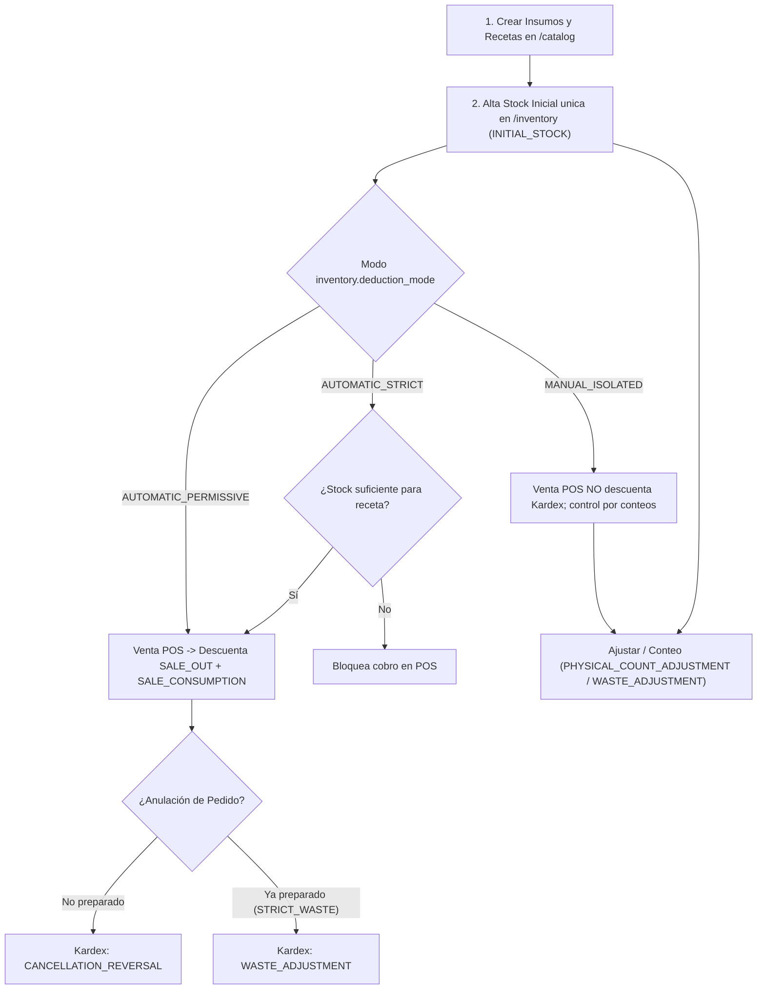

# 📦 Flujo 3.1: Insumos, Recetas, Conteo Inicial y Kardex

> ⬅️ **Índice:** [Procesos de Negocio](../README.md) | [Manual Insumos y Kardex](../../manuals/restaurante/05_insumos_recetas_y_kardex.md) | [Flujo 1.1: Venta POS](../01-pos-y-atencion/01_flujo_atencion_y_venta_pos.md)

Define el ciclo de administración de materia prima, escandallos (recetas), carga inicial de existencias, ajustes físicos y auditoría contable en el **Libro Mayor de Kardex**.

---

## 1. Dónde Se Ejecuta Cada Etapa

| Etapa | Pantalla Real | Ruta | Qué se realiza |
| :--- | :--- | :---: | :--- |
| **1. Alta de Insumos y Recetas** | `Catálogo y Recetas` → pestaña `Insumos y Recetas` | `/catalog` | Crear/editar insumos (nombre, unidad, `minStockAlert`), armar recetas por plato y vincular insumos opcionales a `Grupos de Extras`. |
| **2. Carga Única de Stock Inicial** | `Inventario y Kardex` → `Existencias Actuales` → `Alta Stock Inicial` | `/inventory` | Registrar saldo inicial una sola vez por insumo usando la calculadora bidireccional `Valor Total Pagado <-> Costo Unitario`. |
| **3. Conteos y Mermas** | `Inventario y Kardex` → `Ajustar / Conteo` | `/inventory` | Corregir diferencias físicas o registrar desperdicios/mermas (`WASTE_ADJUSTMENT`). |
| **4. Auditoría Cronológica** | `Inventario y Kardex` → `Libro Mayor de Kardex` | `/inventory` | Inspeccionar todos los movimientos de entrada/salida formateados en la zona horaria local de la sucursal. |

---

## 2. Diagrama del Ciclo de Inventario y Kardex

---

## 3. Movimientos Reales del Libro Mayor de Kardex

| Código de Movimiento | Disparador Real | Signo |
| :--- | :--- | :---: |
| **`INITIAL_STOCK`** | Carga única inicial de un insumo en `/inventory`. | `+` |
| **`SALE_OUT`** | Venta confirmada en POS de platos o combos con receta BOM asignada. | `-` |
| **`SALE_CONSUMPTION`** | Venta confirmada en POS de opciones en `Grupos de Extras` con insumo vinculado. | `-` |
| **`PHYSICAL_COUNT_ADJUSTMENT`** | Ajuste manual desde `Ajustar / Conteo` (ingresos de corrección o faltantes físicos). | `+/-` |
| **`WASTE_ADJUSTMENT`** | Merma registrada manualmente en inventario o por anulación de plato ya cocinado bajo `STRICT_WASTE`. | `-` |
| **`CANCELLATION_REVERSAL`** | Reversión automática al anular un pedido cuyo plato aún no fue preparado. | `+` |

> [!NOTE]
> **Alcance actual vs Roadmap:** El código contempla etiquetas preparatorias para compras a proveedores (`PURCHASE_IN`) y traspasos entre sucursales (`TRANSFER_IN` / `TRANSFER_OUT`), pero **las pantallas operativas de órdenes de compra y traspasos inter-sucursal aún no están habilitadas**. Hoy las reposiciones posteriores al stock inicial se registran vía `Ajustar / Conteo`.

---

## Relacionado

- [Flujo 1.1: Atención y Venta POS](../01-pos-y-atencion/01_flujo_atencion_y_venta_pos.md)
- [Flujo 1.2: UX Móvil POS y Conteo de Inventario](../01-pos-y-atencion/02_flujo_atencion_movil_y_conteo_inventario.md)
- [Flujo 2.2: Gastos y Anulaciones](../02-caja-y-finanzas/02_flujo_gastos_y_autorizaciones.md)
- [Manual de Insumos, Recetas y Kardex](../../manuals/restaurante/05_insumos_recetas_y_kardex.md)
- [Actividad: Estrategia de Deducción de Inventario](../../project/architecture/04-behavior-and-flows/activity_inventory_deduction_strategy.md)
