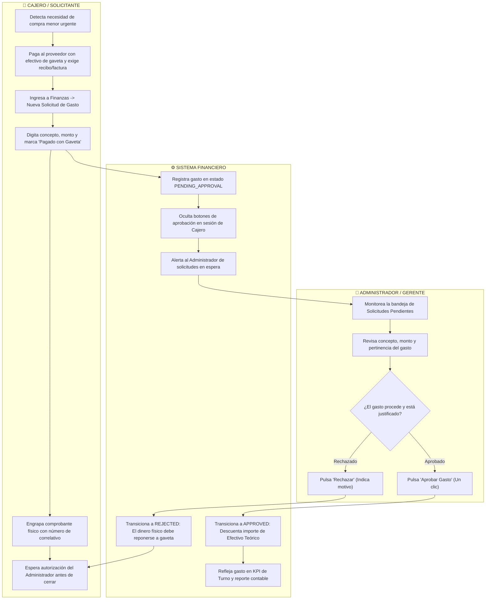
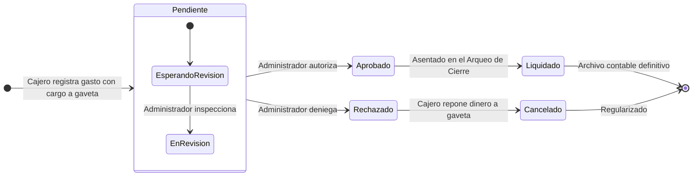

# 💸 Manual Operativo: Circuito de Caja Menor, Gastos de Emergencia y Autorizaciones

> **Documento de Proceso de Negocio y Manual de Operaciones**  
> **Destinatarios:** Propietarios, Franquiciados, Gerentes Generales, Administradores de Sucursal, Cajeros y Auditores Internos.  
> **Objetivo:** Normar y blindar el flujo de desembolso de dinero en efectivo de la gaveta para compras menores, garantizando la doble autorización obligatoria y el sustento digital inalterable.

---

## 📑 Índice de Navegación Rápida
- [1. Visión Ejecutiva y Propuesta de Valor](#-1-visión-ejecutiva-y-propuesta-de-valor)
- [2. Mapa Global del Procedimiento de Egresos (Carriles de Actores)](#️-2-mapa-global-del-procedimiento-de-egresos-carriles-de-actores)
- [3. Diálogo y Secuencia de Aprobación Administrativa](#-3-diálogo-y-secuencia-de-aprobación-administrativa)
- [4. Ciclo de Vida del Gasto de Caja Menor](#-4-ciclo-de-vida-del-gasto-de-caja-menor)
- [5. Guía Operativa Paso a Paso](#-5-guía-operativa-paso-a-paso)
  - [Fase 1: Identificación y Clasificación de la Necesidad Operativa](#fase-1-identificación-y-clasificación-de-la-necesidad-operativa)
  - [Fase 2: Registro Digital de la Solicitud por el Cajero](#fase-2-registro-digital-de-la-solicitud-por-el-cajero)
  - [Fase 3: Adjunto de Evidencia y Sustento Digital](#fase-3-adjunto-de-evidencia-y-sustento-digital)
  - [Fase 4: Decisión y Validación del Administrador](#fase-4-decisión-y-validación-del-administrador-o-gerente)
  - [Fase 5: Impacto Contable en el Efectivo Teórico de la Gaveta](#fase-5-impacto-contable-en-el-efectivo-teórico-de-la-gaveta)
  - [Fase 6: Archivo Físico y Auditoría de Cierre](#fase-6-archivo-físico-y-auditoría-de-cierre)
- [6. Políticas de Control y Prevención de Fugas de Dinero](#-6-políticas-de-control-y-prevención-de-fugas-de-dinero)
- [7. Preguntas Frecuentes (FAQ)](#-7-preguntas-frecuentes-faq)
- [8. Ficha Resumen de Parámetros y Buenas Prácticas](#-8-ficha-resumen-de-parámetros-y-buenas-prácticas)

---

## 🎯 1. Visión Ejecutiva y Propuesta de Valor

En el día a día de un restaurante, los imprevistos son inevitables: se acaba el gas de una hornalla, falta hielo para coctelería, se compran limones frescos en el mercado vecino o se paga un flete urgente de insumos. 

Históricamente, estos pequeños desembolsos se realizaban con "papelitos sueltos" en la gaveta, generando:
- Dinero faltante al final del turno sin responsable claro.
- Compras infladas o gastos personales no autorizados por la gerencia.
- Descuadres recurrentes en el arqueo de caja.

Este sistema implementa un **circuito de doble verificación obligatoria**:
1. **Segregación Estricta de Funciones:** El cajero tiene la potestad de registrar qué compró y cuánto costó, pero el sistema le **bloquea completamente la autoaprobación**.
2. **Autorización Remota o Presencial en un Clic:** El Administrador puede revisar la solicitud desde su panel o teléfono, validar el ticket o factura y aprobar el desembolso.
3. **Afectación Matemática Automática:** Solo cuando el Administrador pulsa *"Aprobar"*, el dinero sale formalmente de la fórmula de efectivo de la gaveta.

---

## 🗺️ 2. Mapa Global del Procedimiento de Egresos (Carriles de Actores)



---

## 💬 3. Diálogo y Secuencia de Aprobación Administrativa

```mermaid
sequenceDiagram
    autonumber
    actor Cajero as 👤 Cajero (POS)
    participant POS as 💻 Módulo Finanzas
    actor Admin as 👔 Administrador

    Cajero->>POS: 1. Registra gasto: "Compra 2 bolsas de hielo" por Bs. 25.00
    Cajero->>POS: 2. Marca origen: [✓] Pagado con Gaveta de Caja
    POS-->>Cajero: 3. Gasto guardado como PENDIENTE (Botón 'Aprobar' deshabilitado)
    Note over Cajero,POS: El sistema impide que el cajero manipule el estado.

    Admin->>POS: 4. Ingresa con su usuario administrador
    POS-->>Admin: 5. Notificación: "Hay 1 solicitud de gasto pendiente de revisión"
    Admin->>POS: 6. Inspecciona el gasto de Bs. 25.00
    
    alt Decisión: Gasto Válido y Autorizado
        Admin->>POS: 7a. Clic en botón "Aprobar"
        POS-->>POS: 8a. Estado cambia a APROBADO
        POS-->>POS: 9a. Saldo Teórico de Gaveta resta Bs. 25.00 automáticamente
        POS-->>Admin: Confirmación: "Gasto de Bs. 25.00 aprobado exitosamente"
    else Decisión: Gasto No Autorizado / No Justificado
        Admin->>POS: 7b. Clic en botón "Rechazar"
        POS-->>POS: 8b. Estado cambia a RECHAZADO
        POS-->>POS: 9b. No se resta de gaveta; el cajero debe devolver el dinero físico
    end
```

---

## 🔄 4. Ciclo de Vida del Gasto de Caja Menor



---

## 📖 5. Guía Operativa Paso a Paso

### 🛒 Fase 1: Identificación y Clasificación de la Necesidad Operativa
Solo se deben canalizar por caja chica aquellos gastos de **monto menor y urgencia inmediata** que no admiten trámite bancario ordinario:
- **Insumos de Emergencia:** Perecederos faltantes (limones, cilantro, pan de molde).
- **Consumibles de Operación:** Bolsas de delivery, servilletas, cinta de embalaje, gas para soplete.
- **Servicios Menores:** Propinas a fleteros, fotocopias de contratos, agua embotellada de emergencia.

---

### 📝 Fase 2: Registro Digital de la Solicitud por el Cajero
Tan pronto el dinero sale físicamente de la caja:
1. El cajero ingresa al menú **Finanzas** y hace clic en la pestaña **Gastos de Caja Menor**.
2. Presiona el botón verde **"Registrar Nuevo Gasto"**.
3. Completa el formulario con tres datos obligatorios:
   - **Descripción Detallada:** Qué se compró y para qué (ejemplo: *"Compra urgente de 3 bidones de agua de mesa para salón"*).
   - **Importe Exacto (Bs.):** El monto real desembolsado según comprobante (ejemplo: `45.00`).
   - **Casilla "Pagado con Dinero de Gaveta":** Indicar si el dinero salió de los billetes de la caja o si lo pagó un socio con dinero externo.
4. Presiona **Guardar Gasto**.

---

### 📎 Fase 3: Adjunto de Evidencia y Sustento Digital
El cajero debe adjuntar el comprobante:
1. Toma una fotografía clara de la factura, recibo o comprobante de compra desde la terminal o teléfono.
2. La adjunta al registro digital para que el Administrador pueda visualizarla sin necesidad de desplazarse físicamente al mostrador.

---

### ⚖️ Fase 4: Decisión y Validación del Administrador o Gerente
El Administrador ingresa a su sesión:
1. Revisa la tabla de gastos filtrando por **"Pendientes de Aprobación"**.
2. Si el concepto es razonable y el comprobante es válido, hace clic en el botón de verificación **"Aprobar"**.
3. El sistema actualiza de inmediato el registro a color verde: `🟢 Aprobado`.

---

### 💰 Fase 5: Impacto Contable en el Efectivo Teórico de la Gaveta
Aquí reside el valor de control del sistema:
- Si un gasto de Bs. 45.00 es **Aprobado**, el sistema automáticamente resta esos Bs. 45.00 del dinero que le exigirá al cajero al final del día.
- Si el gasto queda en **Pendiente**, el sistema asume que el dinero sigue en la gaveta. Si el cajero ya entregó el dinero al proveedor, al cerrar caja le saltará un **Faltante de Bs. 45.00**, alertando al supervisor.

$$\text{Efectivo Teórico} = \text{Fondo Inicial} + \text{Ventas en Efectivo} - \mathbf{\text{Gastos Aprobados de Gaveta}}$$

---

### 🗄️ Fase 6: Archivo Físico y Auditoría de Cierre
Al terminar la jornada:
1. El cajero reúne todos los comprobantes físicos aprobados del día.
2. Los engrapa junto a la tirilla de cierre de turno y arqueo.
3. El sobre de recibos se entrega al Administrador para su consolidación contable mensual.

---

## 🛡️ 6. Políticas de Control y Prevención de Fugas de Dinero

1. **Tope Máximo por Comprobante:** Ningún gasto individual de caja chica puede superar los **Bs. 100.00** (o el límite fijado por la gerencia). Compras mayores a ese importe deben pagarse por transferencia bancaria corporativa.
2. **Prohibición de Gastos Personales:** Queda terminantemente prohibido extraer dinero de la gaveta para préstamos personales, adelantos de sueldo o pagos ajenos a la operación del restaurante.
3. **Aprobación Previa al Cierre de Turno:** Todos los gastos del turno deben quedar en estado `Aprobado` o `Rechazado` antes de iniciar el conteo físico del arqueo final.

---

## ❓ 7. Preguntas Frecuentes (FAQ)

### ¿Qué pasa si llega el fin del turno y el administrador no aprobó un gasto?
El sistema advertirá al cajero que existen solicitudes pendientes. El cajero debe comunicarse con su supervisor para que ingrese al sistema y apruebe el gasto pendiente. Si el supervisor no lo aprueba, ese monto constará como diferencia en contra de la gaveta.

### ¿Qué sucede si el administrador rechaza un gasto?
Si el Administrador rechaza el gasto (por ejemplo, porque era innecesario o no tiene factura), el dinero no se deduce del saldo teórico. Por lo tanto, el cajero que entregó el dinero sin autorización previa deberá responder y reponer el efectivo a la gaveta.

### ¿Se pueden registrar gastos pagados por transferencia o tarjeta del dueño?
Sí. Al registrar el gasto se desmarca la opción *"Pagado con Dinero de Gaveta"*. De esta forma, el gasto queda contabilizado en las utilidades mensuales del restaurante, pero **no descuenta dinero del cajero**.

---

## 📋 8. Ficha Resumen de Parámetros y Buenas Prácticas

| Parámetro Operativo | Valor Recomendado | Justificación de Control |
|---|:---:|---|
| **Límite por Gasto de Gaveta** | Hasta **Bs. 100.00** | Protege la liquidez de caja y evita desembolsos desmedidos. |
| **Tiempo de Respuesta de Aprobación** | Menor a **1 hora** | Permite al cajero tener la certeza de que su arqueo estará cuadrado. |
| **Sustento Mínimo Requerido** | Factura oficial o Recibo membretado | Respaldo ante auditorías fiscales y contables. |
| **Cierre Mensual de Caja Chica** | Último día hábil del mes | Conciliación de saldos y reposición del fondo fijo para la empresa. |
