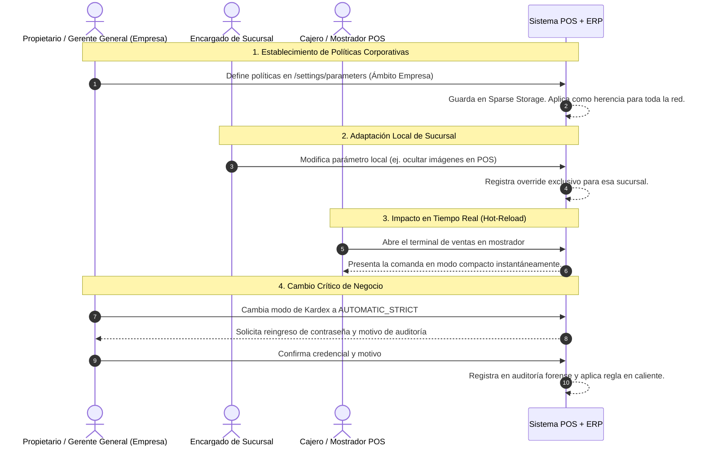

# ⚙️ Manual Operativo: Flujo de Parametrización y Gobierno Operativo del Restaurante

> **Documento de Proceso de Negocio y Manual de Operaciones**  
> **Destinatarios:** Propietarios de Restaurante, Gerentes Generales, Encargados de Sucursal, Supervisores de Turno y Responsables de TI.  
> **Objetivo:** Establecer el procedimiento estándar para definir las políticas comerciales, operativas y de inventario de la empresa, autorizar adaptaciones por sucursal y gobernar cambios críticos que afecten el dinero o las existencias.

---

## 📑 Índice de Navegación Rápida
- [1. Visión Ejecutiva y Propuesta de Valor](#-1-visión-ejecutiva-y-propuesta-de-valor)
- [2. Mapa Global del Procedimiento (Carriles de Responsabilidad)](#️-2-mapa-global-del-procedimiento-carriles-de-responsabilidad)
- [3. Guía Paso a Paso de las Fases del Proceso](#-3-guía-paso-a-paso-de-las-fases-del-proceso)
  - [Fase 1: Configuración de Políticas Corporativas (Matriz)](#-fase-1-configuración-de-políticas-corporativas-matriz)
  - [Fase 2: Adaptaciones y Sobreescrituras Locales (Sucursal)](#-fase-2-adaptaciones-y-sobreescrituras-locales-sucursal)
  - [Fase 3: Circuito de Cambios Críticos y Doble Confirmación](#-fase-3-circuito-de-cambios-críticos-y-doble-confirmación)
  - [Fase 4: Restablecimiento y Reversión a Estándares](#-fase-4-restablecimiento-y-reversión-a-estándares)
- [4. Preguntas Frecuentes y Políticas de Operación (FAQ)](#-4-preguntas-frecuentes-y-políticas-de-operación-faq)
- [5. Ficha Resumen de Parámetros Clave](#-5-ficha-resumen-de-parámetros-clave)

---

## 🎯 1. Visión Ejecutiva y Propuesta de Valor

En cadenas gastronómicas y franquicias, el éxito reside en equilibrar dos fuerzas:
1. **Consistencia Corporativa:** Garantizar que todas las sucursales cumplan las mismas reglas financieras, estándares de cobro y políticas de inventario.
2. **Flexibilidad Local:** Permitir que una sucursal en un aeropuerto o patio de comidas opere en modo rápido sin fotos en la pantalla de cobro, mientras que una sucursal boutique a la carta utilice el catálogo visual interactivo y notas especiales de cocina.

Este sistema implementa un **modelo jerárquico no destructivo**: las sucursales heredan automáticamente las decisiones de la empresa matriz y solo configuran lo que genuinamente necesitan adaptar, con auditoría total de quién realizó cada ajuste.

---

## 🗺️ 2. Mapa Global del Procedimiento (Carriles de Responsabilidad)

---

## 📋 3. Guía Paso a Paso de las Fases del Proceso

### 🏢 Fase 1: Configuración de Políticas Corporativas (Matriz)
1. El **Gerente General** accede a `/settings/parameters` con la pestaña **"Empresa"** activa.
2. Utiliza el buscador o las categorías para localizar las directrices de la cadena:
   - Política de control de inventario (`inventory.deduction_mode`).
   - Límite de gastos menores sin autorización (`finance.max_petty_cash_expense`).
   - Modalidad por defecto de comandas (`pos.default_order_mode`).
3. Cada cambio se guarda de forma atómica. Las sucursales que no tengan una personalización propia adoptarán este valor de forma automática en su siguiente operación.

---

### 🏪 Fase 2: Adaptaciones y Sobreescrituras Locales (Sucursal)
1. El **Encargado de Sucursal** ingresa a `/settings/parameters` con la pestaña **"Sucursal Activa"**.
2. El sistema muestra todas las opciones disponibles con una etiqueta distintiva:
   - 🏷️ `Heredado de Empresa` (valor corporativo vigente).
   - 🏷️ `Personalizado en Sucursal` (valor adaptado para este local).
3. Si el local desea activar una modalidad particular (ej. deshabilitar fotos de platos en la comanda para agilizar la fila en hora pico), conmuta el switch `pos.display_dish_images`.
4. El cambio tiene efecto inmediato en los terminales de cobro de esa sucursal sin afectar al resto de los restaurantes de la cadena.

---

### 🔒 Fase 3: Circuito de Cambios Críticos y Doble Confirmación
Para evitar errores que puedan paralizar el restaurante o falsear los libros contables, los parámetros de **Alta Criticidad** activan un protocolo de blindaje:
1. El usuario intenta modificar un parámetro clasificado como crítico (ej. pasar de inventario permisivo a estricto).
2. El sistema bloquea el cambio directo y presenta una ventana modal con:
   - **Explicación clara de impacto:** Qué consecuencias operativas sufrirá el personal (ej. rechazo de ventas por falta de stock).
   - **Reingreso de Contraseña:** Para validar que la persona frente a la pantalla es el administrador autorizado.
   - **Motivo de Justificación:** Registro obligatorio de texto para auditorías contables posteriores.
3. Tras la confirmación exitosa, el cambio se sella con marca de tiempo, usuario y justificación en la base de datos.

---

### ↩️ Fase 4: Restablecimiento y Reversión a Estándares
1. Si una sucursal adaptó una configuración y posteriormente la gerencia decide unificar la operación:
2. El encargado pulsa el botón **"Restablecer al valor corporativo"** junto al parámetro.
3. El sistema elimina la sobreescritura local y vuelve a sincronizarse automáticamente con las directrices de la empresa matriz.

---

## ❓ 4. Preguntas Frecuentes y Políticas de Operación (FAQ)

**¿Es necesario reiniciar los terminales o servidores tras modificar un parámetro?**  
No. El sistema opera con tecnología *Hot-Reload*: el 95%+ de las configuraciones toman vigencia en la siguiente venta o refresco de pantalla.

**¿Qué sucede si una sucursal pierde la conexión a internet?**  
Los parámetros operativos de sucursal se guardan de forma segura en la base de datos local del navegador (IndexedDB / Dexie.js) al abrir el turno de caja, por lo que el terminal continuará operando sin interrupción.

**¿Quién puede modificar los parámetros de la empresa matriz?**  
Únicamente los usuarios con perfil `ADMIN_TENANT` (Propietarios y Gerentes Generales corporativos). Los encargados de sucursal solo pueden modificar opciones habilitadas para personalización local en su propio establecimiento.

---

## 📌 5. Ficha Resumen de Parámetros Clave

| Parámetro | Impacto en el Restaurante | Ámbito Recomendado |
| :--- | :--- | :--- |
| **`inventory.deduction_mode`** | Define si los platos descuentan ingredientes al instante o si el stock se ajusta manualmente. | Solo Empresa Matriz. |
| **`pos.display_dish_images`** | Alterna entre vista con fotos de comida o botonera compacta ultrarrápida. | Personalizable por Sucursal. |
| **`finance.require_supervisor_pin_cancel`** | Obliga a que un encargado apruebe con PIN cada anulación de comanda en caja. | Solo Empresa Matriz. |
| **`pos.allow_scheduled_pickup`** | Permite registrar pedidos por encargo con hora pactada de entrega. | Personalizable por Sucursal. |
