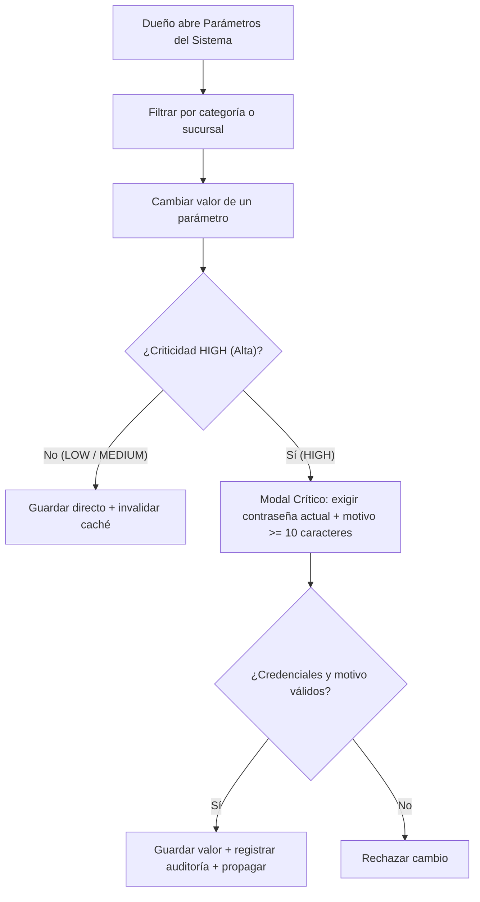

# ⚙️ Flujo 4.1: Parametrización Operativa de la Empresa

> ⬅️ **Índice:** [Procesos de Negocio](../README.md) | [Manual del Dueño](../../manuals/restaurante/06_dueno_finanzas_personal_y_reglas.md) | [Flujo 4.2: Onboarding](./02_flujo_alta_empresa_y_onboarding.md)

Documenta el sistema multinivel de configuración operativa en **`Parámetros del Sistema`** (`/settings/parameters`), que consolida **20 reglas reales** organizadas por categoría (`Todos`, `Punto de Venta`, `Inventario`, `Finanzas`, `Seguridad`, `General`), nivel de criticidad y alcance (`TENANT` o `BRANCH`).

---

## 1. Flujo de Actualización y Control de Criticidad

---

## 2. Catálogo Completo de los 20 Parámetros (`parameters-catalog.json`)

| Categoría | Clave (`SystemParameter`) | Alcance | Criticidad | Default | Estado Real Hoy en Sprint 6 |
| :--- | :--- | :---: | :---: | :---: | :--- |
| **Inventario** | `inventory.deduction_mode` | `TENANT` | `HIGH` | `AUTOMATIC_PERMISSIVE` | ✅ Enforced (`AUTOMATIC_PERMISSIVE`, `AUTOMATIC_STRICT`, `MANUAL_ISOLATED`). |
| **Inventario** | `inventory.allow_negative_stock` | `TENANT` | `HIGH` | `false` | ✅ Enforced en deducciones Kardex. |
| **POS** | `pos.display_dish_images` | `BRANCH` | `LOW` | `true` | ✅ Enforced en `PosComponent` si no hay override en `localStorage`. |
| **POS** | `pos.default_order_mode` | `BRANCH` | `LOW` | `DINE_IN` | 🔜 Guardado por presets; la UI POS siempre inicia hoy en `DINE_IN`. |
| **POS** | `pos.allow_scheduled_pickup` | `BRANCH` | `LOW` | `true` | 🔜 Catalogado; la UI POS muestra siempre `Recoger` hoy. |
| **POS** | `pos.delivery_fee_enabled` | `BRANCH` | `LOW` | `false` | 🔜 Catalogado; checkout `Delivery` permite editar envío manual siempre hoy. |
| **POS** | `pos.delivery_fee_default` | `BRANCH` | `LOW` | `0.00` | 🔜 Catalogado; campo envío en POS inicia en `0` hoy. |
| **POS** | `pos.cancellation_prepared_waste_policy` | `BRANCH` | `MEDIUM` | `ALLOW_AUTO_BUFFER_REUSE` | ⚠️ Enforced en backend (`STRICT_WASTE` genera `WASTE_ADJUSTMENT` en Kardex; buffer `prepared_dish_buffer` aún sin pantalla UI dedicada). |
| **Finanzas** | `finance.max_petty_cash_expense` | `BRANCH` | `MEDIUM` | `100.00` | ✅ Enforced en `ExpenseService` para pagos con efectivo de caja. |
| **Finanzas** | `finance.require_supervisor_pin_cancel` | `TENANT` | `HIGH` | `true` | ✅ Guardado; `OrderServiceImpl.cancelOrder` exige siempre PIN o autorización remota aprobada hoy. |
| **Finanzas** | `finance.shift_opening_policy` | `BRANCH` | `MEDIUM` | `ALL_AUTHORIZED` | ✅ Enforced en `CashShiftService.openShift` (`ALL_AUTHORIZED` vs `SUPERVISOR_ONLY`). |
| **Finanzas** | `finance.shift_concurrency_mode` | `BRANCH` | `HIGH` | `SINGLE_PER_BRANCH` | ✅ Enforced (`SINGLE_PER_BRANCH` vs `INDIVIDUAL_PER_CASHIER`). |
| **Finanzas** | `finance.expense_allow_self_approval` | `BRANCH` | `MEDIUM` | `false` | ✅ Enforced en `ExpenseService` (`ADMIN_TENANT`/`SUPERADMIN` siempre auto-aprueban). |
| **Finanzas** | `finance.auto_open_full_catalog_session` | `BRANCH` | `HIGH` | `true` | ✅ Enforced al abrir primer turno del día (`Toda la Carta` automática). |
| **Seguridad** | `security.require_user_email` | `TENANT` | `HIGH` | `true` | ✅ Enforced en `UserManagementServiceImpl` al crear/editar usuarios. |
| **Seguridad** | `security.enforce_password_change_on_reset` | `TENANT` | `HIGH` | `true` | ✅ Pre-marca `mustChangePassword` en altas; reseteos admin siempre fuerzan cambio. |
| **Seguridad** | `security.session_inactivity_timeout_minutes` | `TENANT` | `MEDIUM` | `15` | 🔜 Persistido en BD/presets; frontend `IdleTimerService` usa `30` min fijos + aviso `120 s` hoy. |
| **General** | `company.currency` | `BRANCH` | `MEDIUM` | `BOB` | ⚠️ Persistido; UI ERP actual renderiza prefijo `Bs.`. |
| **General** | `company.timezone` | `BRANCH` | `MEDIUM` | `America/La_Paz` | ⚠️ Persistido; `branches.timezone` gobierna cortes y Kardex (POS ticket usa `America/La_Paz`). |
| **General** | `catalog.scope_mode` | `TENANT` | `HIGH` | `BRANCH_ISOLATED` | ✅ Enforced en `CatalogServiceImpl` (`BRANCH_ISOLATED` vs `GLOBAL_SHARED`). |

---

## Relacionado

- [Flujo 4.2: Alta de Empresa y Onboarding](./02_flujo_alta_empresa_y_onboarding.md)
- [Flujo 2.1: Jornada, Arqueo y Finanzas](../02-caja-y-finanzas/01_flujo_jornada_y_arqueo_caja.md)
- [Manual del Dueño: Finanzas, Personal y Reglas](../../manuals/restaurante/06_dueno_finanzas_personal_y_reglas.md)
- [Arquitectura: Resolución y Hot-Reload de Parámetros](../../project/architecture/04-behavior-and-flows/sequence_parameter_resolution_and_hot_reload.md)
