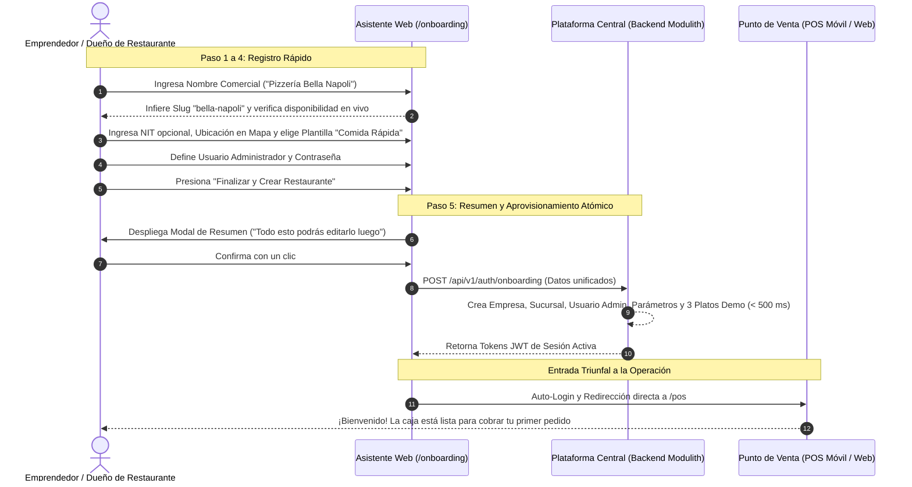

# 🚀 Manual Operativo: Flujo de Alta de Empresa y Asistente de Onboarding

> **Documento de Proceso de Negocio y Manual de Operaciones**  
> **Destinatarios:** Nuevos Clientes, Propietarios de Restaurantes, Emprendedores Gastronómicos, Administradores de Franquicia y Personal de Soporte/Activación.  
> **Objetivo:** Guiar el proceso integral de autoregistro (*Self-Service Onboarding*) para habilitar una nueva empresa gastronómica, su sucursal inicial y su catálogo de prueba en menos de 2 minutos, permitiendo comenzar a vender de inmediato.

---

## 📑 Índice de Navegación Rápida
- [1. Visión Ejecutiva y Propuesta de Valor](#-1-visión-ejecutiva-y-propuesta-de-valor)
- [2. Mapa Global del Procedimiento (Carriles de Responsabilidad)](#️-2-mapa-global-del-procedimiento-carriles-de-responsabilidad)
- [3. Guía Paso a Paso del Asistente de Registro](#-3-guía-paso-a-paso-del-asistente-de-registro)
  - [Paso 1: Identidad del Negocio (Slug Automático y NIT Opcional)](#paso-1-identidad-del-negocio-slug-automático-y-nit-opcional)
  - [Paso 2: Sucursal Principal y Ubicación en Mapa](#paso-2-sucursal-principal-y-ubicación-en-mapa)
  - [Paso 3: Elección de Plantilla Operativa y Platos de Muestra](#paso-3-elección-de-plantilla-operativa-y-platos-de-muestra)
  - [Paso 4: Cuenta de Administrador](#paso-4-cuenta-de-administrador)
  - [Paso 5: Resumen de Confirmación y Acceso Directo a Venta](#paso-5-resumen-de-confirmación-y-acceso-directo-a-venta)
- [4. Preguntas Frecuentes y Políticas de Operación (FAQ)](#-4-preguntas-frecuentes-y-políticas-de-operación-faq)

---

## 🎯 1. Visión Ejecutiva y Propuesta de Valor

Iniciar la digitalización de un restaurante suele ser una experiencia frustrante debido a formularios extensos, configuraciones técnicas complejas (servidores, bases de datos, catálogos vacíos) y demoras de activación.

Nuestro **Asistente de Onboarding** resuelve esta barrera mediante cuatro principios clave:
1. **Velocidad sin Fricción:** En cuatro pasos intuitivos (menos de 120 segundos), el restaurante queda configurado y listo para emitir su primera comanda.
2. **Inclusividad para Pequeños Negocios:** Si el negocio está iniciando y no tiene NIT formal, puede omitirlo sin trabas; el sistema le asigna un identificador (*slug*) único para ingresar.
3. **Plantillas Operativas Listas para Usar:** No parte de una pantalla en blanco. Ofrece hasta 3 platos de muestra con recetas configuradas para probar ventas e inventario al instante.
4. **Cero Preguntas Técnicas Innecesarias:** La zona horaria se infiere localmente (`'America/La_Paz'`) y la moneda se fija en Bolivianos (`BOB`), reduciendo la fatiga de decisión.

---

## 🗺️ 2. Mapa Global del Procedimiento (Carriles de Responsabilidad)

---

## 📋 3. Guía Paso a Paso del Asistente de Registro

### Paso 1: Identidad del Negocio (Slug Automático y NIT Opcional)
- **Nombre Comercial:** Nombre visible con el que los clientes reconocen el local (ej. *"Hamburguesas El Corral"*).
- **Identificador Web (Slug):**
  - Se genera de forma automática eliminando acentos, espacios y caracteres especiales (ej. `hamburguesas-el-corral`).
  - Dispone de un botón interactivo de ayuda `(?)` con información clara: *"Este identificador único formará tu enlace privado de acceso (ej. miapp.com/hamburguesas-el-corral) y te permitirá ingresar si no tienes NIT"*.
  - El usuario puede editarlo libremente si desea una versión más corta.
- **NIT / Documento Tributario (Opcional):**
  - Diseñado para negocios en régimen simplificado o emprendimientos en etapa de inicio.
  - Si el propietario no dispone de NIT, **simplemente lo deja en blanco**.
  - Si lo completa, el sistema asegura que sea único y permitirá iniciar sesión tanto con el NIT como con el slug.
- **Logotipo de la Empresa (Opcional):**
  - Puede subir una imagen cuadrada (PNG/JPG).
  - Si no dispone de imagen en el momento, el sistema genera automáticamente un distintivo elegante con las iniciales del negocio.

### Paso 2: Sucursal Principal y Ubicación en Mapa
- **Nombre de Sucursal:** Sugerido por defecto como *"Sucursal Principal"*.
- **Dirección Referencial:** Texto claro indicando calle, número o zona (ej. *"Av. San Martín esq. Calle 4, Equipetrol"*).
- **Mapa Interactivo (OpenStreetMap / Leaflet):**
  - Permite hacer clic o arrastrar un pin para marcar la ubicación exacta de la tienda.
  - No requiere claves de facturación de Google Maps ni registros adicionales.
- **Teléfono de Contacto (Opcional):** Para figurar en recibos o comandas de entrega.
- **Moneda y Horario:** Asignados de forma automática como Moneda Nacional Boliviana (`BOB`) y Zona Horaria Boliviana (`America/La_Paz`).

### Paso 3: Elección de Plantilla Operativa y Platos de Muestra
El usuario elige entre 4 perfiles preconfigurados:
1. 🍕 **Comida Rápida / Pizzería:** Flujo rápido en mostrador, emisión de ticket directo a despacho y control de insumos por porción.
2. 🍽️ **Restaurante Tradicional / A la Carta:** Comandas organizadas por mesas, notas especiales para cocina y control de meseros.
3. ☕ **Cafetería / Bar:** Cuentas directas al paso, cobro ágil en barra.
4. ⚙️ **En Blanco / Personalizado:** Diseñado para quienes desean dar de alta sus productos manualmente o mediante importación masiva.

> [!NOTE] Platos de Demostración
> Si el usuario selecciona una de las primeras tres plantillas, el sistema precargará **3 productos reales de ejemplo** con sus insumos básicos (ej. *Pizza Margarita*, *Gaseosa 500ml*, *Porción de Papas Fritas*). Un aviso informativo aclara:  
> *"Estos productos te permiten probar el cobro de inmediato. Puedes editarlos, cambiarles el precio, eliminarlos o borrarlos todos en cualquier momento desde el menú de Catálogo"*.

### Paso 4: Cuenta de Administrador
- **Nombre Completo:** Nombre del dueño o encargado responsable (ej. *"Carlos Mendoza"*).
- **Nombre de Usuario:** Identificador para iniciar sesión (ej. `carlos` o `admin`).
- **Correo Electrónico (Opcional):** Para recuperación futura de contraseñas.
- **Contraseña:** Clave protegida criptográficamente mediante algoritmo Argon2id.

### Paso 5: Resumen de Confirmación y Acceso Directo a Venta
- Antes de consolidar el registro, una ventana modal presenta un resumen visual consolidado con todos los datos clave ingresados.
- Un mensaje tranquilizador resalta: *"¡Todo listo! Esta configuración inicial es flexible y podrás ajustar cualquier detalle más adelante en el panel de administración"*.
- Al presionar **"Confirmar y Empezar a Vender"**, el sistema crea la cuenta de forma instantánea y redirige al usuario con su sesión ya iniciada directamente al Punto de Venta (`/pos`).

---

## ❓ 4. Preguntas Frecuentes y Políticas de Operación (FAQ)

### ¿Qué ocurre si no tengo NIT?
No hay ningún inconveniente. Puedes completar el registro dejando el campo de NIT vacío. Para iniciar sesión en el sistema tú y tus colaboradores utilizarán el **Slug de la Empresa** que definiste en el primer paso (ej. `mi-cafecito`) junto con tu usuario y contraseña.

### ¿Puedo cambiar el nombre o el slug de mi restaurante después?
Sí. El nombre comercial y los datos de la sucursal pueden actualizarse en cualquier momento desde el módulo de Configuración. El slug puede modificarse siempre que el nuevo identificador no esté en uso por otra empresa.

### ¿Los platos de prueba descuentan inventario real?
Sí, las recetas de ejemplo están conectadas al Kardex de tu sucursal para que puedas ver cómo el sistema descuenta automáticamente los ingredientes al confirmar una venta. Si deseas vaciar todo el menú de prueba, dispones de una opción de *"Eliminar datos de prueba"* con un solo clic en el módulo de Catálogo.

### ¿Cómo subo mi menú completo de 50 platos?
Una vez completado el onboarding y dentro de la aplicación, el módulo de **Catálogo de Productos** cuenta con una herramienta para importar archivos Excel (`.xlsx`) y CSV de forma masiva, o bien agregar platos uno a uno.

### ¿Cuándo puedo crear una segunda sucursal?
En cuanto completes el onboarding y accedas a tu panel de administración, puedes dirigirte a **Administración > Sucursales** y agregar tantas sucursales o puntos de venta como requiera tu crecimiento comercial.
