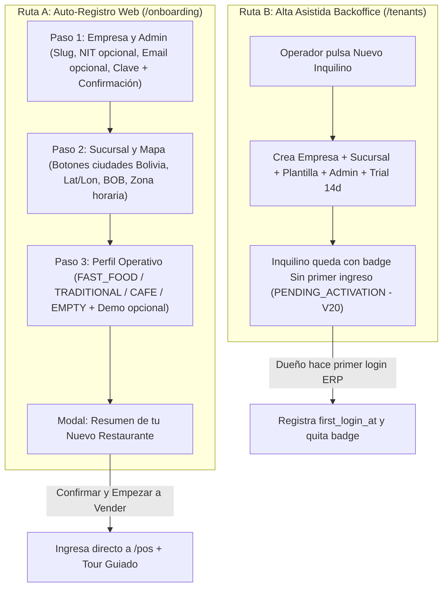

# 🚀 Flujo 4.2: Alta de Empresa y Onboarding

> ⬅️ **Índice:** [Procesos de Negocio](../README.md) | [Guía de Inicio Rápido](../../manuals/restaurante/00_guia_inicio_rapido_restaurante.md) | [Operación Backoffice SaaS](../../manuals/plataforma/operacion_backoffice_saas.md)

Describe las dos rutas reales para incorporar un nuevo restaurante: **auto-registro en 3 pasos** desde `/onboarding` y **alta asistida desde el Backoffice SaaS** (`/tenants`).

---

## 1. Diagrama Comparativo de Onboarding (Público vs Asistido)

---

## 2. Detalle Real del Asistente en 3 Pasos (`/onboarding`)

1. **`1. Empresa y Admin`:**
   - Razón social / nombre comercial, `slug` autogenerado editable, NIT opcional.
   - Nombre completo del dueño, usuario, correo electrónico (**opcional en el paso de onboarding**) y contraseña con campo obligatorio de **Confirmar Contraseña**.
2. **`2. Sucursal y Mapa`:**
   - Nombre de la primera sucursal (ej. *Casa Matriz*) y dirección.
   - **6 botones de ciudades bolivianas** (`La Paz`, `Santa Cruz`, `Cochabamba`, `El Alto`, `Tarija`, `Sucre`) que completan automáticamente Latitud y Longitud editables, moneda (`BOB`) y zona horaria (`America/La_Paz`).
   - *Aclaración frente a versiones previas:* No existe mapa interactivo Leaflet/OSM ni paso de subida de logotipo dentro del wizard.
3. **`3. Perfil Operativo`:**
   - Selección entre **`FAST_FOOD`** (Comida Rápida), **`TRADITIONAL`** (Restaurante Tradicional), **`CAFE`** (Cafetería y Pastelería) o **`EMPTY`** (`Negocio Limpio / Vacío` sin presets ni catálogo demo).
   - En las 3 plantillas de rubro se ofrece la casilla opcional para incluir o excluir el catálogo de demostración.
4. **Cierre del Wizard:** Modal **`Resumen de tu Nuevo Restaurante`** → botón **`Confirmar y Empezar a Vender`** → autentica automáticamente al dueño, redirige a `/pos` y lanza **`Tour Guiado`**.

> [!NOTE]
> Actualmente no existe botón de "Eliminar datos demo" en un clic ni importador masivo Excel/CSV; quienes deseen operar inmediatamente con su propia carta deben elegir `EMPTY` o desmarcar la casilla de catálogo demo antes de confirmar.

---

## Relacionado

- [Flujo 4.1: Parametrización Operativa](./01_flujo_parametrizacion_operativa_empresa.md)
- [Guía de Inicio Rápido del Restaurante](../../manuals/restaurante/00_guia_inicio_rapido_restaurante.md)
- [Manual de Bootstrap y Operación Inicial](../../manuals/plataforma/bootstrap_y_operacion_inicial.md)
- [Secuencia Técnica de Onboarding](../../project/architecture/04-behavior-and-flows/sequence_tenant_onboarding.md)
