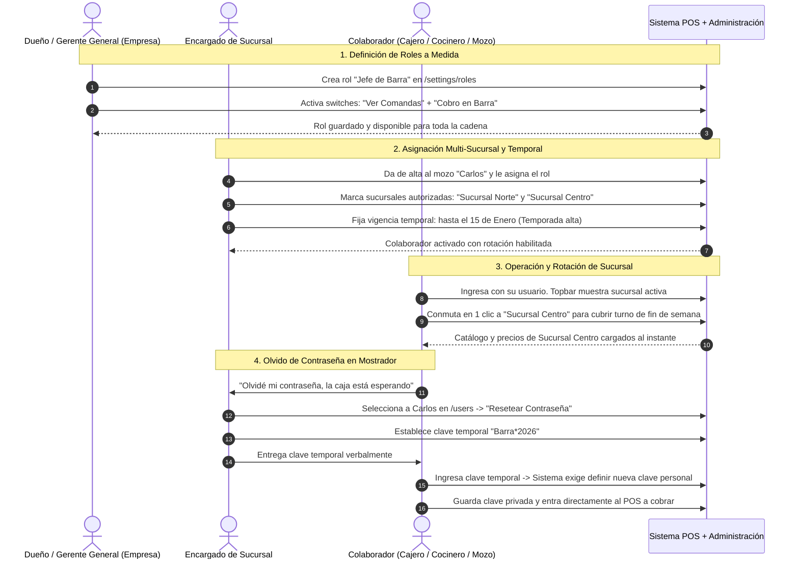

# 🛡️ Manual Operativo: Gestión de Roles, Asignación Multi-Sucursal y Seguridad de Personal

> **Documento de Proceso de Negocio y Manual de Operaciones**  
> **Destinatarios:** Dueños de Restaurante, Gerentes Generales, Encargados de Sucursal y Supervisores de Turno.  
> **Objetivo:** Definir el procedimiento estándar para crear roles a medida según las necesidades operativas de la cocina y el salón, autorizar la rotación de colaboradores entre distintas sucursales, controlar personal de temporada y resolver bloqueos o pérdidas de contraseñas al instante sin requerir correos electrónicos.

---

## 📑 Índice de Navegación Rápida
- [1. Visión Ejecutiva y Propuesta de Valor](#-1-visión-ejecutiva-y-propuesta-de-valor)
- [2. Mapa Global del Procedimiento (Carriles de Responsabilidad)](#️-2-mapa-global-del-procedimiento-carriles-de-responsabilidad)
- [3. Guía Paso a Paso de Procedimientos de Personal](#-3-guía-paso-a-paso-de-procedimientos-de-personal)
  - [Procedimiento A: Creación de Roles Operativos a Medida](#procedimiento-a-creación-de-roles-operativos-a-medida)
  - [Procedimiento B: Asignación de Personal Rotativo entre Sucursales](#procedimiento-b-asignación-de-personal-rotativo-entre-sucursales)
  - [Procedimiento C: Contratación de Personal Temporal (Roles con Vencimiento)](#procedimiento-c-contratación-de-personal-temporal-roles-con-vencimiento)
  - [Procedimiento D: Reseteo Inmediato de Contraseña en Mostrador](#procedimiento-d-reseteo-inmediato-de-contraseña-en-mostrador)
- [4. Preguntas Frecuentes y Políticas de Seguridad (FAQ)](#-4-preguntas-frecuentes-y-políticas-de-seguridad-faq)

---

## 🎯 1. Visión Ejecutiva y Propuesta de Valor

En el día a día de un restaurante, la gestión de personal enfrenta tres desafíos críticos:
1. **Puestos Especializados:** Una pizzería tiene pizzeros, un bar tiene bartenders y un restaurante formal tiene meseros y encargados de compras. Los roles genéricos ("Cajero" o "Admin") son insuficientes para delegar tareas con seguridad.
2. **Personal que Rota entre Locales:** En cadenas gastronómicas, los cajeros y meseros con experiencia suelen cubrir turnos en distintas sucursales durante la semana. Forzar la creación de múltiples cuentas para la misma persona genera duplicidad y caos contable.
3. **Pérdida de Contraseñas sin Correo:** La gran mayoría del personal de mostrador y cocina no tiene correo electrónico corporativo. Si un cajero olvida su contraseña a las 11:30 AM antes del almuerzo, no puede esperar un enlace por email; necesita que su encargado le restablezca el acceso en segundos.

Este sistema implementa un **modelo de seguridad pragmático**: roles personalizables con switches visuales, asignación a múltiples sucursales con una sola cuenta y reseteo asistido directo en caja.

---

## 🗺️ 2. Mapa Global del Procedimiento (Carriles de Responsabilidad)

---

## 📋 3. Guía Paso a Paso de Procedimientos de Personal

### Procedimiento A: Creación de Roles Operativos a Medida
- **Quién lo realiza:** Propietario o Gerente General (`ADMIN_TENANT`).
- **Ruta:** Menú lateral **Configuración > Roles y Permisos** (`/settings/roles`).
- **Pasos:**
  1. Pulsa el botón **"+ Nuevo Rol"**.
  2. Escribe el nombre del cargo (ej. *"Jefe de Barra / Bartender"*).
  3. En la cuadrícula de permisos dividida por áreas, enciende únicamente las facultades que este puesto debe tener:
     - *Punto de Venta:* Cobrar pedidos en barra.
     - *Cocina:* Ver comandas de bebidas.
     - *(Apagados):* Finanzas, arqueos de caja, inventario general y administración de personal.
  4. Presiona **"Guardar Rol"**. El rol queda inmediatamente disponible para ser asignado a cualquier empleado en cualquiera de las sucursales.

### Procedimiento B: Asignación de Personal Rotativo entre Sucursales
- **Quién lo realiza:** Propietario o Encargado de Sucursal con permiso.
- **Ruta:** Menú lateral **Personal > Colaboradores** (`/users`).
- **Pasos:**
  1. Al crear o editar a un colaborador, dirígete a la sección **"Sucursales Autorizadas"**.
  2. Marca las casillas de todas las sucursales donde el colaborador tiene autorización para trabajar (ej. *Sucursal Matriz* y *Sucursal Patio de Comidas*).
  3. Selecciona cuál será su **Sucursal Predeterminada** (donde pasa la mayor parte del tiempo).
  4. Guarda los cambios. El colaborador podrá cambiar de sucursal en el menú superior con un solo clic cada vez que cubra un turno en otra sede, manteniendo un único usuario y contraseña.

### Procedimiento C: Contratación de Personal Temporal (Roles con Vencimiento)
- **Propósito:** Contratar personal de refuerzo para eventos especiales, ferias o temporadas navideñas sin riesgo de que mantengan acceso al sistema meses después de terminar su contrato.
- **Pasos:**
  1. En el perfil del colaborador, activa la opción **"Rol Temporal (Vigencia Limitada)"**.
  2. Selecciona la **Fecha de Expiración** (ej. *31 de Diciembre a las 23:59*).
  3. Guarda los cambios. Una vez llegada la fecha límite, el sistema suspende automáticamente su acceso con un mensaje explicativo y notifica al administrador en el panel de control.

### Procedimiento D: Reseteo Inmediato de Contraseña en Mostrador
- **Quién lo realiza:** Encargado de la sucursal activa (`BRANCH_MANAGER`) o Dueño (`ADMIN_TENANT`).
- **Situación:** El cajero olvidó su clave o se incorporó un nuevo cocinero sin correo electrónico.
- **Pasos:**
  1. En la lista de colaboradores de `/users`, haz clic en los tres puntos del usuario afectado y selecciona **"Resetear Contraseña"**.
  2. El sistema sugerirá una contraseña temporal segura y fácil de recordar (ej. `Caja*2026`) o podrás escribir una manualmente.
  3. Confirma el reseteo.
  4. Comunica verbalmente la clave temporal al empleado.
  5. En cuanto el empleado inicie sesión con esa clave, el sistema le solicitará obligatoriamente que introduzca su propia contraseña privada antes de permitirle acceder a las ventas o a la cocina.

---

## ❓ 4. Preguntas Frecuentes y Políticas de Seguridad (FAQ)

### ¿El encargado de una sucursal puede modificar mi rol de Dueño?
**No, es imposible.** El rol de Administrador de la Empresa (`ADMIN_TENANT`) está blindado por el sistema: no se pueden apagar sus permisos, no se puede restringir su acceso a ninguna sucursal y ningún otro usuario puede eliminarlo o resetear su clave sin autorización del Árbitro de la plataforma (`SUPERADMIN`).

### ¿Un encargado de sucursal puede resetear la clave de otro encargado?
**No.** Por política de seguridad jerárquica, un encargado de sucursal solo puede resetear contraseñas de puestos operativos subordinados (cajeros, meseros, cocineros) asignados a su misma sucursal. Los supervisores y administradores solo pueden ser reseteados por el Dueño del restaurante.

### ¿Qué sucede si un empleado intenta ingresar a una sucursal no autorizada?
El sistema bloquea la operación de forma inmediata. Aunque conozca el código de la otra sucursal, la plataforma verifica sus credenciales contra la lista de sucursales permitidas y rechaza cualquier comanda o cobro no autorizado con un mensaje de alerta.
