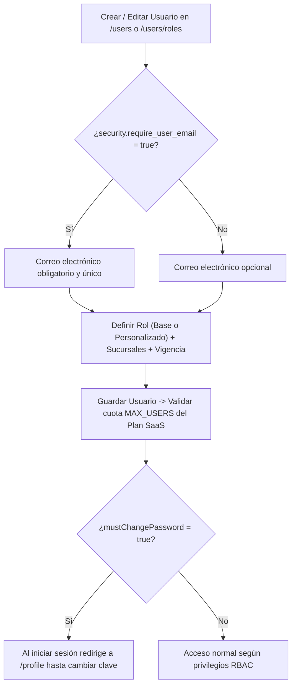

# 👥 Flujo 4.3: Gestión de Personal, Roles y Privilegios

> ⬅️ **Índice:** [Procesos de Negocio](../README.md) | [Flujo 4.4: Sesiones y Seguridad](./04_flujo_ciclo_vida_sesiones_y_seguridad.md) | [Manual del Dueño](../../manuals/restaurante/06_dueno_finanzas_personal_y_reglas.md)

Explica la separación funcional real entre **`Gestión de Personal`** (`/users`) y **`Roles y Privilegios`** (`/users/roles`, con alias `/settings/roles`), así como las validaciones de correo, asignación multi-sucursal, vigencias temporales y recuperación de contraseñas.

---

## 1. Diferencia Entre `/users` y `/users/roles`

| Capacidad | `Gestión de Personal` (`/users`) | `Roles y Privilegios` (`/users/roles`) |
| :--- | :--- | :--- |
| **Enfoque** | Operación rápida de alta/edición diaria de empleados. | Gobernanza avanzada RBAC, sucursales y recuperación de accesos. |
| **Roles asignables** | Los **4 roles base** (`ADMIN_TENANT`, `BRANCH_MANAGER`, `CASHIER`, y opción heredada `KITCHEN`). | Roles base **+ roles personalizados** con permisos granulares (`pos:access`, `finance:shifts`, etc.). |
| **Alcance de sucursal** | Asignación simple estándar. | Asignación **multi-sucursal** y **vigencias temporales** (`validFrom` / `validUntil`). |
| **Contraseñas y sesiones** | Casilla `mustChangePassword` controlada por `security.enforce_password_change_on_reset`. | Acción de **restablecer contraseña temporal** (revoca sesiones activas y fuerza cambio al ingresar). |

---

## 2. Reglas de Validación y Ciclo Operativo

### Recuperación de Contraseña de Usuarios del Restaurante
1. **Dentro del restaurante (`/users/roles`):** El dueño o encargado con permiso genera una clave temporal al empleado; esto revoca sus tokens activos y fuerza cambio obligatorio en `/profile`.
2. **Soporte desde Backoffice (`/tenants/:id` → `Usuarios`):** Si el propio dueño del restaurante pierde su contraseña, el `SUPERADMIN` de plataforma ejecuta **`Restablecer Clave`**, revocando sesiones activas y exigiendo cambio obligatorio en el próximo login ERP.

---

## Relacionado

- [Flujo 4.4: Ciclo de Vida de Sesiones y Seguridad](./04_flujo_ciclo_vida_sesiones_y_seguridad.md)
- [Flujo 4.1: Parametrización Operativa](./01_flujo_parametrizacion_operativa_empresa.md)
- [Manual del Dueño: Finanzas, Personal y Reglas](../../manuals/restaurante/06_dueno_finanzas_personal_y_reglas.md)
- [Operación del Backoffice SaaS](../../manuals/plataforma/operacion_backoffice_saas.md)
- [Arquitectura: Resolución y Enforcement RBAC](../../project/architecture/04-behavior-and-flows/sequence_rbac_resolution_and_enforcement.md)
