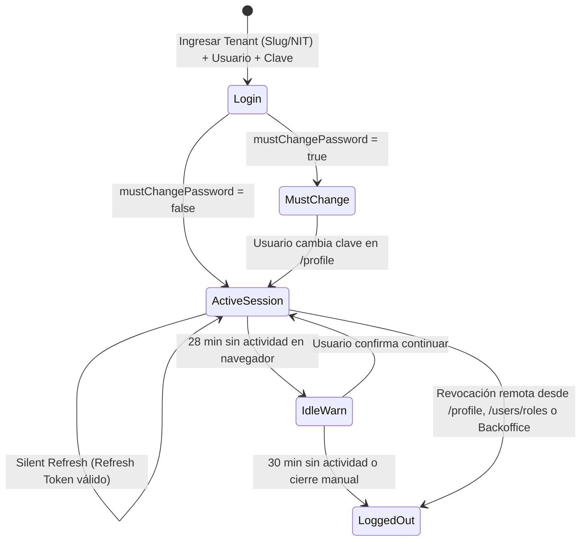

# 🔐 Flujo 4.4: Ciclo de Vida de Sesiones y Seguridad

> ⬅️ **Índice:** [Procesos de Negocio](../README.md) | [Flujo 4.3: Roles y Privilegios](./03_flujo_gestion_roles_y_privilegios.md) | [Manual del Dueño](../../manuals/restaurante/06_dueno_finanzas_personal_y_reglas.md)

Detalla la autenticación de usuarios ERP, la rotación obligatoria de contraseñas temporales, el autoservicio en **`Mi Perfil`** (`/profile`), el manejo del PIN de supervisor y el comportamiento real del cierre por inactividad.

---

## 1. Inicio de Sesión, Cambio Obligatorio y Autogestión (`/profile`)

### Controles Implementados Hoy
1. **Bloqueo de rutas cuando `mustChangePassword = true` (`auth.guard.ts`):** Todo usuario creado con cambio obligatorio o con contraseña restablecida es interceptado en cada navegación y redirigido a `/profile` hasta definir una nueva clave personal.
2. **Autoservicio en `Mi Perfil` (`/profile`):**
   - Actualización de contraseña personal.
   - Configuración y cambio del **PIN numérico de Supervisor (4–6 dígitos)** usado para autorizar anulaciones en `/cash-control`.
   - Listado de **Sesiones Activas** con revocación individual de dispositivos.
3. **Aislamiento de Identidad Backoffice vs ERP:** Los administradores de plataforma (`admin.localhost`) utilizan tablas, secretos JWT y política de contraseña independientes (`security.platform_password_min_length = 12`), sin compartir sesiones con el ERP de restaurantes.

---

## 2. Estado Real del Temporizador de Inactividad vs Parámetro

- En **`Parámetros del Sistema`** existe el parámetro catalogado `security.session_inactivity_timeout_minutes` (default `15`, pre-cargado con `60`/`120` en plantillas de onboarding).
- **Comportamiento real vigente en navegador (`IdleTimerService`):** Actualmente el frontend utiliza un tiempo fijo predeterminado de **`30 minutos` (`DEFAULT_IDLE_TIMEOUT_MINUTES = 30`)** con **aviso preventivo de `120 segundos`** antes de cerrar sesión automáticamente.
- No existen hoy tiempos diferenciados por estación (como sesiones KDS de 8 horas o ventanas distintas para caja vs oficina); el enlace dinámico del temporizador de navegador al parámetro configurado está previsto para futuras actualizaciones.

---

## Relacionado

- [Flujo 4.3: Gestión de Personal, Roles y Privilegios](./03_flujo_gestion_roles_y_privilegios.md)
- [Flujo 4.1: Parametrización Operativa](./01_flujo_parametrizacion_operativa_empresa.md)
- [Flujo 2.2: Gastos y Autorizaciones](../02-caja-y-finanzas/02_flujo_gastos_y_autorizaciones.md)
- [Manual del Dueño: Finanzas, Personal y Reglas](../../manuals/restaurante/06_dueno_finanzas_personal_y_reglas.md)
- [Secuencia Técnica: Ciclo de Vida de Sesiones](../../project/architecture/04-behavior-and-flows/sequence_session_lifecycle_and_refresh.md)
