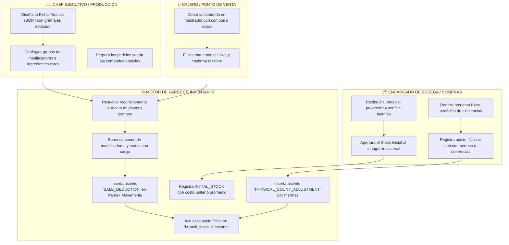
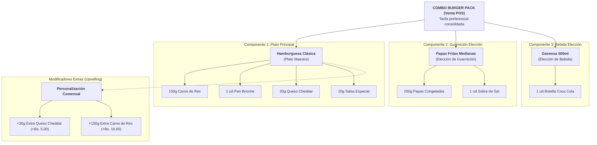
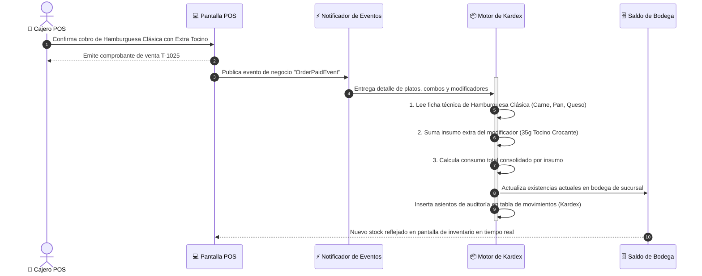

# 🥩 Manual Operativo: Fichas Técnicas (BOM), Combos y Deducción Automática en Kardex

> **Documento de Proceso de Negocio y Manual de Operaciones**  
> **Destinatarios:** Propietarios, Franquiciados, Chefs Ejecutivos, Jefes de Cocina, Encargados de Almacén/Bodega, Gerentes y Auditores de Costos.  
> **Objetivo:** Establecer el estándar operativo para el control de insumos gramo a gramo, diseño de recetas maestras (BOM), deducción atómica de combos y extras, y auditoría de movimientos en el libro mayor de Kardex.

---

## 📑 Índice de Navegación Rápida
- [1. Visión Ejecutiva y Propuesta de Valor](#-1-visión-ejecutiva-y-propuesta-de-valor)
- [2. Mapa Global del Procedimiento de Insumos y Kardex (Carriles de Actores)](#️-2-mapa-global-del-procedimiento-de-insumos-y-kardex-carriles-de-actores)
- [3. Anatomía de una Ficha Técnica Inteligente (BOM)](#-3-anatomía-de-una-ficha-técnica-inteligente-bom)
- [4. Diálogo y Secuencia de Deducción Automática por Venta](#-4-diálogo-y-secuencia-de-deducción-automática-por-venta)
- [5. Estrategias de Inventario de la Empresa (Modos Operativos)](#-5-estrategias-de-inventario-de-la-empresa-modos-operativos)
- [6. Guía Operativa Paso a Paso](#-6-guía-operativa-paso-a-paso)
  - [Fase 1: Catálogo de Insumos Base y Unidades de Medida](#fase-1-catálogo-de-insumos-base-y-unidades-de-medida)
  - [Fase 2: Formulación de la Ficha Técnica (BOM) y Combos](#fase-2-formulación-de-la-ficha-técnica-bom-y-combos)
  - [Fase 3: Apertura de Stock Inicial de Sucursal (INITIAL_STOCK)](#fase-3-apertura-de-stock-inicial-de-sucursal-initial_stock)
  - [Fase 4: Deducción en Tiempo Real tras Cobro en POS](#fase-4-deducción-en-tiempo-real-tras-cobro-en-pos)
  - [Fase 5: Conteo Físico, Ajustes de Stock y Control de Mermas](#fase-5-conteo-físico-ajustes-de-stock-y-control-de-mermas)
  - [Fase 6: Auditoría Cronológica del Libro Mayor (Kardex)](#fase-6-auditoría-cronológica-del-libro-mayor-kardex)
- [7. Preguntas Frecuentes de Cocina y Almacén (FAQ)](#-7-preguntas-frecuentes-de-cocina-y-almacén-faq)
- [8. Ficha Resumen de Parámetros y Buenas Prácticas de Food Cost](#-8-ficha-resumen-de-parámetros-y-buenas-prácticas-de-food-cost)

---

## 🎯 1. Visión Ejecutiva y Propuesta de Valor

En el sector gastronómico, el costo de alimentos y bebidas (*Food Cost*) representa típicamente entre el **28% y el 35% de los ingresos totales**. Las pérdidas invisibles debidas a porcionamiento descontrolado, robos hormiga en bodega o falta de registro de ingredientes extras pueden erosionar drásticamente el margen de ganancia de un restaurante.

Este sistema implementa un **motor de inventario inteligente y automatizado**:
1. **Deducción Gramo a Gramo Sin Esfuerzo Manual:** Cada vez que el cajero cobra una hamburguesa, el sistema rebaja de la bodega los 150 gramos de carne, el pan artesanal, la porción de queso cheddar y el embalaje, sin que nadie deba anotar nada en libretas.
2. **Deducción Recursiva de Combos y Extras:** Si el cliente pide un combo con papas rústicas y agrega doble carne extra, el sistema desglosa los ingredientes de cada componente y los descuenta simultáneamente en una sola transacción atómica.
3. **Kardex Transparente e Inalterable:** Cada movimiento (apertura, venta, compra, ajuste por merma) queda registrado con fecha, hora, responsable y motivo exacto, listo para auditorías contables.

---

## 🗺️ 2. Mapa Global del Procedimiento de Insumos y Kardex (Carriles de Actores)

---

## 🔬 3. Anatomía de una Ficha Técnica Inteligente (BOM)

El sistema soporta estructuras de recetas flexibles y compuestas:

> [!NOTE] **Deducción Consolidada**  
> Cuando se cobra este pedido, el Kardex no genera 8 transacciones dispersas: ejecuta una **única deducción consolidada** que descuenta simultáneamente: 300g de carne, 60g de queso, 1 pan, 20g de salsa, 200g de papas, sal y 1 botella de gaseosa.

---

## 💬 4. Diálogo y Secuencia de Deducción Automática por Venta

---

## ⚙️ 5. Estrategias de Inventario de la Empresa (Modos Operativos)

Cada concepto gastronómico tiene una dinámica de control diferente. La plataforma permite configurar la política de inventario mediante la variable `INVENTORY_DEDUCTION_MODE`:

| Modo de Deducción | Comportamiento en Venta | Escenario Recomendado | Riesgo / Control |
|---|---|---|---|
| **AUTOMATIC_PERMISSIVE** *(Por defecto)* | Descuenta insumos automáticamente tras cada cobro. Si el insumo llega a cero, **permite seguir vendiendo** y registra saldos negativos en Kardex. | Cadenas de comida rápida (*Fast Food*) con alta rotación donde detener la fila de clientes cuesta más que un descuadre temporal de inventario. | Alerta visual en bodega para registrar compras de emergencia o compras pendientes de ingreso. |
| **AUTOMATIC_STRICT** | Descuenta insumos automáticamente. Si un insumo clave llega a stock cero, **bloquea la venta del plato en el POS**. | Restaurantes de mantel o especialidad donde vender un plato sin insumo genera cancelaciones y quejas en mesa. | Cero promesas falsas al comensal; exige un estricto control de compras previo. |
| **MANUAL_ISOLATED** | No descuenta ingredientes en la venta. Las existencias se actualizan únicamente mediante conteo físico manual al cierre de semana o mes. | Bares o cocinas de autor con recetas altamente variables o ingredientes a granel de difícil estandarización. | Mayor dependencia del conteo manual periódico. |

---

## 📖 6. Guía Operativa Paso a Paso

### 🌾 Fase 1: Catálogo de Insumos Base y Unidades de Medida
Antes de definir platos, se catalogan los insumos de la despensa:
1. En **Inventario**, se registran los ingredientes con su **unidad de medida estándar**:
   - Insumos por peso: *Kilogramos (`kg`)* o *Gramos (`g`)*.
   - Insumos por volumen: *Litros (`l`)* o *Mililitros (`ml`)*.
   - Insumos unitarios: *Unidades (`und`)* (panes, huevos, latas de refresco).
2. Se establece el **Stock Mínimo de Seguridad** para que el sistema emita alertas preventivas amarillas o rojas antes de que el ingrediente se agote.

---

### 📋 Fase 2: Formulación de la Ficha Técnica (BOM) y Combos
1. En el módulo **Catálogo**, el Chef o Encargado abre el plato maestro y accede a la pestaña **Ficha Técnica / Receta**.
2. Agrega cada insumo con su cantidad neta requerida por porción (ejemplo: `0.150 kg` de Carne Molida, `1.00 und` de Pan Brioche).
3. Si el plato admite extras con recargo (ej. tocino, queso, salsa trufada), vincula el **Grupo de Modificadores** especificando qué insumo consume cada opción.
4. Si se arma un **Combo**, se vinculan los platos componentes y sus opciones de elección.

---

### 🟢 Fase 3: Apertura de Stock Inicial de Sucursal (`INITIAL_STOCK`)
Al inaugurar una nueva sucursal o comenzar a operar con el sistema:
1. El Encargado de Bodega realiza el pesaje y conteo físico de todo lo recibido en almacén.
2. Ingresa a **Inventario Físico y Kardex** y pulsa **"Apertura de Stock Inicial"**.
3. Selecciona la sucursal, el insumo, la cantidad inicial y el costo unitario de compra (ej. *50.00 kg de Carne de Res a Bs. 38.00 / kg*).
4. El sistema estampa el asiento inicial en Kardex como punto de partida auditable.

> [!IMPORTANT] **Regla de Integridad**  
> El Stock Inicial solo puede registrarse **una sola vez** por insumo y sucursal. Los ingresos posteriores de mercancía deben canalizarse como compras a proveedores (`PURCHASE`).

---

### ⚡ Fase 4: Deducción en Tiempo Real tras Cobro en POS
- El cajero opera normalmente en mostrador.
- Tan pronto el comensal paga y se emite el ticket `T-XXXX`, el sistema ejecuta la deducción en segundo plano en menos de 50 milisegundos.
- El personal de bodega puede ver en su pantalla cómo disminuyen las barras de existencias sin necesidad de consultar a cocina cuántas hamburguesas se vendieron.

---

### ⚖️ Fase 5: Conteo Físico, Ajustes de Stock y Control de Mermas
Periódicamente (diario, semanal o quincenal), se audita la despensa:
1. El bodeguero cuenta y pesa las existencias reales en estantes y congeladores.
2. Si encuentra una discrepancia (ejemplo: el sistema dice 12.5 kg pero en balanza hay 11.8 kg debido a descongelamiento o merma por porcionamiento):
3. Pulsa el botón **"⚙️ Ajustar Stock"** en la fila del insumo.
4. Digita la cantidad física real observada (`11.8000`) y selecciona el motivo (*Merma normal por descongelación*, *Rotura de empaque*, *Diferencia de conteo*).
5. El sistema ajusta el saldo actual y registra un movimiento de ajuste en el Kardex para justificar la diferencia contable.

---

### 📜 Fase 6: Auditoría Cronológica del Libro Mayor (Kardex)
Cualquier socio, gerente o auditor puede acceder a la pestaña **Kardex**:
- Visualiza la historia completa del insumo en orden cronológico:
  - `INITIAL_STOCK`: Saldo de apertura.
  - `SALE_DEDUCTION`: Salidas automáticas vinculadas al número de orden de venta del cliente.
  - `PURCHASE_IN`: Entradas por recepción de mercadería de proveedores.
  - `PHYSICAL_COUNT_ADJUSTMENT`: Correcciones por recuento físico o mermas.
- Cada línea muestra: Fecha/hora exacta, sucursal, cantidad que entró o salió, saldo resultante y usuario responsable.

---

## ❓ 7. Preguntas Frecuentes de Cocina y Almacén (FAQ)

### ¿Cómo se maneja la merma de cocción de la carne?
La ficha técnica siempre se diseña en base al **peso en crudo** (antes de cocción), que es como se compra, recibe y almacena el insumo en bodega. Si una hamburguesa de 150g pierde un 20% de peso en la plancha, la receta descuenta exactamente los 150g en crudo que salieron del congelador.

### ¿Qué sucede con las salsas y aderezos de autoservicio en salón?
Aquellos insumos que los clientes consumen a discreción (ej. dispensadores de ketchup en barra) no se vinculan a la receta de un plato individual. Se manejan como **consumo operativo global** y se ajustan al final de la semana registrando la cantidad de bidones utilizados.

### ¿Se pueden tener recetas diferentes para la misma hamburguesa en dos sucursales?
Sí. El sistema permite **clonar un plato**. Por ejemplo, si en la sucursal Santa Cruz la hamburguesa se prepara con pan de yuca local y en La Paz con pan brioche tradicional, se genera un clon del plato con su propia ficha técnica independiente para esa sucursal, sin afectar el menú maestro.

---

## 📊 8. Ficha Resumen de Parámetros y Buenas Prácticas de Food Cost

| Parámetro de Control | Estándar en la Industria | Impacto en la Rentabilidad |
|---|:---:|---|
| **Rango Meta de Food Cost** | **28% al 32%** del precio de venta | Garantiza margen bruto suficiente para cubrir costos fijos y utilidad neta. |
| **Margen de Variación Tolerable** | Menor al **1.5%** entre teórico y real | Diferencias mayores alertan sobre desperdicio en cocina o sustracción de producto. |
| **Frecuencia de Conteo de Insumos Críticos** | **Diario** para carnes de alto valor y quesos | Identificación inmediata de desvíos antes de acumular pérdidas semanales. |
| **Tiempo de Auditoría de Kardex** | En tiempo real con 1 clic | Cero horas perdidas en hojas de cálculo de Excel a fin de mes. |
