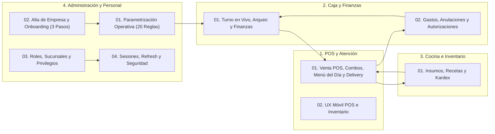

# 🏛️ Mapa de Procesos de Negocio (`docs/business-processes/`)

> ⬅️ **Índice:** [Bóveda Central (`docs/README.md`)](../README.md) | [Manuales del Restaurante](../manuals/restaurante/README.md) | [Manuales de Plataforma](../manuals/plataforma/operacion_backoffice_saas.md)

Documentación funcional y operativa verificada contra el comportamiento real de la plataforma. Cada proceso detalla actores, precondiciones, reglas configurables, flujos reales vigentes y alcance previsto para futuras versiones.

---

## 🗺️ Visión General de los Flujos Operativos

---

## 📂 Inventario de Procesos Documentados

### 1. Punto de Venta y Atención al Cliente (`01-pos-y-atencion/`)
- [**`01_flujo_atencion_y_venta_pos.md`**](./01-pos-y-atencion/01_flujo_atencion_y_venta_pos.md): Ciclo completo de venta en `Punto de Venta (POS)` (catálogo aislado por sucursal, fotos 4:3, extras, combos dinámicos y `Menús del Día`, modalidades `En Sala`/`Para Llevar`/`Recoger`/`Delivery`, 4 medios de pago, tickets en hora local y alcance real del modo offline).
- [**`02_flujo_atencion_movil_y_conteo_inventario.md`**](./01-pos-y-atencion/02_flujo_atencion_movil_y_conteo_inventario.md): Operación responsive móvil (`< 768 px`) para venta ágil en POS (`Galería`/`Compacto`/`Lista`, carrito flotante) y control de existencias mediante acordeones con semáforo en `Inventario y Kardex`.

### 2. Caja, Gastos y Finanzas (`02-caja-y-finanzas/`)
- [**`01_flujo_jornada_y_arqueo_caja.md`**](./02-caja-y-finanzas/01_flujo_jornada_y_arqueo_caja.md): Separación operativa entre `Control de Caja` (turno en vivo) y `Finanzas y Arqueos` (auditoría histórica, `Consolidar`/`Reabrir` y CSV), políticas de apertura y concurrencia, fórmula exacta de arqueo descontando devoluciones en efectivo y `Jornada de Servicio de Hoy`.
- [**`02_flujo_gastos_y_autorizaciones.md`**](./02-caja-y-finanzas/02_flujo_gastos_y_autorizaciones.md): Gastos menores con tope de caja chica, evidencia por texto/URL y control dual (`ADMIN_TENANT` auto-aprueba vs cola pendiente); anulación de pedidos con PIN presencial o `Enviar a Cola Remota`, devolución `CASH`/`DIGITAL` y política de mermas/reservas.

### 3. Cocina, Recetas e Inventario (`03-cocina-e-inventario/`)
- [**`01_flujo_recetas_y_kardex.md`**](./03-cocina-e-inventario/01_flujo_recetas_y_kardex.md): Alta de insumos y recetas en `Catálogo y Recetas`, carga única de stock inicial con calculadora bidireccional en `Inventario y Kardex`, movimientos reales (`INITIAL_STOCK`, `SALE_OUT`, `SALE_CONSUMPTION`, `PHYSICAL_COUNT_ADJUSTMENT`, `WASTE_ADJUSTMENT`, `CANCELLATION_REVERSAL`), 3 modos de deducción y alcance futuro de compras/traspasos.

### 4. Administración, Onboarding y Seguridad (`04-administracion-y-personal/`)
- [**`01_flujo_parametrizacion_operativa_empresa.md`**](./04-administracion-y-personal/01_flujo_parametrizacion_operativa_empresa.md): Catálogo completo de los **20 parámetros** (`TENANT`/`BRANCH`, `HIGH`/`MEDIUM`/`LOW`), validación crítica por contraseña y motivo, propagación inmediata y distinción entre reglas conectadas hoy vs pendientes de enlace dinámico en UI.
- [**`02_flujo_alta_empresa_y_onboarding.md`**](./04-administracion-y-personal/02_flujo_alta_empresa_y_onboarding.md): Auto-registro en **3 pasos** (`Empresa y Admin`, `Sucursal y Mapa` con 6 ciudades bolivianas, `Perfil Operativo` incluyendo `EMPTY` y catálogo demo opcional), alta asistida desde Backoffice (`PENDING_ACTIVATION`) y transición al `Tour Guiado`.
- [**`03_flujo_gestion_roles_y_privilegios.md`**](./04-administracion-y-personal/03_flujo_gestion_roles_y_privilegios.md): Diferencia real entre `Gestión de Personal` (alta/edición rápida con los 4 roles base) y `Roles y Privilegios` (roles personalizados, multi-sucursal, vigencias temporales y reseteo de clave), incluyendo validación `security.require_user_email`.
- [**`04_flujo_ciclo_vida_sesiones_y_seguridad.md`**](./04-administracion-y-personal/04_flujo_ciclo_vida_sesiones_y_seguridad.md): Acceso con JWT + Refresh Token, cambio obligatorio de contraseña (`mustChangePassword` redirigiendo a `/profile`), PIN de supervisor, cierre de sesiones activas y estado actual del temporizador de inactividad en navegador (`30 min` + aviso `120 s`).

---

## Relacionado

- [Manuales de Usuario para Restaurantes](../manuals/restaurante/README.md)
- [Manuales de Plataforma y Backoffice SaaS](../manuals/plataforma/operacion_backoffice_saas.md)
- [Arquitectura Viva y Diagramas Mermaid](../project/architecture/README.md)
- [Sub-Bóveda del Backoffice SaaS](../backoffice/README.md)
