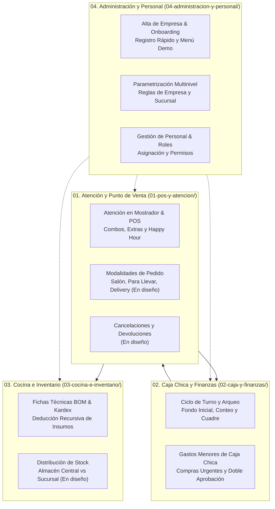

# 📖 Manual de Procesos y Operaciones del Restaurante

Bienvenido al **Manual de Procesos de Negocio** del Sistema de Gestión de Restaurante (POS + ERP). Este compendio documenta cómo opera el restaurante en la vida real, cómo interactúan el cliente, el cajero, el cocinero y el administrador con el sistema, y cuáles son las políticas y reglas operativas que garantizan la rentabilidad y el orden del negocio.

Diseñado con un enfoque **100% de negocio y libre de jerga técnica**, este manual es la herramienta ideal para:
- **Demostración y venta comercial** a nuevos restaurantes y franquicias.
- **Inducción y capacitación rápida** de nuevos colaboradores (cajeros, encargados, cocineros, administradores).
- **Manual de consulta operativa diaria** y auditoría de procedimientos.
- **Artefacto de entrada para Ingeniería:** Los ingenieros y arquitectos diseñan la arquitectura técnica (Fase 2 del SDD-SDLC) a partir de estos flujos de valor humano.

---

## 🗺️ Mapa Macro de Procesos por Áreas Operativas

---

## 📚 Catálogo Estructurado de Procesos por Área

### 🛒 01. Área de Atención y Punto de Venta (`01-pos-y-atencion/`)
Procedimientos de cara al comensal, toma de comandas, opciones de menú y experiencia de despacho:
- [**`01_flujo_atencion_y_venta_pos.md`**](./01-pos-y-atencion/01_flujo_atencion_y_venta_pos.md): **Protocolo de Mostrador, Combos y Venta en POS:** Flujo de atención al comensal, personalización con modificadores y extras con cargo, promociones automáticas Happy Hour según huso local, cobro multiformato (Efectivo/Tarjeta/QR) y resiliencia offline ininterrumpida.
- *(En Diseño / Fase 2)* `flujo_cancelacion_pedidos_y_devolucion.md`: Procedimiento de anulación de orden, autorización con PIN de supervisor, reintegro de dinero en gaveta y destino del plato (merma de cocina vs reintegro a stock).
- *(En Diseño / Fase 2)* `flujo_modalidades_llevar_y_delivery.md`: Circuito de pedidos para llevar (*Takeout*), encargos programados y empaquetado para despacho.

---

### 💵 02. Área de Caja y Finanzas (`02-caja-y-finanzas/`)
Control del dinero en efectivo, arqueos y salidas de fondos de emergencia:
- [**`01_flujo_jornada_y_arqueo_caja.md`**](./02-caja-y-finanzas/01_flujo_jornada_y_arqueo_caja.md): **Ciclo de Turno, Control de Efectivo y Arqueo Final:** Protocolo de apertura de gaveta con fondo inicial (*Float*), acumulación de ventas en efectivo, compras menores de emergencia, autorización administrativa, conteo físico de billetes y dictamen de cuadre exacto ($0.00$ diferencia).
- [**`02_flujo_gastos_y_autorizaciones.md`**](./02-caja-y-finanzas/02_flujo_gastos_y_autorizaciones.md): **Circuito de Caja Menor, Compras Urgentes y Doble Autorización:** Mecanismo anti-fraude para compras urgentes de insumos, solicitud digital por cajero con restricción de autoaprobación y autorización remota en 1 clic por el administrador.

---

### 🍳 03. Área de Cocina e Inventario (`03-cocina-e-inventario/`)
Gestión del Food Cost, rendimiento de insumos y abastecimiento:
- [**`01_flujo_recetas_y_kardex.md`**](./03-cocina-e-inventario/01_flujo_recetas_y_kardex.md): **Fichas Técnicas (BOM), Combos y Deducción en Kardex:** Control de Food Cost, formulación de recetas, deducción recursiva de ingredientes por venta de platos y combos, apertura de stock inicial y auditoría en libro mayor de Kardex.
- *(En Diseño / Fase 2)* `flujo_distribucion_almacen_central_a_sucursal.md`: Protocolo de abastecimiento centralizado, solicitud de reposición desde sucursal y recepción de transferencias internas de insumos.

---

### ⚙️ 04. Área de Administración y Personal (`04-administracion-y-personal/`)
Políticas organizacionales, configuración de empresa y gobierno operativo:
- [**`01_flujo_parametrizacion_operativa_empresa.md`**](./04-administracion-y-personal/01_flujo_parametrizacion_operativa_empresa.md): **Flujo de Parametrización y Gobierno Operativo:** Configuración de directrices corporativas, adaptaciones autorizadas por sucursal, circuito de cambios críticos con contraseña y reversión a estándares mediante Sparse Storage (ADR-0008).
- [**`02_flujo_alta_empresa_y_onboarding.md`**](./04-administracion-y-personal/02_flujo_alta_empresa_y_onboarding.md): **Flujo de Alta de Empresa y Asistente de Onboarding:** Procedimiento de autoregistro rápido en 4 pasos, inferencia automática de slug amigable, NIT opcional para pequeños comercios, selección de giro de negocio (Pizzería, A la carta, Bar), 3 platos semilla de demostración y redirección directa al Punto de Venta (ADR-0009).
- [**`03_flujo_gestion_roles_y_privilegios.md`**](./04-administracion-y-personal/03_flujo_gestion_roles_y_privilegios.md): **Flujo de Roles Personalizados, Asignación de Personal y Reseteo de Contraseñas:** Creación de perfiles a medida (ej. Encargado de Compras, Bartender), asignación de colaboradores a múltiples sucursales con selector activo, control de expiración temporal de accesos y reseteo jerárquico delegado de credenciales para colaboradores sin correo electrónico (ADR-0010).

---

## 🏛️ Gobernanza y Ciclo de Vida (ADR-0007)

Los documentos de esta carpeta se rigen por el **Criterio de Impacto Operativo y Multirrol**:
1. **Origen en Fase 2 (Diseño / Spec-First):** Todo procedimiento que involucre interacción humana directa entre múltiples roles (cajero-supervisor-cocinero) o impacto tangible sobre dinero, comensales o inventario físico debe modelarse aquí antes de diseñar los diagramas técnicos de software.
2. **Sincronización en Fase 4 (Sync-Always):** Si durante la construcción o certificación del software se ajusta un flujo de usuario o paso operativo, el documento correspondiente se actualiza inmediatamente en el mismo commit.
