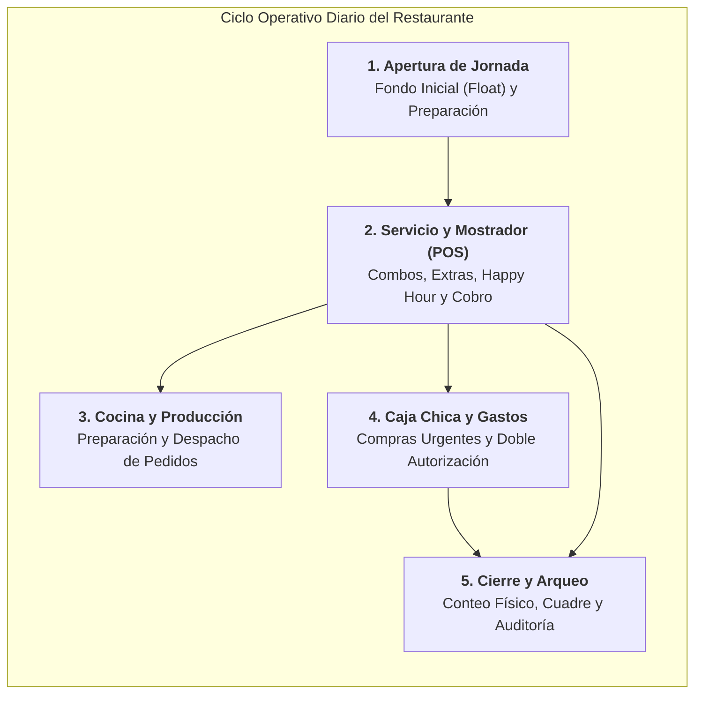

# 📖 Manual de Procesos y Operaciones del Restaurante

Bienvenido al **Manual de Procesos de Negocio** del Sistema de Gestión de Restaurante (POS + ERP). Este compendio documenta cómo opera el restaurante en la vida real, cómo interactúan el cliente, el cajero, el cocinero y el administrador con el sistema, y cuáles son las políticas y reglas operativas que garantizan la rentabilidad y el orden del negocio.

Diseñado con un enfoque **100% de negocio y libre de jerga técnica**, este manual es la herramienta ideal para:
- **Demostración y venta comercial** a nuevos restaurantes y franquicias.
- **Inducción y capacitación rápida** de nuevos colaboradores (cajeros, encargados, administradores).
- **Manual de consulta operativa diaria** y auditoría de procedimientos.

---

## 🗺️ Mapa Macro de Procesos del Restaurante

---

## 📚 Catálogo de Procesos Documentados

| # | Documento de Proceso | Foco de Negocio | Estado |
|:---:|---|---|:---:|
| **01** | [**`01_flujo_jornada_y_arqueo_caja.md`**](./01_flujo_jornada_y_arqueo_caja.md) | **Ciclo de Turno, Control de Efectivo y Arqueo Final:** Protocolo de apertura de gaveta con fondo inicial (*Float*), acumulación de ventas en efectivo, compras menores de emergencia, autorización administrativa, conteo físico de billetes y dictamen de cuadre exacto ($0.00$ diferencia). | 🟢 **Publicado** |
| **02** | [**`02_flujo_atencion_y_venta_pos.md`**](./02_flujo_atencion_y_venta_pos.md) | **Protocolo de Mostrador, Combos y Venta en POS:** Flujo de atención al comensal, personalización con modificadores y extras con cargo, promociones automáticas Happy Hour según huso local, cobro multiformato (Efectivo/Tarjeta/QR) y resiliencia offline ininterrumpida. | 🟢 **Publicado** |
| **03** | [**`03_flujo_gastos_y_autorizaciones.md`**](./03_flujo_gastos_y_autorizaciones.md) | **Circuito de Caja Menor, Compras Urgentes y Doble Autorización:** Mecanismo anti-fraude para compras urgentes de insumos, solicitud digital por cajero con restricción de autoaprobación y autorización remota en 1 clic por el administrador. | 🟢 **Publicado** |
| **04** | [**`04_flujo_recetas_y_kardex.md`**](./04_flujo_recetas_y_kardex.md) | **Fichas Técnicas (BOM), Combos y Deducción en Kardex:** Control de Food Cost, formulación de recetas, deducción recursiva de ingredientes por venta de platos y combos, apertura de stock inicial y auditoría en libro mayor de Kardex. | 🟢 **Publicado** |

---

## 💡 Cómo Utilizar esta Documentación

1. **Lectura Digital Interactiva:** En **Obsidian** o GitHub, los diagramas Mermaid se renderizan de forma interactiva con zoom y navegación clara.
2. **Exportación a PDF Profesional:** Cada archivo cuenta con formato estandarizado en GitHub Flavored Markdown (alertas visuales, tablas estilizadas, fórmulas matemáticas en KaTeX y diagramas vectoriales), listo para imprimir o exportar como folleto de capacitación o propuesta comercial.
