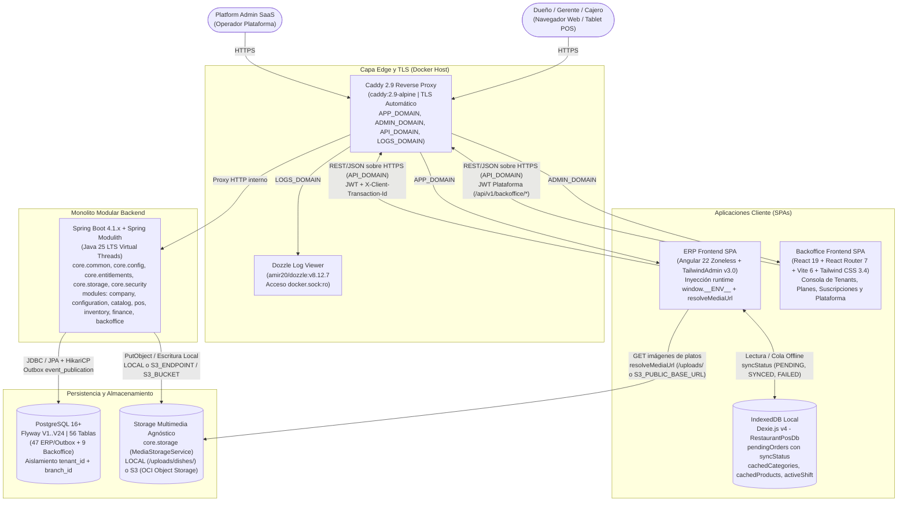

# C4 Nivel 2: Diagrama de Contenedores del Sistema

Este diagrama describe la topología física y lógica de contenedores de la plataforma **Restaurante ERP SaaS + Backoffice** en despliegue productivo/staging y su operación Offline-First en sucursales, sincronizada hasta la migración Flyway `V24` (**56 tablas totales**: `47` tablas ERP/Sistema + `9` tablas Backoffice).

## Diagrama de Contenedores (Mermaid)

## Inventario de Contenedores y Responsabilidades

| Contenedor / Servicio | Tecnología Verificada | Responsabilidad Principal | Referencia de Diseño |
| :--- | :--- | :--- | :--- |
| **Reverse Proxy (`caddy`)** | `caddy:2.9-alpine` | Terminación TLS automática y enrutamiento por subdominio (`APP_DOMAIN`, `ADMIN_DOMAIN`, `API_DOMAIN`, `LOGS_DOMAIN`) sin montar `docker.sock`. | [ADR-0026](../../../adr/0026_cloud_infrastructure_and_deployment_stack.md) |
| **ERP Frontend (`erp-frontend`)** | Angular 22 (Zoneless, Standalone, Signals) + TailwindAdmin v3.0 + `runtime-env.ts` | Operación diaria del restaurante: POS táctil/escritorio, control de caja, menús del día, inventario Kardex, RBAC, parámetros y perfil. Lee `window.__ENV__.API_BASE_URL` en runtime y resuelve URLs multimedia cross-origin mediante `resolveMediaUrl`. | [C4 Nivel 3 - Frontend Angular](./c4_level3_frontend_angular.md), [ADR-0014](../../../adr/0014_tailwindadmin_v3_dynamic_theme_and_uikit.md), [ADR-0033](../../../adr/0033_spa_runtime_env_and_cross_origin_media.md) |
| **Persistencia Local (`RestaurantPosDb`)** | IndexedDB vía Dexie.js v4 | Caché local del catálogo (`cachedCategories`, `cachedProducts`), estado del turno (`activeShift`) y cola transaccional idempotente (`pendingOrders` v2 segmentada por `tenantId`, `branchId` y `syncStatus`). | [Esquema Local Dexie.js](../02-domain-and-data/dexie_local_schema.md), [Sincronización Offline POS](../04-behavior-and-flows/sequence_pos_offline_sync.md), [ADR-0003](../../../adr/0003_offline_first_dexie_sync.md) |
| **Backoffice Frontend (`backoffice-frontend`)** | React 19 (`^19.2.0`), `react-router-dom` (`^7.5.0`), Vite 6, Tailwind CSS 3.4 | Consola administrativa SaaS aislada del ERP: gestión de tenants, planes de suscripción, cobros/pagos, cuotas, telemetría operativa y configuración global de plataforma (`platform_settings`). | [C4 Backoffice System](../../../backoffice/architecture/c4_backoffice_system.md), [ADR-0029](../../../adr/0029_backoffice_subscriptions_quotas_and_telemetry.md) |
| **Backend Monolito Modular (`backend`)** | Java 25 LTS (Virtual Threads), Spring Boot 4.1.x, Spring Modulith | Núcleo `core` (`common`, `config`, `entitlements`, `storage`, `security`, `audit`) y módulos de negocio (`company`, `configuration`, `catalog`, `pos`, `inventory`, `finance`, `backoffice`). Comunicación desacoplada por interfaces `.api` y eventos Modulith persistentes. | [C4 Nivel 3 - Backend Spring Modulith](./c4_level3_backend_modulith.md), [ADR-0001](../../../adr/0001_spring_modulith_monolith.md) |
| **Base de Datos (`postgres`)** | PostgreSQL 16+ con Flyway (`V1`–`V24`) | Almacenamiento relacional multi-tenant con **56 tablas** (`47` ERP + Outbox Modulith y `9` Backoffice). Garantiza atomicidad financiera/inventario, idempotencia por `client_transaction_id` y fechas/zonas según ADR-0006. | [Modelo Entidad-Relación ERP](../02-domain-and-data/database_erd.md), [ERD Backoffice](../../../backoffice/architecture/domain_and_erd_subscriptions.md), [ADR-0002](../../../adr/0002_hybrid_tenancy_and_dynamic_settings.md), [ADR-0006](../../../adr/0006_datetime_and_timezone_handling.md) |
| **Storage Multimedia (`core.storage`)** | `MediaStorageServiceImpl` (`LOCAL` o `S3` OCI Object Storage) | Abstracción de almacenamiento para imágenes de platos y activos multimedia. En modo `LOCAL` sirve desde `/uploads/dishes/`; en modo `S3` sube a bucket compatible S3 (`S3_ENDPOINT`, `S3_BUCKET`, `S3_PUBLIC_BASE_URL`) y prueba conectividad desde Backoffice. | [ADR-0028](../../../adr/0028_agnostic_media_storage_and_platform_settings.md), [ADR-0033](../../../adr/0033_spa_runtime_env_and_cross_origin_media.md) |
| **Observabilidad de Contenedores (`dozzle`)** | `amir20/dozzle:v8.12.7` | Visor de logs en tiempo real expuesto detrás de Caddy (`LOGS_DOMAIN`) montando `/var/run/docker.sock:ro` únicamente para diagnóstico operativo. | [ADR-0026](../../../adr/0026_cloud_infrastructure_and_deployment_stack.md) |

## Invariantes de Comunicación entre Contenedores

1. **Multitenancy y Entitlements:** Toda petición del ERP hacia `API_DOMAIN` transporta JWT con `tenantId`, `branchId`, `userId` y permisos RBAC (`TenantContextHolder`). Adicionalmente, `core.entitlements` (`TenantEntitlementService`) valida en memoria estado de suscripción (`TRIAL`, `ACTIVE`, `GRACE_PERIOD`, `SUSPENDED` con `suspensionMode`) y cuotas (`MONTHLY_ORDERS`, `MAX_BRANCHES`, `MAX_USERS`) antes de permitir ventas, apertura de turnos o creación de recursos. Ver [Ciclo de Vida del Tenant](../04-behavior-and-flows/state_tenant_lifecycle.md).
2. **Aislamiento de Credenciales y Bootstrap:** El plano Backoffice utiliza tokens JWT y `PlatformRefreshToken` separados (`BackofficeSecurityConfig`) y un bootstrap explícito para el primer `PlatformAdmin` sin contraseñas demo en producción. Ver [ADR-0027](../../../adr/0027_platform_identity_and_clean_golive_bootstrap.md).
3. **Soporte Offline-First e Idempotencia:** Ante pérdida de red entre `erp-frontend` y `caddy`/`backend`, el POS guarda la venta localmente en Dexie (`pendingOrders`) con `syncStatus: 'PENDING'` y `clientTransactionId` UUID; al reconectar, sincroniza vía `POST /api/v1/pos/orders/sync` evitando duplicación de órdenes, caja o deducciones Kardex.
4. **Resolución Cross-Origin en Producción:** En entornos con subdominios separados (`APP_DOMAIN` vs `API_DOMAIN` o `S3_PUBLIC_BASE_URL`), `erp-frontend` resuelve dinámicamente el prefijo base con `runtime-env.ts` sin recompilar el bundle de Angular ([ADR-0033](../../../adr/0033_spa_runtime_env_and_cross_origin_media.md)).

## Enlaces Relacionados

- [Índice de Arquitectura del Sistema](../README.md)
- [Visión General de Arquitectura SDD](../../../sdd/01_architecture_overview.md)
- [Arquitectura C4 del Backoffice](../../../backoffice/architecture/c4_backoffice_system.md)
- [ADR-0001: Monolito Modular Spring Modulith](../../../adr/0001_spring_modulith_monolith.md)
- [ADR-0004: Clonación de Catálogo y Overrides](../../../adr/0004_catalog_cloning_and_overrides.md)
- [ADR-0005: Flujo de Turnos de Caja y Gastos](../../../adr/0005_cash_shift_expense_workflow.md)
- [ADR-0026: Stack de Infraestructura Cloud y Despliegue](../../../adr/0026_cloud_infrastructure_and_deployment_stack.md)
- [ADR-0028: Almacenamiento Agnóstico de Medios y Platform Settings](../../../adr/0028_agnostic_media_storage_and_platform_settings.md)
- [ADR-0029: Suscripciones, Cuotas y Telemetría Backoffice](../../../adr/0029_backoffice_subscriptions_quotas_and_telemetry.md)
