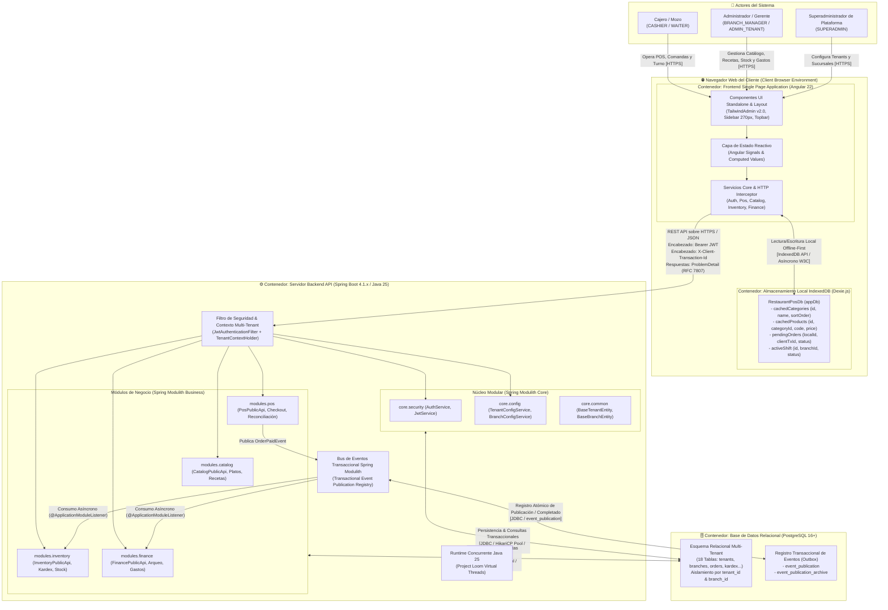
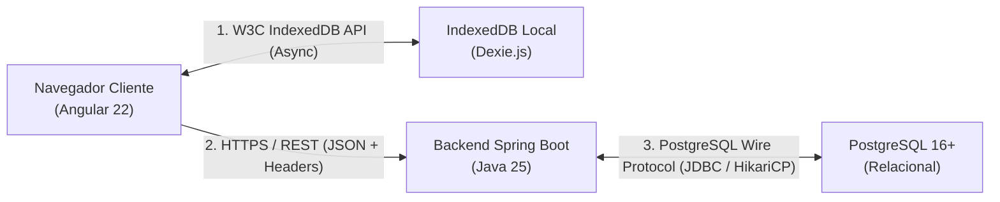

# 📦 Diagrama C4 Nivel 2: Topología de Contenedores

Este documento especifica la **Arquitectura C4 Nivel 2 (Contenedores)** del Sistema Integral de Gestión para Restaurante (POS & ERP). Modela los límites de ejecución de software de alto nivel, los entornos de ejecución, los almacenes de datos y los protocolos de comunicación que interconectan la solución.

---

## 1. Diagrama C4 de Contenedores

---

## 2. Catálogo de Contenedores y Responsabilidades

| Contenedor | Tecnología Principal | Entorno de Ejecución | Responsabilidad Primaria | Estrategia de Aislamiento / Multi-Tenancy | Almacenamiento / Persistencia |
| :--- | :--- | :--- | :--- | :--- | :--- |
| **Frontend SPA** | Angular 22, Tailwind CSS (TailwindAdmin v2.0), TypeScript | Navegador Web (Chrome, Edge, Firefox, Safari) | Interfaz de usuario interactiva y reactiva; gestión de sesiones; procesamiento de ventas táctiles en POS; arqueos de caja; cálculo reactivo de subtotales; operación en modo offline. | Contexto de sesión obtenido del JWT (`tenantId`, `branchId`, `role`) almacenado en memoria reactiva (`AuthService.currentUser`). | Memoria de la aplicación y llamadas a la capa DAL local. |
| **Almacenamiento Local** | IndexedDB API, Dexie.js v4+ (`RestaurantPosDb`) | Sandbox de Almacenamiento del Navegador (IndexedDB) | Persistencia local offline-first del catálogo descargado, turno activo de la estación y cola transaccional de ventas pendientes de sincronización. | Aislado por origen de dominio web; las transacciones contienen `branchId` y `clientTransactionId` asignados. | IndexedDB (`RestaurantPosDb` con `cachedCategories`, `cachedProducts`, `pendingOrders`, `activeShift`). |
| **Servidor Backend API** | Spring Boot 4.1.x, Spring Modulith, Spring Security, Java 25 LTS (Amazon Corretto) | Máquina Virtual Java (JVM) con Project Loom Virtual Threads | Orquestación del dominio de restaurante; validación de reglas de negocio; autenticación Argon2id y emisión de JWT; despacho de eventos de integración intermodular; idempotencia de mutaciones. | `TenantContextHolder` (propagación segura en `ThreadLocal` compatible con Virtual Threads) extraído por `JwtAuthenticationFilter`. | Sin estado (Stateless API). Todo estado transaccional reside en PostgreSQL. |
| **Base de Datos Relacional** | PostgreSQL 16+ con Flyway Migrations | Servidor de Base de Datos / Contenedor PostgreSQL | Almacenamiento persistente ACID de todo el modelo de datos empresarial (18 tablas transaccionales), bitácora de auditoría y almacén de eventos de Spring Modulith. | Multi-tenancy por discriminador de columnas (`tenant_id`, `branch_id`) e índices compuestos denormalizados en todas las tablas transaccionales. | Disco persistente PostgreSQL (`restaurant_db`, tablas de negocio y `event_publication`). |

---

## 3. Matriz de Protocolos e Intercambio de Datos

### Detalle de Protocolos y Encabezados

1. **Cliente $\leftrightarrow$ IndexedDB (`RestaurantPosDb`):**
   - **Protocolo:** W3C IndexedDB API asíncrona mediante el wrapper Dexie.js.
   - **Garantía:** Transacciones ACID locales a nivel de navegador. Permite a los cajeros seguir facturando aunque no haya conexión a Internet (`isOnline = false`).
   - **Objetos Persistidos:** Entidades tipadas (`CachedCategory`, `CachedProduct`, `PendingOrderEntity`, `ActiveShiftEntity`).

2. **Cliente $\rightarrow$ Backend API:**
   - **Protocolo:** HTTPS (TLS 1.3) / RESTful API con formato de carga útil JSON (codificación UTF-8).
   - **Autenticación:** Cabecera `Authorization: Bearer <jwt_token>` validada de forma sin estado en cada petición mediante `JwtAuthenticationFilter`.
   - **Idempotencia Transaccional:** Cabecera `X-Client-Transaction-Id: <UUID>` enviada en transacciones mutables (como creación de comandas `/api/v1/pos/orders` y sincronización por lotes `/api/v1/pos/sync`). El backend descarta o confirma duplicados sin reprocesar recetas ni duplicar cargos.
   - **Manejo Estandarizado de Errores:** Respuestas de error estructuradas conforme al estándar **RFC 7807 (`ProblemDetail`)**, serializando campos `type`, `title`, `status`, `detail`, `instance` y metadatos específicos del tenant.

3. **Backend API $\leftrightarrow$ PostgreSQL 16+:**
   - **Protocolo:** PostgreSQL Wire Protocol sobre TCP (puerto 5432).
   - **Conexiones:** Gestionadas mediante el pool de alto rendimiento **HikariCP**.
   - **Gestión de Esquema:** Versionado declarativo estricto con **Flyway** (`V1__init_schema.sql` para tablas maestras y `V2__spring_modulith_events.sql` para el registro de eventos).
   - **Zonas Horarias:** Conexión forzada a `time_zone = 'UTC'` (`TIMESTAMPTZ`) en base de datos; la conversión a hora de negocio local se efectúa con base en `branches.timezone` (ej. `'America/La_Paz'`).

---

## 4. Decisiones Técnicas y Arquitectónicas Clave (Trazabilidad ADR)

| Código ADR | Título de la Decisión | Impacto en la Topología de Contenedores |
| :--- | :--- | :--- |
| **[ADR-0001](../../../adr/ADR-0001-arquitectura-modular-monolito-spring-modulith.md)** | Monolito Modular con Spring Modulith en lugar de Microservicios | Se mantiene un único contenedor de backend para reducir la latencia de red, eliminar la complejidad de orquestación distribuida (Kubernetes/Istio) y asegurar transacciones ACID locales mediante eventos desacoplados. |
| **[ADR-0002](../../../adr/ADR-0002-estrategia-offline-first-pos-dexie-indexeddb.md)** | Estrategia Offline-First en POS con Dexie.js (IndexedDB) | Despliegue de un contenedor de persistencia en el navegador del cliente que amortigua fallos de conectividad en el salón comedor o caja, permitiendo cobrar y guardar comandas en cola local. |
| **[ADR-0003](../../../adr/ADR-0003-modelo-aislamiento-multitenant.md)** | Aislamiento Multi-Tenant por Columnas Discriminadoras | Un único esquema físico de base de datos PostgreSQL particionado lógicamente por `tenant_id` y `branch_id`, optimizando el uso de memoria del servidor y simplificando el mantenimiento de migraciones Flyway. |
| **[ADR-0004](../../../adr/ADR-0004-concurrencia-project-loom-virtual-threads.md)** | Hilos Virtuales de Java 25 (Project Loom) | El contenedor backend soporta un alto volumen de conexiones concurrentes de POS y sincronización sin agotar el pool de hilos del sistema operativo (`spring.threads.virtual.enabled=true`). |
| **[ADR-0005](../../../adr/ADR-0005-publicacion-eventos-transaccionales-modulith.md)** | Publicación Transaccional de Eventos con Outbox Pattern | Las tablas `event_publication` y `event_publication_archive` dentro de PostgreSQL garantizan que el evento `OrderPaidEvent` emitido por el POS se procese en Kardex y Finanzas con garantía *at-least-once*, evitando pérdidas ante caídas de servidor. |
| **[ADR-0006](../../../adr/ADR-0006-manejo-fechas-zonas-horarias.md)** | Manejo Estricto de Fechas y Zonas Horarias | PostgreSQL almacena instantes transaccionales en UTC (`TIMESTAMPTZ`) y fechas puras sin hora (`DATE`). El backend y el frontend respetan la zona horaria configurada en la sucursal (`branches.timezone`). |

---

## 5. Navegación y Enlaces Relacionados

- **Nivel Superior:** [Índice de la Bóveda de Arquitectura](../README.md)
- **Nivel 3 Backend:** [Componentes de Backend Spring Modulith](./c4_level3_backend_modulith.md)
- **Nivel 3 Frontend:** [Componentes de Frontend Angular Zoneless](./c4_level3_frontend_angular.md)
- **Persistencia Física:** [ERD de Base de Datos PostgreSQL](../02-domain-and-data/database_erd.md) y [Esquema IndexedDB Dexie.js](../02-domain-and-data/dexie_local_schema.md)
- **Flujos Transaccionales:** [Secuencia POS $\rightarrow$ Event $\rightarrow$ Kardex](../04-behavior-and-flows/sequence_pos_order_deduction.md) y [Secuencia Offline-First e Idempotencia](../04-behavior-and-flows/sequence_pos_offline_sync.md)
