# 🧩 Diagrama C4 Nivel 3: Componentes de Backend (Spring Modulith)

Este documento especifica la **Arquitectura C4 Nivel 3 (Componentes de Backend)** del Sistema Integral de Gestión para Restaurante (POS & ERP). Modela la estructura modular de **Spring Modulith** sobre **Java 25 LTS**, detallando los límites estrictos de paquetes, los contratos públicos (`.api`), la encapsulación interna (`.internal`), la orquestación asíncrona de eventos con garantía *outbox* (`event_publication`) y el aislamiento multi-tenant.

---

## 1. Diagrama C4 de Componentes de Backend

```mermaid
graph TD
    subgraph Client["Cliente Web / REST Consumer"]
        HTTP_Req["Peticiones HTTPS / JSON<br/>- Authorization: Bearer JWT<br/>- X-Client-Transaction-Id: UUID"]
    end

    subgraph Backend_Container["Servidor Backend (Spring Boot 4.1.x / Java 25 / Project Loom)"]
        
        %% MÓDULO SECURITY & USUARIOS
        subgraph Mod_Security["Módulo: core.security"]
            subgraph Mod_Security_API[".api (Contratos Públicos)"]
                UserPubApi["UserPublicApi<br/>(getUsersByTenant, getUserById, createUser...)"]
            end
            subgraph Mod_Security_INT[".internal (Implementación & Seguridad)"]
                SecFilter["JwtAuthenticationFilter<br/>(OncePerRequestFilter + X-Branch-Id)"]
                TenantCtx["TenantContextHolder<br/>(ThreadLocal Multi-Tenant Context)"]
                AuthCtrl["AuthController<br/>(/api/v1/auth)"]
                UserCtrl["UserController<br/>(/api/v1/users)"]
                ProfileCtrl["ProfileController<br/>(/api/v1/profile)"]
                AuthSvc["AuthService<br/>(Argon2id + JwtService)"]
                UserMgmtSvc["UserManagementServiceImpl<br/>(Gestión de colaboradores & passwords)"]
                UserRepo[("AppUserRepository<br/>[Encapsulado]")]
            end
        end

        %% MÓDULO CONFIG
        subgraph Mod_Config["Módulo: core.config"]
            subgraph Mod_Config_API[".api (Contratos Públicos)"]
                CfgTenantApi["TenantConfigService<br/>(getString, getBoolean...)"]
                CfgBranchApi["BranchConfigService<br/>(getString, setSetting...)"]
            end
            subgraph Mod_Config_INT[".internal (Implementación)"]
                CfgTenantImpl["TenantConfigServiceImpl"]
                CfgBranchImpl["BranchConfigServiceImpl"]
                CfgRepos[("TenantSettingRepository<br/>BranchSettingRepository")]
            end
        end

        %% MÓDULO COMMON
        subgraph Mod_Common["Módulo: core.common"]
            BaseEntities["BaseTenantEntity / BaseBranchEntity<br/>(tenant_id, branch_id, timestamps)"]
            CommonRepos[("TenantRepository<br/>BranchRepository")]
        end

        %% MÓDULO COMPANY & SUCURSALES
        subgraph Mod_Company["Módulo: modules.company"]
            subgraph Mod_Company_API[".api (Contratos Públicos)"]
                CompanyPubApi["CompanyPublicApi<br/>(getCompany, updateCompany)"]
                BranchPubApi["BranchPublicApi<br/>(getBranchesByTenant, createBranch...)"]
            end
            subgraph Mod_Company_INT[".internal (Implementación)"]
                CompanyCtrl["CompanyController<br/>(/api/v1/company)"]
                BranchCtrl["BranchController<br/>(/api/v1/branches)"]
                CompanySvc["CompanyServiceImpl"]
                BranchSvc["BranchServiceImpl"]
            end
        end

        %% MÓDULO CATALOG
        subgraph Mod_Catalog["Módulo: modules.catalog"]
            subgraph Mod_Cat_API[".api (Contrato Público)"]
                CatApi["CatalogPublicApi<br/>- getRecipeByDishId(UUID)<br/>- getEffectiveDishPrice(dishId, branchId)<br/>- getActiveMenuForBranch(...)<br/>- isDishAvailableInBranch(...)"]
            end
            subgraph Mod_Cat_INT[".internal (Implementación & DAOs)"]
                CatCtrl["CatalogController<br/>(/api/v1/catalog)"]
                CatSvc["CatalogServiceImpl"]
                CatRepos[("CategoryRepository<br/>DishRepository<br/>DishRecipeRepository<br/>BranchDishRepository<br/>IngredientRepository")]
            end
        end

        %% MÓDULO POS
        subgraph Mod_POS["Módulo: modules.pos"]
            subgraph Mod_POS_API[".api (Contrato Público & Evento)"]
                PosApi["PosPublicApi<br/>- placeOrder(CreateOrderRequest)<br/>- getShiftSalesSummary(tenantId, shiftId)"]
                OrderPaidEvt["OrderPaidEvent<br/>(eventId, tenantId, branchId, orderId,<br/>ticketNumber, items, totalAmount, cashShiftId)"]
            end
            subgraph Mod_POS_INT[".internal (Implementación & DAOs)"]
                PosCtrl["OrderController<br/>(/api/v1/pos)"]
                PosSvc["OrderServiceImpl"]
                PosRepos[("OrderRepository<br/>OrderItemRepository")]
            end
        end

        %% BUS TRANSACCIONAL DE EVENTOS
        subgraph Modulith_Events["Spring Modulith Event Publication Registry"]
            EvtPublisher["ApplicationEventPublisher<br/>(Spring Context Core)"]
            EvtRegistry[("Tabla PostgreSQL:<br/>event_publication<br/>(Garantía Outbox At-Least-Once)")]
        end

        %% MÓDULO INVENTORY
        subgraph Mod_Inventory["Módulo: modules.inventory"]
            subgraph Mod_Inv_API[".api (Contrato Público)"]
                InvApi["InventoryPublicApi<br/>- getAvailableStock(tenantId, branchId, ingId)<br/>- getBranchStockSummary(...)<br/>- adjustStock(...)"]
            end
            subgraph Mod_Inv_INT[".internal (Listener, Kardex & Strategies)"]
                InvListener["InventoryEventListener<br/>(@ApplicationModuleListener)"]
                KardexSvc["KardexService<br/>(Deducción & Costo Promedio Ponderado)"]
                DeductStrategy["DeductionStrategy Pattern<br/>- ManualIsolatedStrategy<br/>- AutomaticPermissiveStrategy<br/>- AutomaticStrictStrategy"]
                InvCtrl["InventoryController<br/>(/api/v1/inventory)"]
                InvRepos[("BranchStockRepository<br/>KardexMovementRepository")]
            end
        end

        %% MÓDULO FINANCE
        subgraph Mod_Finance["Módulo: modules.finance"]
            subgraph Mod_Fin_API[".api (Contrato Público)"]
                FinApi["FinancePublicApi<br/>- findActiveShift(tenantId, branchId)<br/>- hasActiveShift(tenantId, branchId)"]
            end
            subgraph Mod_Fin_INT[".internal (Listener, Turnos & Gastos)"]
                FinListener["FinanceEventListener<br/>(@ApplicationModuleListener)"]
                CashShiftSvc["CashShiftService<br/>(Apertura, Cierre & Arqueo Ciego/En Vivo)"]
                ExpenseSvc["ExpenseService<br/>(Gastos de Caja Chica & Aprobación)"]
                FinCtrl["FinanceController<br/>(/api/v1/finance)"]
                FinRepos[("CashShiftRepository<br/>ExpenseRepository")]
            end
        end
    end

    %% Enrutamiento de peticiones HTTP de entrada
    HTTP_Req --> SecFilter
    SecFilter -->|"1. Establece contexto de seguridad"| TenantCtx
    SecFilter -->|"2. Despacha al controlador respectivo"| AuthCtrl
    SecFilter -->|"2. Despacha al controlador respectivo"| CatCtrl
    SecFilter -->|"2. Despacha al controlador respectivo"| PosCtrl
    SecFilter -->|"2. Despacha al controlador respectivo"| InvCtrl
    SecFilter -->|"2. Despacha al controlador respectivo"| FinCtrl

    %% Controladores a Servicios de Aplicación
    AuthCtrl --> AuthSvc
    AuthSvc --> UserRepo
    CatCtrl --> CatSvc
    PosCtrl --> PosSvc
    InvCtrl --> KardexSvc
    FinCtrl --> CashShiftSvc
    FinCtrl --> ExpenseSvc

    %% Implementación de Contratos .api
    CatSvc -.->|"implements"| CatApi
    PosSvc -.->|"implements"| PosApi
    CfgTenantImpl -.->|"implements"| CfgTenantApi
    CfgBranchImpl -.->|"implements"| CfgBranchApi

    %% Consumo Intermodular Estricto por Contratos .api
    PosSvc -->|"Consulta precio efectivo y disponibilidad"| CatApi
    PosSvc -->|"Valida turno activo obligatorio"| FinApi
    InvListener -->|"Consulta Ficha Técnica (BOM) / Receta"| CatApi
    CashShiftSvc -->|"Consulta resumen ventas de turno"| PosApi
    KardexSvc -->|"Consulta estrategia de deducción"| CfgBranchApi

    %% Publicación y Distribución de Eventos Transaccionales
    PosSvc -->|"Publica evento de venta"| EvtPublisher
    EvtPublisher -->|"Persistencia atómica (Outbox Pattern)"| EvtRegistry
    EvtPublisher -->|"Notificación asíncrona"| InvListener
    EvtPublisher -->|"Notificación asíncrona"| FinListener

    %% Procesamiento del Evento
    InvListener -->|"Ejecuta deducción de ingredientes"| KardexSvc
    KardexSvc --> DeductStrategy
    FinListener -->|"Acumula ventas en turno activo"| CashShiftSvc

    %% Acceso a Datos Encapsulado (Dentro del módulo)
    CatSvc --> CatRepos
    PosSvc --> PosRepos
    KardexSvc --> InvRepos
    CashShiftSvc --> FinRepos
    ExpenseSvc --> FinRepos
    CfgTenantImpl --> CfgRepos
    CfgBranchImpl --> CfgRepos
```



---

## 2. Catálogo de Componentes y Límites Modulares

| Módulo / Paquete | Contrato Público (`.api`) | Implementación Interna (`.internal`) | Entidades y Repositorios JPA Encapsulados | Eventos Emitidos / Consumidos |
| :--- | :--- | :--- | :--- | :--- |
| **`core.security`** | `TenantContextHolder`, `TenantContext`, `LoginRequest`, `LoginResponse`, `UserDto` | `JwtAuthenticationFilter`, `JwtService`, `AuthService`, `AuthController`, `SecurityConfig` | **Entidad:** `AppUser`<br/>**Repo:** `AppUserRepository` | Ninguno. |
| **`core.config`** | `TenantConfigService`, `BranchConfigService` | `TenantConfigServiceImpl`, `BranchConfigServiceImpl`, `FlywayConfig` | **Entidades:** `TenantSetting`, `BranchSetting`<br/>**Repos:** `TenantSettingRepository`, `BranchSettingRepository` | Ninguno. |
| **`core.common`** | `BaseTenantEntity`, `BaseBranchEntity` | `DataInitializer` | **Entidades:** `Tenant`, `Branch`<br/>**Repos:** `TenantRepository`, `BranchRepository` | Ninguno. |
| **`modules.catalog`** | `CatalogPublicApi`<br/>*(DTOs: `DishDto`, `CategoryDto`, `IngredientDto`, `DishRecipeDto`, `BranchOverrideRequest`, `CloneDishRequest`)* | `CatalogServiceImpl`, `CatalogController`, `CatalogDataInitializer` | **Entidades:** `Category`, `Dish`, `DishRecipe`, `BranchDish`, `Ingredient`<br/>**Repos:** `CategoryRepository`, `DishRepository`, `DishRecipeRepository`, `BranchDishRepository`, `IngredientRepository` | Ninguno. Expone recetas y listas de precios para POS e Inventario. |
| **`modules.pos`** | `PosPublicApi`, `OrderPaidEvent`<br/>*(DTOs: `OrderDto`, `OrderItemDto`, `CreateOrderRequest`, `SyncOrdersRequest`, `SyncOrdersResponse`, `ShiftSalesSummaryDto`)* | `OrderServiceImpl`, `OrderController` | **Entidades:** `Order`, `OrderItem`<br/>**Repos:** `OrderRepository`, `OrderItemRepository` | **Emite:** `OrderPaidEvent` al confirmar o sincronizar un cobro de comanda exitoso. |
| **`modules.inventory`** | `InventoryPublicApi`<br/>*(DTOs: `InitialStockRequest`, `StockAdjustmentRequest`, `StockBalanceDto`, `KardexMovementDto`)* | `InventoryEventListener`, `KardexService`, `InventoryController`, `DeductionStrategy` (`ManualIsolatedStrategy`, `AutomaticPermissiveStrategy`, `AutomaticStrictStrategy`), `InventoryDataInitializer` | **Entidades:** `BranchStock`, `KardexMovement`, `RecipeDeductionItem`<br/>**Repos:** `BranchStockRepository`, `KardexMovementRepository` | **Consume:** `OrderPaidEvent` mediante `@ApplicationModuleListener` para deducir insumos de la receta en Kardex. |
| **`modules.finance`** | `FinancePublicApi`<br/>*(DTOs: `CashShiftDto`, `CashShiftSummaryDto`, `OpenShiftRequest`, `CloseShiftRequest`, `ExpenseDto`, `CreateExpenseRequest`, `ExpenseApprovalRequest`)* | `FinanceEventListener`, `FinanceServiceImpl`, `CashShiftService`, `ExpenseService`, `FinanceController`, `FinanceDataInitializer` | **Entidades:** `CashShift`, `Expense`<br/>**Repos:** `CashShiftRepository`, `ExpenseRepository` | **Consume:** `OrderPaidEvent` mediante `@ApplicationModuleListener` para sumar ventas al arqueo en tiempo real. |

---

## 3. Reglas Inviolables de Aislamiento Modular (Gobernanza Arquitectónica)

1. **Prohibición Total de Inyección Directa de Repositorios:**
   - **Regla:** Ningún servicio, controlador o componente de un módulo puede inyectar interfaces `JpaRepository` pertenecientes a otro módulo o a `core` (ej. está terminantemente prohibido inyectar `BranchRepository`, `OrderRepository` o `AppUserRepository` en `InventoryService` o `CatalogService`).
   - **Mecanismo:** Todo consumo intermodular debe realizarse a través de la interfaz pública expuesta en el subpaquete `.api` (ej. `CatalogPublicApi`, `FinancePublicApi`). Los repositorios permanecen protegidos con visibilidad de paquete (`package-private`) o confinados en `.internal`.

2. **Verificación Automatizada con Spring Modulith:**
   - La arquitectura se valida formalmente en tiempo de compilación y pruebas mediante la suite unitaria:
   ```java
   @Test
   void verifyModularity() {
       ApplicationModules modules = ApplicationModules.of(RestaurantApplication.class);
       modules.verify();
   }
   ```
   - Si un desarrollador introduce una dependencia circular o viola la frontera de un paquete privado `.internal`, la prueba falla impidiendo el despliegue.

3. **Publicación y Registro Transaccional de Eventos (`event_publication`):**
   - Cuando el POS procesa una venta en `OrderServiceImpl`, emite `OrderPaidEvent` mediante `ApplicationEventPublisher`.
   - Spring Modulith intercepta la publicación y registra el evento en la tabla `event_publication` dentro de la **misma transacción de base de datos** de la orden (Patrón Outbox Transaccional).
   - Los listeners en `InventoryEventListener` y `FinanceEventListener` están anotados con `@ApplicationModuleListener`:
     - Se ejecutan en transacciones aisladas e independientes (`REQUIRES_NEW`).
     - Al completar exitosamente su ejecución, Spring Modulith actualiza la columna `completion_date` en `event_publication`.
     - Si ocurre un fallo en el listener (ej. error transitorio de base de datos), el registro permanece pendiente (`status = 'FAILED'` o `completion_date IS NULL`) y el mecanismo de *resubmission* reintenta el procesamiento sin perder datos de la venta original.

4. **Aislamiento Multi-Tenant y Virtual Threads:**
   - Cada petición entrante es filtrada por `JwtAuthenticationFilter`, extrayendo `tenantId`, `branchId`, `userId` y `role`, inyectándolos en `TenantContextHolder`.
   - Al ejecutarse sobre **Virtual Threads de Java 25 (Project Loom)**, cada hilo virtual transporta su propio contexto `ThreadLocal` sin contaminación cruzada entre transacciones concurrentes ni penalización de memoria.

---

## 4. Estructura de Paquetes en el Código Fuente

```text
com.restaurant.app/
├── RestaurantApplication.java               # Punto de entrada y raíz de módulos
├── core/
│   ├── security/                            # Filtro JWT, Argon2id, TenantContextHolder
│   ├── config/                              # TenantConfigService, BranchConfigService
│   │   ├── api/                             # Contratos públicos de configuración
│   │   └── internal/                        # Implementaciones y repositorios de settings
│   └── common/                              # Entidades base (BaseTenantEntity, BaseBranchEntity)
└── modules/
    ├── catalog/
    │   ├── api/                             # CatalogPublicApi y DTOs (DishDto, RecipeDto)
    │   └── internal/                        # CatalogServiceImpl, Entidades y Repositorios
    ├── pos/
    │   ├── api/                             # PosPublicApi, OrderPaidEvent y DTOs
    │   └── internal/                        # OrderServiceImpl, OrderController y Repositorios
    ├── inventory/
    │   ├── api/                             # InventoryPublicApi y DTOs
    │   └── internal/                        # InventoryEventListener, KardexService, Strategies
    └── finance/
        ├── api/                             # FinancePublicApi y DTOs
        └── internal/                        # FinanceEventListener, CashShiftService, ExpenseService
```

---

## 5. Navegación y Enlaces Relacionados

- **Nivel Superior (Contenedores):** [Diagrama C4 Nivel 2: Topología de Contenedores](./c4_level2_containers.md)
- **Frontend Relacionado:** [Diagrama C4 Nivel 3: Componentes de Frontend Angular](./c4_level3_frontend_angular.md)
- **Flujo de Evento Central:** [Secuencia POS $\rightarrow$ Event $\rightarrow$ Kardex/Finanzas](../04-behavior-and-flows/sequence_pos_order_deduction.md)
- **Patrón Strategy de Inventario:** [Actividad Estrategias de Deducción](../04-behavior-and-flows/activity_inventory_deduction_strategy.md)
- **Reglas de Gobernanza:** [Gobernanza Arquitectónica](../../../.agents/rules/architectural-governance.md) y [Spring Modulith Patterns](../../../.agents/skills/spring-modulith-patterns/SKILL.md)
