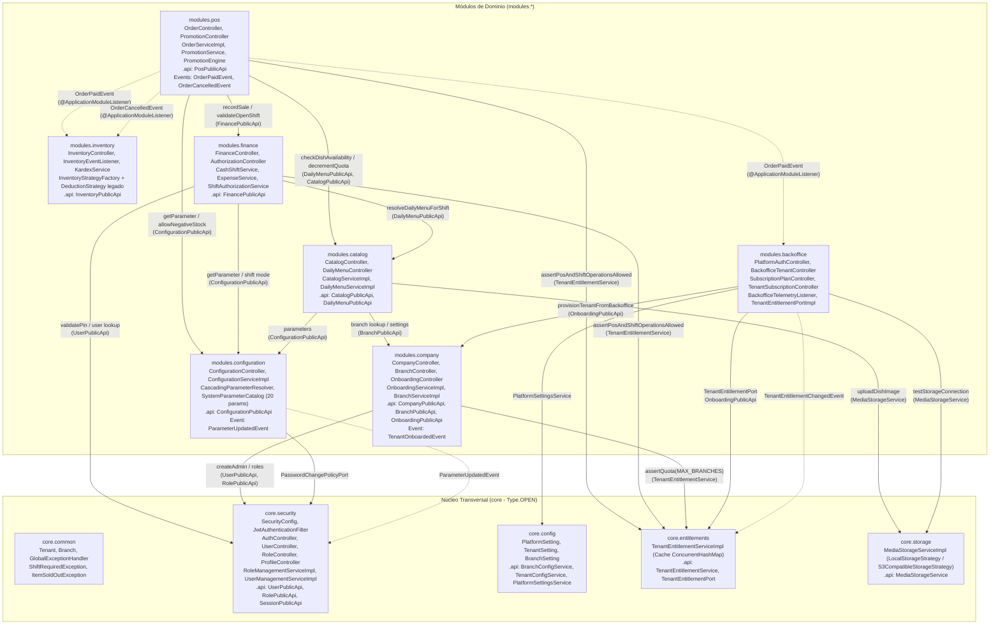

# C4 Nivel 3: Componentes del Backend (Spring Modulith)

El backend en Java 25 LTS y Spring Boot 4.1.x se estructura como un **Monolito Modular** verificado mediante `ApplicationModules.of(RestaurantApplication.class).verify()`. El paquete `core` está declarado como `ApplicationModule.Type.OPEN` para proveer infraestructura transversal, mientras los módulos bajo `modules.*` encapsulan sus repositorios e implementaciones dentro de `internal` y exponen únicamente interfaces, DTOs y eventos en `.api`.

## Diagrama de Módulos, Contratos `.api` y Eventos (Mermaid)



> [!NOTE]
> `FinanceEventListener` en `modules.finance.internal` se encuentra marcado `@Deprecated`: las ventas del POS invocan `FinancePublicApi.recordSale(...)` de manera **síncrona** dentro de la transacción de `OrderServiceImpl` para garantizar que los acumulados del turno reflejen el cobro al instante, mientras que la deducción de Kardex y la telemetría Backoffice se ejecutan vía `@ApplicationModuleListener` sobre la tabla transaccional `event_publication`.

## Arquitectura Interna de Estrategias de Inventario (`modules.inventory`)

El módulo de inventario combina la comprobación global de aislamiento manual con una fábrica de estrategias por plato (`InventoryStrategy`) y un juego heredado de estrategias por parámetro:

1. **`KardexService.processOrderDeduction`**:
   - Si el parámetro `inventory.deduction_mode` resuelve a `MANUAL_ISOLATED`, omite la deducción automática en ventas POS.
   - En caso contrario, delega cada ítem/componente/modificador en `InventoryStrategyFactory`, evaluando el `InventoryStrategy` del plato:
     - `RECIPE_BOM_STRICT`: descuenta ingredientes según la receta (`dish_recipes`) en `branch_stock` verificando `inventory.allow_negative_stock` (y el override del plato `allowNegativeStockOverride`).
     - `DISH_AS_INVENTORY_UNIT`: descuenta stock directo del plato (`branch_stock.dish_id`) por unidad vendida sin desglosar receta.
     - `COMMERCIAL_NO_INVENTORY`: productos comerciales/servicios que no afectan Kardex ni validan existencias.
   - Complementariamente coexiste la jerarquía `DeductionStrategy` (`ManualIsolatedStrategy`, `AutomaticPermissiveStrategy`, `AutomaticStrictStrategy`) para resolución por modo de deducción heredado.
2. **`KardexService.processOrderCancellation`**: Al recibir `OrderCancelledEvent`, reincorpora stock (`CANCELLATION_REVERSAL`), envía platos preparados al `prepared_dish_buffer` (`BUFFER_RETURN`) o registra `WASTE_ADJUSTMENT` según el motivo y política de merma elegida al cancelar.

## Árbol Real de Paquetes (`com.restaurant.app`)

```text
com.restaurant.app
├── RestaurantApplication.java
├── core
│   ├── audit
│   ├── common
│   │   ├── dto / exception (ShiftRequiredException, InsufficientStockException, ItemSoldOutException...)
│   │   ├── entity (Tenant, Branch, BaseTenantEntity, BaseBranchEntity)
│   │   ├── repository (TenantRepository, BranchRepository)
│   │   └── GlobalExceptionHandler, DataInitializer, WebConfig
│   ├── config
│   │   ├── api (BranchConfigService, TenantConfigService, PlatformSettingsService, PlatformSettingDto)
│   │   └── internal (PlatformSetting, TenantSetting, BranchSetting, FlywayConfig, *Impl)
│   ├── entitlements
│   │   ├── api (TenantEntitlementService, TenantEntitlementPort, TenantEntitlementChangedEvent, QuotaResource...)
│   │   └── internal (TenantEntitlementServiceImpl)
│   ├── security
│   │   ├── api (UserPublicApi, RolePublicApi, SessionPublicApi, PasswordChangePolicyPort, DTOs)
│   │   ├── config (SecurityConfig, JwtAuthenticationFilter, JwtService, TenantContextHolder)
│   │   ├── model / repository (AppUser, Role, RolePermission, UserBranch, RefreshToken, SystemPermissions)
│   │   └── internal (AuthController, AuthService, UserController, RoleController, ProfileController,
│   │                 UserManagementServiceImpl, RoleManagementServiceImpl, SessionServiceImpl)
│   └── storage
│       ├── api (MediaStorageService, StorageProviderType, StorageConnectionTestResult)
│       └── internal (MediaStorageServiceImpl, LocalStorageStrategy, S3CompatibleStorageStrategy, MediaValidationSupport)
└── modules
    ├── analytics (placeholder package-info.java)
    ├── backoffice
    │   └── internal (BackofficeSecurityConfig, PlatformAuthController, PlatformAdminController,
    │                 BackofficeTenantController, SubscriptionPlanController, TenantSubscriptionController,
    │                 BackofficeOperationsController, BackofficeTelemetryListener, TenantEntitlementPortImpl,
    │                 TenantUsageSnapshotReader, PlatformBootstrapInitializer, SubscriptionPlanBootstrapInitializer,
    │                 entity: PlatformAdmin, PlatformRefreshToken, SubscriptionPlan, TenantSubscription,
    │                 SubscriptionCharge, SubscriptionPayment, TenantDailyTelemetry, PlatformAuditLog)
    ├── catalog
    │   ├── api (CatalogPublicApi, DailyMenuPublicApi, CourseType, InventoryStrategy, PriceMode, DTOs)
    │   └── internal (CatalogController, DailyMenuController, CatalogServiceImpl, DailyMenuServiceImpl,
    │                 CatalogDataInitializer, entity: Category, Ingredient, Dish, DishRecipe, BranchDish,
    │                 Combo, ComboItem, ComboItemOption, ModifierGroup, Modifier, DailyMenu, DailyMenuItem,
    │                 DailyMenuCombo, BranchServiceSession, ShiftMenuAssignment, ShiftMenuItem, ShiftMenuQuotaAdjustment)
    ├── company
    │   ├── api (CompanyPublicApi, BranchPublicApi, OnboardingPublicApi, TenantOnboardedEvent, DTOs)
    │   └── internal (CompanyController, BranchController, OnboardingController, *ServiceImpl)
    ├── configuration
    │   ├── api (ConfigurationPublicApi, SystemParameter [20 enums], ParameterUpdatedEvent, DTOs)
    │   └── internal (ConfigurationController, ConfigurationServiceImpl, CascadingParameterResolver,
    │                 ParameterCacheService, SystemParameterCatalog, SecurityPasswordPolicyAdapter, SystemParameterValue)
    ├── finance
    │   ├── api (FinancePublicApi, DTOs)
    │   └── internal (FinanceController, AuthorizationController, FinanceServiceImpl, CashShiftService,
    │                 ExpenseService, ShiftAuthorizationService, FinanceDataInitializer,
    │                 entity: CashShift, Expense, ShiftAuthorization)
    ├── inventory
    │   ├── api (InventoryPublicApi, DTOs)
    │   └── internal (InventoryController, InventoryEventListener, KardexService, InventoryStrategyFactory,
    │                 strategy: InventoryDeductionStrategy, RecipeBomStrictStrategy, DishAsInventoryUnitStrategy,
    │                 CommercialNoInventoryStrategy, DeductionStrategy, ManualIsolatedStrategy,
    │                 AutomaticPermissiveStrategy, AutomaticStrictStrategy,
    │                 entity: BranchStock, KardexMovement, PreparedDishBuffer)
    └── pos
        ├── api (PosPublicApi, OrderPaidEvent, OrderCancelledEvent, DTOs)
        └── internal (OrderController, PromotionController, OrderServiceImpl, PromotionService, PromotionEngine,
                      entity: Order, OrderItem, OrderItemModifier, OrderItemSelection, Promotion, PromotionBranch)
```

## Gobernanza Arquitectónica y Enlaces

- [Gobernanza Arquitectónica del Repositorio](../../../../.agents/rules/architectural-governance.md)
- [Skill: Patrones Spring Modulith](../../../../.agents/skills/spring-modulith-patterns/SKILL.md)
- [C4 Nivel 2: Contenedores](./c4_level2_containers.md)
- [C4 Nivel 3: Frontend Angular](./c4_level3_frontend_angular.md)
- [C4 Backoffice System](../../../backoffice/architecture/c4_backoffice_system.md)
- [Modelo de Dominio Java](../02-domain-and-data/domain_model.md)
- [ADR-0001: Monolito Modular Spring Modulith](../../../adr/0001_spring_modulith_monolith.md)
- [ADR-0028: Almacenamiento Agnóstico de Medios y Platform Settings](../../../adr/0028_agnostic_media_storage_and_platform_settings.md)
- [ADR-0029: Suscripciones, Cuotas y Telemetría Backoffice](../../../adr/0029_backoffice_subscriptions_quotas_and_telemetry.md)
