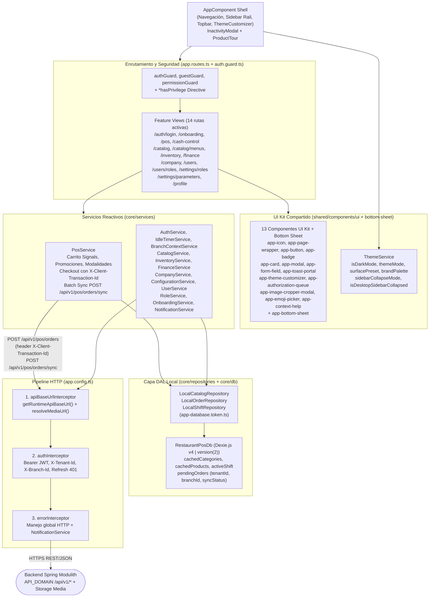

# C4 Nivel 3: Componentes del Frontend (Angular 22 Zoneless)

La aplicación ERP para sucursales está construida sobre **Angular 22** en modo **Zoneless** (`provideExperimentalZonelessChangeDetection`), componentes **Standalone**, gestión de estado basada en **Signals**, diseño visual **TailwindAdmin v3.0** (`ADR-0014`) y persistencia local **Offline-First** mediante **Dexie.js v4**.

## Diagrama de Componentes Angular (Mermaid)



## Rutas Verificadas (`app.routes.ts`)

No existen rutas `/kds` ni `/analytics`. Todas las rutas de negocio usan carga perezosa o componentes standalone protegidos por `authGuard` / `guestGuard` y `permissionGuard`:

| Ruta | Componente | Guards / Permiso Requerido |
| :--- | :--- | :--- |
| `''`, `'**'` | Redirección a `'pos'` | — |
| `'auth'` | Redirección a `'auth/login'` | — |
| `'auth/login'` | `LoginComponent` | `guestGuard` |
| `'onboarding'` | `OnboardingComponent` | `guestGuard` |
| `'pos'` | `PosComponent` | `authGuard`, `permissionGuard` (`pos:access`) |
| `'cash-control'` | `CashControlComponent` | `authGuard`, `permissionGuard` (`finance:shifts`) |
| `'catalog/menus'` | `DailyMenusComponent` | `authGuard`, `permissionGuard` (`catalog:read` + `catalog:write` o `inventory:read`) |
| `'catalog'` | `CatalogComponent` | `authGuard`, `permissionGuard` (`catalog:read` + `catalog:write` o `inventory:read`) |
| `'inventory'` | `InventoryComponent` | `authGuard`, `permissionGuard` (`inventory:read`) |
| `'finance'` | `FinanceComponent` | `authGuard`, `permissionGuard` (cualquiera de `finance:reports`, `finance:shifts_supervisor`, `finance:expenses_approve`, `reports:view`) |
| `'company'` | `CompanyComponent` | `authGuard`, `permissionGuard` (`company:read`) |
| `'users/roles'`, `'settings/roles'` | `RolesComponent` | `authGuard`, `permissionGuard` (`users:read`) |
| `'users'` | `UsersComponent` | `authGuard`, `permissionGuard` (`users:read`) |
| `'settings/parameters'` | `ParametersComponent` | `authGuard`, `permissionGuard` (`settings:read`) |
| `'profile'` | `ProfileComponent` | `authGuard` |

## Pipeline HTTP e Inyección Runtime

1. **Orden exacto de interceptores (`app.config.ts`):**
   ```ts
   withInterceptors([apiBaseUrlInterceptor, authInterceptor, errorInterceptor])
   ```
   - `apiBaseUrlInterceptor`: prefija rutas relativas `/api/...` con `getRuntimeApiBaseUrl()` desde `window.__ENV__.API_BASE_URL` (`core/config/runtime-env.ts`).
   - `authInterceptor`: adjunta `Authorization: Bearer <jwt>`, `X-Tenant-Id` y `X-Branch-Id`, e intenta silent refresh ante respuestas `401` mediante `AuthService`.
   - `errorInterceptor`: intercepta fallos HTTP (`409`, `403`, `402`, `5xx`), delegando mensajes legibles a `NotificationService` sin ocultar respuestas específicas manejadas por los componentes.
2. **Idempotencia en POS:** La cabecera `X-Client-Transaction-Id` se genera y adjunta directamente en `PosService.checkout()` al invocar `POST /api/v1/pos/orders` (no en un interceptor global). Las órdenes encoladas offline se envían por lote a `POST /api/v1/pos/orders/sync`.
3. **Resolución Cross-Origin de Imágenes (`resolveMediaUrl`):** Convierte rutas relativas `/uploads/...` al origen de `API_BASE_URL` manteniendo intactas URLs absolutas `https://...` de OCI Object Storage (`ADR-0033`).

## Sistema de Diseño TailwindAdmin v3.0 y `ThemeService`

- **`ThemeService` (`core/services/theme.service.ts`):**
  - **Signals:** `isDarkMode`, `themeMode` (computed), `surfacePreset` (`'slate-clean' | 'warm-tinted' | 'dark-nav'`), `brandPalette` (`'blue' | 'aqua' | 'purple' | 'emerald' | 'orange'`), `sidebarCollapseMode` (`'mini-rail' | 'full-hide'`), `isDesktopSidebarCollapsed`.
  - **Efectos DOM:** sincroniza clase `html.dark` y atributos `data-surface` y `data-brand` en el elemento raíz.
  - **Métodos:** `applyCompanyDefaults(...)` (aplica branding configurado para la empresa/sucursal en login) y `resetToDefaults()`.
- **Catálogo de UI Kit (`shared/components/ui/index.ts`, 13 componentes):**
  - `app-icon`, `app-page-wrapper`, `app-button`, `app-badge`, `app-card`, `app-modal`, `app-form-field`, `app-toast-portal`, `app-theme-customizer`, `app-authorization-queue`, `app-image-cropper-modal`, `app-emoji-picker`, `app-context-help`.
  - Complementos móviles/globales: `app-bottom-sheet` (`shared/components/bottom-sheet/`) e `InactivityModal` / `ProductTour` (`core/components/`).

## Capa DAL Offline-First (`core/db` y `core/repositories`)

- `RestaurantPosDb` (`Dexie.js` v4, `version(2)`): stores `cachedCategories`, `cachedProducts`, `activeShift` y `pendingOrders` (con índices `tenantId, branchId, syncStatus, createdAt`).
- Todos los servicios acceden a IndexedDB a través de la capa DAL (`LocalCatalogRepository`, `LocalOrderRepository`, `LocalShiftRepository`, inyectando `APP_DATABASE` de `app-database.token.ts`), prohibiendo acceso directo a `db` desde componentes de UI.

## Enlaces Relacionados

- [Skill: Diagramación SDD](../../../../.agents/skills/sdd-architecture-diagramming/SKILL.md)
- [Skill: Estrategia Offline Dexie y Sincronización](../../../../.agents/skills/offline-dexie-sync/SKILL.md)
- [C4 Nivel 2: Contenedores](./c4_level2_containers.md)
- [C4 Nivel 3: Backend Spring Modulith](./c4_level3_backend_modulith.md)
- [Esquema Local Dexie.js](../02-domain-and-data/dexie_local_schema.md)
- [Flujo Offline Sync POS](../04-behavior-and-flows/sequence_pos_offline_sync.md)
- [UX Móvil POS e Inventario](../04-behavior-and-flows/state_mobile_pos_and_inventory_ux.md)
- [ADR-0014: TailwindAdmin v3, Tema Dinámico y UI Kit](../../../adr/0014_tailwindadmin_v3_dynamic_theme_and_uikit.md)
- [ADR-0033: Runtime Env en SPAs y Media Cross-Origin](../../../adr/0033_spa_runtime_env_and_cross_origin_media.md)
- [SDD Frontend Spec](../../../sdd/03_frontend_spec.md)
- [SDD Design System](../../../sdd/05_design_system.md)
