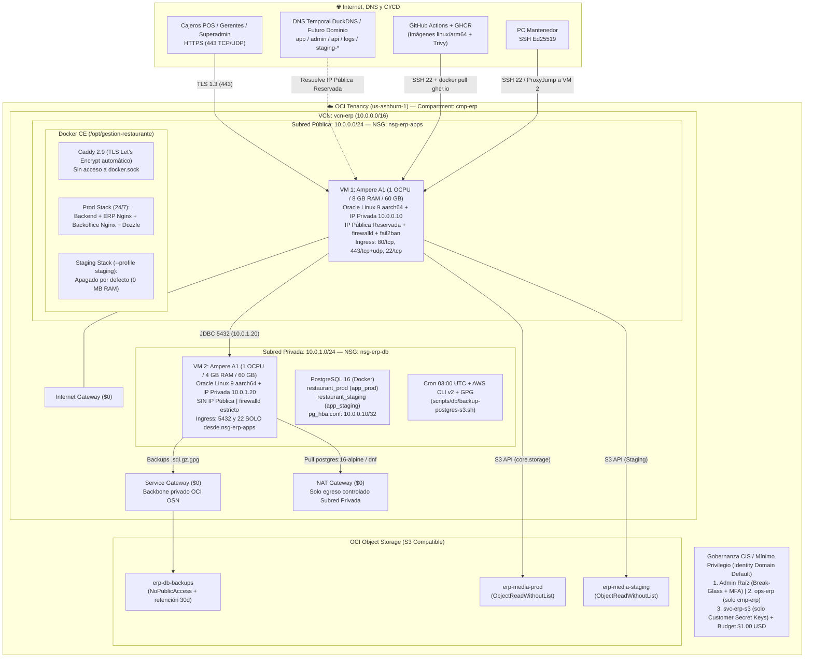

# ☁️ Topología Física Cloud OCI y Red Zero-Trust

Este artefacto vivo complementa al [Diagrama C4 Nivel 2 de Contenedores](./c4_level2_containers.md) y materializa la decisión arquitectónica [ADR-0026](../../../adr/0026_cloud_infrastructure_and_deployment_stack.md) sobre **Oracle Cloud Infrastructure (`us-ashburn-1`)** usando **Oracle Linux 9 ARM64 (`aarch64`)** dentro del presupuesto **Always Free** (`2 OCPUs`, `12 GB RAM`, `120 GB / 200 GB Block`, `Object Storage S3`).

---

## 1. Diagrama de Despliegue OCI (VCN Zero-Trust + Staging Efímero)

---

## 2. Matriz de Seguridad y Tráfico Zero-Trust

| Capa | Regla Aplicada | Propósito |
| :--- | :--- | :--- |
| **OCI Subnet `private-db`** | `prohibit_public_ip_on_vnic = true` + Security List vacía | Impide por diseño asignar IP pública a `VM 2`. |
| **OCI `nsg-erp-db`** | Ingress `5432/tcp` y `22/tcp` únicamente desde `nsg-erp-apps` | Ningún host externo o de otra subred alcanza PostgreSQL ni SSH de `VM 2`. |
| **OS `firewalld` (OL9)** | En `VM 1`: `80`, `443/tcp`, `443/udp`, `22`. En `VM 2`: solo `10.0.0.0/24` hacia `5432` y `22` | Defensa en profundidad a nivel de kernel Linux. |
| **PostgreSQL `pg_hba.conf`** | `host restaurant_prod app_prod 10.0.0.10/32 scram-sha-256` | Aislamiento estricto por base, rol e IP exacta de `VM 1`. |
| **Object Storage Buckets** | `db-backups`: `NoPublicAccess`; `media-*`: `ObjectReadWithoutList` | Las imágenes de platos se leen por URL exacta sin exponer listado de objetos; los backups cifrados son 100% privados. |

---

## 3. Trazabilidad IaC

- Código declarativo OpenTofu/Terraform y `cloud-init`: [`infra/oci/`](../../../../infra/oci/README.md)
- Guía operativa paso a paso: [`infra/oci/RUNBOOK_OCI_PASO_A_PASO.md`](../../../../infra/oci/RUNBOOK_OCI_PASO_A_PASO.md)
