# 🗄️ Diagrama Entidad-Relación Físico (PostgreSQL 16+)

Este documento especifica el **Modelo Entidad-Relación (ERD) Físico** completo y exhaustivo de la base de datos relacional PostgreSQL del sistema. Ha sido extraído y verificado directamente contra las migraciones oficiales Flyway:
- [`backend/src/main/resources/db/migration/V1__init_schema.sql`](../../../../backend/src/main/resources/db/migration/V1__init_schema.sql)
- [`backend/src/main/resources/db/migration/V2__spring_modulith_events.sql`](../../../../backend/src/main/resources/db/migration/V2__spring_modulith_events.sql)
- [`backend/src/main/resources/db/migration/V3__tenant_slug_and_rbac.sql`](../../../../backend/src/main/resources/db/migration/V3__tenant_slug_and_rbac.sql)
- [`backend/src/main/resources/db/migration/V4__inventory_combos_promotions_modifiers.sql`](../../../../backend/src/main/resources/db/migration/V4__inventory_combos_promotions_modifiers.sql)

---

## 1. Convenciones Físicas y Estrategia de Almacenamiento

1. **Tipos de Claves Primarias:** Identificadores únicos universales `UUID` autogenerados mediante `gen_random_uuid()`.
2. **Campos Monetarios:** `NUMERIC(12, 2)` con redondeo bancario exacto para importes, subtotales, totales y descuadres.
3. **Cantidades y Costos Unitarios de Insumos:** `NUMERIC(12, 4)` para permitir formulaciones de recetas con gramajes milimétricos (ej. $0.0050\text{ kg} = 5\text{ g}$) y cálculos estables de costo promedio ponderado.
4. **Control de Concurrencia Optimista:** Columna `version BIGINT NOT NULL DEFAULT 0` presente en todas las tablas transaccionales maestras.
5. **Estrategia Multi-Tenant Denormalizada de Alto Rendimiento (ADR-0002):**
   - Las tablas operativas transaccionales de alto volumen (`orders`, `order_items`, `purchases`, `purchase_items`, `expenses`, `kardex_movements`, `branch_stock`) denormalizan las columnas `tenant_id` y `branch_id`.
   - **Beneficios:**
     - Consultas analíticas, reportes de turnos y validaciones de seguridad sin necesidad de encadenar costosos `JOIN`s hacia `branches` o `tenants`.
     - Habilita índices compuestos de búsqueda inmediata: `idx_<table>_tenant_branch ON <table>(tenant_id, branch_id)`.
     - Facilita el particionamiento físico futuro por `tenant_id` o `branch_id`.
6. **Manejo Estricto de Tiempos y Zonas Horarias (ADR-0006):**
   - Marcas de tiempo transaccionales en `TIMESTAMPTZ` (`java.time.Instant` en UTC).
   - Fechas de calendario puras en `DATE` (`java.time.LocalDate`) para `expenses.expense_date`.
   - Zona horaria de operación por sucursal en `branches.timezone` (default `'America/La_Paz'`).

---

## 2. Diagrama Entidad-Relación (Mermaid ERD)

```mermaid
erDiagram
    %% =========================================================================
    %% A. Módulo de Seguridad, Tenancy y Configuración Dinámica
    %% =========================================================================

    tenants ||--o{ tenant_settings : "configures"
    tenants ||--o{ branches : "owns"
    tenants ||--o{ branch_settings : "owns"
    branches ||--o{ branch_settings : "configures"
    tenants ||--o{ app_users : "employs"
    branches ||--o{ app_users : "assigns"
    app_users ||--|| user_preferences : "personalizes"
    tenants ||--o{ roles : "defines"
    roles ||--o{ role_permissions : "grants"
    tenants ||--o{ role_permissions : "scopes"

    tenants {
        uuid id PK
        varchar legal_name "VARCHAR(150)"
        varchar nit_or_tax_id "VARCHAR(50)"
        varchar slug "VARCHAR(60) UNIQUE"
        boolean is_active "DEFAULT TRUE"
        timestamptz created_at "DEFAULT CURRENT_TIMESTAMP"
        timestamptz updated_at "DEFAULT CURRENT_TIMESTAMP"
        bigint version "DEFAULT 0"
    }

    roles {
        uuid id PK
        uuid tenant_id FK
        varchar code "VARCHAR(50)"
        varchar name "VARCHAR(100)"
        varchar description "VARCHAR(255)"
        boolean is_system "DEFAULT FALSE"
        timestamptz created_at "DEFAULT CURRENT_TIMESTAMP"
    }

    role_permissions {
        uuid id PK
        uuid tenant_id FK
        uuid role_id FK
        varchar permission "VARCHAR(100)"
        timestamptz created_at "DEFAULT CURRENT_TIMESTAMP"
    }

    tenant_settings {
        uuid id PK
        uuid tenant_id FK
        varchar setting_key "VARCHAR(100)"
        text setting_value
        varchar value_type "VARCHAR(20) CHECK"
        varchar description "VARCHAR(255)"
        timestamptz updated_at "DEFAULT CURRENT_TIMESTAMP"
    }

    branches {
        uuid id PK
        uuid tenant_id FK
        varchar name "VARCHAR(100)"
        text address
        varchar phone "VARCHAR(30)"
        varchar timezone "VARCHAR(50) DEFAULT America/La_Paz"
        boolean is_active "DEFAULT TRUE"
        timestamptz created_at "DEFAULT CURRENT_TIMESTAMP"
        bigint version "DEFAULT 0"
    }

    branch_settings {
        uuid id PK
        uuid tenant_id FK
        uuid branch_id FK
        varchar setting_key "VARCHAR(100)"
        text setting_value
        varchar value_type "VARCHAR(20) CHECK"
        varchar description "VARCHAR(255)"
        timestamptz updated_at "DEFAULT CURRENT_TIMESTAMP"
    }

    app_users {
        uuid id PK
        uuid tenant_id FK
        uuid branch_id FK "NULLABLE"
        varchar username "VARCHAR(50)"
        varchar email "VARCHAR(120) NULLABLE"
        varchar password_hash "VARCHAR(255)"
        varchar role "VARCHAR(30) CHECK"
        boolean email_verified "DEFAULT FALSE"
        boolean is_active "DEFAULT TRUE"
        timestamptz created_at "DEFAULT CURRENT_TIMESTAMP"
        bigint version "DEFAULT 0"
    }

    user_preferences {
        uuid user_id PK, FK
        varchar theme "VARCHAR(10) DEFAULT LIGHT"
        varchar language "VARCHAR(10) DEFAULT es"
    }

    %% =========================================================================
    %% B. Módulo Catálogo y Recetas (BOM - Bill of Materials)
    %% =========================================================================

    tenants ||--o{ categories : "owns"
    tenants ||--o{ ingredients : "owns"
    tenants ||--o{ dishes : "owns"
    branches ||--o{ dishes : "exclusive_to"
    categories ||--o{ dishes : "classifies"
    dishes ||--o{ dishes : "cloned_from"
    dishes ||--o{ dish_recipes : "requires"
    ingredients ||--o{ dish_recipes : "used_in"
    tenants ||--o{ branch_dishes : "owns"
    branches ||--o{ branch_dishes : "overrides"
    dishes ||--o{ branch_dishes : "configured_in"

    tenants ||--o{ combos : "owns"
    branches ||--o{ combos : "exclusive_to"
    categories ||--o{ combos : "classifies"
    combos ||--o{ combo_items : "contains"
    combo_items ||--o{ combo_item_options : "offers"
    dishes ||--o{ combo_item_options : "selected_dish"

    tenants ||--o{ modifier_groups : "owns"
    modifier_groups ||--o{ modifiers : "contains"
    ingredients ||--o{ modifiers : "deducts"
    dishes ||--o{ dish_modifier_groups : "has"
    modifier_groups ||--o{ dish_modifier_groups : "attached_to"

    categories {
        uuid id PK
        uuid tenant_id FK
        varchar name "VARCHAR(80)"
        varchar icon "VARCHAR(50)"
        integer sort_order "DEFAULT 0"
        timestamptz created_at "DEFAULT CURRENT_TIMESTAMP"
    }

    ingredients {
        uuid id PK
        uuid tenant_id FK
        varchar name "VARCHAR(100)"
        varchar unit_of_measure "VARCHAR(20) CHECK"
        numeric min_stock_alert "NUMERIC(12,4) DEFAULT 0"
        timestamptz created_at "DEFAULT CURRENT_TIMESTAMP"
    }

    dishes {
        uuid id PK
        uuid tenant_id FK
        uuid branch_id FK "NULLABLE"
        uuid cloned_from_id FK "NULLABLE"
        uuid category_id FK
        varchar code "VARCHAR(30)"
        varchar name "VARCHAR(120)"
        text description
        numeric sale_price "NUMERIC(12,2)"
        boolean is_active "DEFAULT TRUE"
        timestamptz created_at "DEFAULT CURRENT_TIMESTAMP"
        bigint version "DEFAULT 0"
    }

    dish_recipes {
        uuid id PK
        uuid dish_id FK
        uuid ingredient_id FK
        numeric quantity "NUMERIC(12,4) CHECK > 0"
    }

    branch_dishes {
        uuid id PK
        uuid tenant_id FK
        uuid branch_id FK
        uuid dish_id FK
        boolean is_available "DEFAULT TRUE"
        numeric price_override "NUMERIC(12,2) NULLABLE"
        timestamptz created_at "DEFAULT CURRENT_TIMESTAMP"
        bigint version "DEFAULT 0"
    }

    combos {
        uuid id PK
        uuid tenant_id FK
        uuid branch_id FK "NULLABLE"
        uuid category_id FK
        varchar code "VARCHAR(30)"
        varchar name "VARCHAR(120)"
        text description
        numeric base_price "NUMERIC(12,2)"
        boolean is_active "DEFAULT TRUE"
        timestamptz created_at "DEFAULT CURRENT_TIMESTAMP"
        bigint version "DEFAULT 0"
    }

    combo_items {
        uuid id PK
        uuid combo_id FK
        varchar name "VARCHAR(100)"
        varchar selection_mode "VARCHAR(20) DEFAULT FIXED"
        boolean is_required "DEFAULT TRUE"
        uuid default_dish_id FK "NULLABLE"
        integer quantity "INT DEFAULT 1"
        integer sort_order "DEFAULT 0"
    }

    combo_item_options {
        uuid id PK
        uuid combo_item_id FK
        uuid dish_id FK
        numeric price_adjustment "NUMERIC(12,2) DEFAULT 0"
        boolean is_default "DEFAULT FALSE"
    }

    modifier_groups {
        uuid id PK
        uuid tenant_id FK
        varchar name "VARCHAR(100)"
        integer min_selectable "DEFAULT 0"
        integer max_selectable "DEFAULT 1"
        boolean is_required "DEFAULT FALSE"
        timestamptz created_at "DEFAULT CURRENT_TIMESTAMP"
        bigint version "DEFAULT 0"
    }

    modifiers {
        uuid id PK
        uuid group_id FK
        varchar name "VARCHAR(100)"
        numeric additional_price "NUMERIC(12,2) DEFAULT 0"
        uuid ingredient_id FK "NULLABLE"
        numeric quantity_consumed "NUMERIC(12,4) DEFAULT 0"
        integer sort_order "DEFAULT 0"
    }

    dish_modifier_groups {
        uuid dish_id PK,FK
        uuid modifier_group_id PK,FK
    }

    %% =========================================================================
    %% C. Módulo Inventario, Compras y Kardex Físico
    %% =========================================================================

    tenants ||--o{ branch_stock : "owns"
    branches ||--o{ branch_stock : "stores"
    ingredients ||--o{ branch_stock : "inventory_of"

    tenants ||--o{ purchases : "owns"
    branches ||--o{ purchases : "buys_for"
    app_users ||--o{ purchases : "created_by"
    purchases ||--o{ purchase_items : "contains"
    ingredients ||--o{ purchase_items : "purchased"

    tenants ||--o{ kardex_movements : "owns"
    branches ||--o{ kardex_movements : "logs_at"
    ingredients ||--o{ kardex_movements : "tracks"
    app_users ||--o{ kardex_movements : "registered_by"

    branch_stock {
        uuid id PK
        uuid tenant_id FK
        uuid branch_id FK
        uuid ingredient_id FK
        numeric current_quantity "NUMERIC(12,4) DEFAULT 0"
        numeric average_unit_cost "NUMERIC(12,4) DEFAULT 0"
        timestamptz last_updated "DEFAULT CURRENT_TIMESTAMP"
        bigint version "DEFAULT 0"
    }

    purchases {
        uuid id PK
        uuid tenant_id FK
        uuid branch_id FK
        varchar supplier_name "VARCHAR(150)"
        varchar invoice_number "VARCHAR(50)"
        numeric total_amount "NUMERIC(12,2) DEFAULT 0"
        timestamptz purchase_date "DEFAULT CURRENT_TIMESTAMP"
        uuid created_by FK
        timestamptz created_at "DEFAULT CURRENT_TIMESTAMP"
        bigint version "DEFAULT 0"
    }

    purchase_items {
        uuid id PK
        uuid tenant_id FK
        uuid branch_id FK
        uuid purchase_id FK
        uuid ingredient_id FK
        numeric quantity "NUMERIC(12,4) CHECK > 0"
        numeric unit_cost "NUMERIC(12,4) CHECK >= 0"
        numeric subtotal "NUMERIC(12,2)"
    }

    kardex_movements {
        uuid id PK
        uuid tenant_id FK
        uuid branch_id FK
        uuid ingredient_id FK
        varchar movement_type "VARCHAR(30) CHECK"
        numeric quantity "NUMERIC(12,4)"
        numeric unit_cost "NUMERIC(12,4)"
        numeric total_cost "NUMERIC(12,2)"
        numeric balance_quantity "NUMERIC(12,4)"
        uuid reference_id "NULLABLE"
        timestamptz movement_date "DEFAULT CURRENT_TIMESTAMP"
        uuid created_by FK "NULLABLE"
    }

    %% =========================================================================
    %% D. Módulo Punto de Venta (POS)
    %% =========================================================================

    tenants ||--o{ orders : "owns"
    branches ||--o{ orders : "serves"
    app_users ||--o{ orders : "created_by"
    cash_shifts ||--o{ orders : "registers"
    orders ||--o{ order_items : "contains"
    dishes ||--o{ order_items : "orders"
    order_items ||--o{ order_item_modifiers : "customized_with"
    modifiers ||--o{ order_item_modifiers : "applies"
    tenants ||--o{ promotions : "owns"
    promotions ||--o{ promotion_branches : "targets"
    branches ||--o{ promotion_branches : "enforces"

    orders {
        uuid id PK
        uuid tenant_id FK
        uuid branch_id FK
        uuid cash_shift_id FK "NULLABLE"
        varchar ticket_number "VARCHAR(30)"
        varchar order_status "VARCHAR(20) DEFAULT WAITING"
        varchar payment_method "VARCHAR(20) CHECK NULLABLE"
        numeric total_amount "NUMERIC(12,2) DEFAULT 0"
        uuid client_transaction_id "UK UNIQUE"
        text notes
        uuid created_by FK
        timestamptz created_at "DEFAULT CURRENT_TIMESTAMP"
        timestamptz closed_at "NULLABLE"
        bigint version "DEFAULT 0"
    }

    order_items {
        uuid id PK
        uuid tenant_id FK
        uuid branch_id FK
        uuid order_id FK
        uuid dish_id FK
        integer quantity "INT CHECK > 0"
        numeric unit_price "NUMERIC(12,2)"
        numeric subtotal "NUMERIC(12,2)"
        numeric discount_amount "NUMERIC(12,2) DEFAULT 0"
        uuid combo_id FK "NULLABLE"
        text notes
    }

    order_item_modifiers {
        uuid id PK
        uuid order_item_id FK
        uuid modifier_id FK
        numeric unit_price "NUMERIC(12,2) DEFAULT 0"
        numeric subtotal "NUMERIC(12,2) DEFAULT 0"
    }

    promotions {
        uuid id PK
        uuid tenant_id FK
        varchar name "VARCHAR(120)"
        text description
        varchar discount_type "VARCHAR(20)"
        numeric discount_value "NUMERIC(12,2)"
        varchar scope "VARCHAR(20)"
        uuid target_category_id FK "NULLABLE"
        uuid target_dish_id FK "NULLABLE"
        varchar application_mode "VARCHAR(20)"
        varchar days_of_week "VARCHAR(100) NULLABLE"
        time start_time "NULLABLE"
        time end_time "NULLABLE"
        date start_date "NULLABLE"
        date end_date "NULLABLE"
        numeric min_order_amount "NUMERIC(12,2) DEFAULT 0"
        boolean is_active "DEFAULT TRUE"
        timestamptz created_at "DEFAULT CURRENT_TIMESTAMP"
        bigint version "DEFAULT 0"
    }

    promotion_branches {
        uuid promotion_id PK,FK
        uuid branch_id PK,FK
    }

    %% =========================================================================
    %% E. Módulo Finanzas y Arqueo de Caja Chica
    %% =========================================================================

    tenants ||--o{ cash_shifts : "owns"
    branches ||--o{ cash_shifts : "operates"
    app_users ||--o{ cash_shifts : "opened_by"
    app_users ||--o{ cash_shifts : "closed_by"

    tenants ||--o{ expenses : "owns"
    branches ||--o{ expenses : "spends_in"
    cash_shifts ||--o{ expenses : "funds"
    app_users ||--o{ expenses : "created_by"
    app_users ||--o{ expenses : "approved_by"

    cash_shifts {
        uuid id PK
        uuid tenant_id FK
        uuid branch_id FK
        uuid opened_by FK
        uuid closed_by FK "NULLABLE"
        timestamptz opened_at "DEFAULT CURRENT_TIMESTAMP"
        timestamptz closed_at "NULLABLE"
        numeric initial_cash "NUMERIC(12,2) DEFAULT 0"
        numeric total_cash_sales "NUMERIC(12,2) DEFAULT 0"
        numeric total_card_sales "NUMERIC(12,2) DEFAULT 0"
        numeric total_other_sales "NUMERIC(12,2) DEFAULT 0"
        numeric total_cash_expenses "NUMERIC(12,2) DEFAULT 0"
        numeric expected_cash "NUMERIC(12,2) NULLABLE"
        numeric actual_cash "NUMERIC(12,2) NULLABLE"
        numeric difference "NUMERIC(12,2) NULLABLE"
        varchar status "VARCHAR(15) DEFAULT OPEN"
    }

    expenses {
        uuid id PK
        uuid tenant_id FK
        uuid branch_id FK
        uuid cash_shift_id FK "NULLABLE"
        varchar expense_type "VARCHAR(30) CHECK"
        text description
        numeric amount "NUMERIC(12,2)"
        boolean paid_from_cash_drawer "DEFAULT FALSE"
        varchar approval_status "VARCHAR(20) DEFAULT APPROVED"
        uuid approved_by FK "NULLABLE"
        text evidence_url
        text approval_notes
        date expense_date "DEFAULT CURRENT_DATE"
        uuid created_by FK
        timestamptz created_at "DEFAULT CURRENT_TIMESTAMP"
    }

    %% =========================================================================
    %% F. Módulo de Auditoría Inmutable
    %% =========================================================================

    tenants ||--o{ audit_logs : "owns"
    branches ||--o{ audit_logs : "occurs_in"
    app_users ||--o{ audit_logs : "performed_by"

    audit_logs {
        uuid id PK
        uuid tenant_id FK
        uuid branch_id FK "NULLABLE"
        uuid user_id FK "NULLABLE"
        varchar action "VARCHAR(50)"
        varchar entity_name "VARCHAR(50)"
        uuid entity_id
        jsonb old_values "NULLABLE"
        jsonb new_values "NULLABLE"
        varchar ip_address "VARCHAR(45)"
        timestamptz created_at "DEFAULT CURRENT_TIMESTAMP"
    }

    %% =========================================================================
    %% G. Módulo Spring Modulith (Transactional Outbox)
    %% =========================================================================

    event_publication {
        uuid id PK
        varchar listener_id "VARCHAR(512)"
        varchar event_type "VARCHAR(512)"
        text serialized_event
        timestamptz publication_date
        timestamptz completion_date "NULLABLE"
        timestamptz last_resubmission_date "NULLABLE"
        integer completion_attempts "DEFAULT 0"
        varchar status "VARCHAR(20) NULLABLE"
    }

    event_publication_archive {
        uuid id PK
        varchar listener_id "VARCHAR(512)"
        varchar event_type "VARCHAR(512)"
        text serialized_event
        timestamptz publication_date
        timestamptz completion_date "NULLABLE"
        timestamptz last_resubmission_date "NULLABLE"
        integer completion_attempts "DEFAULT 0"
        varchar status "VARCHAR(20) NULLABLE"
    }
```

---

## 3. Catálogo Físico de Índices y Optimización Multi-Tenant

Para garantizar rendimiento $O(\log N)$ en todas las operaciones del restaurante y evitar `Seq Scan` en entornos multi-tenant con millones de registros, el esquema implementa los siguientes índices:

| Tabla | Nombre del Índice | Columnas Indexadas | Propósito / Patrón de Acceso |
| :--- | :--- | :--- | :--- |
| `tenant_settings` | `idx_tenant_settings_lookup` | `(tenant_id, setting_key)` | Búsqueda inmediata de parámetros dinámicos de empresa. |
| `branches` | `idx_branches_tenant` | `(tenant_id)` | Listado de sucursales de la empresa. |
| `branch_settings` | `idx_branch_settings_lookup` | `(branch_id, setting_key)` | Parámetros locales de impresión y sincronización. |
| `app_users` | `idx_users_tenant_branch` | `(tenant_id, branch_id)` | Autenticación, listado de empleados y validación de contexto. |
| `app_users` | `idx_users_email` (Parcial) | `(email) WHERE email IS NOT NULL` | Login por correo y unicidad sin penalizar cajeros sin email. |
| `categories` | `idx_categories_tenant` | `(tenant_id)` | Carga del catálogo inicial en el POS. |
| `ingredients` | `idx_ingredients_tenant` | `(tenant_id)` | Gestión de insumos de compras e inventario. |
| `dishes` | `idx_dishes_tenant_cat` | `(tenant_id, category_id)` | Filtrado de platos por categoría en mostrador. |
| `dishes` | `idx_dishes_branch` | `(branch_id)` | Identificación de platos exclusivos de sucursal. |
| `dish_recipes` | `idx_recipes_dish` | `(dish_id)` | Deducción atómica de ingredientes al pagar una orden. |
| `branch_dishes` | `idx_branch_dishes_lookup` | `(tenant_id, branch_id, is_available)` | Resolución rápida de sobreescritura de precios y catálogo activo. |
| `branch_stock` | `idx_stock_tenant_branch` | `(tenant_id, branch_id)` | Consulta de existencias físicas y alertas de reposición. |
| `purchases` | `idx_purchases_tenant_branch` | `(tenant_id, branch_id)` | Historial de compras por sucursal. |
| `purchase_items` | `idx_purchase_items_purchase` | `(purchase_id)` | Detalle de factura de compra. |
| `purchase_items` | `idx_purchase_items_tenant_branch` | `(tenant_id, branch_id)` | Consultas analíticas de insumos comprados por sucursal. |
| `kardex_movements` | `idx_kardex_lookup` | `(tenant_id, branch_id, ingredient_id, movement_date DESC)` | Trazabilidad del Kardex y cálculo del saldo anterior más reciente. |
| `orders` | `idx_orders_tenant_branch_status` | `(tenant_id, branch_id, order_status)` | Tablero Kanban de cocina y órdenes activas en caja. |
| `orders` | `idx_orders_client_tx` | `(client_transaction_id)` | **Idempotencia:** Evita cobros duplicados en ventas offline sincronizadas. |
| `orders` | `idx_orders_cash_shift` | `(cash_shift_id)` | Consolidación de ventas del turno para el arqueo. |
| `order_items` | `idx_order_items_order` | `(order_id)` | Consulta de líneas de comanda para despacho y ticket. |
| `order_items` | `idx_order_items_tenant_branch` | `(tenant_id, branch_id)` | Reportes analíticos de platos más vendidos por sucursal. |
| `cash_shifts` | `idx_shifts_tenant_branch` | `(tenant_id, branch_id, status)` | Detección del turno de caja `OPEN` activo en la sucursal. |
| `expenses` | `idx_expenses_tenant_branch_date` | `(tenant_id, branch_id, expense_date)` | Reporte diario de gastos operativos en huso local. |
| `expenses` | `idx_expenses_shift_approval` | `(cash_shift_id, approval_status)` | Suma de egresos autorizados en efectivo que afectan el arqueo. |
| `audit_logs` | `idx_audit_tenant_entity` | `(tenant_id, entity_name, entity_id)` | Auditoría forense de una entidad específica (ej. comanda o receta). |
| `event_publication` | `idx_event_publication_date` | `(publication_date)` | Reintento de eventos asíncronos pendientes en Spring Modulith. |
| `event_publication` | `idx_event_publication_status` | `(status)` | Monitoreo del Outbox transaccional. |

---

## 4. Claves Únicas e Integridad Referencial

- **`uq_tenant_setting_key` (`tenant_settings`):** `(tenant_id, setting_key)`.
- **`uq_branch_setting_key` (`branch_settings`):** `(branch_id, setting_key)`.
- **`uq_user_tenant_username` (`app_users`):** `(tenant_id, username)` permite que usuarios de distintos tenants usen el mismo nombre sin colisión.
- **`uq_dish_code_scope` (`dishes`):** `(tenant_id, branch_id, code)` garantiza unicidad del código de plato en su propio ámbito.
- **`uq_dish_ingredient` (`dish_recipes`):** `(dish_id, ingredient_id)` evita duplicidad de insumos dentro de una misma receta.
- **`uq_branch_dish` (`branch_dishes`):** `(branch_id, dish_id)` asegura una sola regla de precio/disponibilidad por plato en cada sucursal.
- **`uq_branch_ingredient` (`branch_stock`):** `(branch_id, ingredient_id)` garantiza una única fila de existencia por insumo en sucursal.
- **`client_transaction_id` (`orders`):** `UNIQUE` a nivel global para asegurar la idempotencia del protocolo de sincronización offline (ADR-0003).

---

## 5. Referencias y Artefactos Relacionados

- **Modelo de Dominio Conceptual:** Ver [domain_model.md](./domain_model.md).
- **Esquema Local Dexie.js (IndexedDB):** Ver [dexie_local_schema.md](./dexie_local_schema.md).
- **Decisión de Aislamiento y Configuración Dinámica:** Ver [ADR-0002](../../../adr/0002_hybrid_tenancy_and_dynamic_settings.md).
- **Decisión de Manejo de Fechas y Huso Horario:** Ver [ADR-0006](../../../adr/0006_datetime_and_timezone_handling.md).
- **Índice de la Bóveda de Arquitectura:** Ver [README.md](../README.md).
