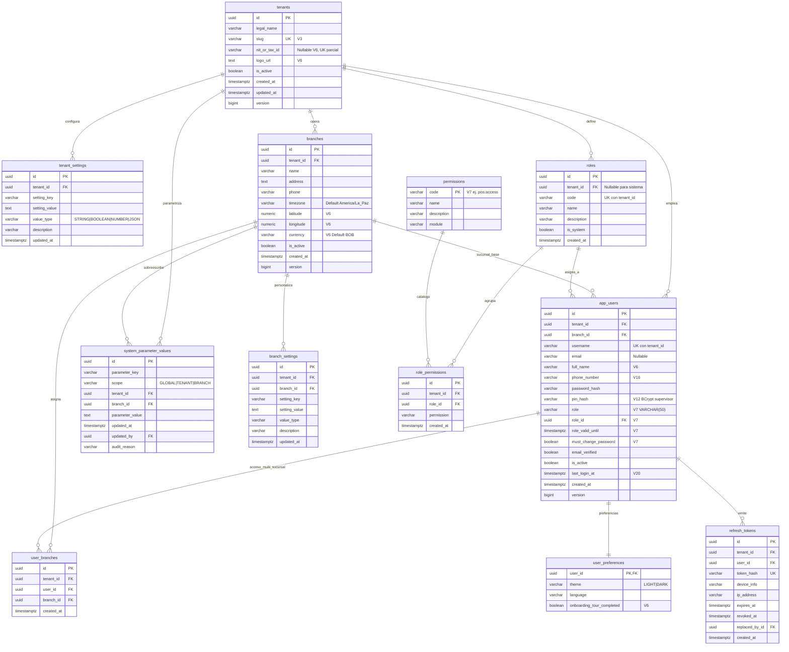
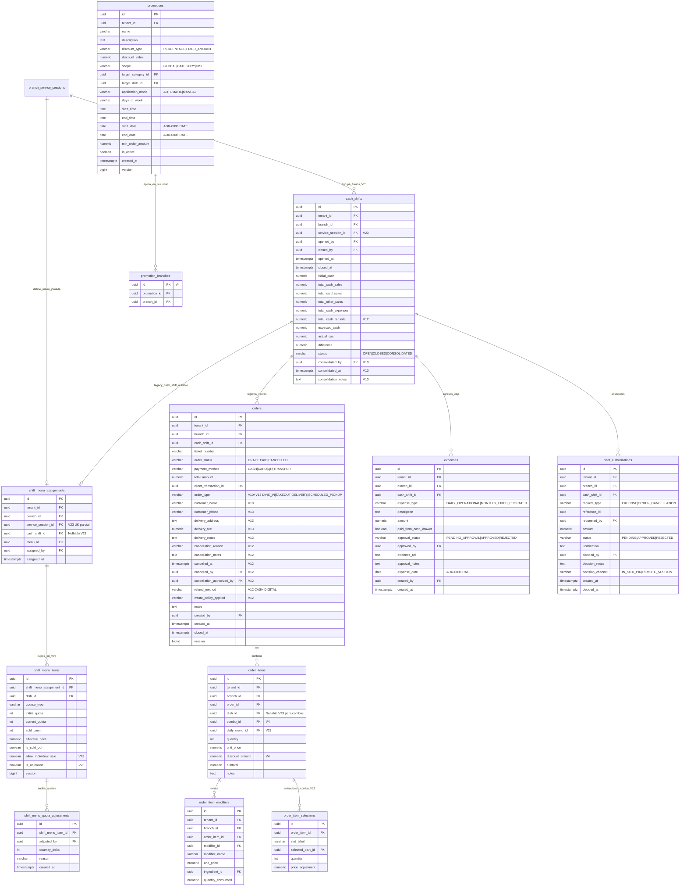
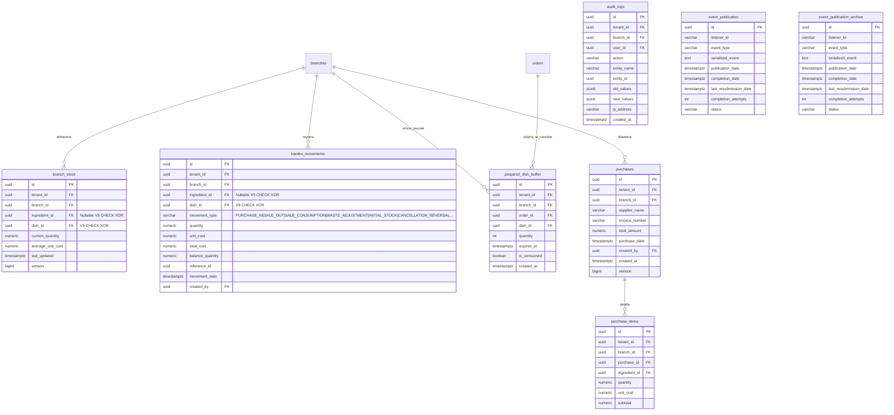

# Modelo Entidad-Relación de Base de Datos (PostgreSQL 16+)

Esquema relacional completo del sistema **Restaurante ERP SaaS**, verificado directamente contra las migraciones Flyway `V1`–`V24`. La base de datos comprende **56 tablas totales**: **47 tablas ERP/Sistema** detalladas en este documento y **9 tablas de Plataforma/Suscripciones Backoffice** (`V17`–`V22`), documentadas en [ERD Backoffice y Suscripciones](../../../backoffice/architecture/domain_and_erd_subscriptions.md).

## Resumen de Evolución Flyway (`V1`–`V24`)

- **Esquema base e infraestructura:** [`V1__init_schema.sql`](../../../../backend/src/main/resources/db/migration/V1__init_schema.sql), [`V2__spring_modulith_events.sql`](../../../../backend/src/main/resources/db/migration/V2__spring_modulith_events.sql) (`event_publication`, `event_publication_archive`).
- **Tenancy, Onboarding, RBAC, Sesión y Parámetros:** [`V3__tenant_slug_and_rbac.sql`](../../../../backend/src/main/resources/db/migration/V3__tenant_slug_and_rbac.sql), [`V5__system_parameter_values.sql`](../../../../backend/src/main/resources/db/migration/V5__system_parameter_values.sql), [`V6__onboarding_and_tax_info.sql`](../../../../backend/src/main/resources/db/migration/V6__onboarding_and_tax_info.sql), [`V7__rbac_dynamic_roles_and_privileges.sql`](../../../../backend/src/main/resources/db/migration/V7__rbac_dynamic_roles_and_privileges.sql), [`V8__session_refresh_tokens.sql`](../../../../backend/src/main/resources/db/migration/V8__session_refresh_tokens.sql), [`V16__user_phone_number.sql`](../../../../backend/src/main/resources/db/migration/V16__user_phone_number.sql), [`V20__tenant_first_login_tracking.sql`](../../../../backend/src/main/resources/db/migration/V20__tenant_first_login_tracking.sql).
- **Catálogo, Inventario Flexible, Menús del Día y Jornadas:** [`V4__inventory_combos_promotions_modifiers.sql`](../../../../backend/src/main/resources/db/migration/V4__inventory_combos_promotions_modifiers.sql), [`V9__daily_menus_and_flexible_inventory.sql`](../../../../backend/src/main/resources/db/migration/V9__daily_menus_and_flexible_inventory.sql), [`V11__modifiers_kardex_consumption.sql`](../../../../backend/src/main/resources/db/migration/V11__modifiers_kardex_consumption.sql), [`V14__dish_image_url.sql`](../../../../backend/src/main/resources/db/migration/V14__dish_image_url.sql), [`V15__category_code_prefix.sql`](../../../../backend/src/main/resources/db/migration/V15__category_code_prefix.sql), [`V23__service_sessions_combo_menus_and_order_selections.sql`](../../../../backend/src/main/resources/db/migration/V23__service_sessions_combo_menus_and_order_selections.sql), [`V24__widen_daily_menus_day_of_week.sql`](../../../../backend/src/main/resources/db/migration/V24__widen_daily_menus_day_of_week.sql).
- **POS, Modalidades, Cancelaciones y Turnos:** [`V10__order_type_customer_name_and_shift_consolidation.sql`](../../../../backend/src/main/resources/db/migration/V10__order_type_customer_name_and_shift_consolidation.sql), [`V12__order_cancellations_and_shift_authorizations.sql`](../../../../backend/src/main/resources/db/migration/V12__order_cancellations_and_shift_authorizations.sql), [`V13__service_modalities_delivery_fee_and_pickup.sql`](../../../../backend/src/main/resources/db/migration/V13__service_modalities_delivery_fee_and_pickup.sql).
- **Backoffice SaaS (9 tablas en documento hermano):** [`V17`](../../../../backend/src/main/resources/db/migration/V17__platform_admins_and_sessions.sql), [`V18`](../../../../backend/src/main/resources/db/migration/V18__platform_settings_storage.sql), [`V19`](../../../../backend/src/main/resources/db/migration/V19__backoffice_subscriptions_telemetry_and_audit.sql), [`V21`](../../../../backend/src/main/resources/db/migration/V21__subscription_plans_category_and_unlimited.sql), [`V22`](../../../../backend/src/main/resources/db/migration/V22__platform_admin_optional_email_and_password_policy.sql).

---

## 1. Tenancy, Configuración Dinámica, Seguridad RBAC y Sesiones (12 Tablas)

---

## 2. Catálogo, Recetas, Modificadores, Combos, Menús y Jornadas (15 Tablas)

```mermaid
erDiagram
    categories ||--o{ dishes : "clasifica"
    categories ||--o{ combos : "clasifica"

    dishes ||--o{ dish_recipes : "compuesto_por"
    ingredients ||--o{ dish_recipes : "insumo"
    dishes ||--o{ branch_dishes : "override_sucursal"
    dishes ||--o{ dish_modifier_groups : "permite"
    modifier_groups ||--o{ dish_modifier_groups : "asocia"
    modifier_groups ||--o{ modifiers : "contiene"
    ingredients ||--o{ modifiers : "descuenta_opcional"

    combos ||--o{ combo_items : "estructura"
    combo_items ||--o{ combo_item_options : "opciones"
    dishes ||--o{ combo_items : "default_dish"
    dishes ||--o{ combo_item_options : "opcion_plato"

    daily_menus ||--o{ daily_menu_items : "incluye_platos"
    daily_menus ||--o{ daily_menu_combos : "habilita_combos"
    dishes ||--o{ daily_menu_items : "referencia"
    combos ||--o{ daily_menu_combos : "referencia"
    daily_menus ||--o{ branch_service_sessions : "asignado_a_jornada"

    categories {
        uuid id PK
        uuid tenant_id FK
        varchar name
        varchar code_prefix "V15 UK con tenant_id"
        varchar icon
        int sort_order
        timestamptz created_at
    }

    ingredients {
        uuid id PK
        uuid tenant_id FK
        varchar name
        varchar unit_of_measure "KG|GRAM|LITER|ML|UNIT"
        numeric min_stock_alert
        timestamptz created_at
    }

    dishes {
        uuid id PK
        uuid tenant_id FK
        uuid branch_id FK "NULL=Maestro"
        uuid cloned_from_id FK
        uuid category_id FK
        varchar code
        varchar name
        text description
        numeric sale_price
        varchar image_url "V14"
        varchar inventory_strategy "V9 RECIPE_BOM_STRICT|DISH_AS_INVENTORY_UNIT|COMMERCIAL_NO_INVENTORY"
        boolean allow_negative_stock_override "V9"
        boolean is_active
        timestamptz created_at
        bigint version
    }

    dish_recipes {
        uuid id PK
        uuid dish_id FK
        uuid ingredient_id FK
        numeric quantity
    }

    branch_dishes {
        uuid id PK
        uuid tenant_id FK
        uuid branch_id FK
        uuid dish_id FK
        boolean is_available
        numeric price_override
        timestamptz created_at
        bigint version
    }

    modifier_groups {
        uuid id PK
        uuid tenant_id FK
        varchar name
        int min_selectable
        int max_selectable
        boolean is_required
        timestamptz created_at
    }

    dish_modifier_groups {
        uuid id PK
        uuid dish_id FK
        uuid group_id FK "V4 nombre real group_id"
        int sort_order
    }

    modifiers {
        uuid id PK
        uuid tenant_id FK
        uuid group_id FK
        varchar name
        numeric additional_price
        uuid ingredient_id FK
        numeric quantity_consumed
        boolean is_active
        int sort_order
    }

    combos {
        uuid id PK
        uuid tenant_id FK
        uuid branch_id FK
        uuid category_id FK
        varchar code
        varchar name
        text description
        numeric base_price
        boolean is_active
        timestamptz created_at
        bigint version
    }

    combo_items {
        uuid id PK
        uuid combo_id FK
        varchar name
        varchar selection_mode "FIXED|CHOICE"
        varchar selection_source "V23 FIXED|SPECIFIC_OPTIONS|MENU_COURSE"
        varchar course_type "V23"
        boolean is_required
        uuid default_dish_id FK
        int quantity
        int sort_order
    }

    combo_item_options {
        uuid id PK
        uuid combo_item_id FK
        uuid dish_id FK
        numeric price_adjustment
        boolean is_default
    }

    daily_menus {
        uuid id PK
        uuid tenant_id FK
        uuid branch_id FK
        varchar name
        text description
        varchar day_of_week "V24 VARCHAR(120)"
        varchar price_mode
        numeric package_price
        boolean is_template
        boolean is_active
        timestamptz created_at
        timestamptz updated_at
        bigint version
    }

    daily_menu_items {
        uuid id PK
        uuid menu_id FK
        uuid dish_id FK
        varchar course_type
        int suggested_quota
        numeric override_price
        boolean is_mandatory_in_package
        boolean allow_individual_sale "V23"
        boolean is_unlimited "V23"
        int sort_order
    }

    daily_menu_combos {
        uuid id PK
        uuid menu_id FK
        uuid combo_id FK
        int sort_order
    }

    branch_service_sessions {
        uuid id PK
        uuid tenant_id FK
        uuid branch_id FK
        date service_date "ADR-0006 DATE"
        varchar menu_mode "FULL_CATALOG|DAILY_MENU"
        uuid daily_menu_id FK
        varchar status "CONFIGURED|ACTIVE|CLOSED"
        uuid configured_by FK
        text notes
        timestamptz created_at
        timestamptz activated_at
        timestamptz closed_at
        bigint version
    }
```

---

## 3. POS, Promociones, Turnos de Caja, Gastos y Menú Activo (12 Tablas)

---

## 4. Inventario Kardex, Buffer, Compras, Auditoría y Outbox Modulith (8 Tablas)

> [!NOTE]
> `purchases`, `purchase_items` y `audit_logs` existen en el esquema DDL desde `V1__init_schema.sql` como estructura base relacional, aunque la versión actual (Sprint 6) no implementa aún entidades JPA ni repositorios Java para dichos agregados. Adicionalmente, `branch_stock` y `kardex_movements` imponen las restricciones `chk_branch_stock_target` y `chk_kardex_target` (`ingredient_id` XOR `dish_id`) para soportar platos unitarios (`DISH_AS_INVENTORY_UNIT`).

## Enlaces Relacionados

- [ERD del Plano Backoffice (9 tablas V17–V22)](../../../backoffice/architecture/domain_and_erd_subscriptions.md)
- [Esquema Local Dexie.js (IndexedDB POS)](./dexie_local_schema.md)
- [Modelo de Dominio Java](./domain_model.md)
- [SDD Esquema de Base de Datos](../../../sdd/04_database_schema.md)
- [ADR-0006: Estándar de Fechas y Zonas Horarias](../../../adr/0006_datetime_and_timezone_handling.md)
- [ADR-0015: Menús Diarios e Inventario Flexible](../../../adr/0015_daily_menus_and_flexible_dish_inventory.md)
- [ADR-0031: Jornadas de Servicio y Combos Dinámicos](../../../adr/0031_branch_service_sessions_and_dynamic_combos.md)
