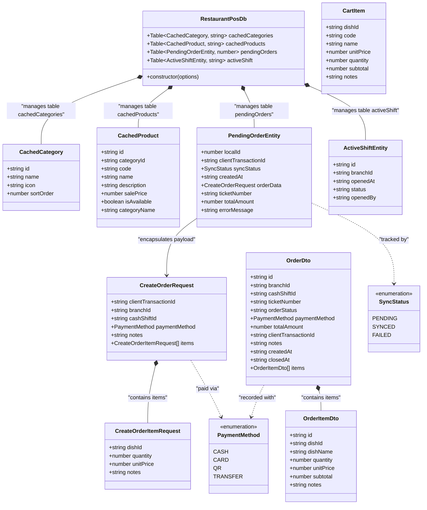
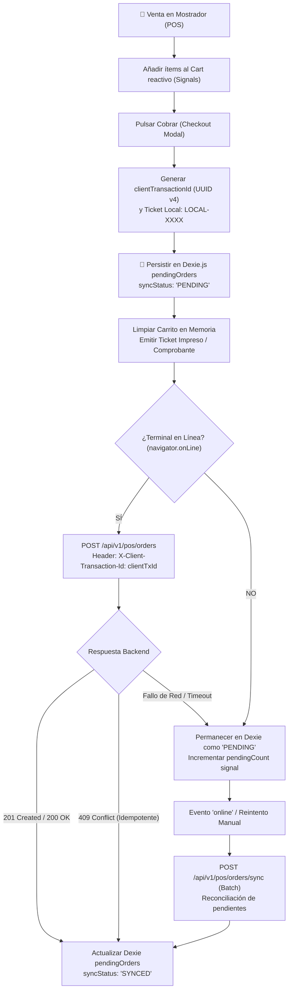

# 💾 Esquema de Almacenamiento Local IndexedDB (Dexie.js)

Este documento especifica el **Esquema de Base de Datos Local en el Cliente Web** gestionado a través de **Dexie.js v4** sobre la API nativa de **IndexedDB** del navegador. Ha sido extraído y verificado directamente contra la implementación en el frontend:
- [`frontend/src/app/core/db/app.database.ts`](../../../../frontend/src/app/core/db/app.database.ts)
- [`frontend/src/app/core/models/pos.models.ts`](../../../../frontend/src/app/core/models/pos.models.ts)
- [`frontend/src/app/core/services/pos.service.ts`](../../../../frontend/src/app/core/services/pos.service.ts)

---

## 1. Contexto Arquitectónico y Filosofía Offline-First (ADR-0003)

En un entorno gastronómico de alta rotación (Fast Food / Restobar), **la atención al cliente en mostrador no puede bloquearse jamás** por caídas de internet, latencia de Wi-Fi o indisponibilidad momentánea del backend.

Para materializar este requerimiento de misión crítica:
1. **Catálogo Autónomo en el Navegador:** Las categorías y platos con precios resueltos se cachean en Dexie.js (`cachedCategories`, `cachedProducts`).
2. **Checkout Ininterrumpido:** Toda orden cobrada offline se persiste en la tabla local `pendingOrders` antes de emitir el ticket local.
3. **Idempotencia Garantizada:** Cada orden local genera un UUID universal (`clientTransactionId`), que el backend valida bajo una restricción `UNIQUE` en PostgreSQL, impidiendo cobros dobles al reconectar.
4. **Gobernanza DAL (Regla 2):** Los componentes de UI y servicios de aplicación no acceden directamente a `appDb`, sino a través de una capa de Data Access Layer (DAL) / Repositorios Locales.

---

## 2. Diagrama de Clases del Esquema Dexie.js



---

## 3. Especificación Técnica de Tiendas (Stores) e Índices

La versión 1 de la base de datos `RestaurantPosDb` define sus almacenes de objetos e índices en Dexie.js de la siguiente forma:

```typescript
this.version(1).stores({
  cachedCategories: 'id, name, sortOrder',
  cachedProducts:   'id, categoryId, code, name, salePrice, isAvailable',
  pendingOrders:    '++localId, clientTransactionId, syncStatus, createdAt, orderData',
  activeShift:      'id, branchId, openedAt, status',
});
```

### Detalle de Índices por Tabla

| Tienda (Table) | Clave Primaria | Índices Secundarios | Propósito Operativo |
| :--- | :--- | :--- | :--- |
| `cachedCategories` | `id` (string UUID) | `name`, `sortOrder` | Ordenar las pestañas de categorías en la botonera táctil del POS. |
| `cachedProducts` | `id` (string UUID) | `categoryId`, `code`, `name`, `salePrice`, `isAvailable` | Filtrar platos por categoría seleccionada, buscar por código de barra/teclado y verificar disponibilidad. |
| `pendingOrders` | `++localId` (auto-incremental) | `clientTransactionId`, `syncStatus`, `createdAt`, `orderData` | Bitácora de pedidos creados localmente. Permite recuperar órdenes `PENDING` para la sincronización por lotes. |
| `activeShift` | `id` (string UUID) | `branchId`, `openedAt`, `status` | Recordar el turno de caja abierto en la sucursal actual para vincular las órdenes offline. |

---

## 4. Ciclo de Vida del Almacenamiento Offline-First

El siguiente diagrama de flujo resume la interacción del almacenamiento local durante el ciclo de vida de una venta:



---

## 5. Protocolo de Sincronización y Reconciliación Idempotente

1. **Reintento Automático ante Retorno de Conexión:**
   - La aplicación escucha `window.addEventListener('online')` y dispara `syncPendingOrders()` en segundo plano.
2. **Idempotencia Transaccional:**
   - Cada llamada HTTP envía la cabecera `X-Client-Transaction-Id: <uuid>`.
   - Si una petición anterior ya fue recibida por el backend pero la respuesta se perdió por corte de conexión, el backend devuelve el registro existente sin reinsertar ni cobrar doblemente.
3. **Manejo de Variaciones de Stock (Strategy Mode):**
   - Si la política de inventario configurada es `AUTOMATIC_STRICT` y no hay existencias físicas en el backend para una orden vendida offline, el backend prioriza la validez financiera de la venta (el dinero físico ya fue recibido por el cajero) y emite una advertencia de déficit de stock para auditoría administrativa.

---

## 6. Referencias y Artefactos Relacionados

- **Modelo de Dominio Conceptual:** Ver [domain_model.md](./domain_model.md).
- **Diagrama Entidad-Relación PostgreSQL:** Ver [database_erd.md](./database_erd.md).
- **Decisión Arquitectónica Offline-First:** Ver [ADR-0003](../../../adr/0003_offline_first_dexie_sync.md).
- **Secuencia Detallada de Sincronización:** Ver [sequence_pos_offline_sync.md](../04-behavior-and-flows/sequence_pos_offline_sync.md).
- **Índice de la Bóveda de Arquitectura:** Ver [README.md](../README.md).
