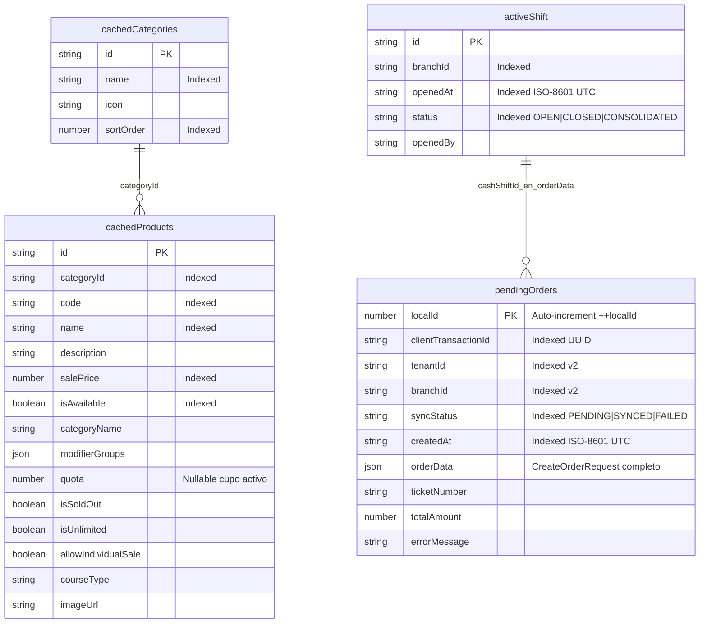

# Esquema Local Offline-First en Dexie.js (IndexedDB)

Base de datos local `RestaurantPosDb` implementada en [`app.database.ts`](../../../../frontend/src/app/core/db/app.database.ts) (`export const appDb = new RestaurantPosDb()`) y tipada por [`pos.models.ts`](../../../../frontend/src/app/core/models/pos.models.ts). Garantiza la continuidad operativa del POS ante caídas de red, segmentación estricta por `tenantId`/`branchId` en la cola offline y aislamiento mediante capa DAL (`core/repositories`).

> [!IMPORTANT]
> **Alineación real con código (Sprint 6):** El esquema activo `version(2)` define exactamente **4 Object Stores** (`cachedCategories`, `cachedProducts`, `pendingOrders`, `activeShift`). La versión `2` únicamente incorpora índices `tenantId` y `branchId` en `pendingOrders` junto con una rutina `upgrade(...)` que purga órdenes huérfanas sin `tenantId`; **no existen** stores locales separados `cachedShiftMenu` ni `cachedShiftMenuItems` (los cupos del menú del día se hidratan directamente en propiedades opcionales de `CachedProduct`).

## Diagrama de Stores Locales y Repositorios DAL (Mermaid)



## Definición Exacta de Versiones en `RestaurantPosDb`

```ts
this.version(1).stores({
  cachedCategories: 'id, name, sortOrder',
  cachedProducts: 'id, categoryId, code, name, salePrice, isAvailable',
  pendingOrders: '++localId, clientTransactionId, syncStatus, createdAt, orderData',
  activeShift: 'id, branchId, openedAt, status',
});

this.version(2).stores({
  pendingOrders: '++localId, clientTransactionId, tenantId, branchId, syncStatus, createdAt, orderData',
}).upgrade(async (tx) => {
  const table = tx.table('pendingOrders');
  const keysToDelete = await table.filter((o: PendingOrderEntity) => !o.tenantId).primaryKeys();
  if (keysToDelete.length > 0) {
    await table.bulkDelete(keysToDelete);
  }
});
```

## Capa de Acceso a Datos Local (DAL)

El acceso a IndexedDB está desacoplado de servicios y componentes mediante inyección de `APP_DATABASE` (`core/repositories/app-database.token.ts`) y 3 repositorios dedicados en `frontend/src/app/core/repositories/`:

1. **`LocalCatalogRepository`** (`local-catalog.repository.ts`): Lectura y refresco atómico de `cachedCategories` y `cachedProducts` (incluyendo cupos de menú diario, modificadores y URLs multimedia).
2. **`LocalOrderRepository`** (`local-order.repository.ts`): Encolado de `PendingOrderEntity` con `clientTransactionId`, filtrado por `tenantId`/`branchId` y `syncStatus` (`PENDING` | `SYNCED` | `FAILED`), transición de estados y limpieza tras sincronización.
3. **`LocalShiftRepository`** (`local-shift.repository.ts`): Persistencia y consulta de `activeShift` (`OPEN` | `CLOSED` | `CONSOLIDATED`) para validar disponibilidad operativa cuando no hay conexión.

## Contratos TypeScript Verificados (`pos.models.ts`)

| Interfaz / Tipo | Campos Clave Verificados | Propósito en Flujo POS / Offline |
| :--- | :--- | :--- |
| `SyncStatus` | `'PENDING' \| 'SYNCED' \| 'FAILED'` | Máquina de estados de la cola local `pendingOrders`. |
| `OrderType` | `'DINE_IN' \| 'TAKEOUT' \| 'DELIVERY' \| 'SCHEDULED_PICKUP'` | Modalidad de servicio capturada en checkout. |
| `PaymentMethod` | `'CASH' \| 'CARD' \| 'QR' \| 'TRANSFER'` | Medio de pago de la orden. |
| `CachedProduct` | `id`, `categoryId`, `code`, `name`, `salePrice`, `isAvailable`, `modifierGroups?`, `quota?`, `isSoldOut?`, `isUnlimited?`, `allowIndividualSale?`, `courseType?`, `imageUrl?` | Proyección unificada del catálogo + disponibilidad del menú activo en turno/jornada. |
| `PendingOrderEntity` | `localId?`, `clientTransactionId`, `tenantId?`, `branchId?`, `syncStatus`, `createdAt`, `orderData`, `ticketNumber?`, `totalAmount?`, `errorMessage?` | Registro offline idempotente aislado por inquilino y sucursal. |
| `ActiveShiftEntity` | `id`, `branchId`, `openedAt`, `status` (`'OPEN' \| 'CLOSED' \| 'CONSOLIDATED'`), `openedBy?` | Caché del turno actual en la sucursal activa. |
| `CreateOrderRequest` | `clientTransactionId?`, `branchId`, `cashShiftId?`, `paymentMethod`, `items`, `appliedPromotionId?`, `orderType?`, `customerName?`, `customerPhone?`, `deliveryAddress?`, `deliveryFee?`, `deliveryNotes?`, campos opcionales de cancelación | Payload enviado en `POST /api/v1/pos/orders` y en `SyncOrdersRequest.orders[]` hacia `POST /api/v1/pos/orders/sync`. |
| `CreateOrderItemRequest` | `dishId: string \| null`, `quantity`, `unitPrice`, `notes?`, `comboId?`, `dailyMenuId?`, `componentDishIds?`, `selections?: OrderItemSelectionRequest[]`, `discountAmount?`, `selectedModifiers?: SelectedModifierRequest[]` | Soporta platos individuales, combos con selecciones dinámicas (`MENU_COURSE`), menús armables y extras con impacto Kardex. |
| `SelectedModifierRequest` | `modifierId`, `modifierName`, `additionalPrice`, `ingredientId?`, `quantityConsumed?` | Modificador seleccionado en ítem de venta. |
| `OrderItemSelectionRequest` / `OrderItemSelectionDto` | `slotLabel`, `selectedDishId`, `selectedDishName`, `quantity`, `priceAdjustment?` | Elección concreta dentro de slots de combos dinámicos o menús. |
| `PromotionDto` | `id`, `name`, `discountType` (`'PERCENTAGE' \| 'FIXED_AMOUNT'`), `discountValue`, `scope` (`'GLOBAL' \| 'CATEGORY' \| 'DISH'`), `targetCategoryId?`, `targetDishId?`, `applicationMode` (`'AUTOMATIC' \| 'MANUAL'`), `daysOfWeek?`, `startTime?`, `endTime?`, `startDate?`, `endDate?`, `minOrderAmount?`, `isActive`, `branchIds?` | Regla de promoción evaluada en carrito POS y validada en servidor. |
| `CancelOrderRequest` | `cancellationReason`, `cancellationNotes?`, `refundMethod` (`'CASH' \| 'DIGITAL'`), `wasPrepared`, `supervisorPin?`, `authorizationRequestId?` | Solicitud de anulación de pedido pagado desde POS/Historial. |
| `OrderDto` | Incluye `cashierId?`, `cashierName?`, `items: OrderItemDto[]`, campos de modalidad y cancelación | Respuesta consolidada del backend usada tras checkout y batch sync (`SyncOrdersResponse`). |

## Enlaces Relacionados

- [Skill: Estrategia Offline Dexie y Sincronización](../../../../.agents/skills/offline-dexie-sync/SKILL.md)
- [Secuencia de Sincronización Offline POS](../04-behavior-and-flows/sequence_pos_offline_sync.md)
- [C4 Nivel 3: Frontend Angular](../01-c4-system/c4_level3_frontend_angular.md)
- [Modelo Entidad-Relación PostgreSQL](./database_erd.md)
- [ADR-0003: Estrategia Offline-First y Sincronización Dexie](../../../adr/0003_offline_first_dexie_sync.md)
