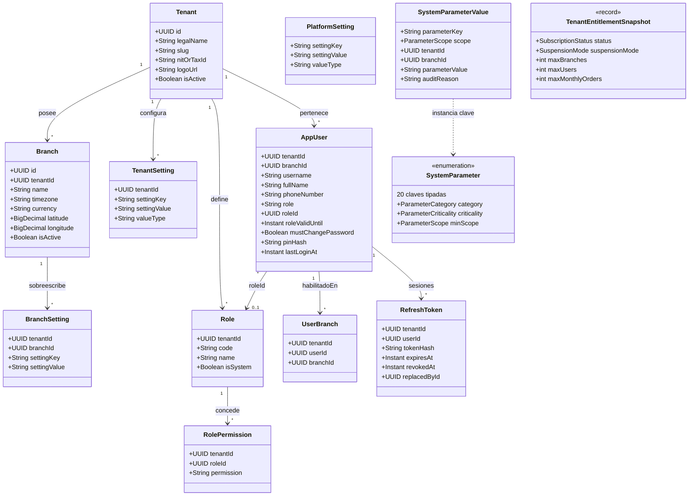
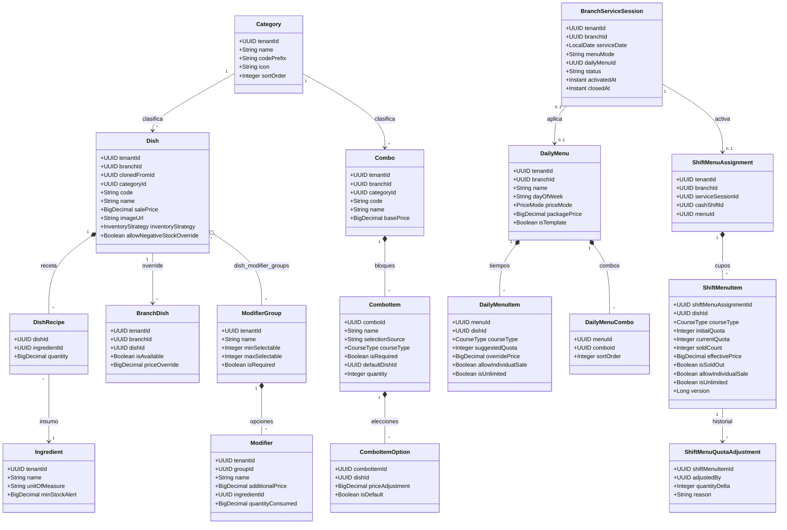
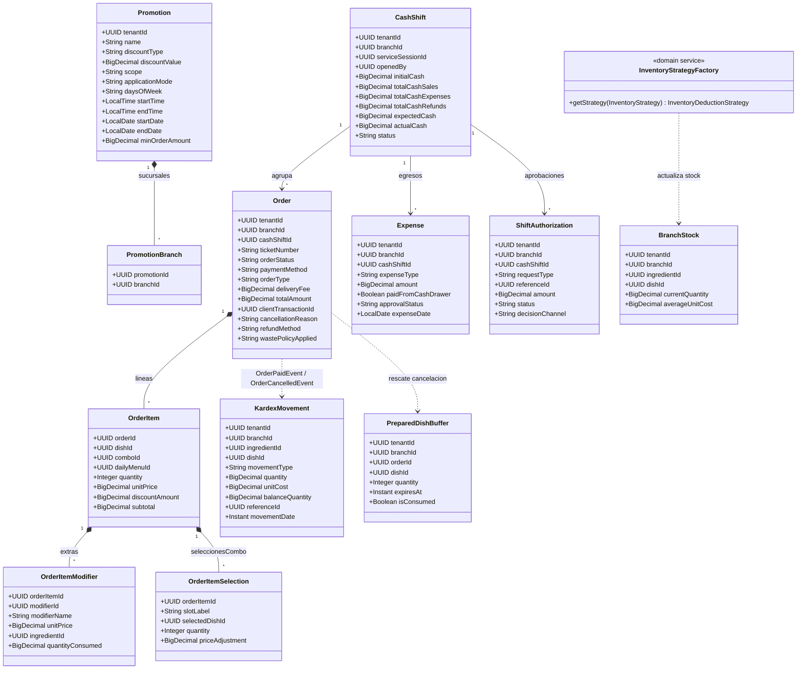

# Modelo de Dominio Java y Agregados Spring Modulith

Representación del modelo de objetos JPA y enums/contratos de dominio verificados en `backend/src/main/java/com/restaurant/app/` hasta `V24` (**40 entidades JPA ERP/Config** + **8 entidades Backoffice**). Por brevedad arquitectónica, los diagramas omiten getters/setters y campos técnicos repetitivos (`id`, `createdAt`, `version`), destacando atributos de negocio, invariantes y relaciones entre agregados.

> [!NOTE]
> **Precisiones estructurales verificadas en código:**
> - Cada entidad transaccional declara explícitamente `tenantId` (y `branchId` cuando aplica) sin heredar de `BaseTenantEntity` ni `BaseBranchEntity` (únicamente `BaseBranchEntity extends BaseTenantEntity` sin subclases `@Entity`).
> - Las tablas DDL `purchases`, `purchase_items` y `audit_logs` (`V1`) aún no tienen entidades `@Entity` en el dominio Java.
> - Los agregados del plano Backoffice (`PlatformAdmin`, `PlatformRefreshToken`, `SubscriptionPlan`, `TenantSubscription`, `SubscriptionCharge`, `SubscriptionPayment`, `TenantDailyTelemetry`, `PlatformAuditLog`) están modelados en [Dominio y ERD del Backoffice](../../../backoffice/architecture/domain_and_erd_subscriptions.md).

---

## 1. Núcleo Transversal: Tenancy, Configuración, Entitlements y RBAC

---

## 2. Catálogo, Recetas, Modificadores, Combos, Menús y Jornadas (`modules.catalog`)

---

## 3. Ventas POS, Promociones, Inventario y Finanzas (`modules.pos`, `inventory`, `finance`)

## Eventos de Dominio entre Módulos (Spring Modulith)

| Evento (`.api`) | Publicador | Consumidor(es) (`@ApplicationModuleListener`) | Propósito |
| :--- | :--- | :--- | :--- |
| `TenantOnboardedEvent` | `modules.company` | Extensible para post-aprovisionamiento | Notifica creación inicial de tenant, admin y sucursal matriz. |
| `ParameterUpdatedEvent` | `modules.configuration` | `core.security` / listeners de caché | Propaga recarga caliente de parámetros críticos (ej. expiración JWT, políticas de contraseña). |
| `OrderPaidEvent` | `modules.pos` | `modules.inventory.InventoryEventListener`, `modules.backoffice.BackofficeTelemetryListener` | Deduce inventario Kardex de forma asíncrona tras la venta y acumula telemetría diaria de consumo. |
| `OrderCancelledEvent` | `modules.pos` | `modules.inventory.InventoryEventListener` | Revierte stock, inserta platos rescatables en `PreparedDishBuffer` o registra `WASTE_ADJUSTMENT`. |
| `TenantEntitlementChangedEvent` | `modules.backoffice` | `core.entitlements.TenantEntitlementServiceImpl` | Invalida caché en memoria del snapshot de suscripción/cuotas del tenant afectado. |

## Enlaces Relacionados

- [Modelo Entidad-Relación PostgreSQL (47 tablas ERP)](./database_erd.md)
- [ERD y Dominio Backoffice (9 tablas V17–V22)](../../../backoffice/architecture/domain_and_erd_subscriptions.md)
- [Esquema Local Dexie.js](./dexie_local_schema.md)
- [C4 Nivel 3: Backend Spring Modulith](../01-c4-system/c4_level3_backend_modulith.md)
- [Estrategia de Deducción Kardex](../04-behavior-and-flows/activity_inventory_deduction_strategy.md)
