# 🧩 Modelo de Dominio Conceptual y Agregados del Sistema

Este documento define el **Modelo de Dominio Conceptual** del Sistema de Gestión para Restaurante bajo los principios de **Domain-Driven Design (DDD)** y **Specification-Driven Development (SDD)**. Representa las entidades de negocio, sus límites de consistencia transaccional (Agregados), comportamientos encapsulados (Rich Domain Model), invariantes y relaciones jerárquicas multi-tenant.

---

## 1. Principios Arquitectónicos del Dominio

1. **Aislamiento Multi-Tenant Estricto (ADR-0002):**
   - Toda entidad transaccional hereda de `BaseTenantEntity` (`tenant_id`, `version`, `created_at`, `updated_at`).
   - Las entidades con alcance operativo por sucursal heredan de `BaseBranchEntity` (`branch_id`).
   - El contexto del tenant y sucursal se propaga de forma transparente vía tokens JWT y se custodia en el backend mediante `TenantContextHolder`.

2. **Modelo de Dominio Rico vs. Modelo Anémico (Regla 6 de Gobernanza):**
   - Las entidades no son meros contenedores pasivos de datos (getters/setters). Encapsulan reglas de validación, transiciones de estado e invariantes de negocio (ej. `closeShift()`, `markAsPaid()`, `deductStock()`, `cloneForBranch()`).
   - Los servicios de aplicación orquestan persistencia y eventos, delegando las mutaciones de estado a los métodos de dominio de las entidades.

3. **Manejo Estricto de Fechas y Zonas Horarias (ADR-0006):**
   - Marcas de tiempo transaccionales en `Instant` (UTC / `TIMESTAMPTZ`).
   - Fechas de calendario puras sin hora en `LocalDate` (ej. `Expense.expenseDate`).
   - Huso horario operativo configurable por sucursal (`branches.timezone`, default `'America/La_Paz'`).

---

## 2. Diagrama de Clases del Dominio Puro

```mermaid
classDiagram
    %% Clases Abstractas Base
    class BaseTenantEntity {
        <<abstract>>
        +UUID tenantId
        +Long version
        +Instant createdAt
        +Instant updatedAt
        +getTenantId() UUID
        +getVersion() Long
    }

    class BaseBranchEntity {
        <<abstract>>
        +UUID branchId
        +getBranchId() UUID
    }

    BaseTenantEntity <|-- BaseBranchEntity

    %% Agregado de Seguridad y Tenancy
    class Tenant {
        +UUID id
        +String legalName
        +String nitOrTaxId
        +boolean isActive
        +activate() void
        +deactivate() void
        +updateTaxInfo(String legalName, String nitOrTaxId) void
    }

    class Branch {
        +UUID id
        +String name
        +String address
        +String phone
        +String timezone
        +boolean isActive
        +updateTimezone(String timezone) void
        +deactivate() void
        +activate() void
    }

    class AppUser {
        +UUID id
        +String username
        +String email
        +String passwordHash
        +Role role
        +boolean emailVerified
        +boolean isActive
        +changePassword(String newHash) void
        +assignRole(Role newRole) void
        +verifyEmail() void
        +deactivate() void
    }

    BaseTenantEntity <|-- Tenant
    BaseTenantEntity <|-- Branch
    BaseTenantEntity <|-- AppUser

    %% Agregado Catálogo y Recetas (BOM)
    class Category {
        +UUID id
        +String name
        +String icon
        +int sortOrder
        +updateInfo(String name, String icon, int sortOrder) void
    }

    class Ingredient {
        +UUID id
        +String name
        +UnitOfMeasure unitOfMeasure
        +BigDecimal minStockAlert
        +updateMinStockAlert(BigDecimal newAlert) void
    }

    class Dish {
        +UUID id
        +UUID categoryId
        +UUID clonedFromId
        +String code
        +String name
        +String description
        +BigDecimal salePrice
        +boolean isActive
        +cloneForBranch(UUID targetBranchId) Dish
        +updatePrice(BigDecimal newPrice) void
        +deactivate() void
        +activate() void
    }

    class DishRecipe {
        +UUID id
        +UUID dishId
        +UUID ingredientId
        +BigDecimal quantity
        +updateQuantity(BigDecimal newQty) void
    }

    class BranchDish {
        +UUID id
        +UUID dishId
        +boolean isAvailable
        +BigDecimal priceOverride
        +overridePrice(BigDecimal newPrice) void
        +resetPriceOverride() void
        +toggleAvailability(boolean available) void
        +getEffectivePrice(BigDecimal defaultPrice) BigDecimal
    }

    BaseTenantEntity <|-- Category
    BaseTenantEntity <|-- Ingredient
    BaseBranchEntity <|-- Dish
    BaseBranchEntity <|-- BranchDish

    %% Agregado Inventario y Kardex
    class BranchStock {
        +UUID id
        +UUID ingredientId
        +BigDecimal currentQuantity
        +BigDecimal averageUnitCost
        +Instant lastUpdated
        +recalculateAverageCost(BigDecimal inQty, BigDecimal inCost) void
        +deductStock(BigDecimal qty, InventoryDeductionMode mode) void
        +increaseStock(BigDecimal qty, BigDecimal unitCost) void
        +hasSufficientStock(BigDecimal requiredQty) boolean
    }

    class Purchase {
        +UUID id
        +String supplierName
        +String invoiceNumber
        +BigDecimal totalAmount
        +Instant purchaseDate
        +UUID createdBy
        +addItem(PurchaseItem item) void
        +recalculateTotal() void
    }

    class PurchaseItem {
        +UUID id
        +UUID purchaseId
        +UUID ingredientId
        +BigDecimal quantity
        +BigDecimal unitCost
        +BigDecimal subtotal
        +calculateSubtotal() BigDecimal
    }

    class KardexMovement {
        +UUID id
        +UUID ingredientId
        +MovementType movementType
        +BigDecimal quantity
        +BigDecimal unitCost
        +BigDecimal totalCost
        +BigDecimal balanceQuantity
        +UUID referenceId
        +Instant movementDate
        +UUID createdBy
    }

    BaseBranchEntity <|-- BranchStock
    BaseBranchEntity <|-- Purchase
    BaseBranchEntity <|-- PurchaseItem
    BaseBranchEntity <|-- KardexMovement

    %% Agregado POS y Ventas
    class Order {
        +UUID id
        +UUID cashShiftId
        +String ticketNumber
        +OrderStatus orderStatus
        +PaymentMethod paymentMethod
        +BigDecimal totalAmount
        +UUID clientTransactionId
        +String notes
        +UUID createdBy
        +Instant closedAt
        +addItem(OrderItem item) void
        +markAsPaid(PaymentMethod method, UUID shiftId) void
        +transitionTo(OrderStatus targetStatus) void
        +cancel(String reason) void
        +recalculateTotal() void
    }

    class OrderItem {
        +UUID id
        +UUID orderId
        +UUID dishId
        +int quantity
        +BigDecimal unitPrice
        +BigDecimal subtotal
        +String notes
        +calculateSubtotal() BigDecimal
    }

    BaseBranchEntity <|-- Order
    BaseBranchEntity <|-- OrderItem

    %% Agregado Finanzas y Caja
    class CashShift {
        +UUID id
        +UUID openedBy
        +UUID closedBy
        +Instant openedAt
        +Instant closedAt
        +BigDecimal initialCash
        +BigDecimal totalCashSales
        +BigDecimal totalCardSales
        +BigDecimal totalOtherSales
        +BigDecimal totalCashExpenses
        +BigDecimal expectedCash
        +BigDecimal actualCash
        +BigDecimal difference
        +ShiftStatus status
        +registerSale(BigDecimal amount, PaymentMethod method) void
        +registerExpense(BigDecimal amount) void
        +calculateExpectedCash() BigDecimal
        +closeShift(UUID closedBy, BigDecimal actualCash) void
    }

    class Expense {
        +UUID id
        +UUID cashShiftId
        +ExpenseType expenseType
        +String description
        +BigDecimal amount
        +boolean paidFromCashDrawer
        +ApprovalStatus approvalStatus
        +UUID approvedBy
        +String evidenceUrl
        +String approvalNotes
        +LocalDate expenseDate
        +UUID createdBy
        +approve(UUID supervisorId, String notes) void
        +reject(UUID supervisorId, String notes) void
    }

    BaseBranchEntity <|-- CashShift
    BaseBranchEntity <|-- Expense

    %% Agregado Auditoría
    class AuditLog {
        +UUID id
        +UUID userId
        +String action
        +String entityName
        +UUID entityId
        +String oldValues
        +String newValues
        +String ipAddress
    }

    BaseBranchEntity <|-- AuditLog

    %% Enumeraciones de Dominio
    class Role {
        <<enumeration>>
        SUPERADMIN
        ADMIN_TENANT
        BRANCH_MANAGER
        CASHIER
        KITCHEN
    }

    class InventoryDeductionMode {
        <<enumeration>>
        MANUAL_ISOLATED
        AUTOMATIC_PERMISSIVE
        AUTOMATIC_STRICT
    }

    class MovementType {
        <<enumeration>>
        PURCHASE_IN
        SALE_OUT
        WASTE_ADJUSTMENT
        TRANSFER_IN
        TRANSFER_OUT
        INITIAL_INVENTORY
        PHYSICAL_COUNT_ADJUSTMENT
    }

    class OrderStatus {
        <<enumeration>>
        DRAFT
        WAITING
        IN_PREPARATION
        READY
        DELIVERED
        PAID
        CANCELLED
    }

    class PaymentMethod {
        <<enumeration>>
        CASH
        CARD
        QR
        TRANSFER
    }

    class ShiftStatus {
        <<enumeration>>
        OPEN
        CLOSED
    }

    class ExpenseType {
        <<enumeration>>
        DAILY_OPERATIONAL
        MONTHLY_FIXED_PRORATED
    }

    class ApprovalStatus {
        <<enumeration>>
        PENDING_APPROVAL
        APPROVED
        REJECTED
    }

    class UnitOfMeasure {
        <<enumeration>>
        KG
        GRAM
        LITER
        ML
        UNIT
    }

    %% Relaciones y Multiplicidades entre Entidades
    Tenant "1" *-- "0..*" Branch : "owns"
    Tenant "1" *-- "0..*" AppUser : "employs"
    Branch "1" o-- "0..*" AppUser : "assigns"
    Tenant "1" *-- "0..*" Category : "catalogs"
    Tenant "1" *-- "0..*" Ingredient : "stocks"

    Category "1" *-- "0..*" Dish : "classifies"
    Dish "1" *-- "0..*" DishRecipe : "defines BOM"
    Ingredient "1" <-- "1..*" DishRecipe : "referenced in"
    Branch "1" *-- "0..*" BranchDish : "overrides"
    Dish "1" <-- "0..*" BranchDish : "overridden by"

    Branch "1" *-- "0..*" BranchStock : "stores"
    Ingredient "1" <-- "1" BranchStock : "inventory of"
    Purchase "1" *-- "1..*" PurchaseItem : "contains"
    Ingredient "1" <-- "1" PurchaseItem : "purchased item"
    BranchStock "1" ..> "0..*" KardexMovement : "tracks via"

    Order "1" *-- "1..*" OrderItem : "contains"
    Dish "1" <-- "1" OrderItem : "selects"
    CashShift "1" o-- "0..*" Order : "registers payments"
    CashShift "1" o-- "0..*" Expense : "funds"
    AppUser "1" --> "0..*" Order : "creates"
    AppUser "1" --> "0..*" CashShift : "operates"
    AppUser "1" --> "0..*" Expense : "registers"

    %% Relaciones con Enums
    AppUser ..> Role
    Ingredient ..> UnitOfMeasure
    KardexMovement ..> MovementType
    Order ..> OrderStatus
    Order ..> PaymentMethod
    CashShift ..> ShiftStatus
    Expense ..> ExpenseType
    Expense ..> ApprovalStatus
    BranchStock ..> InventoryDeductionMode
```

---

## 3. Descripción Detallada de los Agregados de Dominio

### 3.1. Agregado de Seguridad, Tenancy y Usuarios
- **`Tenant` (Root):** Representa a la empresa u organización gastronómica. Custodia la razón social y número de identificación tributaria (NIT). Controla el estado activo de la suscripción.
- **`Branch`:** Sucursal física u operativa de la empresa. Define el huso horario oficial (`timezone`) para cálculos de arqueo y ventas del día.
- **`AppUser`:** Operador del sistema. Su nombre de usuario es único por tenant. El campo `email` es opcional para simplificar la creación de operarios de cocina o cajeros sin correo corporativo. Posee un rol estricto tipado por el enum `Role`.

### 3.2. Agregado de Catálogo y Recetas (BOM - Bill of Materials)
- **`Category`:** Clasificador visual y taxonómico de productos (ej. "Bebidas", "Hamburguesas", "Postres").
- **`Ingredient`:** Insumo puro con unidad de medida estandarizada (`KG`, `GRAM`, `LITER`, `ML`, `UNIT`) y umbral de alerta de existencias mínimas.
- **`Dish` (Root):** Producto comercial de venta. Soporta tres modalidades arquitectónicas:
  1. *Plato Maestro:* Creado a nivel corporativo (`branch_id = null`).
  2. *Plato Exclusivo:* Creado específicamente para una sucursal (`branch_id != null`).
  3. *Plato Clonado:* Derivado de un plato maestro (`cloned_from_id != null`) para permitir variaciones de receta independientes por región (ADR-0004).
- **`DishRecipe`:** Especificación técnica de consumo de insumos por ración servida (BOM).
- **`BranchDish`:** Regla de sobreescritura local sobre un plato maestro. Permite que una sucursal inhabilite la venta del plato (`is_available = false`) o defina un precio regional específico (`price_override`).

### 3.3. Agregado de Inventario, Compras y Kardex
- **`BranchStock` (Root):** Representa el inventario físico en tiempo real de un insumo dentro de una sucursal específica. Mantiene el **Costo Unitario Promedio Ponderado** recalculado tras cada compra.
- **`Purchase` & `PurchaseItem`:** Factura de recepción de insumos a proveedores. Incrementa el stock físico y actualiza el costo promedio ponderado.
- **`KardexMovement`:** Bitácora inmutable de auditoría de inventario físico. Registra cada ingreso (`PURCHASE_IN`, `TRANSFER_IN`, `INITIAL_INVENTORY`) y egreso (`SALE_OUT`, `WASTE_ADJUSTMENT`, `TRANSFER_OUT`) garantizando la trazabilidad matemática del saldo resultante (`balance_quantity`).

### 3.4. Agregado de Punto de Venta (POS)
- **`Order` (Root):** Comanda de venta generada en mostrador.
  - Posee un identificador universal único de cliente (`client_transaction_id`) para garantizar la **idempotencia** ante reintentos de red o sincronizaciones offline.
  - Métodos ricos: `addItem()`, `markAsPaid()`, `transitionTo()`, `cancel()`.
- **`OrderItem`:** Detalle de los platos ordenados, cantidades, precio unitario y notas específicas de cocina (ej. "sin cebolla").

### 3.5. Agregado de Finanzas y Caja Chica
- **`CashShift` (Root):** Turno de caja operado por un cajero.
  - Inicia con un fondo de apertura (`initial_cash`).
  - Acumula ventas clasificadas por método de pago (`total_cash_sales`, `total_card_sales`, etc.) y egresos autorizados en efectivo (`total_cash_expenses`).
  - Fórmula del arqueo ciego:
    $$\text{expected\_cash} = \text{initial\_cash} + \text{total\_cash\_sales} - \text{total\_cash\_expenses}$$
  - Calcula la discrepancia (`difference = actual_cash - expected_cash`) al ejecutar `closeShift()`.
- **`Expense`:** Solicitud de egreso menor de caja chica. Clasificado entre gasto operativo diario o prorrateo mensual fijo. Requiere aprobación supervisor (`ApprovalStatus`) y soporte de comprobante digital (`evidence_url`) para descontarse de la gaveta de efectivo.

### 3.6. Agregado de Auditoría Inmutable
- **`AuditLog`:** Registro no repudiable de operaciones críticas sobre el sistema (mutaciones de recetas, eliminaciones lógicas, modificaciones de precios o anulaciones de comandas), capturando estado anterior y posterior en formato estructurado JSONB.

---

## 4. Matriz de Enums y Semántica de Dominio

| Enum | Valores Posibles | Semántica en el Sistema |
| :--- | :--- | :--- |
| `Role` | `SUPERADMIN`, `ADMIN_TENANT`, `BRANCH_MANAGER`, `CASHIER`, `KITCHEN` | Jerarquía de autorización basada en roles (RBAC). |
| `InventoryDeductionMode` | `MANUAL_ISOLATED`, `AUTOMATIC_PERMISSIVE`, `AUTOMATIC_STRICT` | Política configurada por tenant para el Strategy Pattern de descuento de recetas al pagar una comanda. |
| `MovementType` | `PURCHASE_IN`, `SALE_OUT`, `WASTE_ADJUSTMENT`, `TRANSFER_IN`, `TRANSFER_OUT`, `INITIAL_INVENTORY`, `PHYSICAL_COUNT_ADJUSTMENT` | Tipología oficial de entradas y salidas en el Kardex. |
| `OrderStatus` | `DRAFT`, `WAITING`, `IN_PREPARATION`, `READY`, `DELIVERED`, `PAID`, `CANCELLED` | Máquina de estados finita del ciclo de vida de la comanda. |
| `PaymentMethod` | `CASH`, `CARD`, `QR`, `TRANSFER` | Medios de cobro soportados en el checkout. |
| `ShiftStatus` | `OPEN`, `CLOSED` | Estado del turno de caja del operario. |
| `ExpenseType` | `DAILY_OPERATIONAL`, `MONTHLY_FIXED_PRORATED` | Clasificación contable del egreso de caja. |
| `ApprovalStatus` | `PENDING_APPROVAL`, `APPROVED`, `REJECTED` | Flujo de autorización para gastos que afectan el saldo en efectivo de la gaveta. |
| `UnitOfMeasure` | `KG`, `GRAM`, `LITER`, `ML`, `UNIT` | Unidades estándar de dosificación para ingredientes y recetas. |

---

## 5. Referencias y Artefactos Relacionados

- **Diagrama Físico de Base de Datos:** Ver [database_erd.md](./database_erd.md).
- **Esquema de Almacenamiento Local Offline:** Ver [dexie_local_schema.md](./dexie_local_schema.md).
- **Especificación de Esquema DDL:** Ver [docs/sdd/04_database_schema.md](../../../sdd/04_database_schema.md).
- **Decisión de Tenancy y Configuración Dinámica:** Ver [ADR-0002](../../../adr/0002_hybrid_tenancy_and_dynamic_settings.md).
- **Índice de la Bóveda de Arquitectura:** Ver [README.md](../README.md).
