# 📋 Casos de Uso - Módulo de Catálogo, Recetas, Combos y Menús del Día

El módulo de **Catálogo** (`modules.catalog`) gestiona en `/catalog` y `/catalog/menus` el maestro de categorías, insumos, platos con recetas e imágenes, sobreescrituras/clonaciones multi-sucursal, grupos de modificadores, combos armables, plantillas de menús diarios (`V24`) y jornadas de servicio compartidas por sucursal (`BranchServiceSession`, `V23`).

---

## 🗺️ 1. Diagrama General de Casos de Uso del Módulo Catálogo

```mermaid
flowchart TB
    Admin["👤 ADMIN_TENANT / Encargado (/catalog & /catalog/menus)"]
    POS["🛒 Módulo POS & BranchServiceSession"]

    subgraph Mod_Cat["Módulo de Catálogo (modules.catalog)"]
        UC01["UC-CAT-01: Categorías (Emoji, Orden y codePrefix)"]
        UC02["UC-CAT-02: Insumos Base (KG, GRAM, LITER, ML, UNIT)"]
        UC03["UC-CAT-03: Platos, Recetas, next-code e Imagen WebP"]
        UC04["UC-CAT-04: Overrides de Sucursal (branch_dishes)"]
        UC05["UC-CAT-05: Clonar Plato Inter-Sucursal / Duplicar"]
        UC06["UC-CAT-06: Consultar Catálogo Efectivo por Sucursal"]
        UC07["UC-CAT-07: Estrategias Flexibles de Inventario"]
        UC08["UC-CAT-08: Grupos de Modificadores / Extras"]
        UC09["UC-CAT-09: Combos Armables (FIXED / SPECIFIC / MENU_COURSE)"]
        UC10["UC-CAT-10: Plantillas de Menús del Día (V24)"]
        UC11["UC-CAT-11: Configurar / Cerrar BranchServiceSession"]
        UC12["UC-CAT-12: Ajustar Cupos de Sesión / Turno"]
    end

    Admin --> UC01
    Admin --> UC02
    Admin --> UC03
    Admin --> UC04
    Admin --> UC05
    Admin --> UC07
    Admin --> UC08
    Admin --> UC09
    Admin --> UC10
    Admin --> UC11
    Admin --> UC12
    POS --> UC06
    POS --> UC11
```

---

## 📝 2. Especificación Detallada de Casos de Uso

### UC-CAT-01: Administrar Categorías de Menú (`Emoji Picker`, `codePrefix` y Orden)

| Atributo | Detalle |
| :--- | :--- |
| **Identificador** | `UC-CAT-01` |
| **Actor Principal** | `ADMIN_TENANT` / Encargado (`catalog:read`, `catalog:write`) |
| **Flujo Principal** | 1. Consulta `GET /api/v1/catalog/categories` ordenadas por `sortOrder`. 2. Crea (`POST`), edita (`PUT /api/v1/catalog/categories/{categoryId}`) o elimina (`DELETE /api/v1/catalog/categories/{categoryId}`) categorías enviando `CreateCategoryRequest(name, icon, sortOrder, codePrefix)`. 3. El formulario usa el selector nativo `<app-emoji-picker>` (`ADR-0022`), prefijo alfanumérico (`<= 10` caracteres, ej. `HAM`, `BEB`) y asignación secuencial automática de `sortOrder` (`max + 1`). |
| **Excepciones** | - **Categoría en uso:** `DELETE` retorna `409 Conflict` si existen platos vinculados. |

---

### UC-CAT-02: Gestionar Insumos Base (`TASK-635`)

| Atributo | Detalle |
| :--- | :--- |
| **Identificador** | `UC-CAT-02` |
| **Actor Principal** | `ADMIN_TENANT` / Encargado (`catalog:read`, `catalog:write`) |
| **Flujo Principal** | 1. Lista insumos vía `GET /api/v1/catalog/ingredients`. 2. Crea (`POST /ingredients`), edita (`PUT /ingredients/{ingredientId}`) o elimina (`DELETE /ingredients/{ingredientId}`) enviando `CreateIngredientRequest(name, unitOfMeasure, minStockAlert)`. 3. El backend valida `unitOfMeasure` contra el patrón exacto **`KG | GRAM | LITER | ML | UNIT`** y retorna `IngredientDto(id, tenantId, name, unitOfMeasure, minStockAlert, createdAt)` (el costo de lote y unitario se gestiona en Inventario, sin código de barras o costo maestro en este maestro). |

---

### UC-CAT-03: Crear, Editar Platos, Recetas e Imagen WebP

| Atributo | Detalle |
| :--- | :--- |
| **Identificador** | `UC-CAT-03` |
| **Actor Principal** | `ADMIN_TENANT` / Encargado (`catalog:write`) |
| **Flujo Principal** | 1. Al seleccionar una categoría en el alta, el frontend consulta `GET /api/v1/catalog/dishes/next-code?categoryId={id}` (`NextDishCodeResponse`: `nextCode`, `prefix`, `suggestedSequence`). 2. El usuario completa `CreateDishRequest(categoryId, branchId, code, name, description, salePrice, isActive, recipeItems, inventoryStrategy, allowNegativeStockOverride, imageUrl)` donde cada `DishRecipeItemRequest` contiene únicamente `(ingredientId, quantity)` (`> 0`), sin atributos extra de estación de cocina ni porcentaje de merma. 3. Envía `POST /api/v1/catalog/dishes` (o `PUT /api/v1/catalog/dishes/{dishId}` para edición y `GET/PUT /api/v1/catalog/dishes/{dishId}/recipe` para la receta). 4. **Alcance por defecto ([ADR-0030](../../../adr/0030_catalog_branch_isolation_by_default.md)):** Si `catalog.scope_mode = BRANCH_ISOLATED` (default) y no se pasa `branchId`, `CatalogServiceImpl` asigna el `branchId` activo de `TenantContextHolder`. 5. **Imagen del plato ([ADR-0021](../../../adr/0021_visual_dish_catalog_image_cropping_and_pos_view_modes.md), [ADR-0028](../../../adr/0028_agnostic_media_storage_and_platform_settings.md)):** `<app-image-cropper-modal>` recorta `4:3` y comprime a WebP antes de enviar `POST /api/v1/catalog/dishes/{dishId}/image` (validado por *magic bytes* en `MediaStorageService`, límite dinámico `storage.max_file_size_bytes` default `1 MB` bajo techo Tomcat `10 MB`). |

---

### UC-CAT-04: Sobreescribir Precio y Disponibilidad por Sucursal (`branch_dishes`)

| Atributo | Detalle |
| :--- | :--- |
| **Identificador** | `UC-CAT-04` |
| **Actor Principal** | `ADMIN_TENANT` / Encargado (`catalog:write`) |
| **Flujo Principal** | 1. Selecciona una sede destino y envía `POST /api/v1/catalog/dishes/{dishId}/branch-override` con `BranchOverrideRequest(branchId, isAvailable, priceOverride)`. 2. El backend actualiza o crea la entrada en `branch_dishes` sin alterar el precio ni receta de otras sedes. |

---

### UC-CAT-05: Clonar Plato Entre Sucursales o Duplicar Variante (`TASK-632`, `TASK-633`)

| Atributo | Detalle |
| :--- | :--- |
| **Identificador** | `UC-CAT-05` |
| **Actor Principal** | `ADMIN_TENANT` / Encargado (`catalog:write`) |
| **Flujo Principal** | 1. Desde la ficha del plato origen, elige clonar hacia otra sucursal (`targetBranchId`) o duplicar dentro de la misma sucursal. 2. Envía `POST /api/v1/catalog/dishes/{dishId}/clone` con `CloneDishRequest(targetBranchId, newCode, newName, newSalePrice, customRecipe)`. 3. El backend crea un plato independiente manteniendo trazabilidad `clonedFromId`, heredando estrategia/receta original (o aplicando `customRecipe` si se especifica). |

---

### UC-CAT-06: Consultar Catálogo Efectivo de Sucursal para POS

| Atributo | Detalle |
| :--- | :--- |
| **Identificador** | `UC-CAT-06` |
| **Actor Principal** | Sistema POS / Catálogo (`GET /api/v1/catalog/dishes?branchId={id}`) |
| **Flujo Principal** | 1. El backend combina platos globales (`branch_id IS NULL`) y platos propios de la sucursal (`branch_id = :branchId`), resuelve overrides de `branch_dishes` e incluye los grupos de modificadores asociados (`DishPriceDto`, incluyendo `imageUrl` resuelta en cliente con `resolveMediaUrl()` según [ADR-0033](../../../adr/0033_spa_runtime_env_and_cross_origin_media.md)). |

---

### UC-CAT-07: Configuración de Estrategias Flexibles de Inventario (`InventoryStrategy`)

| Atributo | Detalle |
| :--- | :--- |
| **Identificador** | `UC-CAT-07` |
| **Actor Principal** | `ADMIN_TENANT` (`catalog:write`) |
| **Flujo Principal** | 1. Al registrar un plato (`POST /api/v1/catalog/dishes`), se establece `inventoryStrategy` (`RECIPE_BOM_STRICT`, `DISH_AS_INVENTORY_UNIT`, `COMMERCIAL_NO_INVENTORY`) y opcionalmente `allowNegativeStockOverride`. 2. El motor de inventario (`InventoryStrategyFactory`) aplica dicha estrategia automáticamente en `UC-INV-03`. |
| **Brecha Vigente (`TASK-640`)** | El endpoint dedicado `PATCH /api/v1/catalog/dishes/{id}/inventory-strategy` para mutación aislada posterior **aún no está implementado** en `CatalogController` y permanece planificado bajo `TASK-640`. |

---

### UC-CAT-08: Administrar Grupos de Modificadores y Extras (`PB-020`)

| Atributo | Detalle |
| :--- | :--- |
| **Identificador** | `UC-CAT-08` |
| **Actor Principal** | `ADMIN_TENANT` / Encargado (`catalog:write`) |
| **Flujo Principal** | 1. En `/catalog`, administra grupos mediante `GET/POST /api/v1/catalog/modifier-groups`, `PUT/DELETE /modifier-groups/{id}` con `CreateModifierGroupRequest(name, minSelectable, maxSelectable, isRequired, modifiers)`, donde cada modificador (`CreateModifierRequest`) define `name`, `additionalPrice`, opcionalmente `ingredientId` y `quantityConsumed` (para descuento Kardex `SALE_CONSUMPTION`) y `sortOrder`. 2. Vincula grupos a un plato mediante `GET/POST/PUT /api/v1/catalog/dishes/{dishId}/modifier-groups` enviando `List<UUID> groupIds`. |

---

### UC-CAT-09: Administrar Combos Armables (`TASK-634`)

| Atributo | Detalle |
| :--- | :--- |
| **Identificador** | `UC-CAT-09` |
| **Actor Principal** | `ADMIN_TENANT` / Encargado (`catalog:write`) |
| **Flujo Principal** | 1. En `/catalog`, consulta (`GET /api/v1/catalog/combos?branchId=...`), crea (`POST /combos`), consulta detalle (`GET /combos/{id}`), edita (`PUT /combos/{id}`) o elimina (`DELETE /combos/{id}`). 2. `CreateComboRequest(branchId, categoryId, code, name, description, basePrice, items)` define bloques (`CreateComboItemRequest`) con `selectionSource`:    - `FIXED` (componente fijo),    - `SPECIFIC_OPTIONS` (opciones acotadas `CreateComboItemOptionRequest(dishId, priceAdjustment, isDefault)`),    - `MENU_COURSE` (resuelto dinámicamente contra el tiempo de menú `courseType`: `STARTER|MAIN|DESSERT|BEVERAGE|GENERAL` del menú diario activo). |
| **Hoja de Ruta (`TASK-637`, `TASK-638`)** | Evolución futura planificada para migrar slots `CourseType` hacia `category_id` (`TASK-637`) y unificar plato/combo/complemento (`TASK-638`). |

---

### UC-CAT-10: Administrar Plantillas de Menús del Día (`V24`)

| Atributo | Detalle |
| :--- | :--- |
| **Identificador** | `UC-CAT-10` |
| **Actor Principal** | `ADMIN_TENANT` / Encargado (`/catalog/menus`, `catalog:write`) |
| **Flujo Principal** | 1. Crea (`POST`), lista (`GET`), consulta detalle (`GET /{id}`), edita (`PUT /{id}`), elimina (`DELETE /{id}`) o clona (`POST /api/v1/catalog/menus/{id}/clone` con `CloneDailyMenuRequest(targetBranchId, newName)`) plantillas en `/api/v1/catalog/menus`. 2. `CreateDailyMenuRequest` soporta `dayOfWeek` multi-día (`VARCHAR(120)`, ej. `"LUNES,MARTES,MIERCOLES"`), `priceMode` (`INDIVIDUAL_ITEMS | FIXED_PACKAGE`), `packagePrice`, `isTemplate`, `comboIds` (tabla puente `daily_menu_combos`) e ítems `CreateDailyMenuItemRequest` con `courseType`, `suggestedQuota`, `overridePrice`, `isMandatoryInPackage`, `sortOrder`, **`allowIndividualSale`** y **`isUnlimited`**. |

---

### UC-CAT-11: Configurar y Cerrar Jornada de Servicio (`BranchServiceSession`, `V23`)

| Atributo | Detalle |
| :--- | :--- |
| **Identificador** | `UC-CAT-11` |
| **Actor Principal** | Encargado / Cajero (`/catalog/menus` o `/pos`) |
| **Flujo Principal** | 1. Consulta la jornada activa de la sucursal vía `GET /api/v1/catalog/service-sessions/current?branchId=...`. 2. Configura o activa la jornada enviando `POST /api/v1/catalog/service-sessions/configure` con `ConfigureServiceSessionRequest(branchId, menuMode, dailyMenuId, customQuotas, unlimitedDishIds, notes)`:    - `menuMode = FULL_CATALOG`: habilita la carta completa de la sucursal.    - `menuMode = DAILY_MENU`: instancia la plantilla `dailyMenuId` con cupos iniciales o ilimitados compartidos entre todos los turnos de caja (`cash_shifts.service_session_id`) de la sucursal. 3. Al finalizar la jornada de cocina/servicio, cierra mediante `POST /api/v1/catalog/service-sessions/{sessionId}/close`. 4. Si no existe sesión al abrir un turno de caja y `finance.auto_open_full_catalog_session = true`, el backend crea automáticamente una sesión `FULL_CATALOG`. |

---

### UC-CAT-12: Ajustar Cupos Activos en Jornada / Turno

| Atributo | Detalle |
| :--- | :--- |
| **Identificador** | `UC-CAT-12` |
| **Actor Principal** | Supervisor / Encargado (`catalog:write` o `finance:shifts_supervisor`) |
| **Flujo Principal** | 1. Para aumentar raciones preparadas o rebajar mermas en vivo, invoca `POST /api/v1/catalog/shifts/{shiftId}/menu-items/{itemId}/adjust-quota` con `AdjustQuotaRequest(quantityDelta, reason)` (respaldado igualmente en `shift_menu_assignments` asociadas a la `BranchServiceSession`). 2. El backend actualiza atómicamente `current_quota` (rechazando saldos negativos con `400`/`409`) y audita el delta en `shift_menu_quota_adjustments`. |

---

## Documentos Relacionados
- [Mapa Macro de Casos de Uso](./use_cases_overview.md)
- [Casos de Uso de POS](./use_cases_pos.md)
- [Casos de Uso de Inventario](./use_cases_inventory.md)
- [Casos de Uso de Configuración](./use_cases_configuration.md)
- [Manual de Catálogo, Platos, Combos y Fotos](../../../manuals/restaurante/01_catalogo_platos_combos_y_fotos.md)
- [Manual de Menús del Día y Jornada de Sucursal](../../../manuals/restaurante/02_menus_del_dia_y_jornada_sucursal.md)
- [Secuencia de Asignación de Menú del Día y Cupos](../04-behavior-and-flows/sequence_daily_menu_shift_assignment_and_quota_enforcement.md)
- [Actividad de Estrategia de Deducción de Inventario](../04-behavior-and-flows/activity_inventory_deduction_strategy.md)
- [ADR-0004: Clonación y Overrides de Catálogo por Sucursal](../../../adr/0004_catalog_cloning_and_overrides.md)
- [ADR-0015: Menús del Día y Estrategias Flexibles de Inventario](../../../adr/0015_daily_menus_and_flexible_dish_inventory.md)
- [ADR-0018: Modificadores, Extras y Deducción Kardex](../../../adr/0018_pos_modifiers_extras_and_kitchen_notes_suite.md)
- [ADR-0021: Catálogo Visual, Recorte WebP y Modos de Vista](../../../adr/0021_visual_dish_catalog_image_cropping_and_pos_view_modes.md)
- [ADR-0022: Asistente Secuencial SKU y Selector Emoji](../../../adr/0022_sequential_sku_assistant_category_emoji_picker_and_ordering.md)
- [ADR-0030: Aislamiento del Catálogo por Sucursal por Defecto](../../../adr/0030_catalog_branch_isolation_by_default.md)
- [ADR-0031: Sesiones de Servicio por Sucursal y Combos Dinámicos](../../../adr/0031_branch_service_sessions_and_dynamic_combos.md)
- [ADR-0033: Runtime Env en SPAs y Media Cross-Origin](../../../adr/0033_spa_runtime_env_and_cross_origin_media.md)
