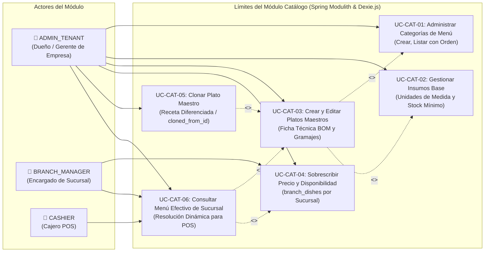

# 📋 Casos de Uso - Módulo de Catálogo y Recetas (BOM)

El módulo de **Catálogo y Recetas** gestiona la estructura de productos ofertados en el restaurante, la definición de listas de materiales o fichas técnicas de producción (**Bill of Materials - BOM**) y la política de sobreescritura de precios y disponibilidad por sucursal.

---

## 🗺️ 1. Diagrama de Casos de Uso del Módulo Catálogo

---

## 📝 2. Especificación Detallada de Casos de Uso

---

### UC-CAT-01: Administrar Categorías de Menú

| Dimensión | Especificación Formal |
| :--- | :--- |
| **Identificador** | `UC-CAT-01` |
| **Nombre** | Administrar Categorías de Menú |
| **Actor Principal** | `ADMIN_TENANT` |
| **Actores Secundarios** | `BRANCH_MANAGER`, `CASHIER` (Lectura) |
| **Objetivo** | Organizar el menú del restaurante en agrupadores jerárquicos visuales (ej. Pizzas, Hamburguesas, Bebidas, Postres) con orden numérico para el terminal POS. |
| **Precondiciones** | El usuario debe estar autenticado con un JWT válido que contenga el `tenant_id`. |
| **Flujo Principal** | 1. El usuario accede al módulo de Catálogo en la pestaña Categorías. 2. El sistema solicita `GET /api/v1/catalog/categories` y renderiza el listado ordenado por `sortOrder` ascendente. 3. El usuario pulsa "Nueva Categoría" e ingresa `name`, `icon` (identificador Lucide o URL SVG) y `sortOrder`. 4. El sistema valida que el nombre no esté duplicado en el tenant. 5. Se persiste la entidad `Category` con `isActive = true`. 6. El sistema retorna `201 Created` con el `CategoryDto` creado y actualiza la grilla. |
| **Flujos Alternativos / Excepciones** | - **Nombre duplicado:** Si ya existe una categoría activa con el mismo nombre en el tenant, retorna `400 Bad Request` con ProblemDetail. - **Datos incompletos:** Si `name` está vacío, el validador Bean Validation `@NotBlank` rechaza la solicitud retornando `400 Bad Request`. |
| **Postcondiciones** | La categoría queda disponible inmediatamente para clasificar platos maestros y para su sincronización local en terminales POS. |
| **Contrato de API** | - `GET /api/v1/catalog/categories` → `200 OK` (`List<CategoryDto>`) - `POST /api/v1/catalog/categories` → `201 Created` (`CreateCategoryRequest` → `CategoryDto`) |
| **Entidades Afectadas** | `categories` (`id`, `tenant_id`, `name`, `icon`, `sort_order`, `is_active`, `created_at`, `version`) |

---

### UC-CAT-02: Gestionar Insumos Base

| Dimensión | Especificación Formal |
| :--- | :--- |
| **Identificador** | `UC-CAT-02` |
| **Nombre** | Gestionar Insumos Base (Materia Prima) |
| **Actor Principal** | `ADMIN_TENANT` |
| **Actores Secundarios** | `BRANCH_MANAGER` (Lectura de fichas técnicas) |
| **Objetivo** | Registrar las materias primas e ingredientes que conforman las recetas de los platos, fijando unidad de medida estandarizada, costo referencial y umbral de stock mínimo para alertas. |
| **Precondiciones** | `tenant_id` establecido en el contexto de seguridad. El actor debe tener rol `ADMIN_TENANT`. |
| **Flujo Principal** | 1. El administrador ingresa a la vista de Insumos / Materias Primas. 2. El sistema consulta `GET /api/v1/catalog/ingredients` y muestra la lista de ingredientes. 3. El usuario abre el diálogo de creación y registra:    - `name`: Nombre del insumo (ej. "Harina 000", "Queso Mozzarella", "Carne Molida Especial").    - `sku`: Código interno único por tenant (ej. "INS-HAR-01").    - `unitOfMeasure`: Unidad de medida oficial (`KG`, `GR`, `LT`, `ML`, `UNIDAD`).    - `costPerUnit`: Costo base estimado (`NUMERIC(12, 4)`).    - `minimumStock`: Umbral de alerta para reposición (`NUMERIC(12, 4)`). 4. El sistema valida unicidad de `sku` y `name` en el tenant. 5. Se persiste la entidad `Ingredient`. 6. El sistema responde `201 Created` con el `IngredientDto`. |
| **Flujos Alternativos / Excepciones** | - **SKU Duplicado:** Si el SKU ya pertenece a otro insumo en el tenant, retorna `400 Bad Request`. - **Unidad de medida no soportada:** Si la unidad no pertenece al catálogo admitido, retorna `400 Bad Request`. |
| **Postcondiciones** | El insumo queda habilitado para ser utilizado en las recetas BOM (`dish_recipes`) y para registrar existencias iniciales en Kardex (`branch_stocks`). |
| **Contrato de API** | - `GET /api/v1/catalog/ingredients` → `200 OK` (`List<IngredientDto>`) - `POST /api/v1/catalog/ingredients` → `201 Created` (`CreateIngredientRequest` → `IngredientDto`) |
| **Entidades Afectadas** | `ingredients` (`id`, `tenant_id`, `name`, `sku`, `unit_of_measure`, `minimum_stock`, `cost_per_unit`, `created_at`, `version`) |

---

### UC-CAT-03: Crear y Editar Platos Maestros con Ficha Técnica (BOM)

| Dimensión | Especificación Formal |
| :--- | :--- |
| **Identificador** | `UC-CAT-03` |
| **Nombre** | Crear y Editar Platos Maestros con Ficha Técnica (Bill of Materials - BOM) |
| **Actor Principal** | `ADMIN_TENANT` |
| **Actores Secundarios** | `BRANCH_MANAGER` (Lectura) |
| **Objetivo** | Definir los productos finales ofertados al cliente, asignándoles categoría, precio base corporativo, área de preparación (ej. `COCINA`, `BARRA`, `HORNO`) y su composición exacta de ingredientes con porcentaje de merma. |
| **Precondiciones** | Deben existir al menos una categoría creada (`UC-CAT-01`) y los insumos requeridos dados de alta (`UC-CAT-02`). |
| **Flujo Principal** | 1. El usuario pulsa "Crear Plato Maestro". 2. Completa los datos generales: `categoryId`, `code` (único, ej. "PLT-PIZ-001"), `name`, `description`, `basePrice` y `preparationArea`. 3. El sistema valida la solicitud y persiste la entidad `Dish` mediante `POST /api/v1/catalog/dishes`. 4. En la pestaña "Ficha Técnica (BOM)", el usuario agrega insumos seleccionándolos de la lista de ingredientes y especificando para cada uno:    - `ingredientId`: UUID del insumo.    - `quantityRequired`: Gramaje o cantidad requerida por porción (`NUMERIC(12, 4)`).    - `wastePercentage`: Factor de merma operativa esperada (ej. `5.00%`). 5. Al guardar la receta, el cliente invoca `PUT /api/v1/catalog/dishes/{dishId}/recipe`. 6. El backend reemplaza atómicamente la lista de ingredientes en `dish_recipes` y responde `200 OK` con `DishRecipeDto`. |
| **Flujos Alternativos / Excepciones** | - **Código de Plato Duplicado:** Retorna `400 Bad Request` indicando que el código ya existe. - **Insumo inexistente o de otro tenant:** Retorna `404 Not Found` o `400 Bad Request`. - **Gramaje negativo o cero:** Validación Bean Validation `@Positive` rechaza la petición. |
| **Postcondiciones** | El plato maestro queda registrado en el catálogo corporativo. Toda venta en POS referenciará esta receta para aplicar la deducción automática en Kardex. |
| **Contrato de API** | - `POST /api/v1/catalog/dishes` → `201 Created` (`CreateDishRequest` → `DishDto`) - `GET /api/v1/catalog/dishes/{dishId}` → `200 OK` (`DishDto`) - `PUT /api/v1/catalog/dishes/{dishId}` → `200 OK` (`CreateDishRequest` → `DishDto`) - `GET /api/v1/catalog/dishes/{dishId}/recipe` → `200 OK` (`DishRecipeDto`) - `PUT /api/v1/catalog/dishes/{dishId}/recipe` → `200 OK` (`List<DishRecipeItemRequest>` → `DishRecipeDto`) |
| **Entidades Afectadas** | `dishes`, `dish_recipes` (`id`, `dish_id`, `ingredient_id`, `quantity_required`, `waste_percentage`) |

---

### UC-CAT-04: Sobrescribir Precio y Disponibilidad por Sucursal

| Dimensión | Especificación Formal |
| :--- | :--- |
| **Identificador** | `UC-CAT-04` |
| **Nombre** | Sobrescribir Precio y Disponibilidad por Sucursal (`branch_dishes`) |
| **Actor Principal** | `BRANCH_MANAGER`, `ADMIN_TENANT` |
| **Actores Secundarios** | `CASHIER` (Afectado indirectamente en POS) |
| **Objetivo** | Permitir que una sucursal específica modifique el precio de venta al público de un plato (por costos logísticos o promociones locales) o lo desactive temporalmente por falta de insumos locales. |
| **Precondiciones** | El plato maestro debe existir. El actor debe tener permisos sobre la sucursal indicada. |
| **Flujo Principal** | 1. El encargado de sucursal accede al catálogo de su sucursal (`branchId`). 2. Selecciona un plato maestro y abre el diálogo "Ajuste de Sucursal". 3. El usuario puede:    - Especificar un `price` diferenciado (o dejar `null` para heredar el `basePrice` del plato maestro).    - Modificar la bandera `isAvailable` (ej. marcar como `false` por agotamiento local). 4. El frontend envía `POST /api/v1/catalog/dishes/{dishId}/branch-override` con el cuerpo `BranchOverrideRequest`. 5. El backend actualiza o inserta el registro en la tabla `branch_dishes` con `(tenant_id, branch_id, dish_id)`. 6. El sistema responde `200 OK`. |
| **Flujos Alternativos / Excepciones** | - **Sucursal no perteneciente al Tenant:** El sistema valida que el `branchId` pertenezca al `tenant_id` autenticado. Si no coincide, retorna `400 Bad Request`. - **Precio negativo:** La validación rechaza precios menores a cero (`400 Bad Request`). |
| **Postcondiciones** | La consulta del catálogo para POS en esa sucursal (`UC-CAT-06`) reflejará de inmediato el nuevo precio y estado de disponibilidad sin afectar a las demás sucursales. |
| **Contrato de API** | - `POST /api/v1/catalog/dishes/{dishId}/branch-override` → `200 OK` (`BranchOverrideRequest` → `BranchDish`) |
| **Entidades Afectadas** | `branch_dishes` (`id`, `tenant_id`, `branch_id`, `dish_id`, `price`, `is_available`, `created_at`, `version`) |

---

### UC-CAT-05: Clonar Plato Maestro con Receta Diferenciada

| Dimensión | Especificación Formal |
| :--- | :--- |
| **Identificador** | `UC-CAT-05` |
| **Nombre** | Clonar Plato Maestro con Receta Diferenciada (`cloned_from_id`) |
| **Actor Principal** | `ADMIN_TENANT` |
| **Actores Secundarios** | Ninguno |
| **Objetivo** | Crear una variante o derivación de un plato existente (ej. "Hamburguesa Doble" clonada de "Hamburguesa Clásica", o versión "Sin Gluten") manteniendo trazabilidad histórica del plato original mediante `cloned_from_id` y copiando opcionalmente su receta BOM. |
| **Precondiciones** | El plato maestro original debe existir en el tenant. |
| **Flujo Principal** | 1. El usuario selecciona el plato original y pulsa "Clonar Plato". 2. Ingresa un nuevo código (`newCode`), nuevo nombre (`newName`) y un flag booleano `copyRecipe` (true/false). 3. El frontend emite `POST /api/v1/catalog/dishes/{dishId}/clone` con `CloneDishRequest`. 4. El backend crea un nuevo registro `Dish` copiando la categoría, descripción, precio y asignando `cloned_from_id = dishId`. 5. Si `copyRecipe == true`, el backend copia en segundo plano todos los ítems de `dish_recipes` del plato original al nuevo plato. 6. El sistema responde `201 Created` con el `DishDto` recién generado. |
| **Flujos Alternativos / Excepciones** | - **Código duplicado:** Si `newCode` ya existe en el tenant, arroja `400 Bad Request`. - **Plato original no encontrado:** Si el `dishId` no existe, retorna `404 Not Found`. |
| **Postcondiciones** | El nuevo plato queda disponible para ser modificado independientemente en sus ingredientes o precios sin alterar el plato de origen. |
| **Contrato de API** | - `POST /api/v1/catalog/dishes/{dishId}/clone` → `201 Created` (`CloneDishRequest` → `DishDto`) |
| **Entidades Afectadas** | `dishes` (nuevo registro con `cloned_from_id`), `dish_recipes` (nuevos registros duplicados si `copyRecipe = true`) |

---

### UC-CAT-06: Consultar Catálogo Efectivo de Sucursal para POS

| Dimensión | Especificación Formal |
| :--- | :--- |
| **Identificador** | `UC-CAT-06` |
| **Nombre** | Consultar Catálogo Efectivo de Sucursal para POS |
| **Actor Principal** | `CASHIER`, `BRANCH_MANAGER`, `ADMIN_TENANT` |
| **Actores Secundarios** | Terminal POS Offline (Dexie.js) |
| **Objetivo** | Obtener la lista consolidada de platos activos para una sucursal, resolviendo dinámicamente si el precio corresponde al `basePrice` maestro o a la sobreescritura local de `branch_dishes`, y filtrando ítems no disponibles. |
| **Precondiciones** | La sucursal debe estar activa. El usuario debe poseer credenciales vigentes. |
| **Flujo Principal** | 1. El terminal POS al iniciar o sincronizar invoca `GET /api/v1/catalog/dishes?branchId={branchId}`. 2. El backend busca todos los platos activos del tenant. 3. Para cada plato, verifica si existe un registro en `branch_dishes` para esa sucursal:    - Si existe y tiene `price != null`: `effectivePrice = branchDish.price`, `isOverridden = true`.    - Si no existe sobreescritura: `effectivePrice = dish.basePrice`, `isOverridden = false`.    - Disponibilidad: `isAvailable = (branchDish != null ? branchDish.isAvailable : dish.isAvailable)`. 4. Retorna la colección en formato `List<DishPriceDto>`. 5. El frontend POS recibe los datos y los persiste en Dexie.js (`cachedProducts` y `cachedCategories`) para operación offline. |
| **Flujos Alternativos / Excepciones** | - **Sin parámetro branchId:** Retorna la lista de platos maestros sin resolver precios de sucursal (`List<DishDto>`). - **Sucursal no encontrada:** Retorna `404 Not Found`. |
| **Postcondiciones** | El terminal POS dispone del menú actualizado con precios locales listos para calcular los subtotales en las comandas. |
| **Contrato de API** | - `GET /api/v1/catalog/dishes?branchId={branchId}` → `200 OK` (`List<DishPriceDto>`) |
| **Entidades Consultadas** | `dishes`, `categories`, `branch_dishes` |

---

## 🔗 3. Relación con Otros Subsistemas

- **Punto de Venta (POS):** El catálogo resuelto en `UC-CAT-06` alimenta la base de datos local Dexie.js en [use_cases_pos.md](./use_cases_pos.md).
- **Inventario & Kardex:** La ficha técnica configurada en `UC-CAT-03` es consumida por el módulo de inventario ([use_cases_inventory.md](./use_cases_inventory.md)) ante el cobro de comandas.
- **Índice General:** [README](../README.md)
