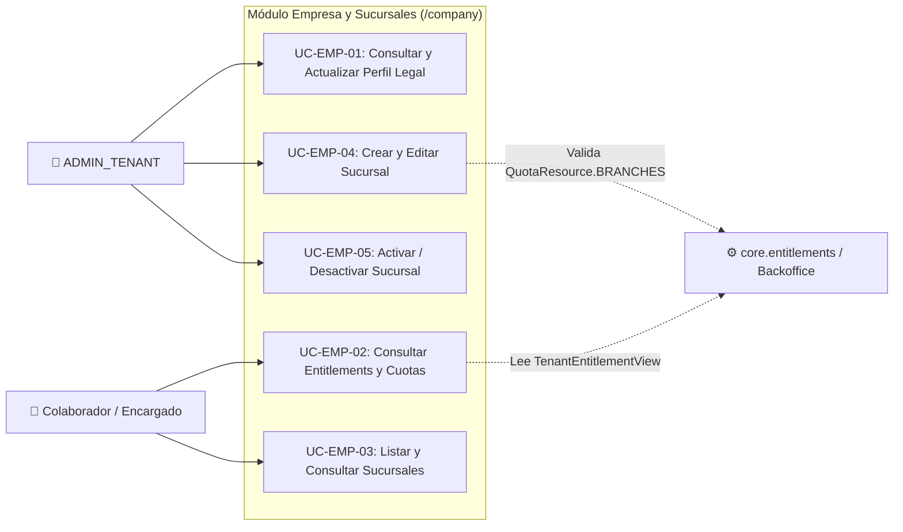

# 🏢 Casos de Uso - Módulo de Empresa, Cuotas y Sucursales

Este documento formaliza los casos de uso funcionales de administración organizacional dentro del ERP (`modules.company` y consumo de `core.entitlements`), verificados contra `CompanyController`, `BranchController` y `CompanyComponent` (`/company`).

---

## 👥 1. Actores y Matriz de Permisos

| Caso de Uso | Identificador | Actor Principal | Permiso / Autorización Real | Endpoint REST |
| :--- | :--- | :--- | :--- | :--- |
| **Consultar / Editar Perfil de Empresa** | `UC-EMP-01` | `ADMIN_TENANT` | `company:read` / `company:write` | `GET`, `PUT /api/v1/company` |
| **Consultar Suscripción y Cuotas** | `UC-EMP-02` | Usuario Autenticado | Autenticado (Tenant JWT) | `GET /api/v1/company/entitlements` |
| **Listar y Consultar Sucursales** | `UC-EMP-03` | Colaborador / Encargado | `branches:read` | `GET /api/v1/branches`, `GET /api/v1/branches/{id}` |
| **Crear y Editar Sucursal** | `UC-EMP-04` | `ADMIN_TENANT` | `branches:write` (+ Cuota `BRANCHES`) | `POST /api/v1/branches`, `PUT /api/v1/branches/{id}` |
| **Activar o Desactivar Sucursal** | `UC-EMP-05` | `ADMIN_TENANT` | `branches:write` | `PATCH /api/v1/branches/{id}/status` |

---

## 🗺️ 2. Diagrama de Casos de Uso (Mermaid)

---

## 📝 3. Especificación Detallada de Casos de Uso

### UC-EMP-01: Consultar y Actualizar Perfil Legal de Empresa

| Atributo | Detalle |
| :--- | :--- |
| **Identificador** | `UC-EMP-01` |
| **Actor Principal** | `ADMIN_TENANT` |
| **Permisos** | `company:read` (lectura), `company:write` (edición) |
| **Flujo Principal** | 1. El administrador accede a `/company` (`CompanyComponent`). 2. El cliente invoca `GET /api/v1/company` y recibe `TenantDto(id, legalName, nitOrTaxId, slug, logoUrl, isActive, createdAt, updatedAt)`. 3. El usuario modifica razón social (`legalName`), NIT opcional (`nitOrTaxId`), identificador `slug` o `logoUrl` mediante `UpdateCompanyRequest`. 4. Al confirmar, el frontend envía `PUT /api/v1/company`. 5. El backend valida unicidad de `slug` y `nitOrTaxId` (índice parcial cuando no es nulo) y retorna `200 OK` con el `TenantDto` actualizado. |
| **Flujos Alternativos / Excepciones** | - **NIT o Slug duplicado:** Retorna `409 Conflict` (`RFC 7807 ProblemDetail`). - **Permiso insuficiente:** Retorna `403 Forbidden`. |

---

### UC-EMP-02: Consultar Suscripción Activa, Saldos y Cuotas del Tenant

| Atributo | Detalle |
| :--- | :--- |
| **Identificador** | `UC-EMP-02` |
| **Actor Principal** | Usuario Autenticado del Tenant |
| **Flujo Principal** | 1. El cliente o consumidor autorizado invoca `GET /api/v1/company/entitlements`. 2. El backend consulta `TenantEntitlementService` en memoria y retorna `TenantEntitlementView` con:    - Estado comercial (`managedSubscription`, `status`, `effectiveSuspensionMode`, `suspensionReason`).    - Plan y período (`planCode`, `planName`, `currentPeriodStart`, `currentPeriodEnd`, `graceUntil`, `graceMaxOrders`, `graceOrdersUsed`, `pendingBalance`, `currency`).    - Banderas operativas (`loginAllowed`, `posOperationsAllowed`).    - Mapa de cuotas por recurso (`quotas`: `Map<QuotaResource, ResourceQuotaUsage(used, limit, overQuota)>` y `overQuotaResources`). |
| **Nota de Alcance UI** | El contrato backend `GET /api/v1/company/entitlements` está completamente operativo y cubierto por pruebas modulares; su visualización dedicada dentro de la pantalla `/company` en Angular queda pendiente de integración UI. |

---

### UC-EMP-03: Listar y Consultar Sucursales

| Atributo | Detalle |
| :--- | :--- |
| **Identificador** | `UC-EMP-03` |
| **Actor Principal** | Colaborador autenticado con permiso `branches:read` |
| **Flujo Principal** | 1. En `/company` (o al resolver contexto multi-sucursal), el sistema invoca `GET /api/v1/branches` (o `GET /api/v1/branches/{id}` para detalle puntual). 2. El backend retorna la lista de `BranchDto(id, tenantId, name, address, latitude, longitude, phone, currency, timezone, isActive, createdAt)` filtrada estrictamente al `tenant_id` del token JWT. |

---

### UC-EMP-04: Crear y Editar Sucursal con Validación de Cuota SaaS

| Atributo | Detalle |
| :--- | :--- |
| **Identificador** | `UC-EMP-04` |
| **Actor Principal** | `ADMIN_TENANT` (con permiso `branches:write`) |
| **Precondiciones** | Suscripción del tenant con `QuotaResource.BRANCHES` disponible. |
| **Flujo Principal** | 1. Desde `/company`, el administrador presiona **"Nueva Sucursal"** o **"Editar"** sobre una sede existente. 2. Completa el payload `CreateBranchRequest(name, address, latitude, longitude, phone, currency, timezone)` (ej. moneda `BOB`, zona IANA `America/La_Paz`). 3. Para creación, envía `POST /api/v1/branches`; para modificación, envía `PUT /api/v1/branches/{id}`. 4. Al crear, `BranchServiceImpl` invoca `TenantEntitlementPort` para validar que el tenant no haya superado el límite de `QuotaResource.BRANCHES` ni se encuentre bloqueado. 5. Persiste la sucursal en PostgreSQL y responde `201 Created` / `200 OK` con `BranchDto`. |
| **Flujos Alternativos / Excepciones** | - **Cuota de sucursales agotada o tenant suspendido:** `TenantEntitlementPort` lanza `EntitlementBlockedException` (`RFC 7807`) impidiendo crear nuevas sedes hasta ampliar el plan desde Backoffice. - **Validación de longitud/formato:** `name` obligatorio (`<= 100`), `phone` (`<= 30`), `currency` código ISO de 3 caracteres (`400 Bad Request`). |

---

### UC-EMP-05: Activar o Desactivar Sucursal

| Atributo | Detalle |
| :--- | :--- |
| **Identificador** | `UC-EMP-05` |
| **Actor Principal** | `ADMIN_TENANT` (con permiso `branches:write`) |
| **Flujo Principal** | 1. El administrador conmuta el estado operativo de una sucursal en `/company`. 2. El frontend envía `PATCH /api/v1/branches/{id}/status` con `{ "isActive": boolean }`. 3. El backend actualiza `branches.is_active` dentro del mismo `tenant_id` y devuelve `200 OK` con `BranchDto`. |

---

## Documentos Relacionados
- [Mapa Macro de Casos de Uso](./use_cases_overview.md)
- [Casos de Uso de Onboarding](./use_cases_onboarding.md)
- [Casos de Uso de Configuración](./use_cases_configuration.md)
- [Casos de Uso de Backoffice SaaS](../../../backoffice/architecture/use_cases_backoffice.md)
- [Secuencia de Onboarding de Tenant](../04-behavior-and-flows/sequence_tenant_onboarding.md)
- [Estado del Ciclo de Vida del Tenant](../04-behavior-and-flows/state_tenant_lifecycle.md)
- [ADR-0002: Modelo Multi-Tenant Híbrido y Configuración Dinámica](../../../adr/0002_hybrid_tenancy_and_dynamic_settings.md)
- [ADR-0009: Onboarding Guiado de Empresa y Sucursal Matriz](../../../adr/0009_tenant_onboarding_and_operational_presets.md)
- [ADR-0029: Motor SaaS de Backoffice, Cuotas y Telemetría](../../../adr/0029_backoffice_subscriptions_quotas_and_telemetry.md)
- [Manual Operativo de Backoffice SaaS](../../../manuals/plataforma/operacion_backoffice_saas.md)
- [Guía de Inicio Rápido Restaurante](../../../manuals/restaurante/00_guia_inicio_rapido_restaurante.md)
- [Manual de Dueño, Finanzas, Personal y Reglas](../../../manuals/restaurante/06_dueno_finanzas_personal_y_reglas.md)
