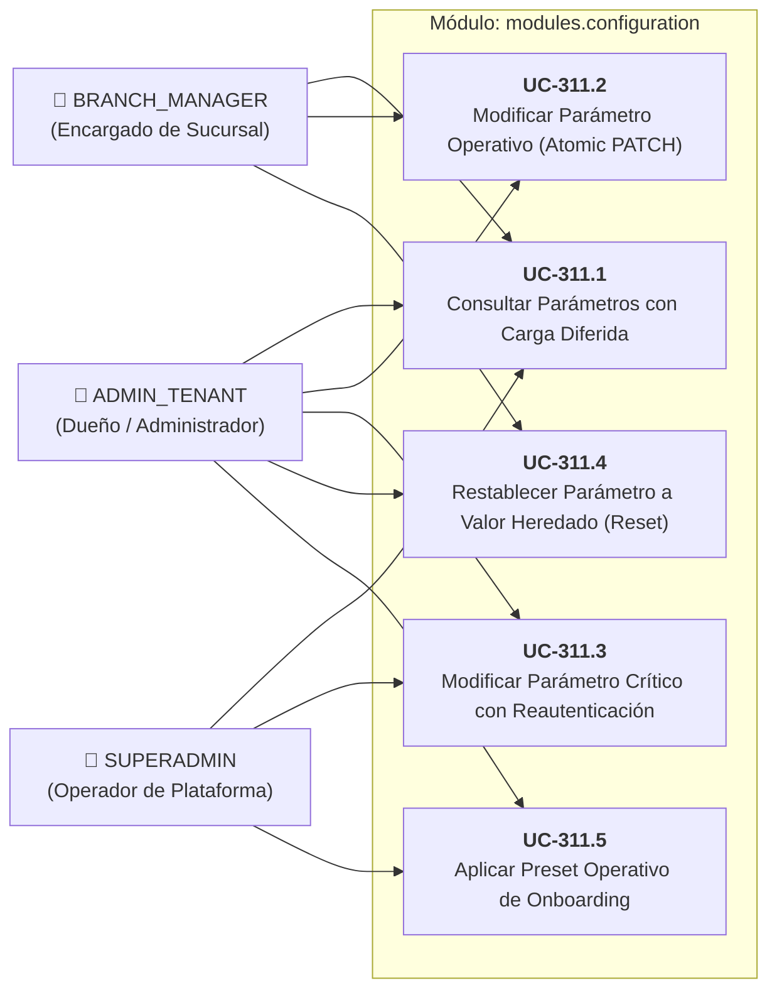

# ⚙️ Casos de Uso: Módulo de Configuración y Parametrización Multinivel

Este documento formaliza la especificación funcional y la matriz de permisos para el **Módulo de Parametrización Multinivel** (`modules.configuration`), estructurado según el estándar de **Specification-Driven Development (SDD)** ([ADR-0008](../../../adr/0008_unified_multilevel_parameter_system.md) / `TASK-311`).

---

## 👥 1. Actores y Matriz de Permisos RBAC

| Caso de Uso | Identificador | Actor Principal | Permiso RBAC Requerido | Ámbito Permitido (*Scope*) |
| :--- | :--- | :--- | :--- | :--- |
| **Consultar Catálogo y Valores Efectivos** | `UC-311.1` | `ADMIN_TENANT`, `BRANCH_MANAGER`, `SUPERADMIN` | `settings:read` | `GLOBAL`, `TENANT`, `BRANCH` |
| **Modificar Parámetro Operativo (Baja/Media)** | `UC-311.2` | `ADMIN_TENANT`, `BRANCH_MANAGER` | `settings:write` | `TENANT`, `BRANCH` |
| **Modificar Parámetro Crítico (Alta Criticidad)** | `UC-311.3` | `ADMIN_TENANT`, `SUPERADMIN` | `settings:write:critical` | `GLOBAL`, `TENANT` (Exige Reautenticación) |
| **Restablecer Parámetro al Valor Heredado** | `UC-311.4` | `ADMIN_TENANT`, `BRANCH_MANAGER` | `settings:write` | `BRANCH` (elimina override local) |
| **Aprovisionar Parámetros Semilla (Onboarding)** | `UC-311.5` | `SUPERADMIN`, Sistema Autónomo | Público (`/onboarding`) o `superadmin:provision` | `TENANT` (Aplica presets iniciales) |

---

## 🗺️ 2. Diagrama de Casos de Uso (Mermaid)

---

## 📋 3. Especificación Detallada de Casos de Uso

### UC-311.1: Consultar Parámetros con Carga Diferida por Categorías
- **Precondiciones:** Usuario autenticado con rol `ADMIN_TENANT` o `BRANCH_MANAGER` y claim `tenant_id` en JWT.
- **Flujo Principal:**
  1. El usuario accede a `/settings/parameters` y selecciona una categoría (ej. `Punto de Venta`).
  2. Si la categoría ya se encuentra en la caché de `Signals` del cliente, la interfaz se renderiza en $0$ ms.
  3. Si es la primera consulta, se presenta un *Skeleton Loader* y se despacha:  
     `GET /api/v1/parameters?scope=BRANCH&branchId={id}&category=POS` (enviando encabezado `If-None-Match` si existe ETag previo).
  4. El backend evalúa la correspondencia de ETag: si no hay cambios retorna `HTTP 304 Not Modified`; de lo contrario, fusiona el `SystemParameterCatalog` con `system_parameter_values` y retorna la lista enriquecida.
  5. La interfaz renderiza las tarjetas con título, control interactivo y badges de herencia (*"Heredado de Empresa"* o *"Personalizado en Sucursal"*).

### UC-311.3: Modificar Parámetro Crítico con Reautenticación y Auditoría
- **Precondiciones:** Usuario con rol `ADMIN_TENANT`, permiso `settings:write:critical`. Parámetro catalogado con `criticality = HIGH` (ej. `inventory.deduction_mode`).
- **Flujo Principal:**
  1. El usuario intenta conmutar el modo de descuento de inventario a `AUTOMATIC_STRICT`.
  2. El frontend intercepta la acción y despliega el modal `CriticalChangeModalComponent`.
  3. El modal explica el impacto contable: *"Cambiar a AUTOMATIC_STRICT bloqueará ventas en mostrador si un ingrediente no tiene existencias registradas en Kardex"*.
  4. El administrador debe introducir su contraseña actual y redactar un motivo de justificación (mínimo 10 caracteres).
  5. El frontend despacha:  
     `PATCH /api/v1/parameters/inventory.deduction_mode`  
     Payload: `{"value": "AUTOMATIC_STRICT", "passwordConfirmation": "******", "auditReason": "Cierre de inventario mensual completado"}`.
  6. El backend revalida la contraseña mediante Argon2id, persiste la mutación en `system_parameter_values` con el `updated_by` y `audit_reason`, desaloja la caché en memoria y emite `ParameterUpdatedEvent`.
  7. El frontend cierra el modal y muestra un toast de confirmación exitosa.

### UC-311.4: Restablecer Parámetro al Valor Heredado (*Reset to Default*)
- **Precondiciones:** El parámetro posee una sobreescritura local en la sucursal (`isOverridden == true`).
- **Flujo Principal:**
  1. El encargado de sucursal pulsa el botón *"Restablecer al valor corporativo"*.
  2. El frontend despacha `DELETE /api/v1/parameters/{key}?scope=BRANCH&branchId={id}`.
  3. El backend elimina la fila en `system_parameter_values`, desaloja la clave de la caché en memoria y retorna `HTTP 204 No Content`.
  4. La interfaz actualiza el Signal: el badge cambia a *"Heredado de Empresa"* y el control adopta inmediatamente el valor corporativo.
